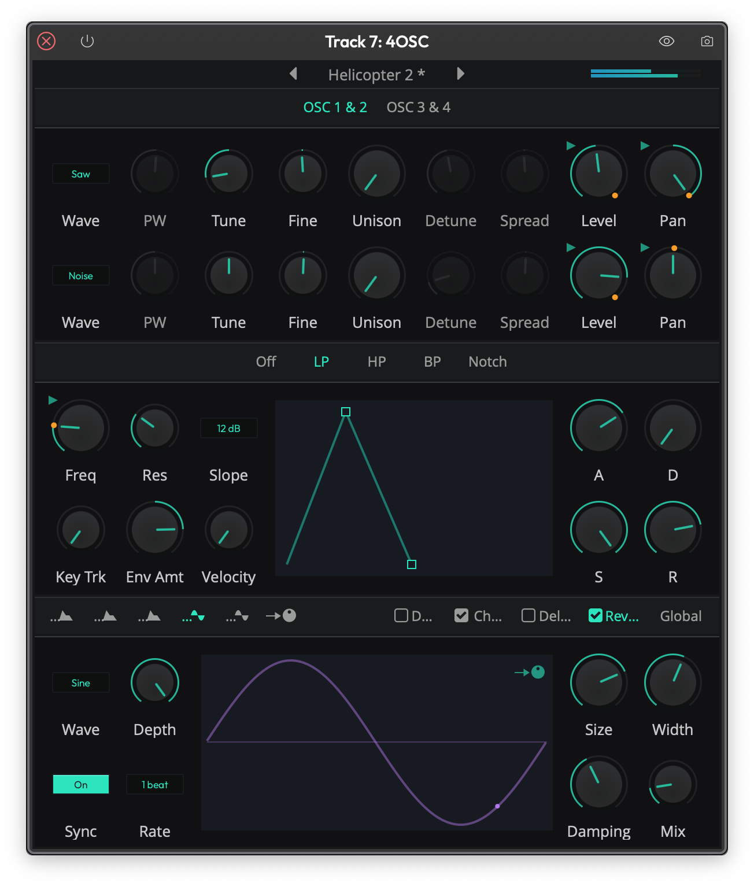

# 4OSC Synthesiser { #4osc-synthesizer }

4OSC is Waveform's built-in four-oscillator subtractive synthesiser. It has four oscillators with unison, a multi-mode filter, amplitude and filter envelopes, two modulation envelopes, two LFOs and a chain of built-in effects. Reach for it when you want a synth sound without loading a third-party plugin.

*4OSC with oscillators 1 and 2, the LP filter and its envelope, LFO 1 and the Reverb settings.*

## Oscillators

4OSC provides four independent oscillators, displayed in two pages: **OSC 1 & 2** and **OSC 3 & 4**. Click the page tabs at the top of the plugin to switch between them. Each oscillator has its own row of controls.

### Waveform Selection

**Wave**: Selects the oscillator's waveform. Choose from None, Sine, Square, Saw, Triangle, or Noise. Setting an oscillator to None turns it off and greys out its other controls. (Default: Oscillator 1 is Sine, Oscillators 2-4 are None)

### Per-Oscillator Controls

**PW** (Pulse Width): Adjusts the pulse width of the Square waveform. It only has an effect when the oscillator is set to Square. Moving it away from centre makes the wave more asymmetric, with a thinner, more nasal sound. (Default: 50%)

**Tune**: Coarse pitch tuning in semitones, from -36 to +36. Use it to set octave intervals between oscillators or to build chord-like stacks. (Default: 0 st)

**Fine**: Fine pitch tuning in cents, from -100 to +100. Slight detuning between oscillators (3-10 cents) adds warmth and movement. (Default: 0)

**Level**: The volume of this oscillator in decibels, from -100 dB to 0 dB. (Default: 0 dB)

**Pan**: Stereo position of the oscillator, from full left to full right. Panning oscillators apart creates a wider stereo image. (Default: centre)

### Unison

Each oscillator can stack up to eight voices for a thick, detuned "supersaw" or "superwave" sound.

**Unison**: The number of stacked voices, from 1 to 8. Higher values give a denser, more chorus-like sound but use more CPU. (Default: 1)

**Detune**: How far apart the unison voices are detuned from each other. Small values add a little richness, and large values sound more like a detuned chorus. Only active when **Unison** is greater than 1. (Default: 0%)

**Spread**: The stereo spread of the unison voices, from -100% to +100%. At higher values, voices are panned further apart across the stereo field. Only active when **Unison** is greater than 1. (Default: 0%)

> 💡 **Tip:** For a classic supersaw lead, set one oscillator to Saw with 5-7 unison voices, a small amount of detune, and spread around 50-70%.

## Filter

The filter section sits in the middle of the plugin. Select a filter type from the header bar: **Off**, **LP** (Low Pass), **HP** (High Pass), **BP** (Band Pass), or **Notch**. When set to Off, the entire filter section is bypassed and its controls are greyed out. (Default: Off)

**Freq**: The filter cutoff frequency, shown in Hz. (Default: 440 Hz)

**Res** (Resonance): Boosts frequencies around the cutoff point, from 0% to 100%. Higher values create a sharper, more pronounced peak. (Default: 0%)

**Slope**: Selects between 12 dB/octave and 24 dB/octave filter rolloff. The 12 dB slope is gentler, and 24 dB is steeper and more aggressive. (Default: 12 dB)

**Key Trk** (Key Tracking): Controls how much the filter cutoff follows the note you play, from 0% to 100%. At 100%, the filter tracks the keyboard one-to-one, so the tone stays consistent across the range. At 0%, the cutoff stays put whatever note you play. (Default: 0%)

**Env Amt** (Envelope Amount): Controls how much the filter's own ADSR envelope affects the cutoff frequency, from -100% to +100%. Positive values sweep the filter up from the cutoff on each note, and negative values sweep it down. Setting this to zero disables the filter envelope controls. (Default: 0%)

**Velocity**: How much note velocity affects the filter envelope depth. At 100%, playing softly barely moves the filter while playing hard opens it wide. (Default: 0%)

### Filter Envelope

The filter has its own ADSR envelope, shown both as knobs (A, D, S, R) and as a graph you can drag. It only takes effect when **Env Amt** is not zero.

- **A** (Attack): Time for the filter to sweep from initial cutoff to peak, from 0 to 60 seconds. (Default: 100 ms)
- **D** (Decay): Time for the filter to fall from peak to sustain level, from 0 to 60 seconds. (Default: 100 ms)
- **S** (Sustain): The filter envelope level while a note is held, from 0% to 100%. (Default: 80%)
- **R** (Release): Time for the filter to return to initial cutoff after a note is released, from 0 to 60 seconds. (Default: 100 ms)

Drag the square handles on the graph to adjust Attack, Decay/Sustain and Release.

> 💡 **Tip:** For a classic pluck bass, set the filter to LP with a low Freq, high Env Amt, short Attack, moderate Decay, low Sustain, and moderate Release.

## Amp Envelope

The amp envelope controls the volume shape of each note. Select the **A** tab (the first icon) in the bottom-left modulation header to see it. Like the filter envelope, it has both knobs and a graph you can drag.

- **A** (Attack): Time for the note to reach full volume, from 1 ms to 60 seconds. (Default: 100 ms)
- **D** (Decay): Time to fall from full volume to the sustain level, from 1 ms to 60 seconds. (Default: 100 ms)
- **S** (Sustain): Volume level while the note is held, from 0% to 100%. (Default: 80%)
- **R** (Release): Time for the sound to fade out after the note is released, from 1 ms to 60 seconds. (Default: 100 ms)

**Velocity**: How much MIDI velocity affects the note volume, from 0% to 100%. At 0%, every note plays at the same volume however hard you play. At 100%, soft notes are much quieter than hard ones. (Default: 100%)

**Analog**: When on, the envelope uses an exponential (analogue-style) curve instead of a linear one. This sounds more natural, and linear envelopes can sound stiff in comparison, so leaving it on suits most sounds. (Default: On)

## Modulation Envelopes

4OSC includes two independent modulation envelopes, labelled **1** and **2** in the modulation header. These extra ADSR envelopes don't control anything until you assign them as modulation sources in the modulation matrix, where they can drive any knob.

Each modulation envelope has the same four controls:

- **A** (Attack): From 0 to 60 seconds. (Default: 100 ms)
- **D** (Decay): From 0 to 60 seconds. (Default: 100 ms)
- **S** (Sustain): From 0% to 100%. (Default: 80%)
- **R** (Release): From 0.001 to 60 seconds. (Default: 100 ms)

## LFOs

Two LFOs are available, labelled with wave icons (**1** and **2**) in the modulation header. Like the modulation envelopes, the LFOs are modulation sources that add movement to your sound.

**Wave**: The LFO waveform: None, Sine, Triangle, Saw Up, Saw Down, Square, or Sample & Hold. Sample & Hold produces random stepped values, which suit glitchy or retro-style effects. (Default: LFO 1 is Sine, LFO 2 is None)

**Depth**: The intensity of the LFO, from 0% to 100%. It sets how far the LFO swings the parameter it modulates. (Default: 100%)

**Sync**: When enabled, the LFO rate locks to the Edit tempo instead of running freely. This switches the **Rate** control from a free-running Hz knob to a beat-division selector. (Default: Off)

**Rate** (free-running): The LFO speed in Hz, from 0 to 500 Hz. (Default: 1 Hz)

**Rate** (synced): The LFO speed as a beat division. Options range from 8 beats down to 1/32 beat. (Default: 1 beat)

The LFO panel shows an animated waveform preview with a moving dot that indicates the current LFO phase in real time.

> 💡 **Tip:** A slow Sine LFO on the filter **Freq** adds movement to a pad. Start at around 0.5-2 Hz with moderate depth.

## Modulation Matrix

Click the arrow icon (the last tab in the modulation header row) to open the modulation source list. This is where you connect modulation sources to the synth's knobs.

### Available Modulation Sources

- **LFO 1** and **LFO 2**
- **Envelope 1** and **Envelope 2**
- **MPE Pressure** and **MPE Timbre** (for MPE controllers)
- **MIDI Note Number** and **MIDI Velocity**
- **MIDI CC 0-127** (any MIDI continuous controller)

### Assigning Modulation

1. Click a modulation source's assign icon in the source list, or the assign icon on an envelope or LFO panel. The icon flashes to show it is active, and the source's name appears in the title bar.
2. Drag any knob to set its modulation depth: right or up increases it, left or down decreases it. A white arc around the knob shows the modulation range. LFOs are bipolar (they modulate in both directions from the knob position), while envelopes and the other sources are unipolar (they modulate in one direction).
3. Click the assign icon again to leave assignment mode.

When a parameter is being modulated, a small indicator icon appears on its knob. During playback, orange dots show the live modulated position on the knob arc.

### Removing Modulation

Right-click a modulated knob while in assignment mode to see its modulation connections. Select a connection to remove it.

> 📝 **Note:** Hold Shift while clicking a modulated knob to bypass the modulation overlay and adjust the knob's base value.

## Effects

The effects section is on the right of the plugin's lower half. It has four effects, each with a checkbox to turn it on or off: **Dist** (Distortion), **Chorus**, **Delay**, and **Reverb**. The **Global** tab holds the voice and level settings. The effects run in this order: Distortion, Chorus, Delay, Reverb.

### Distortion

A simple saturation-style distortion.

**Distortion**: The drive amount, from 0% to 100%. Higher values push the signal into harder clipping. (Default: 0%)

### Chorus

A stereo chorus that thickens and widens the sound.

**Speed**: The modulation rate in Hz, from 0.1 to 10 Hz. (Default: 1 Hz)

**Depth**: The modulation depth in milliseconds, from 0.1 to 20 ms. Higher values create a more pronounced pitch wobble. (Default: 3 ms)

**Width**: The stereo width of the chorus, from 0% to 100%. Higher values create more left/right separation. (Default: 50%)

**Mix**: Wet/dry balance, from 0% (fully dry) to 100% (fully wet). (Default: 0%)

### Delay

A tempo-synced stereo delay with crossfeed between left and right channels.

**Delay**: The delay time as a beat division, from 8 beats down to 1/32 beat. It follows the Edit tempo automatically. (Default: 1 beat)

**Feedback**: How much of the delayed signal is fed back into the delay line, in dB from -100 to 0 dB. Higher values (closer to 0 dB) create more repeats. (Default: -10 dB)

**Crossfeed**: How much the left delay feeds into the right channel and vice versa, in dB from -100 to 0 dB. Raising it gives a ping-pong-like effect. (Default: -100 dB)

**Mix**: Wet/dry balance, from 0% to 100%. (Default: 0%)

### Reverb

A reverb for adding space to the sound.

**Size**: The room size, from 0% to 100%. Larger values create longer, more spacious reverb tails. (Default: 0%)

**Width**: Stereo width of the reverb, from 0% to 100%. (Default: 0%)

**Damping**: High-frequency damping, from 0% to 100%. Higher values roll off the highs in the reverb tail, for a darker, more natural-sounding space. (Default: 0%)

**Mix**: Wet/dry balance, from 0% to 100%. (Default: 0%)

## Global Settings

Click **Global** in the effects header for the master voice and output settings.

**Mode**: The voice mode for the synthesiser:
- **Mono**: One voice at a time. New notes cut off the previous note immediately.
- **Legato**: One voice at a time, but overlapping notes glide smoothly instead of retriggering the envelopes.
- **Poly**: Multiple simultaneous voices.

(Default: Poly)

**Legato**: The glide time in milliseconds when in Legato mode, from 0 to 500 ms. Only active when **Mode** is set to Legato. (Default: 0 ms)

**Level**: Master output level in dB, from -100 dB to 0 dB. Use it to balance 4OSC against the other instruments in your Edit. (Default: 0 dB)

**Voices**: The maximum number of simultaneous voices in Poly mode, from 1 to 32. Lower values save CPU, but notes may be cut off (stolen) when you play dense chords. (Default: 32)

## Presets

4OSC ships with a library of factory presets. The preset selector sits just below the plugin's title bar. Click the left and right arrows to step through presets, or click the preset name for the preset menu: pick a preset, or use **Save**, **Save as...**, **Delete** or **Reset to default**. **Reset to default** returns the synth to its starting state.

## MPE Support

4OSC supports MIDI Polyphonic Expression (MPE) controllers. To turn MPE mode on, right-click the plugin header and tick **MPE**. With MPE on, the synth responds to per-note pressure and timbre, which you can use as modulation sources in the modulation matrix.

## ⚡ Things to Watch Out For

- **Filter Resonance at high values.** Resonance above 80-90% can produce very loud, piercing peaks. Turn down the master **Level** or your monitoring volume before pushing it that far.

- **Unison voice count and CPU.** Each of the four oscillators can have up to 8 unison voices. With all four at maximum unison in Poly mode with 32 voices, the synth could be rendering over 1,000 oscillator voices at once. If you hear crackling or audio dropouts, reduce the **Unison** count or the **Voices** setting.

- **Delay time is tempo-synced only.** The delay always locks to the Edit tempo. For a free-running delay set in milliseconds, put a separate delay plugin on the track.

- **Effects are post-voice.** Distortion, Chorus, Delay and Reverb are applied after all the voices are mixed together, so you can't give individual voices their own effect settings.

## Moving On

For wavetable synthesis and sample-based instruments, see [Wavetable Synthesiser](wavetable.md) and [Samplers and Instruments](samplers-and-instruments.md).
