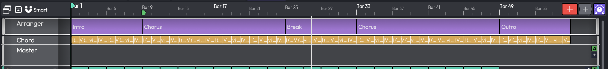

# The Arranger Track PRO { #the-arranger-track }

> 📝 **Edition:** Waveform Pro.

The Arranger track gives you a bird's-eye view of your song's structure. You divide the Edit into
named, coloured **sections** (Intro, Verse, Chorus, Bridge, Outro, and so on) and then rearrange
the whole song by dragging those sections instead of carefully moving clips on every individual track.

When you move or copy a section, Waveform moves the underlying audio and MIDI clips *plus* any tempo,
time-signature, and pitch events in that range, all in lock-step across every track. The Arranger
track itself makes no sound and cannot host plugins; it is purely a structural tool.

*The Arranger track showing Intro, Verse, Chorus, and Bridge sections*

## Showing and Hiding the Arranger Track

Click the **Arranger** button in the global-tracks strip at the top of the Edit tab to show or hide
the track. The button tooltip reads "Show/Hide arranger track". You can also use the keyboard
command **"Show or hide Arranger track"** or the *View > Global tracks > Show Arranger track* menu
item. Arranger track visibility is saved with the Edit and as part of each [layout](layouts.md).

> 💡 **Tip:** If you use [layouts](layouts.md) to switch between different working setups, you can
> include or exclude the Arranger track in each layout. This is useful for keeping the screen tidy when you are focused
> on mixing rather than arrangement.

## Creating Sections

To draw a new section, **hold Shift, Cmd / Ctrl or Opt / Alt and drag** across the Arranger track.
Any of these modifier keys works. The cursor changes to a pencil while you drag, and the section snaps
to the current snap grid.

You can also select the Arranger track and press **G** (**Insert a new MIDI clip into the selected
track**), which adds a section instead of a MIDI clip.

> 💡 **Tip:** A plain drag on the Arranger track does *not* draw a section. You must hold a modifier
> key first.

Once a section exists, click it to select it. You can rename and recolour it from the Actions panel
(see [Section Properties](#section-properties) below).

## Rearranging Sections

Drag a section and drop it to rearrange your song. A menu appears when you release the mouse:

| Drop target | Menu options |
|---|---|
| Empty space on the track | **Copy section** / **Move section** |
| Another section | **Replace** / **Swap** |
| Left or right edge of another section | Inserts just before or just after that section |

**Move section** shifts the source content to the destination position. **Copy section** duplicates
it. **Swap** exchanges the two sections' content; **Replace** overwrites the target with the source.

> 📝 **Note:** **Swap** and **Replace** silently abort if the two sections overlap. No error message
> is shown. Make sure the sections do not overlap before using these operations.

When you have tracks selected, a Copy or Move operation affects only those tracks. With no tracks
selected, it affects all tracks (the Arranger track itself is always included). This lets you make
partial rearrangements, for example moving a vocal part independently of the rest of the
arrangement.

## Inserting Space

To add blank time at a specific point, right-click a section and choose **Insert time at selected
clips**, or use the **Insert Space** dialog. To open the dialog, right-click the timeline and choose
*Insert space > Insert time at cursor*, or use the **Insert time at cursor** keyboard command. The
dialog has fields for **Bars/Beats** and **Time** and an **Insert** button, and inserts the time at the
current cursor position.

## Section Properties

Select a section and its actions appear in the [Actions panel](actions-panel.md). The following
controls are available:

| Control | Purpose |
|---|---|
| **Name** | Label the section ("Verse 1", "Chorus") |
| **Start / Length / End** | Position and duration in timecode (Length is shown locked) |
| **Colour** | Set the section's display colour using the hue picker |
| **Select Clips** | Select other sets of clips related to this section |
| **Set Edit Tempo** | Set the Edit's tempo based on this section's length (shown when one section is selected) |
| **Split Clips** | Split the selected sections into two |
| **Move Clip** | Options for moving the section relative to its neighbours |
| **Delete** | Remove the selected section(s) |

The Arranger track header itself shows only the standard **Shrink** / **Grow** track-height buttons;
there are no arranger-specific track options.

## Section Right-Click Menu

Right-clicking a section gives you:

- Colour
- Cut / Copy / Duplicate
- Delete
- Split at cursor
- **Delete time of selected clips**: removes that time range from the entire Edit
- **Insert time at selected clips**: inserts blank time at the section's position
- Delete time gap before / after / both

## Related Features

- **[Using Markers](using-markers.md)**: the Marker track, Tempo track, and Chord track are sibling
  global tracks that work alongside the Arranger track.
- **[Layouts](layouts.md)**: Arranger track visibility can be saved and recalled as part of any layout.
- **[Rendering and Stems](rendering-and-stems.md)**: in the Render dialog's Advanced mode, the
  **Each Arranger Clip Region** range renders each section to its own file.
