# Audio Clips and Editing Audio

Audio clips hold your recorded and imported audio. Each one has
built-in handles for moving, trimming, slipping and fading it, right on
the clip.

## Parts of an Audio Clip

An Audio clip has a header, which holds the trim and slip handles, and
a body, which holds the waveform thumbnail and fade handles.

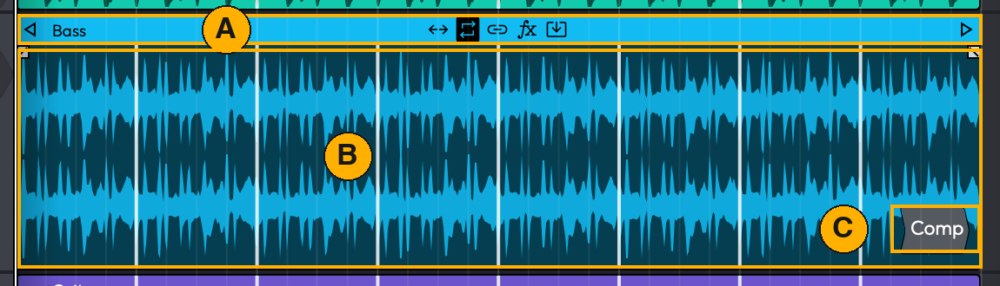

*Main parts of an Audio clip: A header, B body, C clip effects*

**Header**: Move Audio clips by dragging from the header. The header
includes the trim handles (hollow), slip handles (solid), and other
tools.

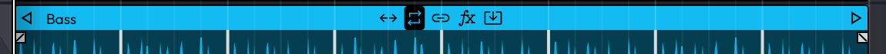

*Audio Clip Header*

**Body**: The Audio clip body shows the waveform thumbnail, fade
handles and the clip name.

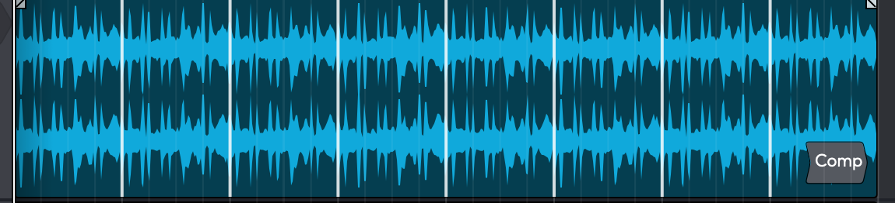

*Audio Clip Body*

**Plugins**: Audio clips can host plugins directly, so you might see one
or more plugins on the clip body. See
[Clip Effects](clip-effects.md).

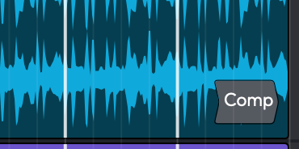

*Audio Clip Effects*

**Properties**: Like most other objects in Waveform, Audio clips have
many more properties and controls in the Actions panel.

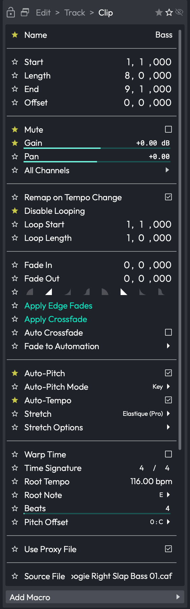

*Audio Clip properties*

> 📝 **Note:** If you accidentally move or edit an Audio clip, you can always
press **Undo** (Cmd + Z / Ctrl + Z).

## Moving Clips

When you move the mouse pointer over the Audio clip header, it changes
to a grabbing hand. Drag to move the clip earlier or later in time. If
**Snap** is on, the start of the clip snaps to the grid.

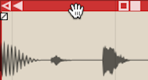

*Move Audio Clips by Dragging from the Header*

> 📝 **Note:** The grid resolution depends on the zoom level. See
[Selecting and Snapping](selecting-and-snapping.md).

You can also drag Audio clips from track to track. With snap on, the
clip usually stays in time. With snap off, it's easy to move the clip
slightly off time; to prevent that, hold Shift as you drag, which keeps
the clip's timing fixed.

> 💡 **Tip:** You can also nudge a clip to another track without
changing its timing: select the clip, hold Shift and press Up Arrow or
Down Arrow.

## Deleting Clips

To delete a clip, select it and press Delete or Backspace. Cut (Cmd +
X / Ctrl + X) does the same, and so does the **Delete** button in the
Actions panel.

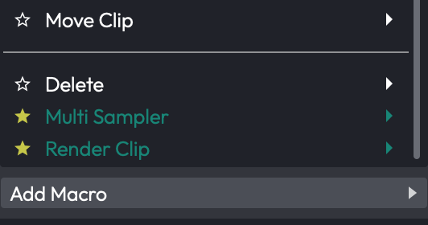

*Audio Clip Properties Delete Button*

> 💡 **Tip:** To clear the selection, press Esc.

## Audio Clip Handles

Each Audio clip header has six handles for trimming, slipping and
reframing: four arrows and two boxes.

**Trimming**: The hollow left and right arrows at the upper corners of
the clip are trim handles. Drag a trim handle left or right to trim the
start or end of the clip. Trimming this way changes the **Start** and
**End** values in the Actions panel.
With **Snap** turned on, trimming snaps to the grid. To trim freely,
hold down Cmd / Ctrl as you drag or turn **Snap** off.

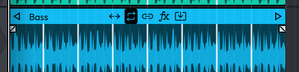

*Audio Clip Trim Handles*

> 💡 **Tip:** To hear the audio under the mouse while you trim, turn on
*Options > Audible trimming* in the main menu. (Default: off)

**Slip editing**: Slip editing moves the waveform within the clip
without changing its **Start**, **Length** or **End** values. Drag the
solid box-shaped handle left or right to slip edit. Hold Cmd / Ctrl to
override snapping while you slip edit.

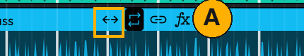

*Audio clip slip handle (A)*

**Reframing**: Drag the hollow box-shaped handle left or right to
reframe the clip: the clip moves but the waveform doesn't, so the audio
keeps its timing.

**Slip trimming**: The solid left and right arrows are slip trim
handles. Dragging the left solid arrow moves the clip's **Start** and
keeps the **End** where it is. Dragging the right solid arrow moves the
**End** and keeps the **Start** where it is. Unlike a plain trim, the
underlying waveform slips relative to the end that isn't moving.

> 💡 **Tip:** With **Snap** on, hold down Cmd / Ctrl as you drag to temporarily
override snapping for most editing operations.

**Video Clip:** [Basic Audio
Editing](https://w-edstrom.wistia.com/medias/qr0fax85zn)

## Splitting a Clip

Splitting is one of the most common audio edits. The quickest way:

1.  Select the clip.
2.  Place the cursor where you want to split.
3.  Press slash (/).

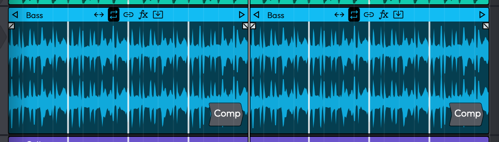

*Audio Clip, Right after Split*

> 💡 **Tip:** To make a lot of splits, hold down the left mouse button
as you drag the cursor, and press slash (/) at each point without
letting go.

The Actions panel also has a **Split Clips** button, with options to
split at the cursor, at the In marker or at the Out marker. These
actions only affect the selected clips.

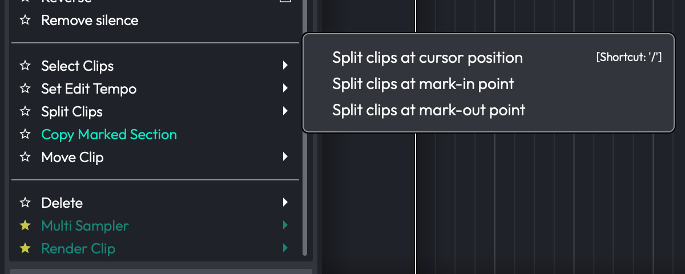

*Audio Clip properties, Split Clips actions*

## Duplicating Clips

To duplicate one or more clips, select them and press D. This copies
the clips and pastes them straight after the originals, in one action.

> 💡 **Tip:** To use a different key for duplicating, change it in *Settings > Keyboard Shortcuts* (the **Duplicate**
command in the **Editing** group).

## Fade-in/Fade-out

The fade handles sit in the upper corners of the Audio clip body. Each
looks like a tiny box with a diagonal line through it. Drag a fade
handle inward to draw a fade-in or fade-out.

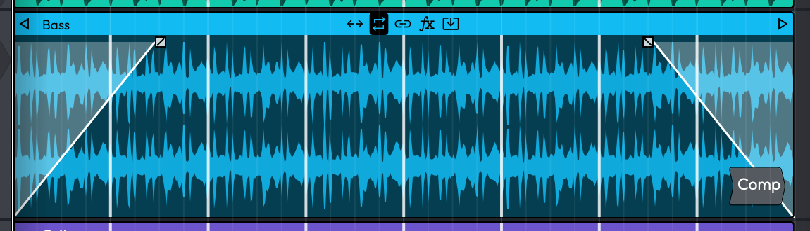

*Audio Clip Fades*

By default you get a linear fade; the clip's Actions panel has other
fade types. For more control, edit the **Fade In** and **Fade Out**
values in the Actions panel directly.

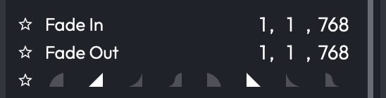

*Audio Clip, Fade properties*

## Pitch Fade

Right-click a fade handle to choose between a volume fade and a pitch
fade. A pitch fade gives a tape-stop or tape run-up effect, and its fade
graphic is shaded darker than a volume fade's.

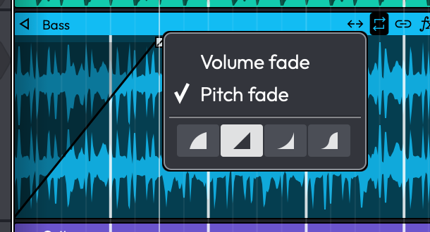

*Right-click Fade Handle, Pitch Fade Speed Up*

This video tutorial demonstrates pitch fades:

[Pitch Fade Video
Tutorial](https://w-edstrom.wistia.com/medias/o2ff37pknl)

## Crossfades

A crossfade fades out one Audio clip while fading in another. To
create one:

1.  Drag a clip so that it overlaps another one a little.
2.  Press X.

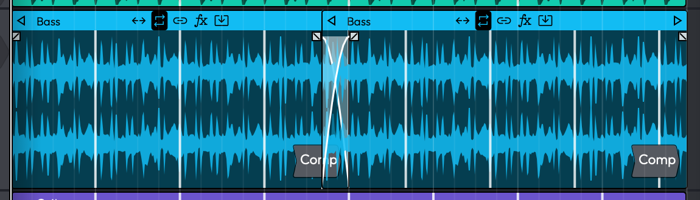

*Crossfaded Audio Clips*

The fade-out of the first clip now overlaps the fade-in of the next.
You can also select the overlapping clips and click **Apply Crossfade**
in the Actions panel. Adjust the fade shapes with the buttons in the
Actions panel, as for any other fade.

*Fade-in/Fade-out Shape Buttons*

> 📝 **Note:** The fade shape buttons only change the selected clip, so
select the clip on the side of the crossfade you want to change.

## Auto Crossfade

*Settings > General* has a setting labelled **Default auto crossfade
mode**, set to **Disabled** or **Enabled**. When it's **Enabled**,
dragging a clip so that it overlaps another creates a crossfade.

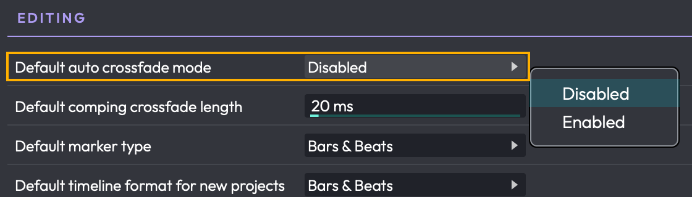

*Settings Tab, General page, Default Auto Crossfade Mode*

> 📝 **Note:** **Auto Crossfade** is a property of each Audio clip,
which you can toggle in the Actions panel. With it on, moving the clip
over another one crossfades them automatically. Changing **Default auto
crossfade mode** only affects clips you create or add to the Edit
afterwards.

## Edge Fades

Sometimes you need short fades at both edges of an Audio clip to avoid
pops, especially after splitting a clip in the middle of a note.
Waveform calls these short fade-ins and fade-outs "edge fades."

*Apply Edge Fades*

To add them, click **Apply Edge Fades** in the Actions panel. This applies 5 ms fades to the
start and end of all selected clips.

> 💡 **Tip:** To give every new clip a small fade in and out
automatically, turn on **Create fades on clip edges** in *Settings >
General*. (Default: off)

## Copy and Paste

The usual cut, copy and paste commands work with Audio clips:

-   Cut (Cmd + X / Ctrl + X)
-   Copy (Cmd + C / Ctrl + C)
-   Paste (Cmd + V / Ctrl + V)

## Clip Gain, Mute, & Pan

Clip gain is a useful mixing tool: split out one phrase, or even one
note, and adjust its level. The Actions panel also has clip mute and
pan.

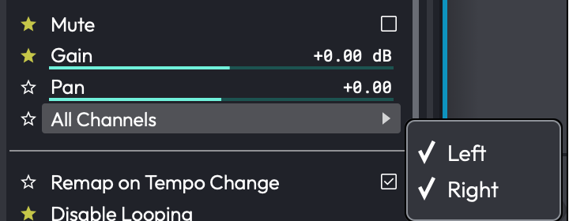

*Audio Clip Gain, Mute, Pan and Channels*

**Gain**: Drag the slider left or right to adjust the **Gain** value,
or click the slider and type a value. The height of the waveform
thumbnail on the clip changes straight away to match.

**Mute**: Click the **Mute** icon to silence the clip. The waveform
thumbnail dims to grey.

**Pan** (mono clips): Drag the **Pan** slider left or right to place
the clip in the stereo field, or click it and type a value. Full left
is -1.00, centred is 0, and full right is 1.00.

**Pan** (stereo clips): On stereo Audio clips, **Pan** acts as a
balance control. Slide it right and the left side gets quieter; slide
it left and the right side gets quieter. At the extremes, the opposite
side is silent. The waveform thumbnail updates to show the effect.

**All Channels** (stereo clips): With one stereo clip selected, the
Actions panel shows a channel button that reads **All Channels** while
both channels are on. Click it for a menu of the clip's channels, with
the ones in use ticked, and choose a channel to turn it off or on.
Choosing **Left**, for example, turns the left side off and the button
then reads **Channels: Right**. This doesn't just mute the left side: it
switches the clip to a mono version of the right side. The waveform
thumbnail updates straight away to show this.

## Reversing Audio Clips

To make a clip play backwards, click the **Reverse** button in the
Actions panel. The waveform thumbnail reverses, and the clip plays
backwards.

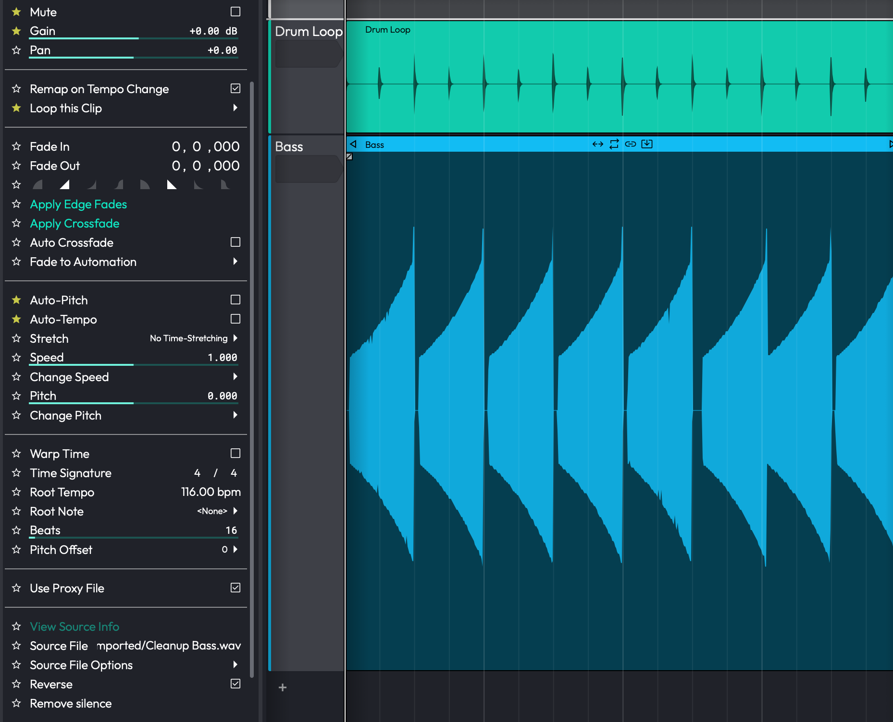

*Reversing an Audio Clip*

> 📝 **Note:** Some arrangement edits aren't offered for clips in the
[clip launcher](clip-launcher.md). Launcher clips play without fades, so
their Actions panel has no fade, edge fade or crossfade controls, and
they can't be split, merged or flattened.

## Merging Clips to One Clip

After editing, you might want to combine several clips back into a
single clip. Select all the clips with Shift-click or lasso selection. Then choose *Render Clip > Merge the selected clips* in the
Actions panel. If the clips are on several tracks, **Merge the selected
clips from each track** merges the clips on each track separately. With a
single clip selected, the menu offers **Flatten the selected clip**
instead.

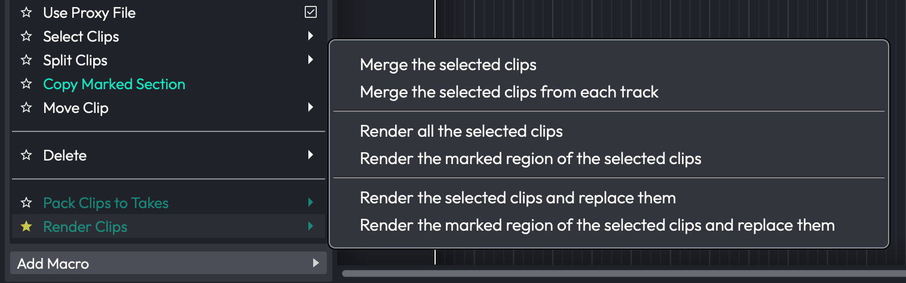

*Render Clip > Merge the selected clips*

After a few moments, Waveform combines them into a single continuous
clip.
The other ways to render and export are covered in
[Rendering and Stems](rendering-and-stems.md).

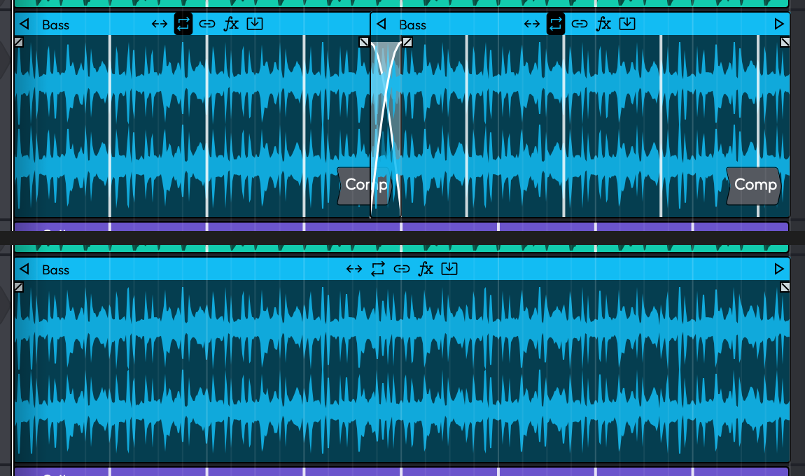

*Merge Clips, Before and After*

This video demonstrates merging clips:

[Merge Selected Clips Video
Demo](https://w-edstrom.wistia.com/medias/5h6bn8h3vg)

## Deleting a Section of Audio Removing Space

You can delete a section of audio from one or more clips and close up
the gap it leaves. To do this:

1.  Set the In marker and Out marker over the section you want to
    delete.
2.  Select all the clips on all tracks (Cmd + A / Ctrl + A).
3.  In the Actions panel, choose *Delete > Delete marked region of
    selected clips, and move up selected clips* (Cmd + L / Ctrl + L).
    With every clip selected, **Delete marked region of selected clips,
    and move up all on track** (Cmd + J / Ctrl + J) does the same job.

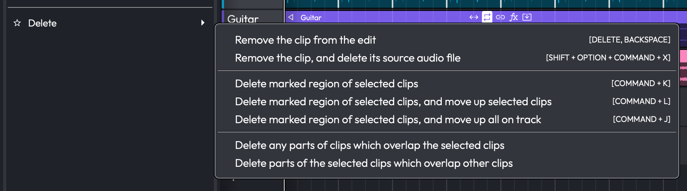

*Delete a Section Removing the Space*

## Editing with ARA

Waveform supports ARA (Audio Random Access) plugins, which edit the
pitch and timing of a clip non-destructively. Unlike a conventional
plugin, an ARA plugin has continuous access to the clip's audio, so its
edits stay in sync with Waveform's transport and loop as you work.

The best-known ARA plugin is Celemony Melodyne, and a Melodyne Essential
licence is bundled with Waveform. Installation details came with your
Waveform order. The steps below use Melodyne as the example, but any
ARA plugin you install (for example VocAlign, SynthV or SpectraLayers)
appears in the same way and is chosen by name.

> 📝 **Note:** ARA is available in all editions of Waveform, on macOS and
Windows only. Installed ARA plugins also appear in the **ARA** column of
*Settings > Plugins*.

### Invoke an ARA Plugin

1.  Select an Audio clip.

    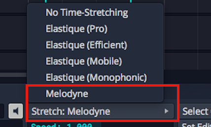

    *Change Stretch Property to Melodyne*

2.  In the Actions panel change the **Stretch** property to the name of the ARA
    plugin you want to use. Installed ARA plugins are listed together under
    an **ARA** heading in the dropdown; choose **Melodyne** here. The clip's
    **Stretch** property now reads **ARA: Melodyne** and the plugin's name
    appears at the centre of the clip.

    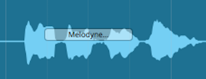

    *Audio Clip with Melodyne Invoked*

3.  Click the plugin name at the centre of the clip (or click **Show ARA
    Plugin UI** in the Actions panel) to open the plugin's editor.

    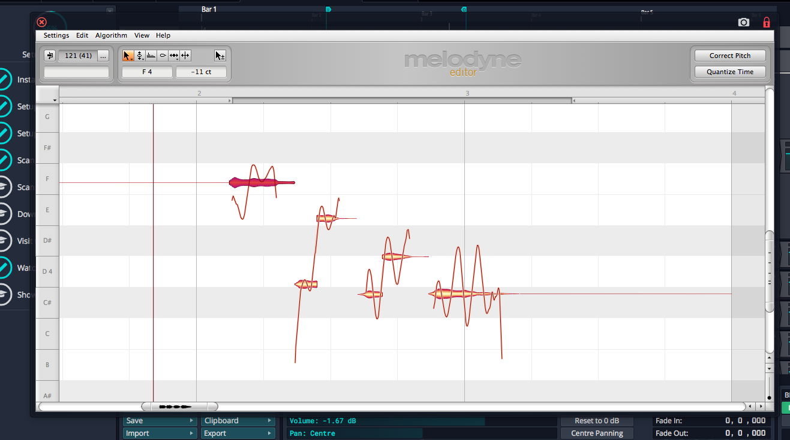

    *The Melodyne UI*

4.  Edit pitch and time by dragging the note "blobs" in the plugin's
    UI. The transport and loop stay synchronised between Waveform and
    the ARA plugin as you edit.

> 💡 **Tip:** For Melodyne's own documentation, click *Help > Manual*
in the Melodyne UI. Skip the section on Loading, Transferring and
Saving, because ARA handles those automatically.

> 📝 **Note:** While a clip is in ARA mode, warp time and reverse are
unavailable for that clip.

To remove an ARA plugin from a clip:

1.  Select an Audio clip that is using an ARA plugin.
2.  In the Actions panel, change the **Stretch** property to **No
    Time-Stretching** or to a time-stretch algorithm such as **Elastique
    (Pro)** or **Signalsmith (Default)**. The ARA plugin is removed from
    the clip.

### Reopen the Editor from the Clip

While a clip is in ARA mode, the clip strip shows a small button named
after the plugin (for example **Melodyne...**). Click it at any time to
reopen the plugin's editor. The pitches the plugin has detected are
drawn as a note overlay on the clip's waveform, so the pitch and timing
edits you make in the plugin show directly on the Waveform clip.

### Convert an Audio Clip to MIDI

When a clip is in ARA mode, the Actions panel shows a **Convert to MIDI
clip** button. It uses the plugin's note analysis to create a new MIDI
clip with the same name, start and length, which replaces the Audio clip
on that track. This is a quick way to turn a monophonic part, such as a
vocal or bass line, into an editable MIDI performance.

**Video Clip:** This video explains [how to invoke
Melodyne in Waveform](https://youtu.be/N3T8G-qF4zQ).

## Group Clips

A Group clip combines clips on a track into a single clip without
rendering, and you can ungroup it at any time to get back to the
individual clips.

To create a Group clip, select the clips you want to group. They don't
have to be next to each other, but they do need to be on the same
track.

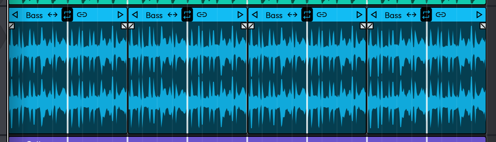

*Select the Clips to Group*

Next, click **Create Group Clip** in the Actions panel.

*Create a Group Clip from the Actions panel*

The new clip has a "Group" label and an icon at the lower left showing
how many clips it contains, and a simplified header.

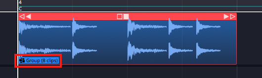

*A Group Clip*

To ungroup the clip back to its original state, select it and click
**Ungroup** in the Actions panel.

*Ungroup from the Actions panel*

You can also use the keyboard: **Group clips** is Cmd + G / Ctrl + G and
**Ungroup clips** is Shift + Cmd + G / Ctrl + Shift + G by default.

Group clips are useful for beats made from sliced-up audio. You can
move and duplicate the Group clip as a single clip, and ungroup it
whenever you want to change the parts.

## Linked Clips

You can create linked copies of clips that reference the same
underlying audio file or MIDI data. Changes to the original clip then
show in all the linked copies. This works for Audio clips, MIDI clips
and Step clips.

To create a linked clip, drag the link button from the clip header (its
tooltip reads "Drag to create a linked copy of this clip"). What you
drag is a copy that refers back to the source clip.

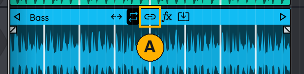

*Link button in the clip header (A)*

In the next image, a linked copy of an Audio clip has been dragged
out. The lower left of each clip shows a "link" icon, marking it as a
linked clip.

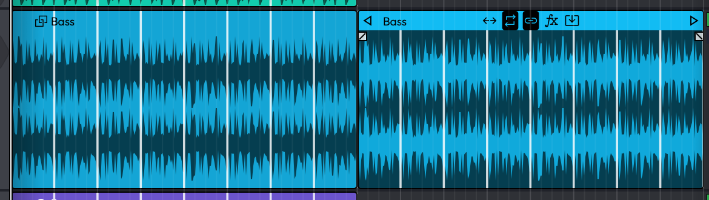

*Linked Audio Clips*

Here the first clip has been reversed to test the link. Reverse is
non-destructive, but linked clips share their clip properties, so the
second clip is reversed too.

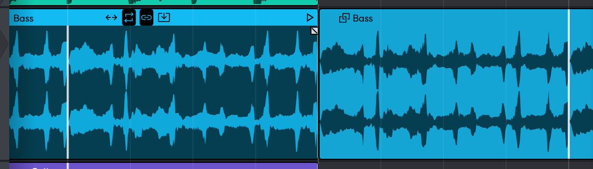

*Reversed Linked Audio Clips*

Changes to fades and fade types, gain, pan, mute, channels, looping,
pitch, stretch mode and reverse are copied to every clip in the link
group. Each clip keeps its own position and length, and splitting a
clip doesn't affect the linked copies. Anything that changes the
underlying file affects them all. For more edits of this kind, select an
Audio clip, then in the Actions panel open *View Source Info > Edit
Audio File > Basic Editing Operations*.

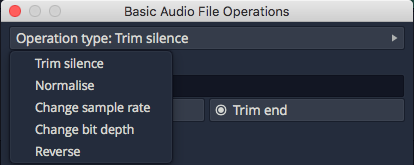

*Basic Audio Editing Operations*

This dialog offers several kinds of edits to the underlying file.
They affect all linked copies as well as the original.

Linked clips can be even more useful for MIDI clips. A change to any
linked clip shows in all the copies, which helps with a beat you use in
many places in a song: update one linked copy and they all change.

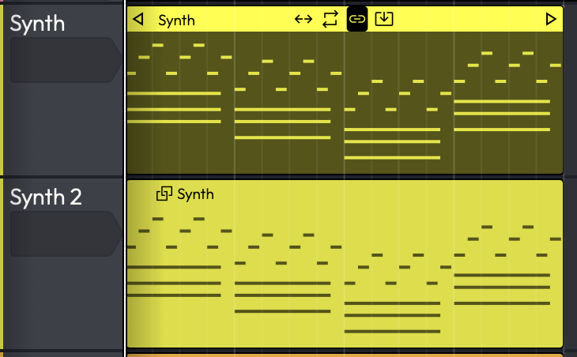

*Linked MIDI Clips on Separate Tracks*

Looped clips do something similar, but they are a continuous series of
repeats on a single track. Linked clips are separate clips and can even
sit on different tracks.

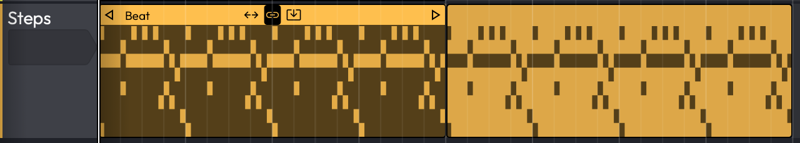

*Linked Step Clips, Green Link Button*

You can make linked copies of Step clips with the same link button.

> 💡 **Tip:** Linked Step clips are harder to spot, because they don't
show a clip name and link icon. Instead, look at the link button in the
header: it turns green whenever linked copies exist. This is true for
linked Audio clips and MIDI clips as well.

## Moving On

Time stretching is covered in [Warp Time](warp-time.md), and looping
Audio clips in [Working with Loops](working-with-loops.md).
