# Audio Device Setup

Waveform talks to your audio interface, whether that's the sound built
into your computer or an external interface, through a device type
(driver). The choices are:

- Windows: ASIO (recommended), Windows Audio (three modes), and DirectSound
- macOS:   Core Audio
- Linux:   JACK (recommended), and ALSA or PulseAudio/ALSA

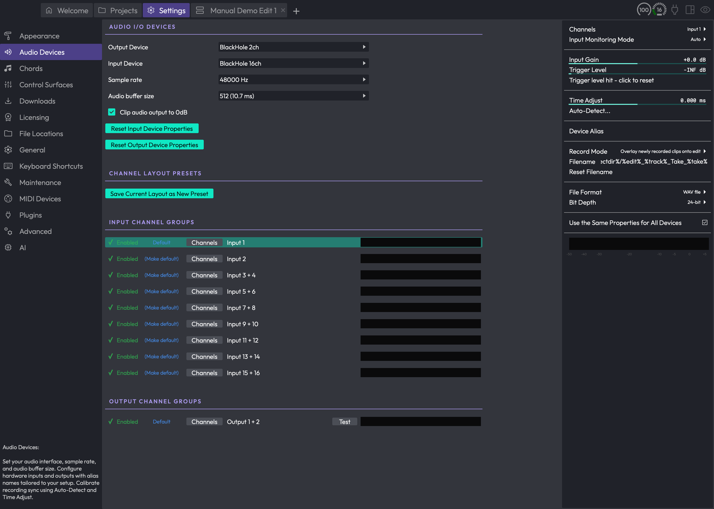

*Audio Device Page*

## Audio Device Setup in Windows

Open *Settings > Audio Devices*.

Waveform gives Windows users five choices for **Device type**:

-   Windows Audio
-   Windows Audio (Exclusive Mode)
-   Windows Audio (Low Latency Mode)
-   DirectSound
-   ASIO

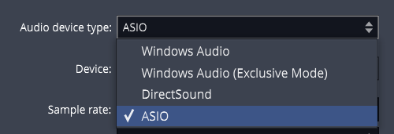

*Windows Audio Device Types*

Any of these five might work on your computer, but they differ, and
some are better choices than others:

**ASIO**: The best choice if you use an external audio interface.
Install the manufacturer's driver first. ASIO usually gives the best
low-latency performance for recording and playback. Many modern audio
interfaces include a mixer app to control low-latency mixing within the
unit. With ASIO, you choose one device and it is used for both inputs
and outputs.

**Windows Audio**: Use this if you run Windows 10 or 11 and use your
computer's internal sound, for example on a laptop while travelling.
This device type uses WASAPI (Windows Audio Session API), which gives
applications well-optimised access to audio I/O. Windows Audio also
works with USB Audio Class 1 interfaces.

**Windows Audio (Exclusive Mode)**: The same as Windows Audio, but while
Waveform is running no other application can use the audio interface.
For the lowest latency with your internal sound, choose this option.

**Windows Audio (Low Latency Mode)**: Shared like Windows Audio, so
other applications can still play sound, but Waveform asks Windows for
smaller buffers to get lower latency. Try it if you want lower latency
from your internal sound without locking out other applications.

**DirectSound**: This technology is deprecated in Windows 10 and 11, and
there is no good reason to choose it.

> 📝 **Note:** Windows versions earlier than Windows 10 have reached end
of life and are no longer officially supported. You might be able to
run Waveform on older 64-bit Windows systems, but the Waveform
development and support team test on Windows 10 and 11.

> 📝 **Note:** Windows 10 and 11 support USB Audio Class 2 devices
natively. For a simple 2 x 2 interface or built-in audio, this is a
workable alternative to ASIO. To get the full feature set of most audio
interfaces, install the manufacturer's driver and use ASIO if you can.

## Audio Device Setup on macOS

1.  Open *Settings > Audio Devices*.
2.  Select an output device. If the drivers are installed and the
    device is connected, it appears as an option for the **Output
    Device** property.

    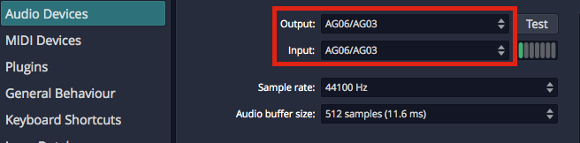

    *macOS - Audio Device Output and Input Properties*

    > 📝 **Note:** On macOS, USB audio interfaces that follow USB Audio
    Class 1 (1998) or USB Audio Class 2 (2009) work without any extra
    driver. Product specs often list such devices as "class compliant."

3.  Select an **Input Device**.

> 💡 **Tip:** macOS lets you choose the input and output devices
separately, but select the same device for both where you can. This
example uses a "USB iTwo", a simple 2 in / 2 out interface.

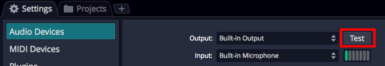

*Audio Device Test Button on Mac*

**Test** button: Further down the Audio Devices page, each enabled
output in the **Output Channel Groups** list has its own **Test**
button. Click it to send a short test tone to that output. If you hear
the tone, your device is set up correctly.

## Audio Device Setup on Linux

Waveform can connect to the Linux audio system through JACK or ALSA.
JACK is the recommended choice, because it gives a low-latency signal
path and more routing options.

In *Settings > Audio Devices*, set **Device type** to **JACK**.

Setting up Waveform itself is easy. Preparing the Linux system, and
finding an audio device that works with Linux, takes more care.

The Waveform development and support team can't promise anything about
the Linux compatibility of your audio interface, but here is what to
expect in general:

- Audio chips built into the computer's motherboard, as in laptops,
  are mostly supported by Linux.
- External USB audio devices are usually supported if they are sold as
  "USB class compliant" or "iOS compliant", at least for their basic input and output channels. If a
  USB device comes with management software, that software usually
  doesn't run on Linux, and any features that only the management
  software can reach stay out of reach.
- For internal cards, and for interfaces that connect in other ways
  (FireWire, for instance), no general statement is possible.

Whatever your device, contact your hardware vendor, or ask the relevant
Linux user communities about their experience with it. One place to ask
is this forum: https://linuxmusicians.com/viewforum.php?f=6

PipeWire is now the default audio (and video) transport in the major
Linux distributions, so the setup instructions below are for PipeWire.
They were tested on Ubuntu LTS (24.04).

PipeWire was developed as a low-latency replacement for JACK, ALSA,
PulseAudio and GStreamer, which are proven but limited in how far they
can be extended and integrated. It provides compatibility layers so
that applications written for those interfaces keep working. For ALSA,
only the user-space features are replaced; the ALSA parts that provide
the hardware drivers stay as they are.

Out of the box, Ubuntu (and flavours of it such as Kubuntu) bases its
audio system on PipeWire, through the preinstalled packages *pipewire*
and *pipewire-pulse*. The usual audio signal path is then:

**App** (Multimedia Player) **--> pipewire-pulse --> basic management layer --> pipewire --> ALSA --> audio device**

You run the app, and the operating system takes care of the rest.

To run Waveform on Ubuntu, though, you need to add the compatibility
layers for the JACK or ALSA interfaces to PipeWire, because they
aren't preinstalled. The packages you need are:

- *pipewire-jack*
- *pipewire-alsa*
- *wireplumber*

The *pipewire-jack* and *pipewire-alsa* packages provide the
compatibility layers. WirePlumber replaces the basic management layer
of Ubuntu's default PipeWire setup, which is no longer enough, with the
more capable management that these layers need.

So far, this is much the same on all Linux distributions built on
Debian, such as SparkyLinux, Ubuntu and Linux Mint. The configuration
steps needed after installing the packages may vary.

The easiest way to get Ubuntu ready for audio work with Waveform is to
install this package:

- *ubuntustudio-pipewire-config*

On Ubuntu, this package pulls in all the packages above and puts the
necessary configuration in place. Restart the computer, and there is no
further configuration to do. After the reboot, these signal paths are
available:

**App** (Multimedia Player) **--> pipewire-pulse --> wireplumber --> pipewire --> ALSA --> audio device**

**App** (Waveform) **--> pipewire-alsa --> wireplumber --> pipewire --> ALSA --> audio device**

**App** (Waveform) **--> pipewire-jack --> wireplumber --> pipewire --> ALSA --> audio device**

You can use them side by side, each with its own features. For
instance, JACK applications can route signals between each other, so
you can build up networks of audio apps. A graphical patch bay such as
*qpwgraph* helps you manage a JACK-based audio network.

As another example, several applications using PulseAudio and several
using JACK can run at the same time, all streaming to the same audio
interface. PipeWire mixes the streams with almost zero latency.

You can still use the ALSA path for Waveform, as before. But setting up
JACK on PipeWire is now easy, without the configuration hassles of the
past, and JACK gives a lower-latency signal path, so set Waveform to use
JACK.

For convenience, you can also install the Ubuntu Studio Audio
Configuration and Ubuntu Studio Installer apps from this package:

- *ubuntustudio-installer*

Ubuntu Studio Audio Configuration helps you set the main audio system
options. It is especially useful for changing the PipeWire Quantum,
which balances latency against system load through its buffer size and
sample rate. The default is "1024 48000". To change it system-wide
straight away, run the tool and enter the values you want.

Ubuntu Studio Installer handles more specialised configuration. For
instance, it can install a low-latency kernel and make all the related
settings automatically with a single click. It can also install curated
software bundles, not only for audio (the *ubuntustudio-audio* bundle)
but also for video and photography. Many users with modern computers
don't need the Installer; the Audio Configuration tool is the more
useful of the two.

## Choosing the Audio Interface

With the device type set, you can choose any audio interface connected
to your computer, or the internal sound. Select your device for the
**Output Device** property if it isn't already shown. With ASIO there
is a single device for both inputs and outputs.

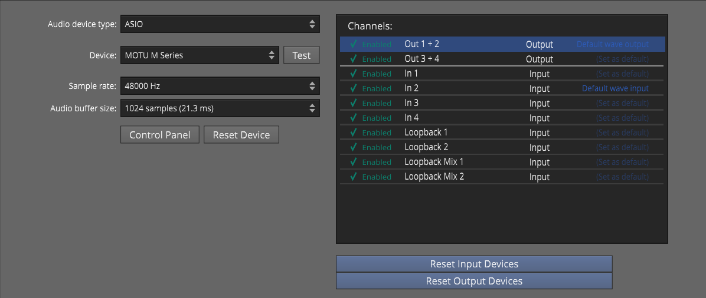

*ASIO Device Setup on Windows*

**Control Panel**: On some audio interfaces, clicking **Control Panel**
opens the manufacturer's driver control panel, where you can set the
buffer size. Many audio interfaces don't let host software set the
buffer size or sample rate. In that case, find the interface's control
panel software on your system, open it, and set the sample rate and
buffer size there. Sometimes you need to restart Waveform for the
change to take effect.

**Reset Device**: Shown next to **Control Panel**. It closes the current
audio device and opens it again, which can help after changing settings
in the driver's control panel.

**Clip audio output to 0dB**: When on, Waveform limits its output to
0 dB so that overs never reach your interface. (Default: on)

## Setting the Sample Rate

The default sample rate is 44100 Hz, the sample rate of CDs. Use this or
48000 Hz unless you have a specific reason to choose another rate.

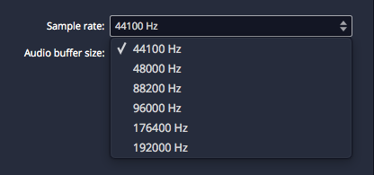

*Setting the Sample Rate*

## Testing for Audio Playback

Test playback to make sure you get sound and a complete stereo image.
One way to do that:

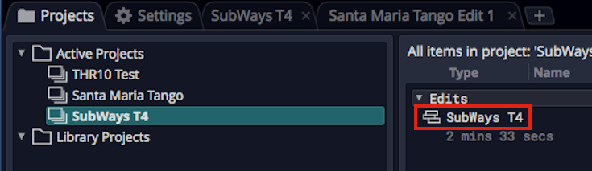

*Loading the SubWays Demo*

1.  Open the Welcome tab and pick a song from the **Project Templates**
    list to open it as a new Edit. Or open any demo song from the
    Projects tab (see [Demo Projects and
    Templates](installing-the-demo-projects.md)).
2.  Click **Play** (Space bar). You should hear music.

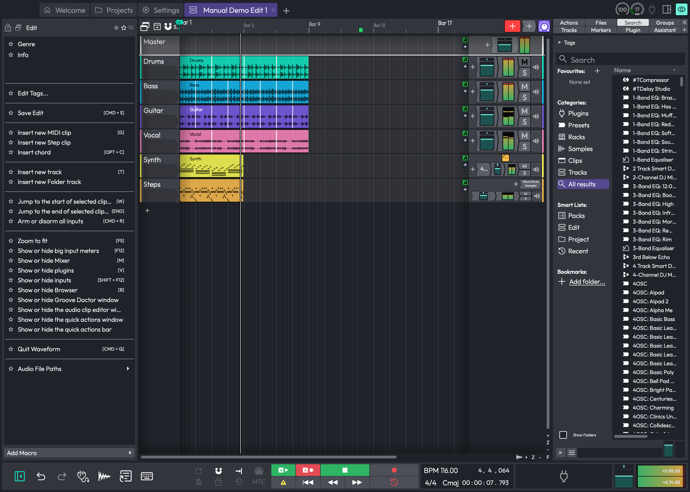

*Successful Play Back*

## Channel Groups

The lower part of the Audio Devices page lists your interface's inputs
under **Input Channel Groups** and its outputs under **Output Channel
Groups**. Each row is one input or output as Waveform sees it, and has
these controls:

- **Enabled / Disabled**: switches the input or output on or off.
- **Default / (Make default)**: shows which input or output is the
  default, or makes this one the default.
- **Channels**: sets whether this input or output is **Mono** or
  **Stereo**. Layouts with more than two channels
  PRO, such as 5.1 and 7.1, need Waveform Pro
  or the Surround Expansion.
- **Test**: on enabled outputs, plays a short test tone.

Click a row to select it and see its properties on the right. Inputs
have the recording properties described in
[Input Properties](recording-audio.md#input-properties). Outputs have
**Channels**, **Dithering Enabled**, **Left/Right Reversed** and **Device
Alias**.

### Channel Layout Presets

If you switch between setups, for example a stereo mix and a set of
mono mic inputs, you can save the arrangement of channel groups as a
preset. Click **Save Current Layout as New Preset** under **Channel Layout
Presets** and give it a name. Saved presets are listed above the button:

- Click a preset to apply it. Waveform asks you to confirm before it
  replaces the current layout.
- Click its update button to replace the preset with the current layout.
- Click its delete button to remove it.

## About Latency

Mixing your tracks, calculating digital effects and triggering
instrument samples all take time in any DAW; digital mixing can't
happen instantly. The time your computer needs to compute, process, mix
and play back from input to output is called 'latency.' It is the time
you give the computer to think, and is measured in milliseconds, from a
few to several hundred.

During playback, latency only shows as a delay between pressing play
and hearing sound. The transport responds with a barely detectable lag,
which doesn't cause much trouble.

Latency matters more when you overdub. If you hear the existing tracks
a little late, what you record won't line up, because your timing
reference has shifted. Even a few milliseconds affect the feel. At 30
or 60 milliseconds, the timing of the recording can seem completely
off.

That's why all DAWs include "latency compensation": after recording,
the audio is shifted to make up for the latency of the A/D conversion,
mixing and plugin processing.

## Managing Latency

**Audio buffer size** by default is 512 samples (11.6 ms) on macOS, 256
samples (5.8 ms) on Windows, and 1024 on Linux (21.3 ms).
On modern computers, you can usually run with the buffer size set to
256 or even lower.

> 📝 **Note:** The buffer sizes on offer depend on your audio
interface, connection type and driver.

Take a latency of 11 ms. That's a very short time. If you play a MIDI
controller into a virtual instrument, you hear each note 11 ms after you
play it. The same goes for a virtual guitar amp or amp simulator: you
play a note on the guitar and hear it 11 ms later. Sound travels through
air at roughly one foot (0.34 metres) per millisecond, so this latency
is like playing with your guitar amp or keyboard monitor 11 feet (3.4
metres) away. There is a delay, but you might get by. At 6 ms the delay
is usually barely noticeable.

With computer recording, you're always balancing noticeable latency
against clean playback. You can't lower the buffer all the way, because
the computer needs time to produce the sounds and process effects. Set
the buffer too low and you get pops, clicks and dropouts. Keep it lower
while you record, and raise it while you edit and mix.

> 💡 **Tip:** Start with 256 samples. While your songs are simple, this
works on most modern systems. If virtual instruments feel too delayed,
try a lower buffer size. If the audio starts to break up, try a higher
one.

> 📝 **Note:** If you use Melodyne Essential to edit audio, increase the
buffer size to at least 1024 samples to avoid a warning message and get
clean playback.

## Calibrating Input Latency Compensation

If you use Waveform for any overdubbing, **this is possibly the most
important lesson in this book. Waveform requires you to run
Auto-Detect** using a loopback connection on your audio interface.

> ⚠️ **Warning:** This test sets up a deliberate feedback loop. Switch
your speakers off during this test. You will be connecting an output to
an input with a patch cord, so be careful.

To run the test:

1.  Turn off your monitor speakers.
2.  Make sure any input monitoring knobs, buttons or mixers are off or
    turned down.
3.  Connect one output back to one of the inputs. To keep it simple,
    connect the left output to input one.
4.  Turn the gain on that input up about halfway.
5.  In Waveform, go to *Settings > Audio Devices*.
6.  In the **Input Channel Groups** list, click one of the inputs.

    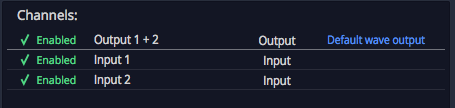

    *Select an Input*

7.  In the input's properties on the Settings page, click
    **Auto-Detect...**.

    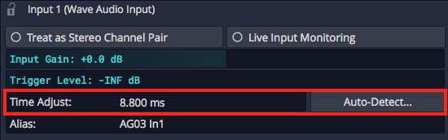

    *Auto-Detect & Time Adjust Parameters*

8.  Click **Run Test**. Waveform sends a short test signal from the
    output to the input and calculates the delay between them.

    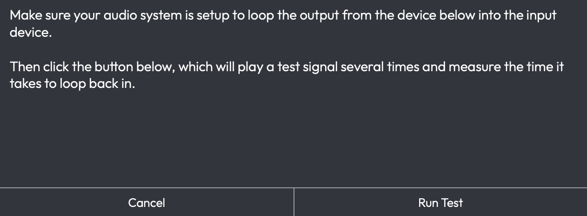

    *Recording Synch Test Dialog Box*

9.  Click **Apply** to copy the delay value to the **Time Adjust**
    property.

    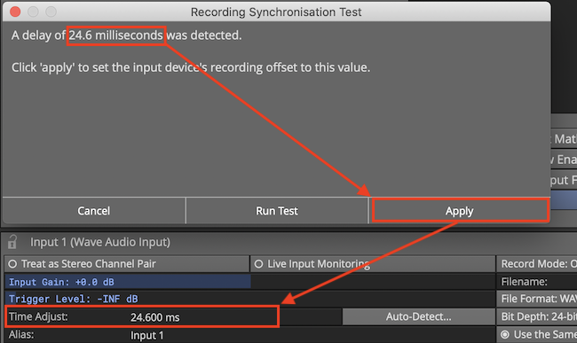

    *Applying the Auto-Detect Result to Time Adjust*

For recordings to line up during overdubs, repeat this every time you
change the **Sample rate** or **Audio buffer size**. If you don't, your
recordings will be several milliseconds out of line with existing
tracks.

> 📝 **Note:** Instead of a loopback cable, you can connect a microphone
to the input and point it at one of your speakers to run Auto-Detect.
This works, but make sure that Live Input Monitoring is off AND that
direct input monitoring on your audio interface is off. If either is on,
the feedback could damage your speakers, if not your ears.

> 💡 **Tip:** Note down the **Time Adjust** values for the settings you
use most, and enter them manually when you switch.

> ⚠️ **Warning:** To configure Waveform for recording, you must use the
Auto-Detect feature along with a hardware loopback. If you don't, your
overdubbed tracks will not line up with existing tracks. It isn't
difficult, but you need to repeat this manual step whenever you change
the audio device setup.

## Resetting to the Defaults

To reset these settings to the defaults, click either of these:

**Reset Input Device Properties**: Resets **Input Gain**, **Trigger
Level**, **Time Adjust**, and recording options.

**Reset Output Device Properties**: Resets the **Dithering Enabled** and
**Left/Right Reversed** parameters.

## Advanced Audio Device Settings

There are additional options for Low Latency Mode and audio performance
on the *Settings > Advanced* page. See the Advanced section of
[Reference: Settings](reference-settings.md#advanced).

## First Run Setup

When you run Waveform for the first time, the First Run Setup Progress
panel appears on the left. Click an item to go straight to the page and
feature in the Settings tab that completes that task.

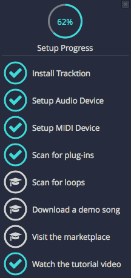

*First Run Setup Progress Panel*

If you close the panel and want it back, choose *Help > Show the First
Run Setup panel*.

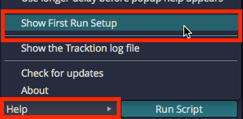

*Turning First Run Setup On*

## Moving On

With your audio device set up and calibrated, go on to
[Recording Audio](recording-audio.md).
