# Automation

Automation lets you program changes to the parameters on a track over time:
volume, pan and the controls of any plugin. You can record it from hardware
controllers with knobs and faders, or draw it by adding points to the
automation curve, the line that appears on or below the track.

To keep automation organised, you can add automation tracks that nest under
a track, open them while you work on the automation, and close them again
when you move on to other parts of the Edit.

The examples here use Volume & Pan automation; the same steps work for the
parameters of any other plugin.

## Activating Automation on a Track

Automation starts from the A icon and the plus icon at the far right of each
track.

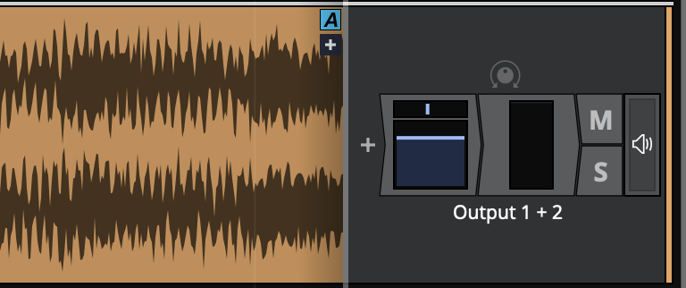

*The A and Plus Automation Icons*

Click the plus icon to open a menu:

- *Add a new automation track with this parameter: X* adds an automation
  track showing X, the parameter the track is currently showing.
- *Add an empty automation track* adds an automation track with no parameter
  chosen yet.
- *Add automation tracks for each active parameter on this track* adds one
  automation track for every parameter on the track that already has
  automation.
- *Active parameter curves for this track* lists the parameters that have
  automation. Pick one to add an automation track showing it.

Shift-click the plus icon to add an empty automation track straight away. The
new automation track appears below your original track, with minus, A and plus
icons of its own.

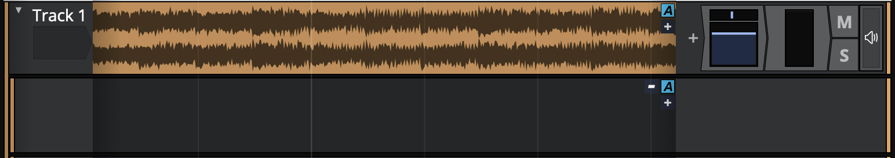

*Track with One Automation Track*

The minus icon removes the automation track, the A icon chooses what it
shows, and the plus icon adds another automation track below this one.

To colour an automation track, right-click its header and pick a colour from
the colour strip in the menu.

### Pinning the Shown Curve

When an audio track (not an automation track) is showing automation, there's a pin button next to its A button. While the pin is off, the curve shown on the track changes whenever you move a plugin parameter. That's a quick way to find a curve: unpin, move the parameter in the plugin's window, and its curve appears. To keep the current curve on screen, pin it, or click the A button and move it to its own automation track.

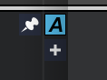

*Unpinned*

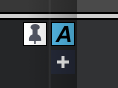

*Pinned*

## Choosing What to Automate

To automate the track's volume, click the A icon and choose *Automatable
parameters for this track > Volume & Pan Plugin > Volume*.

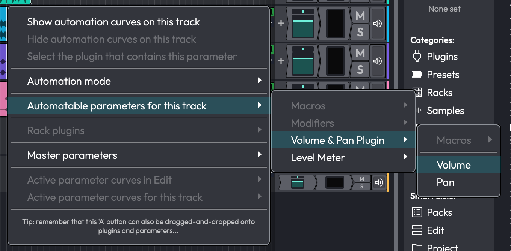

*Select the Parameter to Automate*

An automation line appears, labelled with the name of the parameter, with the
parameter's value shown on the right. This line is the automation curve. It's
flat until you add points to it, and from there you can draw curves, steps and
ramps.

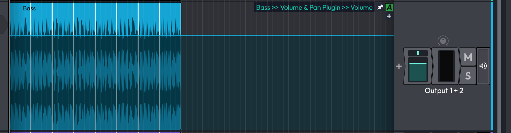

*The Automation Curve Line*

Click the curve to select it, and the Actions panel shows the curve's
name and its actions. Those make more sense once you have some automation
points on the curve.

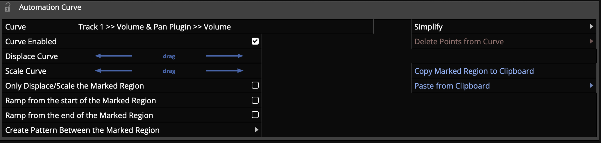

*The automation curve in the Actions panel*

> 💡 **Tip:** A faster way to choose the parameter is to drag the A icon onto
the plugin you want to automate, then pick the parameter from the list. To
automate panning, for example, drop the A on the Volume & Pan plugin and
choose *Pan*. This works for third-party plugins too.

### The A Button Menu

Clicking the A icon opens a menu of everything the track can show:

| Entry | What it does |
| --- | --- |
| *Show automation curves on this track* | Shows the track's volume curve again when no curve is shown |
| *Hide automation curves on this track* | Hides the curve the track is showing |
| *Select the plugin that contains this parameter* | Selects the plugin that owns the shown curve, so its controls appear in the Actions panel |
| *Automation mode* | Sets the track's automation mode (see [Automation Modes](#automation-modes) below) |
| *Automatable parameters for this track* | Every parameter on the track, grouped by plugin, plus the track's *Macros* and *Modifiers* submenus |
| *Rack plugins* | Each rack in the Edit, with its *Macros*, *Modifiers* and *Faceplate* controls and the plugins inside it |
| *Master parameters* | The master volume and pan, the master plugins and the Edit's macros |
| *Active parameter curves in Edit* | Every parameter in the Edit that already has automation |
| *Active parameter curves for this track* | The parameters on this track that already have automation |

Choosing a parameter shows its curve on the track. For the parameters these
submenus lead to, see [Macro Parameters](racks.md#macro-parameters),
[Modifiers](modifiers.md) and [Faceplates](faceplates.md).

## Adding Points to the Automation Curve

To give the automation curve some shape, add points to it: double-click the
curve, or Opt-click / Alt-click it.

### Creating a Ramp

To draw a ramp, add two points and then drag one of them up or down. This
adjusts the steepness of the ramp. Drag the points left or right to adjust
the start and end of the ramp.

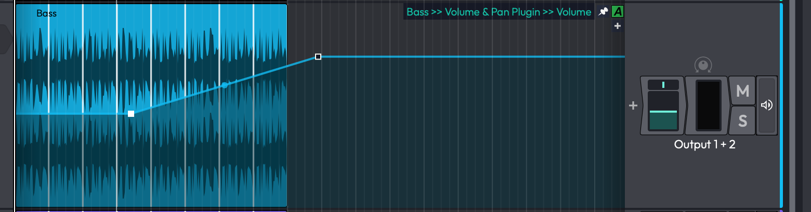

*Drawing an Automation Ramp*

### Shaping with Curvature

To shape the line segment between two points, use its curvature point.
Waveform puts one midway between every pair of automation points. Drag it up
or down to bend the segment.

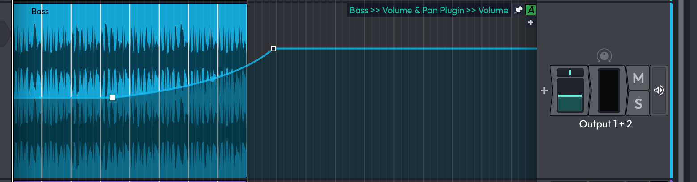

*Adjusting a Curvature Point*

> 💡 **Tip:** You can also set a selected point with the **Value** slider in
the Actions panel, alongside a **Curvature** slider.

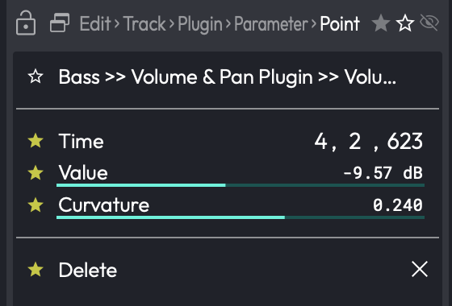

*Value and Curvature in the Actions panel*

### Drawing an Automation Step

Add two points to mark where the step starts and ends. Hold Cmd / Ctrl and
drag the line segment between them up or down. The segment moves on its own,
separately from the rest of the curve, which draws a step. Without
Cmd / Ctrl, dragging a line segment moves its two end points, pulling the
neighbouring segments with them.

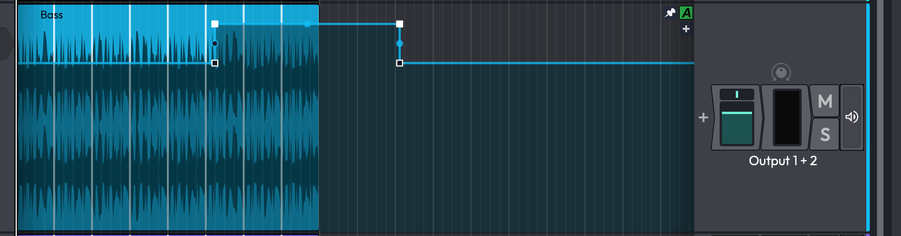

*Hold Cmd / Ctrl to Draw a Step*

### Editing Points

- **Delete a point**: double-click it, or Opt-click / Alt-click it.
- **Move a point and every point after it**: Cmd + Shift-drag / Ctrl +
  Shift-drag the point left or right. This slides the rest of the curve in
  time without changing any values.
- **Move a point along one axis only**: hold Shift while you drag it, and the
  point keeps either its time or its value, whichever you moved less.
- **Select a run of points**: select one point, then Shift-click another to
  select every point between them.
- **Add or remove a point from the selection**: Cmd-click / Ctrl-click it.

## Editing Automation

Select a range on a track that's showing automation and the automation edit handles appear. They only change the points inside the range: the top handles scale them and the bottom handles shift them up or down. The centre handles change every point in the range equally, while a corner handle tapers the change so it's strongest at that corner's end of the range and fades to nothing at the other. Use them to adjust many points at once, or to add musical effects such as ramps.

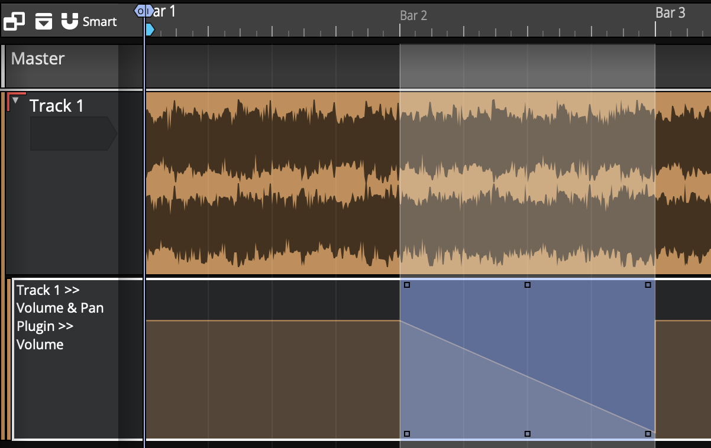

*Automation edit handles*

With a range selected you can also right-click and choose *Insert automation shape* to fill the range with a shape. After picking the shape, choose how it repeats: a set number of times to fit the range, or once every musical period.

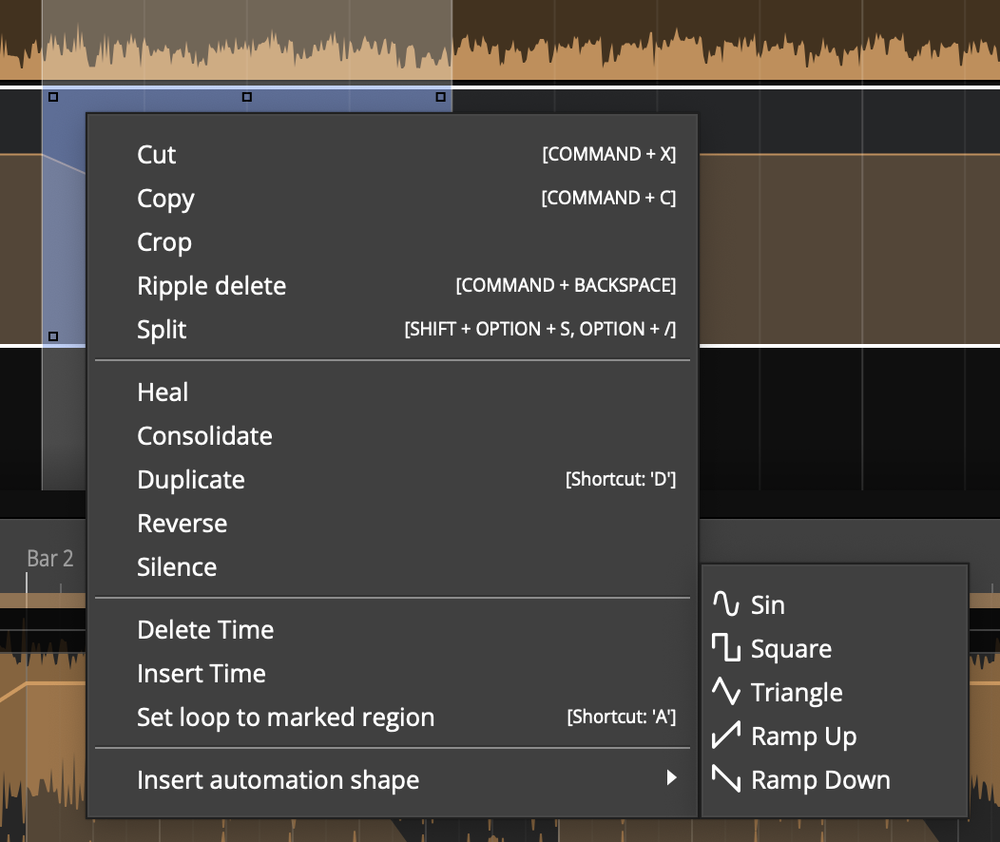

*Inserting an automation shape*

Combine an inserted shape with the edit handles to build rhythmic patterns.

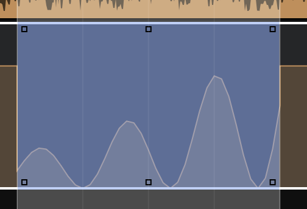

*An inserted shape adjusted with the edit handles*

## Automating Fade-ins and Fade-outs

To draw a fade with automation, add a point where you want the fade to start
and another where you want it to end, then drag the second point all the way
down until the value reads zero. To change the shape of the fade, drag the
curvature point between them. Dragging it down makes the level drop quickly
at the start of the fade and then tail off; dragging it up holds the level
for longer and drops it towards the end. You can also set the point's value
and curvature in the Actions panel.

If you automate a Folder track's VCA fader, the fade applies to every track
inside it. See
[Automating a Fade within a Folder Track](folder-tracks.md#automating-a-fade-within-a-folder-track).

## Converting a Clip Fade-in or Fade-out to Automation

You can fade Audio clips in and out with the fade handles in the clip's upper
left and right corners (see
[Fade-in/Fade-out](audio-clips-and-editing-audio.md#fade-infade-out)). For
more control over the fade's shape, convert the clip fade to an automation
curve.

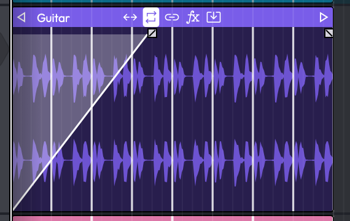

*Clip Fade*

To convert it, select the clip, then click
**Fade to Automation** in the Actions panel and choose *Transfer Fade-in to
Automation* or *Transfer Fade-out to Automation*.

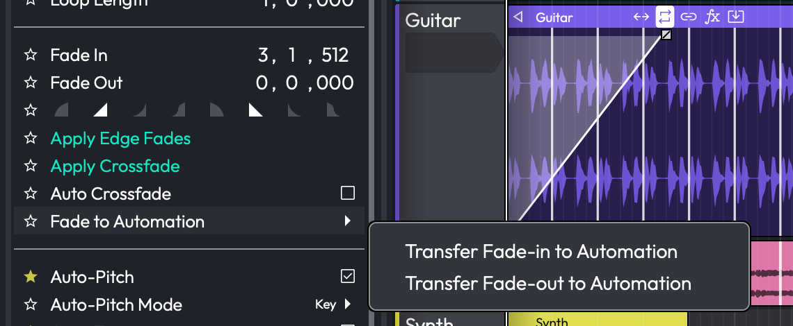

*Fade to Automation*

Waveform redraws the automation curve in the shape of the fade and removes
the fade from the clip. You can then add points and reshape it with the
automation tools.

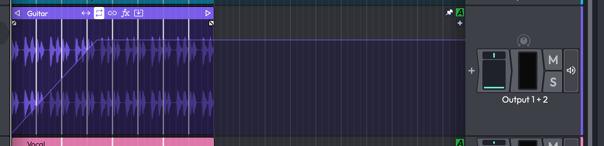

*Result of Fade to Automation*

## Reading Automation

Waveform plays back the automation you've drawn as long as the **Read**
button in the transport bar is on.

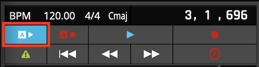

*Read Enabled*

During playback, the controls move in real time as the cursor passes
through the Edit.

## Automation Curve Actions

The automation curve has its own controls. Click the curve to select it, and
they appear in the Actions panel.

*The automation curve in the Actions panel*

**Curve**: The name shown above the automation curve, made up of the track
name, the plugin name and the parameter. It's for reference only, and you
can't change it here.

**Curve Enabled**: Turns the curve on or off. A disabled curve has no effect
on the parameter and shows greyed out on the track, so turning it off is a
quick way to hear what the automation is doing. Writing automation in touch or
latch mode turns the curve back on.

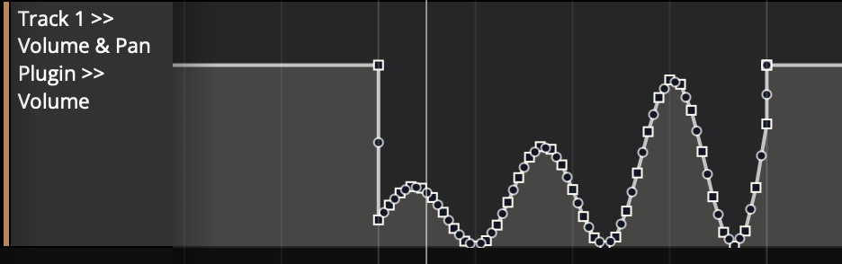

*A disabled automation curve*

**Displace Curve**: Moves the whole curve, with all its points, down when you
drag left and up when you drag right. Use it for small mix changes after the
automation is in place.

**Scale Curve**: Works like an intensity control. Dragging left lowers every
point on the curve in proportion, squashing its shape; dragging right expands
the curve, scaling it upwards.

**Only Displace/Scale the Marked Region**: Works with **Displace Curve** and
**Scale Curve**. When it's on, they only affect the curve between the In
marker and the Out marker.

**Simplify**: Thins out the points on a busy curve. Choose *Simplify the
entire curve*, then *Light*, *Medium* or *Strong*: *Light* removes the fewest
points and *Strong* the most. This helps most with automation recorded from a
hardware controller, which can add hundreds of points.

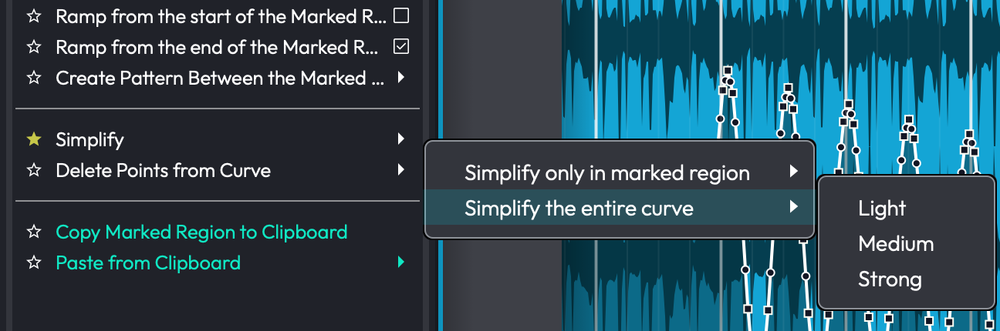

*Automation Curve Simplify*

*Simplify only in marked region* does the same for the part of the curve
between the In and Out markers, so you can thin out a section recorded from
hardware and leave the rest of the curve as it is.

**Delete Points from Curve**: Options for clearing points from the curve.
Deleting all of them takes the curve back to a flat line, which can leave the
value very low, so you may need to drag the line back to a sensible starting
level. *Delete points within the marked region* deletes the points between
the In marker and the Out marker, and the "close the gap" version also removes
the time inside the marked region.

**Copy Marked Region to Clipboard**: Copies the part of the curve between the
In marker and the Out marker. Move the cursor to where you want it and choose
**Paste from Clipboard** > *Paste curves at cursor position*. Use it to repeat
a pattern of automation, or to reuse an effect later in the song.

**Paste from Clipboard**: Has two options. *Paste curves at cursor position*
is the usual choice, and Cmd + V / Ctrl + V does the same.
*Paste curves to fit between in/out markers* fits the pasted curve inside the
marked region.

> 💡 **Tip:** You don't need to copy automation by hand when you move or
duplicate clips on a track. Turn on **Auto Lock** in the transport bar and
the automation goes with the clips.

## How to Find Out What Automation Is Active for a Track { #how-to-find-out-what-automation-is-active-for-a-track }

Once a track has a lot of automation, not every curve will be on screen. To
see them all, click the A icon and choose *Active parameter curves for this
track*. The submenu lists every automated parameter on the track, and you can
pick the one to show.

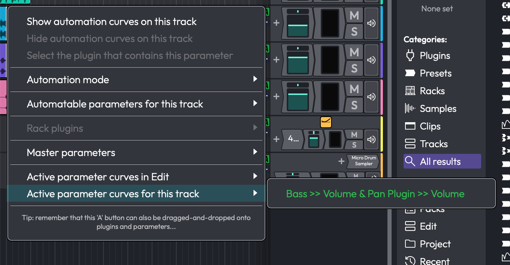

*Active Parameters for a Track*

This helps most when the parameters aren't each on their own automation
track.

## Remap on Tempo Change

Each plugin has a **Remap on Tempo Change** setting. For third-party plugins,
racks and some built-in plugins (such as Volume & Pan) it's a toggle in the
plugin's Actions panel; for the other built-in plugins it's an item in the
menu on the plugin window's title bar. With it enabled, the plugin's
automation follows tempo changes: it gets shorter if you speed up the tempo
and longer if you slow it down, so it stays lined up with the clips in your
Edit. It's off by default, so you turn it on for each plugin.

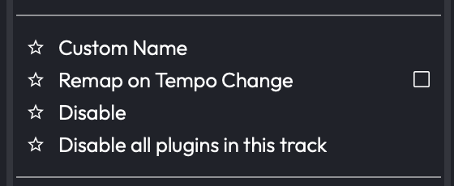

*Remap on Tempo Change*

> 💡 **Tip:** To turn **Remap on Tempo Change** on for all new Edits, go to
*Settings > General*, click **Set defaults** on the **Tempo change
remapping** row and enable *Remap plugin automation*.

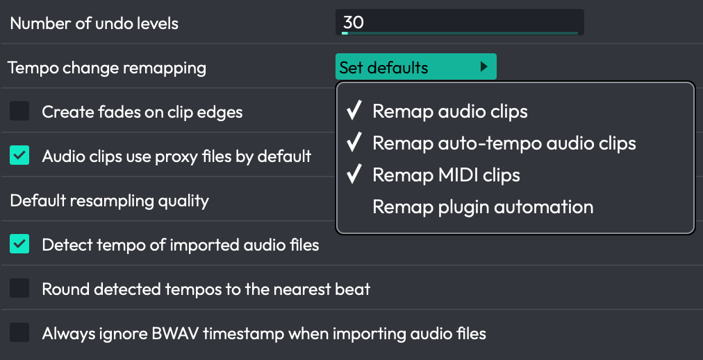

*Make Remap the Default*

> 📝 **Note:** *Remap plugin automation* is not turned on by default, to
maintain compatibility with older projects.

## Writing Automation on the Fly

During playback, you can move a parameter and have Waveform record the
movement as automation, either from a MIDI controller or by moving the plugin's
controls on screen. Set up your automation track, then turn on the **Write**
button in the transport bar.

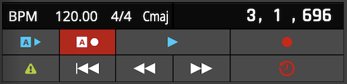

*Write Enabled*

With **Write** on, Waveform records any changes you make to the parameter
during playback.

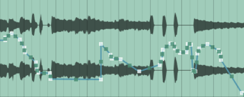

*Automation from Write Mode*

> 📝 **Note:** You don't need to be recording to write automation. Turning on
**Write** and playing is enough.

> 💡 **Tip:** Waveform already simplifies newly written automation
(*Settings > Advanced > Automation > Simplify newly-recorded automation*, on by
default; see [Reference: Settings](reference-settings.md#automation)). Use
**Simplify** again if you want it thinner; *Medium* is a good starting point.
The **Glide** setting on the same page sets how long newly written automation
takes to cross-fade into the curve that was already there.

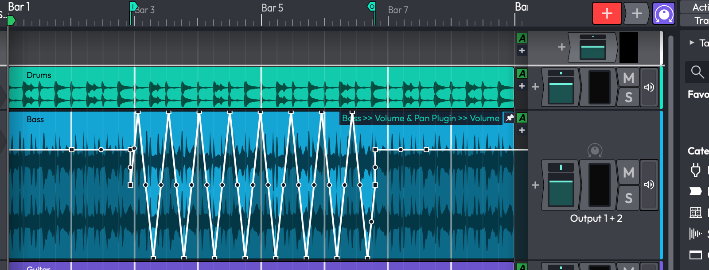

*Automation with Medium Simplification*

### Automation Modes

Each track has an automation mode, which you set from the A button's *Automation mode* submenu. The A button changes colour to show the current mode.

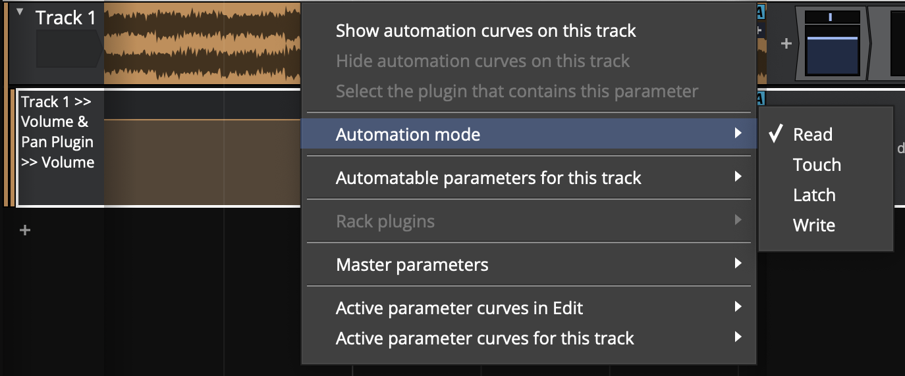

*The Automation mode submenu*

**Read**: Automation is only played back, never written. The **Read** button in the transport bar must also be on; if it isn't, the A button is greyed out to show the automation won't be read.

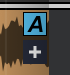

*Read mode*

**Touch**: Automation is written only while you're moving the parameter, which usually means while the mouse button is held down on a control or you're touching a control on an external controller.

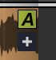

*Touch mode*

**Latch**: Automation is written from the moment you first change the parameter. After you let go, the last value written keeps overwriting the points on the curve until playback stops.

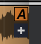

*Latch mode*

**Write**: Automation is written the whole time. Take care with this mode: as soon as you start playback, the parameters' current values overwrite the existing automation. Touch or Latch is usually the better choice.

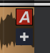

*Write mode*

> 📝 **Note:** In the writing modes (Touch, Latch and Write), the **Write** button in the transport bar must also be on. If it isn't, the A buttons are greyed out to show automation won't be written.

> 💡 **Tip:** While a parameter on a track is being written, the track's A button and the **Write** button in the transport bar flash.

## Automation Lock

The transport bar has an **Auto Lock** button, which is off by default. While
it's off, moving a clip on a track leaves the automation where it was.

*Automation Lock Engaged*

With **Auto Lock** on, the automation moves with the clip when you drag it to
a different place in time. Turn it off when you want to move clips without
disturbing the automation.

## Clip Automation PRO { #clip-automation }

> 📝 **Edition:** Waveform Pro, or with the Recording Engineer Expansion, the
> MIDI Producer Expansion or the Launcher Expansion.

You can also add automation curves to individual clips. They can control parameters of the clip's own plugins, its track's plugins or the master plugins, but not a plugin on a different track.

Clip automation differs from track automation in two ways. It always plays back relative to the clip, so it moves with the clip, and each parameter has three separate curves: absolute, relative and scale.

Combining these curves with different timing settings lets you build complex, rhythmic patterns from very few points.

### The Clip Automation Editor

The clip automation editor is part of the clip's view in the
[Detail Editor](detail-editor.md). Open it with *View > Show Content Editor*,
the eye button, or by double-clicking the clip. If you don't see the clip
automation properties above the **Background Audio Clip** property, increase
the height of the panel.

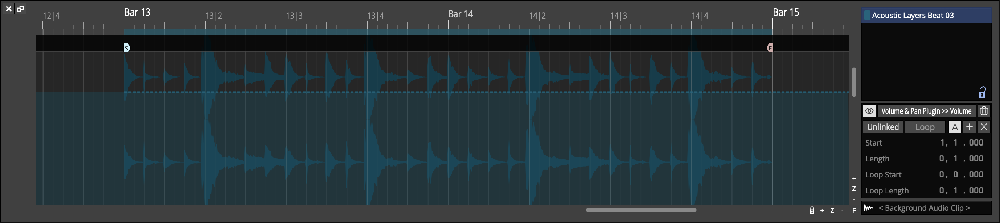

*Clip automation in the Detail Editor*

With the clip selected, the editor shows its contents against the Edit's timeline. (Clip launcher clips are always shown relative to time 0.) Turn on the eye button in the clip automation controls to show the automation editor; the clip's contents dim.

Next, choose the plugin and parameter to automate from the box next to that eye button. If the curve has no automation yet, a dashed line shows the parameter's current value.

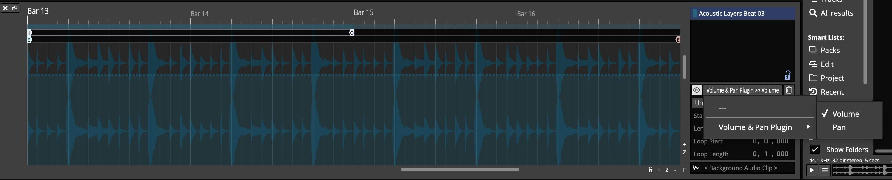

*Choosing the parameter to automate*

With the **Absolute** curve selected and the **Unlinked** button off, add points to the curve to set the parameter's value. If the clip is looped, the looped region appears under the time bar, along with the clip's start and end points on the timeline.

Draw a simple ramp, for example, and the automation line ramps down and stays low, while the shaded area in the looped region shows the automation's value each time the clip loops.

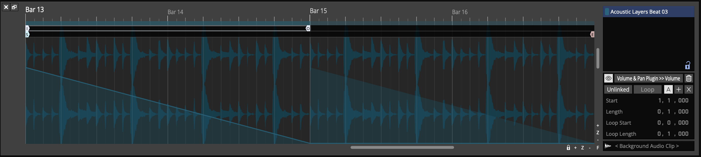

*A ramp in a looped clip*

The cursor here shows the position in the automation that's being read, rather than the position on the overall timeline, which helps you work out which points play when.

To remove all automation curves from this clip for the parameter being shown, click the trash can button to the right of the parameter selector button.

#### Linked/Unlinked Mode

In linked mode (**Unlinked** button off), the curve's start, length, loop start and loop length are tied to the clip. They're shown under the time bar, but you can't edit them, and the properties to the right of the curve editor are greyed out.

In unlinked mode, these properties are separate from the clip. Turn on **Unlinked** to edit the start and length with the timecode properties, or by dragging the start and end flags below the timeline.

The **Loop** setting is also separate from the clip's own loop setting. Turn it on to edit the loop start and end properties and drag the loop in and out flags on the timeline. There's no end flag in looped mode, because the automation carries on until the clip ends.

Each curve type has its own **Unlinked** setting and properties.

#### Curve Types (Absolute/Relative/Scale)

There are three types of curve:

- **Absolute**: Controls the base value of the parameter, overriding any track automation that might be present.
- **Relative**: Modifies the base value of the parameter by shifting it up or down 50%.
- **Scale**: Modifies the base value of the parameter by scaling 0-100%.

Because each curve has its own timing, a few points go a long way. For example, a single absolute point creates a straight line:

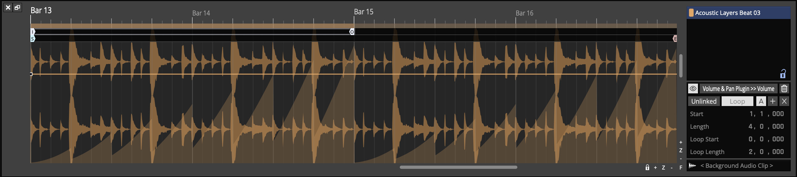

*A single Absolute point*

A short relative loop creates a repeating ramp:

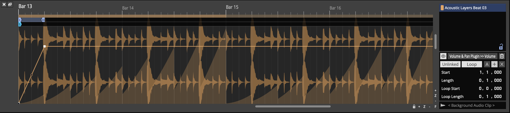

*A short Relative loop*

A longer scale ramp controls the peak of each relative loop:

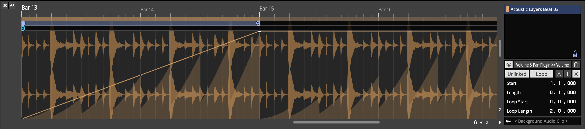

*A longer Scale ramp*

The result is the repeating one-beat ramp in the filled section of the editor.

#### Curve Editing

You edit clip automation curves the same way as track automation curves.
Select a range to show the curve edit handles in its corners, and drag them to shift or skew the points in the range.

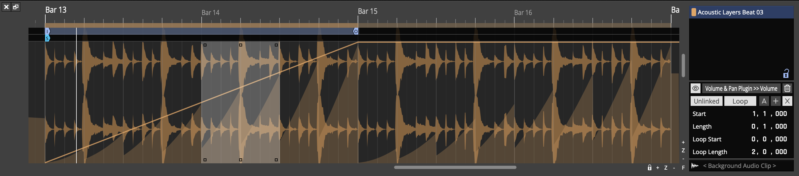

*Curve edit handles*

Right-click the curve for a menu to delete, copy or paste points. What it offers depends on whether a range is selected.

The same menu's *Insert automation shape* adds a ready-made shape such as a sine, saw or square, repeated a set number of times or at a musical interval.

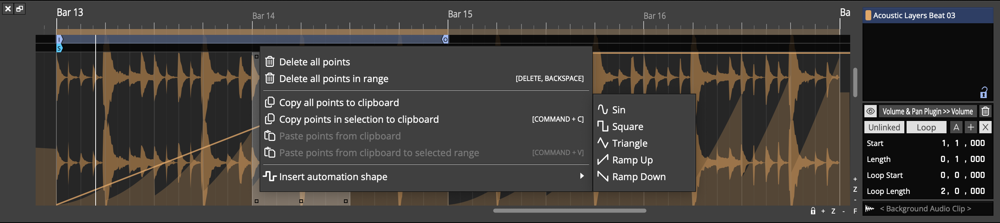

*The curve's right-click menu*

## Automation Patterns

You can fill the range between the In marker and the Out marker with a
repeating automation pattern.

1.  Create an automation curve for the parameter you want to modulate. This
    example uses a simple volume curve.
2.  Set the In marker and Out marker over the range you want the pattern to
    fill.

    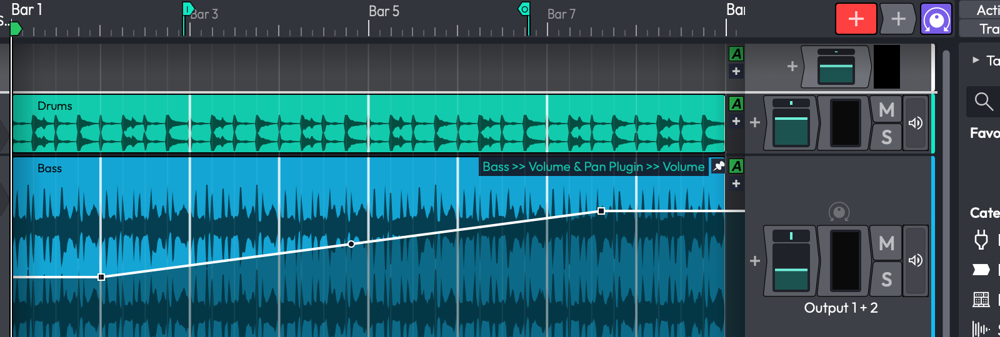

    *Volume Automation Between In Marker and Out Marker*

3.  Select the automation curve, then in the Actions panel click **Create
    Pattern Between the Marked Region**.

    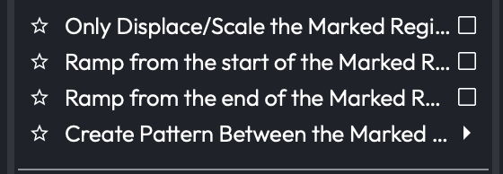

    *Create Pattern Between the Marked Region*

4.  Choose a pattern shape. This example uses *Triangle*.

    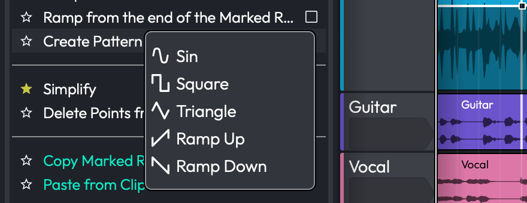

    *Select the Pattern Shape*

5.  Choose a note division or a number of repeats. Here, *1/2 beat* repeats
    the pattern every 1/8th note.

    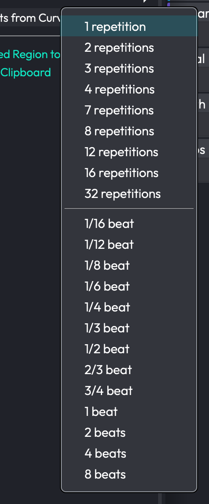

    *Select Beat Division or Repetitions*

    The result looks like this:

    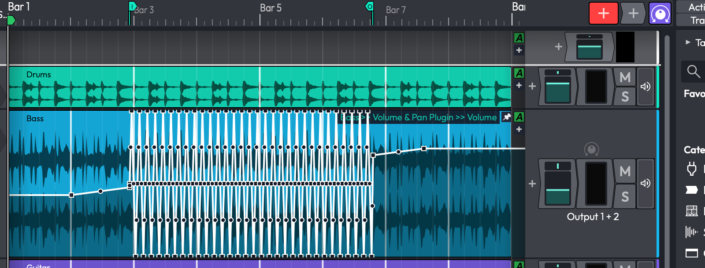

    *Repeating Triangle Automation*

6.  Adjust the curve with the **Displace Curve** and **Scale Curve** drag
    controls, or edit the automation points in the usual way.

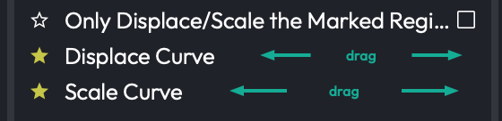

*Displace and Scale Curve Controls*

The other pattern shapes look like this:

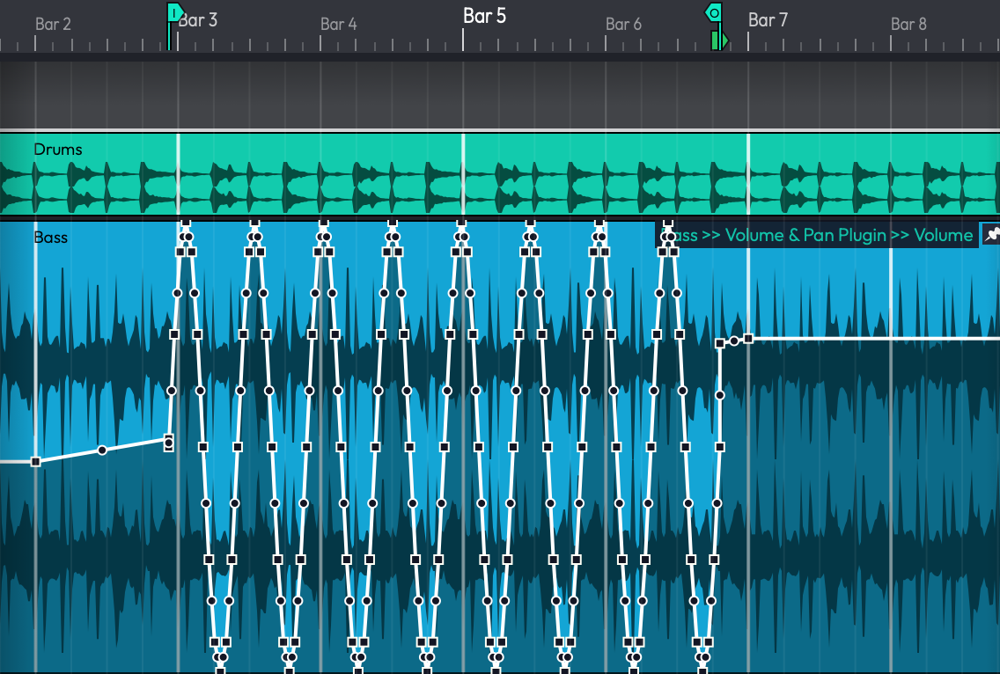

*Sine Wave*

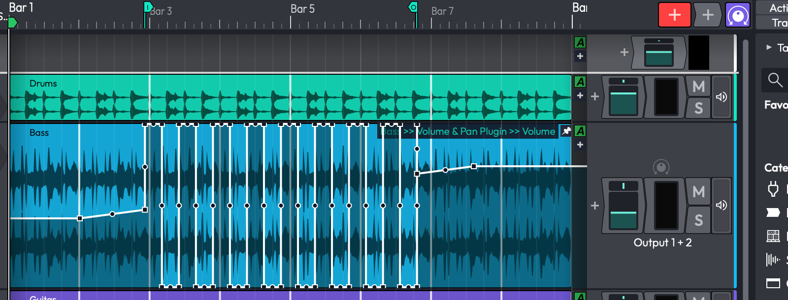

*Square Wave*

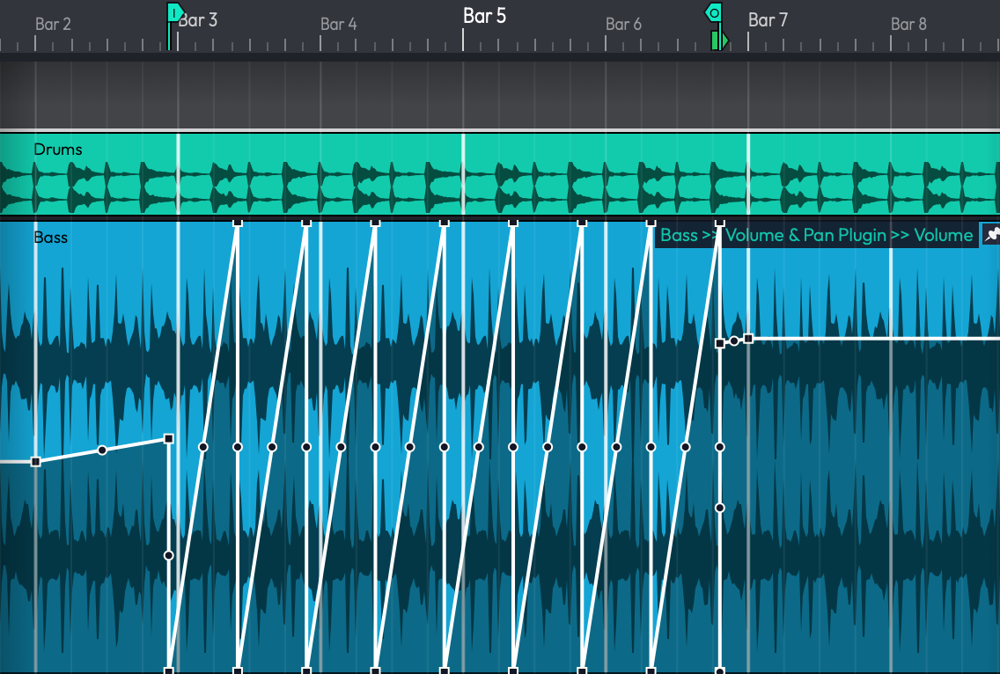

*Ramp Up*

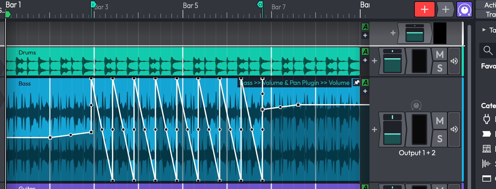

*Ramp Down*

## Automation Ramps

Automation ramps go hand in hand with patterns: they let you raise or lower
a pattern's intensity over time. The two **Ramp** options change how the
**Displace Curve** and **Scale Curve** controls work across the marked region.

To ramp a pattern in:

1.  Set the In marker and Out marker over the part of the automation you want
    to ramp in.

    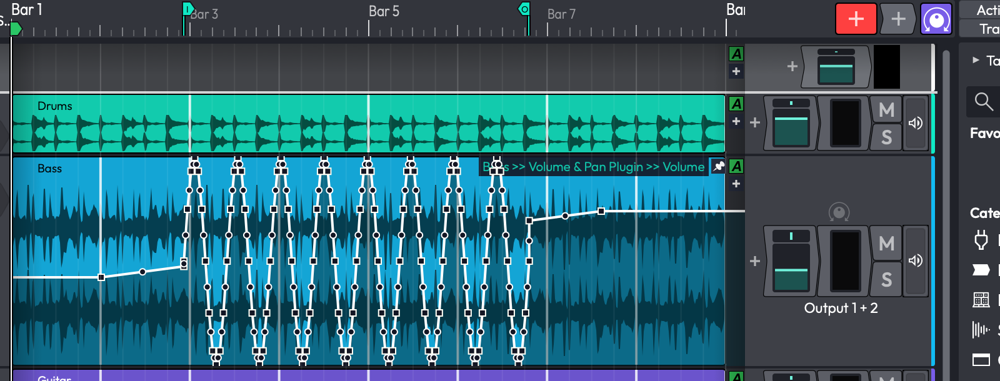

    *Selected Region of an Automation Pattern*

2.  Click the automation curve to select it.
3.  In the Actions panel, click **Ramp from the start of the Marked Region**
    to turn the ramp on.

    

    *Enable Ramp from the start of the Marked Region*

4.  Drag the **Displace Curve** and **Scale Curve** sliders in the Actions
    panel. They now affect the left side of the curve, so you can fade the
    pattern in.

*Taper the Curve Using the Displace Curve and Scale Curve Sliders*

**Ramp from the end of the Marked Region** works the other way round, so you
can taper the automation down.

*Ramp from the end of the Marked Region*

> 💡 **Tip:** The automation ramps also work with the Volume & Pan Clip Layer
effect. See [Clip Layer Effects](clip-layer-effects.md).

**Video Clip:** This [video clip](https://youtu.be/koDUoO3XD-0) demonstrates
the automation ramps.

## Moving On

You can automate almost any parameter, including sends and the master
plugins: click the A button and choose from *Master parameters*, or drag the A
onto a plugin on the Master track. For parameters that move on their own
without drawn automation, see [Modifiers](modifiers.md).
