# Automation

This chapter is an introduction to the automation features in Waveform.
Automation allows you to program changes to many of the parameters that
exist within a track. You can easily program changes to volume, pan, and
plugin parameters. You can program automation using external hardware,
like controllers that have knobs and faders. Alternatively, you can
program automation by adding points and changing the shape of the
graphic automation curve that appears as a line on or below the track.

Waveform has excellent features designed to keep all of your automation
nicely organised. For example, you can add automation tracks that nest
under your track. You can also open them when you're working on
automation changes and edits, and then close them when you move onto
other parts of your project.

In this chapter, we're going to focus on Volume & Pan automation and
then offer an example of how to extend automation to parameters within
other plugins.

## Activating Automation on a Track

The keys to automation are the A icon and the 'plus' icon that reside at
the far right of each track.

*The A and Plus Automation Icons*

The first step is to click the plus sign. It opens a menu:

- *Add a new automation track with this parameter: X* adds an automation
  track showing X, the parameter the track is currently showing.
- *Add an empty automation track* adds an automation track with no parameter
  chosen yet.
- *Add automation tracks for each active parameter on this track* adds one
  automation track for every parameter on the track that already has
  automation.
- *Active parameter curves for this track* lists the parameters that have
  automation. Pick one to add an automation track showing it.

Shift-click the plus sign to add an empty automation track straight away. It
appears below your original track, with minus, A, and plus icons.

*Track with One Automation Track*

The minus icon will remove the automation track, the A icon allows you
to set up the track, and the plus icon will add yet another automation
track below this one.

To colour an automation track, right-click its header and pick a colour from
the colour strip in the menu.

### Pinning the Shown Curve

When showing automation on an *audio* track (i.e. not an *automation* track), you will see a pin button next to the A button. When this pin is disabled, the displayed curve on this track will change when a plugin parameter changes. This can make it much quicker to show the relevant curve as you can just unpin the current curve, move the parameter in the plugin's UI and the curve will change. If you want to keep this curve visible you can either pin it or click the A button and choose to move it to a dedicated automation track.

*Unpinned*

*Pinned*

## Choosing What to Automate

For this example, we're going to automate volume on the track. To do
that, click the A icon. Then select the menu item, *Automatable
parameters for this track > Volume & Pan Plugin > Volume*.

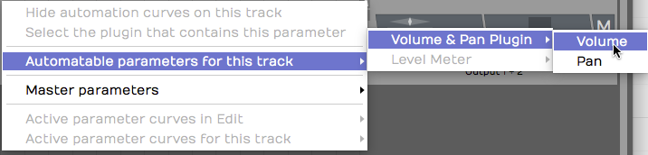

*Select the Parameter to Automate*

You'll see an automation line appear. The line is labelled with the name
of the parameter, and the value of the parameter is listed over on the
right. This line is the "automation curve." There's no literal curve to
it yet, because it's just a line. As you will see shortly, it's easy to
draw curves, steps, and ramps.

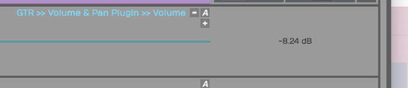

*The Automation Curve Line*

Click the curve to select it, and the Actions panel shows the curve's
name and its actions. Those make more sense once you have some automation
points on the curve.

*The automation curve in the Actions panel*

> 💡 **Tip:** A fast way to set the automation parameter for the track is to
grab the A icon and just drop it on the thing you would like to
automate. Then choose the parameter from the list. So, to automate
panning, drag the A and drop it on the Volume & Pan plugin and then
choose *Pan* from the list. This also works for third party plugins.

### The A Button Menu

Clicking the A icon opens a menu of everything the track can show:

| Entry | What it does |
| --- | --- |
| *Show automation curves on this track* | Shows the track's volume curve again when no curve is shown |
| *Hide automation curves on this track* | Hides the curve the track is showing |
| *Select the plugin that contains this parameter* | Selects the plugin that owns the shown curve, so its controls appear in the Actions panel |
| *Automation mode* | Sets the track's automation mode (see [Automation Modes](#automation-modes) below) |
| *Automatable parameters for this track* | Every parameter on the track, grouped by plugin, plus the track's *Macros* and *Modifiers* submenus |
| *Rack plugins* | Each rack in the Edit, with its *Macros*, *Modifiers* and *Faceplate* controls and the plugins inside it |
| *Master parameters* | The master volume and pan, the master plugins and the Edit's macros |
| *Active parameter curves in Edit* | Every parameter in the Edit that already has automation |
| *Active parameter curves for this track* | The parameters on this track that already have automation |

Choosing a parameter shows its curve on the track. For the parameters these
submenus lead to, see [Macro Parameters](racks.md#macro-parameters),
[Modifiers](modifiers.md) and [Faceplates](faceplates.md).

## Adding Points to the Automation Curve

To give your automation curve some shape, you need to add some points on
it. Add points with either double-click or Opt-click / Alt-click. Here
is how to work with the automation points.

### Creating a Ramp

To draw a ramp, add two points and then drag one of them up or down. This
adjusts the steepness of the ramp. Drag the points left or right to adjust
the start and end of the ramp.

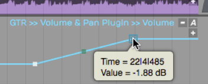

*Drawing an Automation Ramp*

### Shaping with Curvature

To shape the line segment between two points, use its curvature point. A
curvature point is automatically inserted midway between two automation
points. Adjust the curvature by dragging it diagonally.

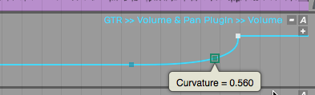

*Adjusting a Curvature Point*

> 💡 **Tip:** The automation point can also be adjusted in the Actions panel
using the **Value** slider. You will also find a slider for
**Curvature** there.

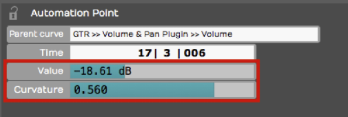

*Value and Curvature in the Actions panel*

### Drawing an Automation Step

Insert two points that define the position of the step. Hold down
Cmd / Ctrl and drag the line segment between the points up or down.
You'll see that the line segment moves separately from the overall
automation curve, which draws a step shape on your automation. Without
Cmd / Ctrl, dragging a line segment moves its two end points, pulling the
neighbouring segments with them.

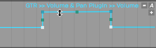

*Hold Cmd / Ctrl to Draw a Step*

### Editing Points

- **Delete a point**: double-click it, or Opt-click / Alt-click it.
- **Move a point and every point after it**: Cmd + Shift-drag / Ctrl +
  Shift-drag the point left or right. This slides the rest of the curve in
  time without changing any values.
- **Move a point along one axis only**: hold Shift while you drag it, and the
  point keeps either its time or its value, whichever you moved less.
- **Select a run of points**: select one point, then Shift-click another to
  select every point between them.
- **Add or remove a point from the selection**: Cmd-click / Ctrl-click it.

## Editing Automation

If you select a range in a track showing automation, the automation edit handles will appear. You can drag the centre handles to shift or scale all the existing points, or the handles in the corners to shift or scale the points anchored from one of the ends. This allows you to quickly adjust many points or add musical effects like ramps.

*Automation edit handles*

With a range selected you can also right-click and choose *Insert automation shape* to create a shape within the range. Once the shape is chosen, you can choose the number of repetitions, either a specific number to fit inside the range or the shape repeating at a musical period.

*Inserting an automation shape*

You can combine shape inserting with the scale/offset handles to quickly create interesting and rhythmical patterns.

*An inserted shape adjusted with the edit handles*

## Automating Fade-ins and Fade-outs

To program a fade shape with automation, add a point where you'd like
the fade to start, then add another point where you'd like the fade to
end. Drag the second point all the way down until the value reads zero.
Adjust the speed of the fade by dragging the curvature point down to the left
for a quicker fade or up to the right for a more gradual fade. Of course, you
always have the option to adjust those parameters directly in the Actions
panel.

If you automate a folder track's VCA fader, the fade applies to every track
inside it. See
[Automating a Fade within a Folder Track](folder-tracks.md#automating-a-fade-within-a-folder-track).

## Converting a Clip Fade-in or Fade-out to Automation

You can apply fade-ins or fade-outs to Audio clips with the fade handles on
the upper left and right corners of the clip (see
[Fade-in/Fade-out](audio-clips-and-editing-audio.md#fade-infade-out)). If
you'd like more control over the fade shape, you can convert a clip-level
fade to an automation curve.

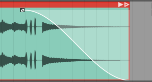

*Clip Fade*

To convert a clip fade to automation, first select the clip, then click
**Fade to Automation** in the Actions panel and choose *Transfer Fade-in to
Automation* or *Transfer Fade-out to Automation*.

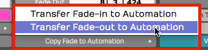

*Fade to Automation*

That will redraw the automation curve in the shape of the fade and
remove the clip fade from the clip. Now you can apply additional points
and shaping using the automation tools.

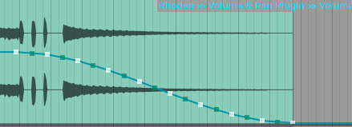

*Result of Fade to Automation*

## Reading Automation

Once you've drawn automation like this, Waveform performs the automation
dynamically during playback, as long as you have the **Read** button
enabled in the transport bar.

*Read Enabled*

As you playback, watch the controls changing in real time as the cursor
moves through the Edit. If you go back about three decades that feature
would cost you about a million bucks!

## Automation Curve Actions

The automation curve has several of its own controls. Click on the
curve to select it and look at the Actions panel. Here is a rundown of the
controls.

*The automation curve in the Actions panel*

**Curve**: The name that appears above the automation curve. It is here for
reference only and you can't change it directly. It is made up of the track
name, the plugin name and the parameter.

**Curve Enabled**: Allows you to disable the curve. A disabled curve has no
effect on the parameter, so you can use it to quickly test what effect the
automation is having. A disabled curve shows greyed out in the track. If you
write automation in touch or latch mode, the curve is enabled again.

*A disabled automation curve*

**Displace Curve**: Drag left or right to offset the whole curve down or up.
It takes the entire programmed curve and set of points and moves them down if
you drag left, or up if you drag right. This is useful for minor mix changes
after the automation is already programmed.

**Scale Curve**: Works like an intensity control. Dragging to the left
proportionately lowers all of the points on the curve, squashing its shape.
Dragging to the right expands the curve, scaling it upward.

**Only Displace/Scale the Marked Region**: Works along with **Displace Curve**
and **Scale Curve**. When enabled, scaling and displacing only happen between
the In marker and the Out marker.

**Simplify**: If your automation curve becomes very complex, with lots of
points, use **Simplify** to thin them out. Choose *Simplify the entire curve*
and then pick from *Light*, *Medium* and *Strong*. *Light* does the least
thinning and *Strong* the most. This is particularly useful if you recorded
automation from a hardware controller that added hundreds of points.

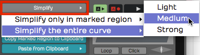

*Automation Curve Simplify*

You also have the option to *Simplify only in marked region*. Use this to
simplify just a section that was recorded from hardware, leaving the rest of
the curve unchanged.

**Delete Points from Curve**: A set of options for resetting the automation
curve. If you delete all points from the curve, you've taken it back to a flat
line. Sometimes this leaves the automation value very low, so you might need
to drag the curve line back to a good starting position. You can also
*Delete points within the marked region*, which deletes all the points between
the In marker and the Out marker. You can do the same thing and "close the
gap", which also takes out the time within the marked region.

**Copy Marked Region to Clipboard**: Set the In marker and the Out marker over
a region of automation and click **Copy Marked Region to Clipboard** to copy
that region of the curve. Then position the cursor at the destination and
choose **Paste from Clipboard** > *Paste curves at cursor position* to paste
the automation. This makes it fast to create repeating patterns of
automation, or to reproduce a specific effect in a later part of the song.

**Paste from Clipboard**: Has two options. *Paste curves at cursor position*
is the usual choice, and you can also do it with Cmd + V / Ctrl + V.
*Paste curves to fit between in/out markers* fits the pasted curve inside the
marked region.

> 💡 **Tip:** You don't need to manually copy automation when moving or
duplicating clips on a track. Enable **Auto Lock** in the transport bar
and the automation follows along as you move or duplicate clips.

## How to Find Out What Automation Is Active for a Track { #how-to-find-out-what-automation-is-active-for-a-track }

It's pretty easy to program a lot of automation, but sometimes you don't
have all of the automation curves visible. To see which ones are
available click the A icon and select *Active parameter curves for this
track*. This shows all automation curves for the track and you can
choose which one to make visible.

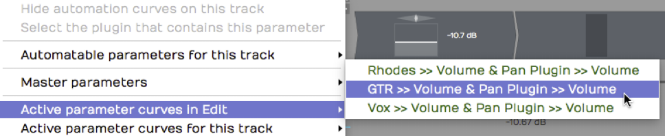

*Active Parameters for a Track*

This is particularly helpful if you don't have each parameter on a
separate automation track.

## Remap on Tempo Change

Each plugin has a **Remap on Tempo Change** setting. For third-party plugins,
racks and some built-in plugins (such as Volume & Pan) it's a toggle in the
plugin's Actions panel; for the other built-in plugins it's an item in the
menu on the plugin window's title bar. With it enabled, the plugin's
automation follows tempo changes: it gets shorter if you speed up the tempo
and longer if you slow it down, so it stays lined up with the clips in your
Edit. It's off by default, so you turn it on for each plugin.

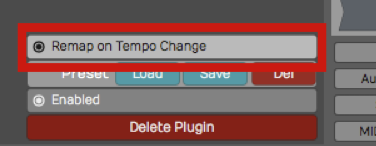

*Remap on Tempo Change*

> 💡 **Tip:** To turn **Remap on Tempo Change** on for all new Edits, make
it a global default. To do so, go to *Settings > General*, click
**Set defaults** on the **Tempo change remapping** row and enable *Remap
plugin automation*.

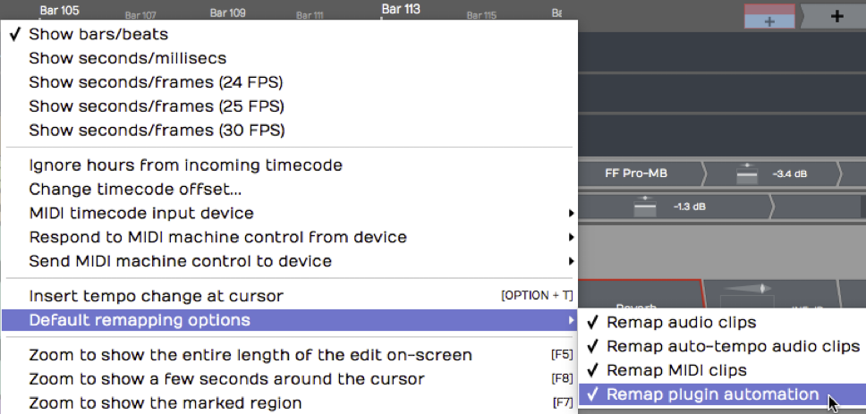

*Make Remap the Default*

> 📝 **Note:** *Remap plugin automation* is not turned on by default, to
maintain compatibility with older projects.

## Writing Automation on the Fly

During playback, you can adjust a parameter in real time and have
Waveform record it as automation. You can do this with a MIDI
controller, or simply by manipulating plugin controls on-screen during
playback. All you need to do is set up your automation track and enable
the **Write** button in the transport bar.

*Write Enabled*

To go into write mode, enable the **Write** button in the
transport bar. Now, during playback, Waveform will record any dynamic
changes you make to the parameter.

*Automation from Write Mode*

> 📝 **Note:** You don't need to be in Record mode to record automation
changes. All you need is to have automation write turned on during
playback.

> 💡 **Tip:** Waveform already simplifies newly written automation
(*Settings > Advanced > Automation > Simplify newly-recorded automation*, on by
default; see [Reference: Settings](reference-settings.md#automation)). Use
**Simplify** again if you want it thinner. The *Medium* option is a good
starting point.
The **Glide** setting on the same page sets how long newly written automation
takes to cross-fade into the curve that was already there.

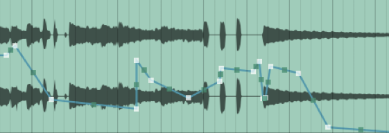

*Automation with Medium Simplification*

### Automation Modes

Each track has several different automation modes it can be in. These can be set from the A button and the *Automation mode* submenu. The A button on the track will change colour based on the current mode.

*The Automation mode submenu*

**Read**: In read mode automation is only read. The **Read** button in the transport bar must also be enabled. If it is not, the A button is greyed out to show automation won't be read.

*Read mode*

**Touch**: In touch mode, automation is written while the parameter is actively being used. This usually means while the mouse is down on a control or an external controller is being touched.

*Touch mode*

**Latch**: In latch mode, automation is written from the time a parameter is first changed. If the mouse is then lifted, whatever the last value written was will overwrite any points on the curve until playback is stopped.

*Latch mode*

**Write**: In write mode, automation is continuously written. This can be dangerous, as as soon as you start playback, whatever value the parameters have will overwrite the existing automation. Prefer touch or latch mode.

*Write mode*

> 📝 **Note:** For modes that enable writing (touch/latch/write), the **Write** button in the transport bar must also be enabled. If it is not, the A buttons are greyed out to show automation won't be written.

> 💡 **Tip:** When a track has a parameter that is being written, the track's A button and the global automation write button will flash to indicate this.

## Automation Lock

Notice in the transport bar, there is an **Auto Lock** button. By default
that button is not engaged. If you move a clip around on a track, the
automation will not follow it to the new position.

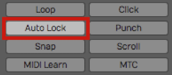

*Automation Lock Engaged*

With **Auto Lock** engaged, automation will follow as you drag the clip to
a different place in time. It's a great feature, assuming that's what
you want to do.

## Clip Automation PRO { #clip-automation }

> 📝 **Edition:** Waveform Pro, or with the Recording Engineer Expansion, the
> MIDI Producer Expansion or the Launcher Expansion.

You can also add automation curves to specific clips. These can control parameters from clip, track or master plugins within the clip's scope (i.e. not a parameter from a plugin on a different track to the clip).

These curves are slightly different to track automation curves in that they are always played back relative to the clip (i.e. they move with the clip) and there are actually three separate curves to control the parameter: absolute, relative and scale.

Using a combination of these curves and different timing settings you can quickly create complex and rhythmic patterns. We'll go through the settings next.

### The Clip Automation Editor

The clip automation editor is part of the clip's view in the
[Detail Editor](detail-editor.md). Open it with *View > Show Content Editor*,
the eye button, or by double-clicking the clip. If you don't see the clip
automation properties above the **Background Audio Clip** property, increase
the height of the panel.

*Clip automation in the Detail Editor*

With the clip selected, you should see its contents in relation to the Edit's timeline. (Clip launcher clips are always relative to time 0.) Make sure the eye button in the clip automation controls is enabled to show the automation editor. The clip's content will dim.

Next, select the plugin and parameter you want to automate from the box next to that eye button. If there is no automation on the curve already, you'll see a dashed line indicating the parameter's current value.

*Choosing the parameter to automate*

If the **Absolute** curve is selected and the **Unlinked** button disabled, the value of the parameter can be set by adding points to the curve. If the clip is looped, you'll see the looped region under the time bar along with the start/end points of the clip on the timeline.
If you make a simple curve like a ramp, you'll see the automation line ramp down and stay low, but in the looped region the shaded area shows the value of the automation once the clip loops.

*A ramp in a looped clip*

The cursor here shows the position of the automation being read rather than the overall timeline, which can be useful when working out which automation points correspond to which time.

To remove all automation curves from this clip for the parameter being shown, click the trash can button to the right of the parameter selector button.

#### Linked/Unlinked Mode

In "linked" mode (**Unlinked** button disabled), the start/length and loop start/length properties of the curve are tied to the clip. You can see these indicated under the time bar but can't edit them. The properties to the right of the curve editor are also greyed out.

In "Unlinked" mode, these properties are separate from the clip. Enabling **Unlinked** allows you to edit the start/length with the timecode properties or by dragging the start/end flags below the timeline.

The **Loop** setting is also separate from the clip's loop setting and can be turned on/off. If enabled the loop start/end properties are editable and the loop in/out flags can be dragged in the timeline. There is no "end" flag in looped mode as automation will continue until the clip ends.

The **Unlinked** mode and corresponding properties are separate for each automation curve type.

#### Curve Types (Absolute/Relative/Scale)

There are three types of curve that can be programmed:

- **Absolute**: Controls the base value of the parameter, overriding any track automation that might be present.
- **Relative**: Modifies the base value of the parameter by shifting it up or down 50%.
- **Scale**: Modifies the base value of the parameter by scaling 0-100%.

Having these three curves, each with different timing information, means you can create complex patterns using very few points. For example, a single absolute point creates a straight curve:

*A single Absolute point*

A short relative loop creates a repeating ramp:

*A short Relative loop*

A longer scale ramp controls the peak of each relative loop:

*A longer Scale ramp*

The result is the 1 beat repeating ramp you can see in the filled section of the editor.

#### Curve Editing

Clip automation curves can be edited in the same way as track automation curves.
Selecting a range shows the curve edit handles in the corners which can be dragged to shift or skew the points in the range.

*Curve edit handles*

Right-clicking the curve opens a menu where points can be deleted, copied or pasted. The options available depend on whether a range is selected.

Finally, you can use *Insert automation shape* to create pre-defined shapes such as sine, saw or square, repeating a number of times or at a musical interval.

*The curve's right-click menu*

## Automation Patterns

Waveform lets you quickly create repeated automation patterns between
the In marker and the Out marker.

1.  To get started, create an automation curve for a parameter you would
    like to modulate. In this example we are using a simple volume
    curve.
2.  Then, set the In marker and Out marker over the range to which you
    want to apply the pattern.

    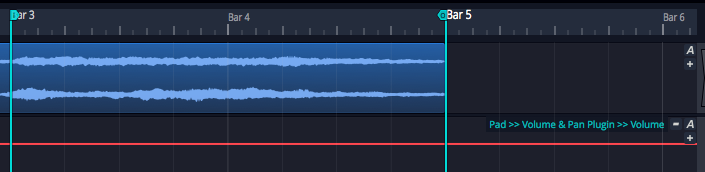

    *Volume Automation Between In Marker and Out Marker*

3.  Select the automation curve, then in the Actions panel click **Create
    Pattern Between the Marked Region**.

    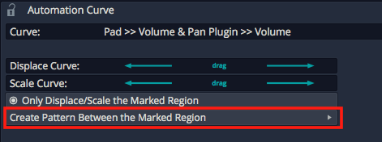

    *Create Pattern Between the Marked Region*

4.  Next, choose from the various pattern shape options. For this
    example we chose *Triangle*.

    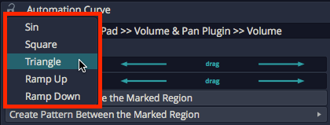

    *Select the Pattern Shape*

5.  Choose a note division for the pattern or number of repeats. In
    typical Waveform fashion, we chose *1/2 beat* in order to repeat the
    pattern every 1/8th note.

    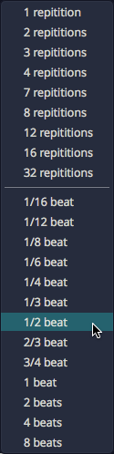

    *Select Beat Division or Repetitions*

    Here is the resulting automation.

    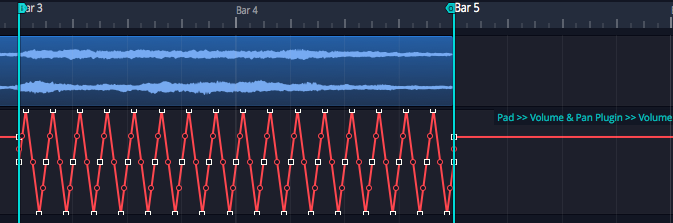

    *Repeating Triangle Automation*

6.  Adjust the curve using the **Displace Curve** and **Scale Curve** drag
    controls or by editing the automation points in the usual way.

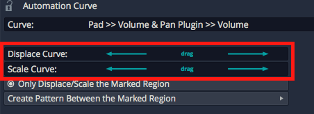

*Displace and Scale Curve Controls*

Here are examples of the other automation pattern shapes:

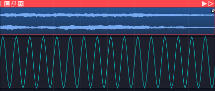

*Sine Wave*

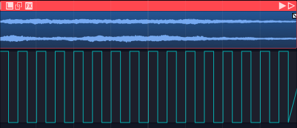

*Square Wave*

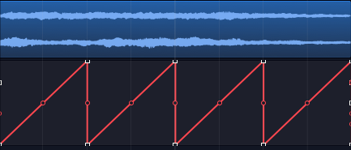

*Ramp Up*

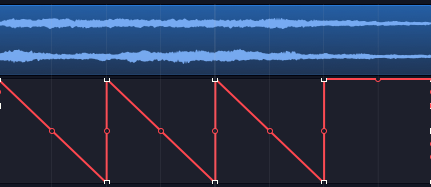

*Ramp Down*

## Automation Ramps

As a companion to automation patterns, Waveform allows you to ramp
patterns up or down in a very simple and effective way. This works in
conjunction with patterns to allow you to increase or decrease the
intensity of a pattern over time. The two **Ramp** options work as
modifiers to the existing **Displace Curve** and **Scale Curve** controls.

Automation ramps are best explained with an example:

1.  Set the In marker and Out marker over a segment of automation you
    would like to ramp in.

    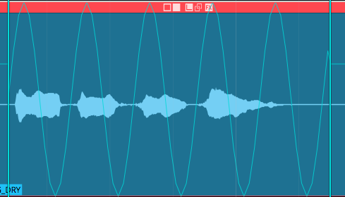

    *Selected Region of an Automation Pattern*

2.  Click on the automation curve to select it.
3.  In the Actions panel, click **Ramp from the start of the Marked Region**
    to enable the ramp behaviour.

    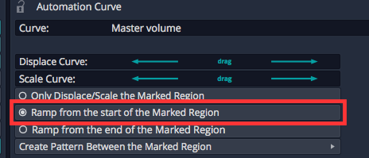

    *Enable Ramp from the start of the Marked Region*

4.  In the Actions panel, manipulate the **Displace Curve** and **Scale
    Curve** sliders. Notice how these affect the left side of the curve
    allowing you to fade in the automation pattern.

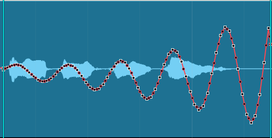

*Taper the Curve Using the Displace Curve and Scale Curve Sliders*

The companion **Ramp from the end of the Marked Region** allows you to
taper automation down.

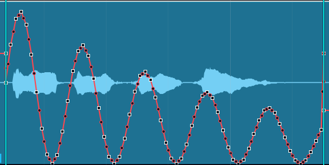

*Ramp from the end of the Marked Region*

These features are easy to miss at first glance, but they provide
tremendous creative potential when programming automation.

> 💡 **Tip:** The automation ramp features are also available when working
with the Volume & Pan Clip Layer effect, which is explained in
[Clip Layer Effects](clip-layer-effects.md).

**Video Clip:** Here is a [video clip](https://youtu.be/koDUoO3XD-0)
that demonstrates the automation ramp modifiers.

## Moving On

There is a lot more you can do with automation, because you can automate
almost any parameter. You can automate sends to effects. You can even
automate your Master plugins: click the A button and choose from *Master
parameters*, or drag the A onto a plugin on the Master track.
