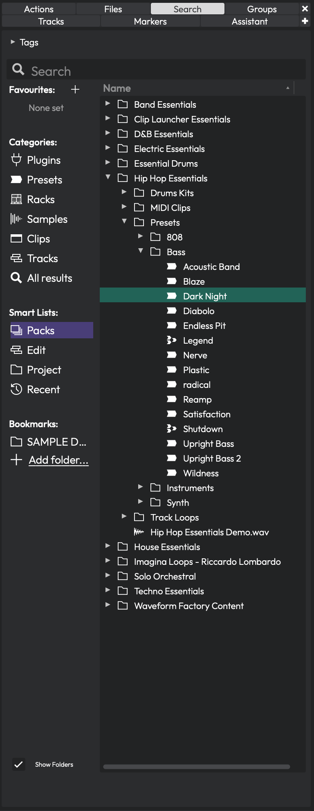
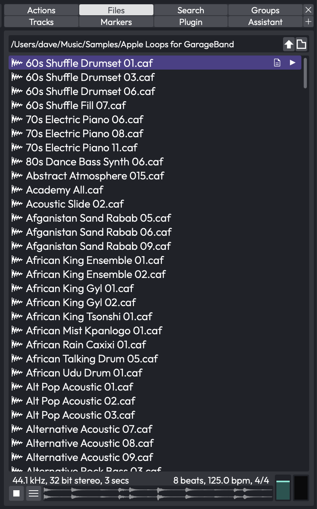
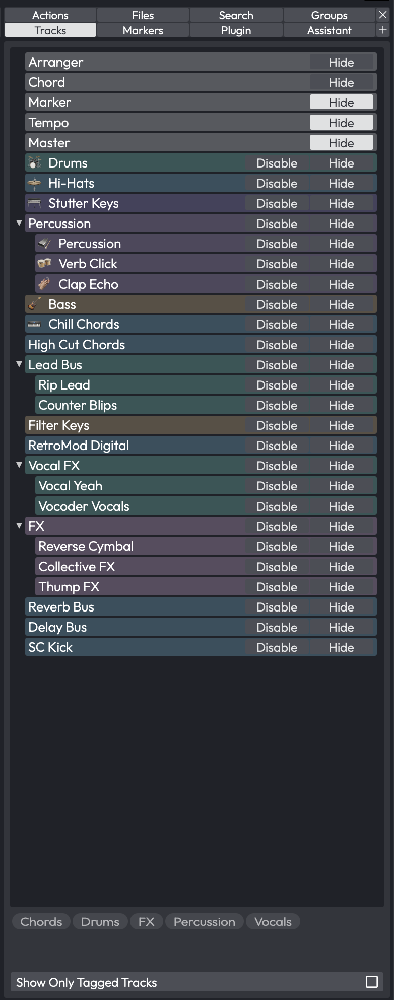
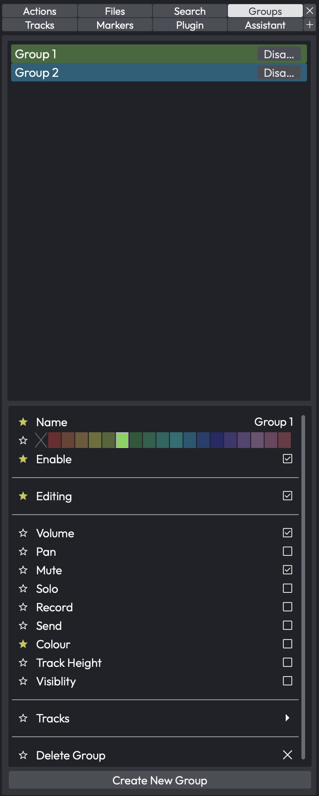

# The Browser

The Browser is the tabbed panel at the side of the Edit tab (on the right by default). Its **Search** tab finds and previews plugins, presets, samples, clips and tracks, and most of this chapter describes it. The Files, Tracks and Groups tabs are covered at the end.

*The Search tab of the Browser showing Packs content with folders expanded. The category list on the left lets you filter by category, and the results area on the right displays matching items in a tree view.*

## Opening the Browser

If the Browser is not visible, choose *View > Show Browser* from the main menu or press B. Click a tab at the top of the Browser to switch to it. To move the Browser to the left, right or top of the window, change **Browser position** in *Settings > Appearance*.

The Browser's other tabs are covered elsewhere: **Actions** in [The Actions Panel](actions-panel.md), **Markers** in [Using Markers](using-markers.md), **Plugin** in [The Plugin Panel](plugin-side-panel.md) (you can hide it with **Show Plugin panel in browser** in *Settings > Plugins*), and **Assistant** in [The AI Assistant](ai-assistant.md). The Search, Files, Tracks and Groups tabs are described below.

## The Search Tab

Click the **Search** tab at the top of the Browser to search your library. It has a tags bar and a search box at the top, the category list on the left, the results area to the right of the category list, and the preview area at the bottom.

### Tags

At the very top of the Search tab is a collapsible **Tags** bar. Tags are labels attached to your samples, presets and other library content, and they let you narrow down results without typing a search.

Drag the divider just below the tags area to resize it, or drag it all the way up to hide the tags. The tags shown depend on the current results, so you only see tags that apply.

> 💡 **Tip:** If you use tags a lot, keep the tags bar open and give it some height, so you can combine a tag with a category. For example, select **Packs** in the category list and then click a "Bass" tag.

### The Search Box

Below the tags bar is the **Search** box. Type here to filter the results within whatever you have selected in the category list. The results update as you type, so you don't need to press Enter. A spinning icon shows while results are being fetched; with thousands of samples, the first search or category you open can take a moment.

> 💡 **Tip:** Press Return while the Search tab has focus to restart the preview of the selected item, so you can listen again without reaching for the mouse.

### The Category List

The category list runs down the left side of the Search tab, in four sections. Only one item can be selected across all four sections at a time, so clicking an item in one section deselects any item in the others.

#### Favourites

The **Favourites** section shows the tags you have marked as favourites, so your most-used tags are one click away. If you haven't set any, it shows "None set."

To add a favourite, click the **+** button next to the Favourites heading. A menu lists all the available tags: click a tag to add it, and click it again to remove it. Favourite tags show a filled colour dot next to their name.

Right-click any favourite tag for two options:

- **Remove from favourites**: removes the tag from this list
- A colour picker that gives the tag its own colour, so it stands out in both the category list and the results list

When you select a favourite tag, the results area shows all content tagged with that label.

#### Categories

The **Categories** section lets you filter by content type. The available categories are:

- **Plugins**: all installed audio plugins (VST, AU, etc.)
- **Presets**: plugin presets
- **Racks**: rack presets
- **Samples**: audio and MIDI files in your libraries
- **Clips**: clip presets
- **Tracks**: track presets
- **All results**: everything, unfiltered by type

Each category has its own icon. When you first open the Search tab, **All results** is selected.

#### Smart Lists

**Smart Lists** show content based on what you're working on:

- **Packs**: the content packs you have installed, which are the bundled and downloadable sound libraries
- **Edit**: all the assets used in the open Edit. When this is selected, a **Consolidate** button appears at the bottom, which copies any external files into the project folder
- **Project**: all the assets in the current Project. When this is selected, a **Consolidate Project** button appears
- **Recent**: recently used items

> 💡 **Tip:** Check the Edit and Project smart lists before you share an Edit. If the **Consolidate** button is active, some files live outside the project folder and could go missing if you move the Project.

#### Bookmarks

The **Bookmarks** section holds folders on your computer that you want to reach quickly. Click **Add folder...** at the bottom to pick a folder and bookmark it.

Select a bookmark to show that folder's contents in the results area. To remove one, right-click it and choose **Remove Bookmark**.

> 💡 **Tip:** Bookmark your sample library folders, loop collections and any other folders you often pull sounds from.

### The Results Area

The main area of the Search tab shows your results in a tree view. Depending on what you selected in the category list, you see either a folder hierarchy or a flat list of items.

#### Columns

The results header can display up to five columns:

- **Name**: the item name, shown with a type-specific icon (waveform for audio, MIDI icon for MIDI files, plugin icons, etc.)
- **Tags**: any tags assigned to the item
- **Location**: the file path on disk
- **Size**: the file size
- **Date**: the creation date

Click a column header to sort the results by that column, and click it again to reverse the order.

#### Show Folders Toggle

At the bottom-left of the Search tab, below the category list, is the **Show Folders** checkbox. (Default: on)

- **On**: results are shown in their folder hierarchy, with expandable folders
- **Off**: results are shown as a flat list, which can be easier to scan when there are a lot of items

#### Browsing and Selecting

Click any item in the results list to select it. The preview area at the bottom shows information about the item and, if **Auto-play** is on, starts playing it.

Double-click an item to insert it into your Edit at the current insert point. For audio and MIDI files, this creates a new clip. For plugins, this inserts the plugin on the selected track.

#### Drag and Drop

Most of the time, you use the Search tab by dragging items from the results area onto tracks in your Edit:

1. Find a sample, preset or plugin in the Search tab.
2. Drag it onto a track.
3. Release the mouse button to place it.

Hold **Shift** while dragging audio files to place them on consecutive tracks instead of the same track.

You can also drag files *into* the Search tab from your operating system's file manager. Audio files you drop there are added to your loop library, and preset files are imported into your preset library.

#### Right-Click Menu

Right-click an item in the results list for options that vary by item type:

**For all items:**

- **Set tags...**: opens a dialog to edit the item's tags
- **Set tags from favourites**: a submenu showing your favourite tags as quick toggles. Filled dots indicate tags already assigned; click to add or remove

**For audio/MIDI files:**

- **Delete file**: moves the selected files to your system's trash (the Trash on macOS, the Recycle Bin on Windows), after asking you to confirm
- **Open the folder containing this file...**: reveals the file in your system's file manager

**For presets:**

- **Edit Preset...**: opens the preset editor
- **Delete Preset**: removes the preset
- **Export Preset...**: saves the preset to a file
- **Import Preset...**: imports a preset from a file
- **Open the folder containing this file...**: reveals the preset file in your file manager

> ⚠️ **Warning:** Deleting a preset from the right-click menu can't be undone.

### The Preview Area

The preview strip at the very bottom of the Search tab shows information about the selected item, with playback controls.

#### Audio and MIDI Preview

When you select an audio or MIDI file, the preview strip displays:

- Two info labels showing file details (format, sample rate, bit depth, duration, etc.)
- A waveform or MIDI thumbnail showing the content at a glance
- A **Play** button to start playback (switches to a **Stop** button while playing)
- A menu button (three horizontal lines) for playback options
- A volume control for the preview output level. It is separate from your Edit's master volume, so check it first if you can't hear previews
- A level meter showing the preview output level

#### Preview Playback Options

Click the menu button (the three-line icon) in the preview area for these settings:

- **Play all**: starts playback of all the previews in the Browser
- **Stop all**: stops all previews
- **Match tempo**: time-stretches the previewed audio to match your Edit's tempo, so you hear loops at your Edit's BPM
- **Match pitch**: pitch-shifts the preview to match your Edit's key
- **Re-trigger on play**: restarts the preview when your Edit begins playback
- **Sync to Edit**: synchronises preview playback with the Edit's transport position
- **Auto-play**: automatically plays a file when you select it in the results list. (Default: on)
- **Loop**: loops the preview continuously. (Default: on)
- **Preview all MIDI clips as drums**: forces all MIDI previews to use a drum sound, which is helpful when browsing MIDI patterns intended for drum kits

> 💡 **Tip:** Leaving **Auto-play** and **Loop** on suits most work: you can audition content by clicking through the results list, without pressing **Play** each time.

#### Preset Preview

When you select a plugin or track preset rather than an audio file, the preview area shows:

- A text description of the preset
- A visual thumbnail showing the plugin chain (each plugin displayed as a shaped block with its name)
- A **Preview** button that turns on live preview of the selected preset, played from your inputs
- An **Inputs** button to choose which MIDI inputs feed the preview
- An **Outputs** button to select the audio output for preview playback

With live preset preview, you can play a synth preset from your MIDI controller before you decide to use it.

> 📝 **Note:** For live preset preview to produce sound, at least one of your selected MIDI inputs must have input monitoring enabled. Only the first four selected inputs are used. If no inputs have monitoring on, or you have selected more than four, a warning icon appears.

## The Files Tab { #the-files-panel }

The Browser also has a separate **Files** tab. Where the Search tab organises your library by category and tags, the Files tab is a plain file browser: a folder tree you navigate like your operating system's file manager. It is the quickest way to bring in audio that isn't part of your tagged library.

*The Files tab browsing a folder of audio files*

### Choosing What to Browse

The folder button at the top of the tab opens a menu of starting locations:

- **Project files**: the audio files registered in the current Project
- **Project folder**: the Project's folder on disk
- **Drives**: the drives and volumes on your system, so you can browse anywhere
- **Refresh**: re-scan the current folder to pick up files you have just added
- **Bookmark current folder**: bookmarks the folder you are viewing, so you can go back to it in one click (**Delete bookmark for current folder** removes it again)

Use the up-arrow button to move up to the parent folder.

> 💡 **Tip:** Bookmark the folders where you keep your loops and one-shots. That's the fastest way to reach a sample library you haven't tagged for the Search tab.

### Auditioning and Inserting

The Files tab lists audio files (plus SoundFont `.sf2` and `.sfz` files) and has the same preview strip at the bottom as the Search tab, so you can audition a file before you use it. As in the Search tab, drag a file onto a track to place it, double-click to insert it at the cursor, or hold **Shift** while dragging to spread several files across consecutive tracks.

Right-click a file in the list for these options:

- **Set tags...**: edit the tags of the selected files. Only available for files that are in your loop library.
- **Open the folder containing this file...**: reveals the file in your system's file manager.
- **Browse to folder containing this file**: switches the tab to the file's folder. This helps when you are viewing **Project files**, which gathers files from several folders.
- **Delete File**: moves the selected files to your system's trash, after asking you to confirm.

> 📝 **Note:** The Files tab browses your filesystem directly, so it shows files whether or not they have been tagged or added to your library. Dragging a new file in from here does not add it to your loop library. Use the Search tab for tagged, searchable content.

## The Tracks Tab { #the-tracks-panel }

The **Tracks** tab is a compact track list where you can tag your tracks and then show only the ones you are working on. In a large arrangement, with dozens of tracks across drums, vocals, synths and busses, you can show only the "Drums" tracks, for example, without hiding everything else by hand. The tab is available in every edition.

*The Tracks tab, showing the track tree, the tags bar, and the Show Only Tagged Tracks button at the bottom*

### Opening the Tracks Tab

Click the **Tracks** tab at the top of the Browser. The tab lists every track in the Edit as a tree, with Folder tracks expandable. Each row shows the track's colour, icon and name, with a **Hide** button and a **Disable** button on the right; these match the show/hide and enable/disable state in the track header. Selecting a row here selects the track in the Edit, and vice versa.

### Tagging Tracks

Tags live on the tracks themselves, so you assign them from the track's Actions panel rather than from this tab:

1. Select one or more tracks (Cmd-click / Ctrl-click to multi-select).
2. In the track's Actions panel, find the **Tags** field.
3. Type one or more tags, separated by commas (for example `Drums, Verse`). The same tags are applied to every selected track.

Only audio tracks, Folder tracks and automation tracks can be tagged.

### Filtering by Tag

The tags bar in the middle of the tab lists every tag in use on your tracks. Click a tag to turn it on, and click more than one to combine them. With at least one tag on, turn on **Show Only Tagged Tracks** (the button at the bottom of the tab) and the timeline shows only the tracks that carry an enabled tag. Their tagged parent folders and tagged child tracks stay visible too, so the folder structure is kept. Turn the button off to bring every track back; Waveform remembers the tag selection.

### Control Reference

- The track tree lists all tracks, and its selection is synced with the Edit. Each row has a **Hide** and a **Disable** button.
- The tags bar lists the tags in use. Click a tag to turn it on or off for filtering.
- **Show Only Tagged Tracks**: toggle; when on, only tracks with an enabled tag (and their tagged folders/children) are shown in the arrangement. (Default: off)

> 📝 **Note:** If no tags are enabled, or you haven't tagged any tracks, **Show Only Tagged Tracks** has no effect: the filter only works once at least one tag is enabled.

## The Groups Tab PRO { #the-groups-panel }

> 📝 **Edition:** Waveform Pro, or with the Recording Engineer Expansion. In other editions the Groups tab doesn't appear.

The **Groups** tab is where the Browser handles [Edit Mix Groups](edit-mix-groups.md), which link several audio tracks so that an action on one (a fader move, a mute and so on) is mirrored on the rest. Here you can see every group in the Edit, create new ones, and switch them on and off.

*The Groups tab, listing the Edit's mix groups*

Each row shows the group's name in the group's colour. A small `*` appears next to any group that contains a selected track, so you can see which groups your selection belongs to.

- **Create New Group**: the button at the bottom of the tab makes a new group from the selected audio tracks, and selects the new group so you can name it and set its options straight away. See [Creating and Managing Groups](edit-mix-groups.md#creating-and-managing-groups) for the other ways to build a group.
- **Disable**: each row has its own **Disable** button, which bypasses that group only and leaves the others alone. Use it to adjust a single track without taking it out of the group for good.
- Double-click a row to open that group's property page, where you choose which operations the group links (volume, mute, pan, solo and so on). The full list is in [What Gets Linked](edit-mix-groups.md#what-gets-linked).
- Click a group to select it (Cmd-click / Ctrl-click to select several), and press **Delete** to remove the selected groups. Deleting a group never deletes its tracks.

> 💡 **Tip:** A track can belong to more than one group at once. The coloured circle in the track header shows a slice for each group it is in. See [The Track Header Group Icon](edit-mix-groups.md#the-track-header-group-icon) for details.

## ⚡ Things to Watch Out For

- **Tags are shared across your library.** When you tag a sample or preset, the tag is stored globally, so removing a tag in one Browser view removes it everywhere.

## Moving On

For more on presets and racks, see [Plugin Racks](racks.md) and [Using Plugins](using-plugins.md).
