# Built-in Effects Plugins

Waveform's built-in effects are plugins you combine into effects chains in
the mixer or inside plugin racks.

## Waveform Effects

Drag the plugin object to the mixer to open the plugin picker, then choose
*Waveform > Effects*. You'll see the list of built-in effects. The *Waveform*
folder also has *Instruments* and *Utility* subfolders.

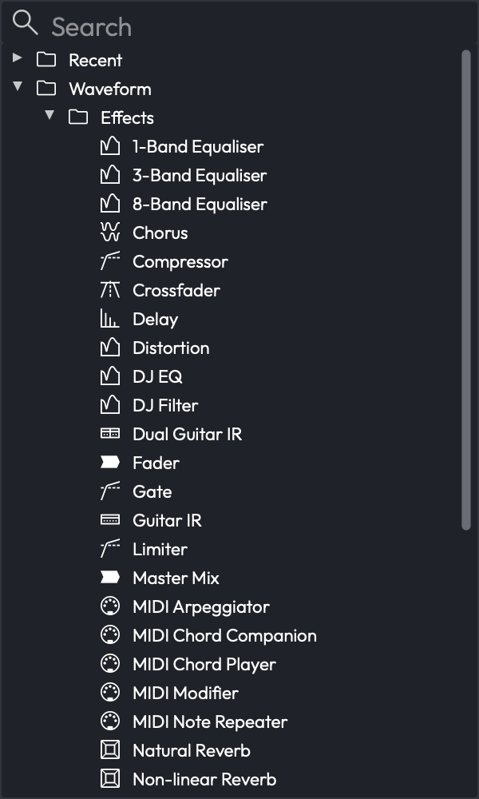

*Built-in Plugin Effects in Waveform*

This chapter covers the Volume & Pan and Level Meter plugins, the
equalisers, reverbs, Delay, Chorus, Phaser, the dynamics plugins,
Distortion, Pitch Shifter, DJ EQ and DJ Filter, the DJ Tools, the Text
plugin, Guitar IR, the Artisan Collection and Master Mix. The MIDI effects
and the utility plugins have chapters of their own: see
[MIDI Effects](midi-effects.md) and [Utility Plugins](utility-plugins.md).

> 📝 **Note:** The older versions of several effects are in a *Legacy*
folder, which is hidden until you turn it on: go to *Settings > Plugins*,
click **Enable internal plugins** and choose *Enable Legacy Plugins*, then
restart Waveform. See [Legacy Plugins](legacy-plugins.md).

> 📝 **Note:** Delay, Chorus, Phaser, Distortion, DJ Filter and the three
reverbs have a **Mix Lock** button on their **Mix** control. Turn it on to keep
your **Mix** setting when you load a preset, so you can try presets on a send or
an insert without the wet/dry balance jumping about. (Default: off)

## Volume & Pan Plugin

Every new track has a *Volume & Pan* plugin at the right of the inline
mixer, with the level and pan controls you'd find on any mixer channel.
Because the Waveform mixer is made of plugins, you can move *Volume & Pan*
in front of other plugins or delete it. You can also add a second *Volume &
Pan* and use it as a trim control for gain staging.

### Adjusting Volume

Drag the volume slider up or down. While you drag, a larger slider appears
with dB markings for fine adjustment. The **Volume** value is also shown in
the Actions panel.

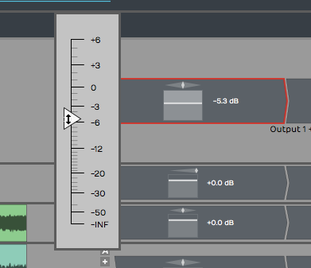

*Volume & Pan Plugin, Adjusting Volume*

### Adjusting Panning

Panning works the same way: click the panner, then drag left or right to set
the stereo position.

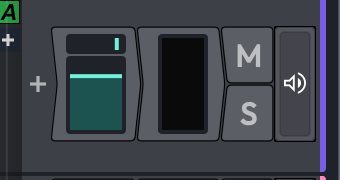

*Volume & Pan Plugin, Adjusting Panning*

### Resetting Controls

To reset **Volume** or **Pan** to its default, Opt-click / Alt-click the
control.

### In the Actions Panel

Select a *Volume & Pan* plugin to show its values and actions in the
Actions panel.

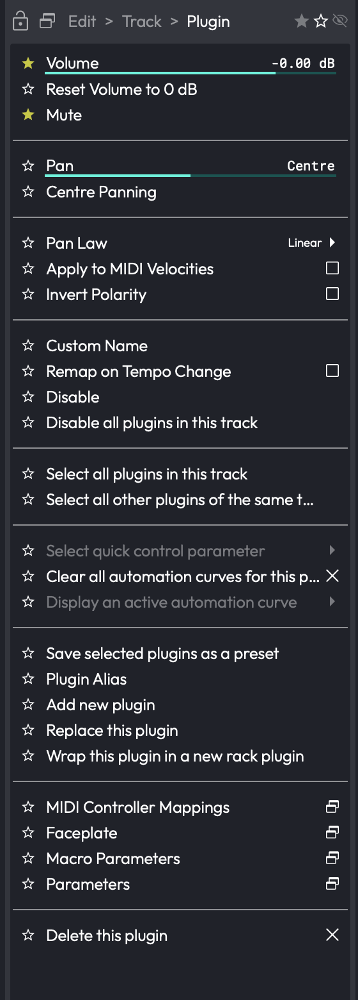

*Volume & Pan plugin in the Actions panel*

The **Volume** slider is repeated in the Actions panel along with
**Reset Volume to 0 dB** and **Mute/Unmute** buttons. **Pan** is repeated
there along with a **Centre Panning** button that resets panning. Below
them are **Invert Polarity**, which flips the polarity of the signal, and,
on a track inside a folder, **Ignore VCA**, which makes the plugin ignore a
VCA plugin on the parent folder track.

**Pan Law** (Choices: (Use Default), Linear, -2.5 dB Center, -3.0 dB Center,
-4.5 dB Center, -6.0 dB Center): How the level changes as you pan.
*(Use Default)* follows the **Default pan law** in *Settings > General*, which
is *Linear* unless you change it. Many DAWs use a -3 dB pan law, which lowers
the level slightly as you pan towards the centre so a track stays in balance
as you move it across the stereo field. (Default: Linear)

> 💡 **Tip:** To offset the velocity of notes going into a virtual
instrument, insert a *Volume & Pan* plugin before it (to its left) and turn on
**Apply to MIDI Velocities**. The fader then raises or lowers the MIDI
velocity, which is a quicker way to make MIDI drums hit harder than editing
the notes. It only works with *Volume & Pan* ahead of the instrument.

## Level Meter

Every track also has a *Level Meter* plugin at the right end of the mixer by
default. It's a stereo meter showing the left and right levels. To add another
one, find it in *Waveform > Utility* in the plugin picker.

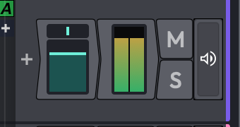

*Level Meter Plugin*

Select a *Level Meter* and the Actions panel shows a large horizontal
version of the meter, with dB markings.

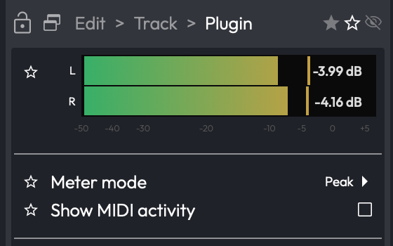

*Large Meter in the Actions panel*

A red indicator at the top of the meter shows when the signal has
overloaded. Click it to reset the meter.

> 💡 **Tip:** To clear all overload indicators in the Edit, right-click any
level meter and choose *Reset all overload indicators*, or press **\\**.

The *Level Meter* starts in peak mode, like the meters in most DAWs. To
change the mode, use the Actions panel or the right-click menu. The modes
are:

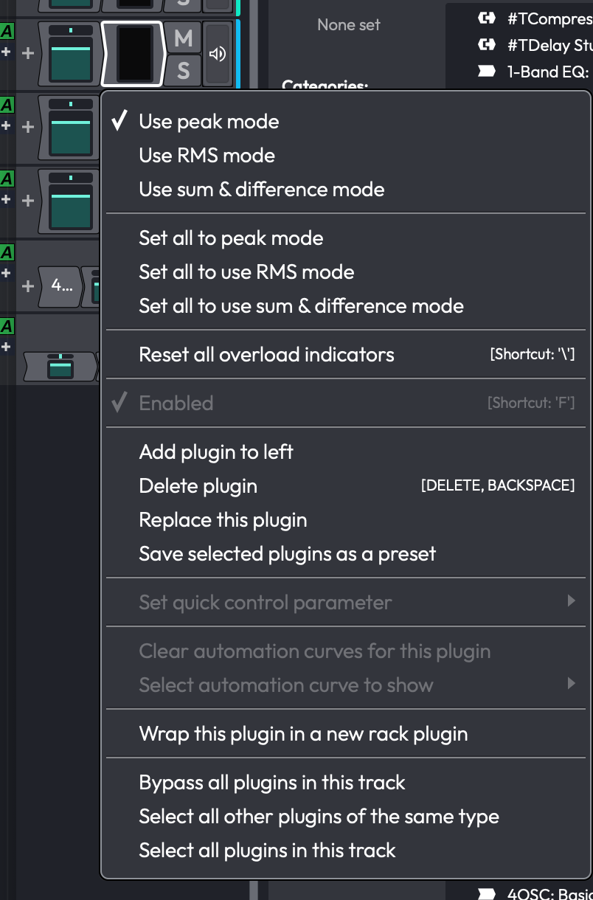

*Meter Modes for the Level Meter Plugin*

**Peak**: Shows the digital peak level. Keep it out of the red to avoid
digital clipping.

**RMS**: Shows the average level, closer to how loud the signal sounds. It
behaves like a traditional VU meter, so it's a better guide to how loud one
track sounds compared with others.

**Sum & difference**: Shows both the level and the stereo spread. The left
part of the meter shows the sum of left and right, the combined level of the
stereo signal.

The right part shows the difference between left and right: the more it
shows, the wider the stereo spread. If both channels play exactly the same
thing, left minus right cancels to zero and the right part stays still,
meaning the signal is mono.

> 💡 **Tip:** Turn on **Show MIDI activity** in the Actions panel and the
meter also shows MIDI activity, which helps when you're working out why a
virtual instrument isn't playing.

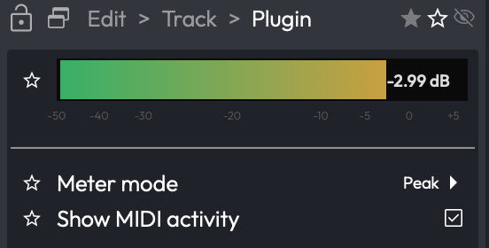

*Level Meter, Show MIDI Activity*

## Equalisers

Waveform's equalisers come in three sizes: *1-Band*, *3-Band* and
*8-Band*. Each has a frequency-response display in the plugin window where you
drag nodes to shape the sound: drag a node up or down for **Gain**, left or
right for **Frequency**, and around the node to set its **Q** (width).

*1-Band Equaliser* is the smallest: a single band you can set to a bell or a
shelf, for a single cut or a gentle tone change.

*The 1-Band Equaliser*

*3-Band Equaliser* has a low shelf, a sweepable mid bell and a high shelf,
the classic three-band tone stack. Set the **Frequency** and
**Gain** of each band by dragging its node.

*The 3-Band Equaliser*

*8-Band Equaliser* is the full parametric EQ. It has eight bands (a low
shelf, six peaking bands, and a high shelf), each with its own
**Frequency**, **Gain** and **Q**, and each able to be switched on or off
individually. It also has a *Stereo* or *Mid/Side* mode: in *Mid/Side*
mode you equalise the centre (mono) and the sides (stereo) of the signal
separately, which is useful for mastering and stereo-width work.

*The 8-Band Equaliser*

> 📝 **Note:** The older *4-Band Equaliser* from earlier versions now lives
in the *Legacy* folder. See [Legacy Plugins](legacy-plugins.md) if you need it
to open an old project.

## Reverbs

Waveform has three algorithmic reverbs, each tuned for a different kind of
space: *Natural Reverb*, *Plate Reverb* and *Non-linear Reverb*. They share the
same controls, so once you know one you know them all.

- *Natural Reverb* models real rooms and halls, for natural depth and ambience.
- *Plate Reverb* recreates the bright, dense sound of a studio plate, a
  long-standing choice for vocals and snares.
- *Non-linear Reverb* is a gated reverb whose tail cuts off abruptly rather
  than fading away, the big drum sound of the 1980s.

*The Natural Reverb*

*The Plate Reverb*

*The Non-linear Reverb*

The controls are:

- **Pre Delay**: a short gap before the reverb starts, which helps keep the
  dry signal clear and present.
- **Size**: the dimensions of the simulated space, from a small room to a
  large hall.
- **Decay**: how long the tail takes to fade out.
- **Density** and **Diffusion**: the thickness and smoothness of the reverb
  tail.
- **Low Cut** / **High Cut**: filters that trim the bottom and top off the
  reverb.
- **Low Damp** / **High Damp**: how quickly low and high frequencies die away
  in the tail, for a warmer or brighter sound.
- **Slope**: (*Natural* and *Plate*) tilts the overall tonal balance of the
  tail.
- **Pan**: positions the reverb in the stereo field.
- **Mix**: blends the wet reverb against the dry signal.

> 💡 **Tip:** Assign **Mix** as the quick control parameter so you can bring
the reverb in and out while mixing. More reverb pushes a track further back,
and less brings it forward; combined with panning, that gives a mix more
space.

## Delay

*Delay* is a stereo delay with independent left and right channels, and can
ping-pong between them. Each side has its own delay time, feedback,
cross-feedback, pan and trim, for anything from a simple slapback to wide
bouncing stereo echoes.

*The Delay*

For each channel (*L* and *R*):

- **Delay**: the delay time in milliseconds, or, with **Sync** on, locked to
  a musical note value at the project tempo.
- **Feedback**: how much of the delayed signal is fed back into itself to
  create repeats.
- **Cross FB**: cross-feedback, which sends each channel's echoes into the
  other side. This is what creates the classic ping-pong bounce.
- **Pan** and **Trim**: the position and level of that channel's output.

The shared controls are:

- **Sync**: switches the delay times between free milliseconds and
  tempo-locked note values.
- **Low Cut** / **High Cut**: filters in the feedback path, so the repeats get
  progressively darker (or brighter) as they fade.
- **Mix**: the balance of wet delay against the dry signal.

> 📝 **Note:** The original simple mono *Delay* now lives in the *Legacy*
folder.

## Chorus

*Chorus* gives the classic shimmering, doubling effect, often used on
guitars, pads, electric pianos, bass and vocals. It modulates a short delay so
the pitch drifts gently up and down.

*The Chorus*

- **Mode**: *Normal*, *Wide*, or *Wider*, setting how far the effect spreads
  across the stereo field.
- **Delay**: the base delay time the modulation works around.
- **Depth**: how far the delay is modulated; more depth means a stronger,
  more obvious warble.
- **Rate**: the speed of the modulation, or, with **Sync** on, a **Note** value
  locked to the tempo.
- **Sync**: switches **Rate** between free Hz and tempo-locked note values.
- **Mix**: the blend of dry and chorused signal.

> 📝 **Note:** The older *Chorus* lives in the *Legacy* folder. The two share
a name, but the new one (in the *Effects* folder) is the default.

## Phaser

*Phaser* gives a swirling, sweeping sound, often used on guitars, synths and
electric pianos, or any track that needs movement. It sweeps a set of notches
up and down through the frequency spectrum.

*The Phaser*

- **Stages**: the number of filter stages (4 to 12); more stages give a
  richer, more pronounced sweep.
- **Floor** and **Ceiling**: the lowest and highest frequencies the sweep
  travels between.
- **Rate**: the speed of the sweep, or a tempo-locked **Note** value with
  **Sync** on.
- **Sync**: switches **Rate** between free Hz and tempo-locked note values.
- **Feedback**: feeds the output back to intensify the resonant peaks for a
  more dramatic effect.
- **Mix**: the blend of dry and phased signal.

> 📝 **Note:** The older *Phaser* lives in the *Legacy* folder.

> 💡 **Tip:** To change the order of effects on a track, drag a plugin left
or right. As you drag, a red drop target glows where the plugin will go when
you drop it.

## Dynamics: Compressor, Gate, and Limiter

Waveform's dynamics processing is split into three plugins, one for each
job.

**Compressor** evens out the level of a signal by turning down anything
that rises above a threshold.

*The Compressor*

- **Threshold**: the level above which compression starts, from -60 to
  0 dB. (Default: -30 dB)
- **Ratio**: how hard the signal is turned down once it crosses the
  threshold, from 1:1 to 100:1. (Default: 2:1)
- **Attack** and **Release**: how quickly the compressor reacts, and then
  recovers once the signal falls back below the threshold. Attack runs from
  1 to 100 ms and Release from 1 to 1000 ms. (Default: 50 ms and 500 ms)
- **Knee**: softens the transition around the threshold for a gentler, more
  transparent action, from 0 to 18 dB. (Default: 0 dB)
- **Output gain**: make-up gain to bring the level back up after
  compression, from -20 to +20 dB. (Default: 0 dB)
- **Sidechain gain**: trims the level of an external sidechain, from -20 to
  +20 dB. (Default: 0 dB) Route another track into the *Compressor*'s
  sidechain input to make it duck, for example a kick drum pumping a bass
  line.

**Gate** does the opposite: it turns the signal *down* when it falls
*below* the threshold, silencing quiet passages, bleed, or hiss between
notes.

*The Gate*

- **Threshold**: the level below which the gate closes, from -60 to 0 dB.
  (Default: -40 dB)
- **Attack**: how fast the gate opens when the signal returns, from 0.1 to
  100 ms. (Default: 1 ms)
- **Hold**: how long it stays open after the signal drops, from 0 to
  1000 ms. (Default: 2 ms)
- **Release**: how fast it closes again, from 1 to 1000 ms. (Default: 100 ms)

**Limiter** is a brick-wall limiter that stops the signal from ever going
over a set ceiling. Use it on the master bus to catch peaks and raise the
overall loudness.

*The Limiter*

- **Gain**: drives the signal into the limiter; more gain means more
  limiting and a louder result. From -20 to +20 dB. (Default: 0 dB)
- **Release**: how quickly the limiter recovers after catching a peak, from
  1 to 300 ms. (Default: 300 ms)
- **Ceiling**: the absolute maximum output level; nothing passes above it.
  From -60 to 0 dB. (Default: -0.3 dB)

> 📝 **Note:** The classic combined *Compressor/Limiter* from earlier
versions is now in the *Legacy* folder.

## Distortion

*Distortion* adds harmonic grit and saturation, from gentle warmth to
full-on fuzz.

*The Distortion*

- **Type**: the flavour of distortion (*Light*, *Medium*, *Hard*, *Clip*,
  *Tube*, or *Fuzz*). (Default: Light)
- **Drive**: how hard the signal is pushed into the distortion.
- **Post Gain**: output level, to compensate for the volume change the
  distortion adds.
- **Tone**: shapes the brightness of the distorted sound.
- **Emphasis**: sharpens the character of the distortion by emphasising
  certain frequencies before the waveshaping.
- **Mix**: blends the distorted signal with the dry input. (Default: fully
  wet)

## Pitch Shifter

*Pitch Shifter* changes the pitch of the signal in real time.

*The Waveform Pitch Shifter Plugin*

**Semitones**: How far to shift the pitch, from -24 to +24 semitones: 12
shifts up an octave and -12 down an octave. Click the value under the knob to
type an exact number, or double-click the knob to go back to the original
pitch. (Default: 0)

**Pitch**: Opens a menu of exact shifts, from +2 octaves down to -2 octaves in
semitone steps, with *Original pitch* in the middle.

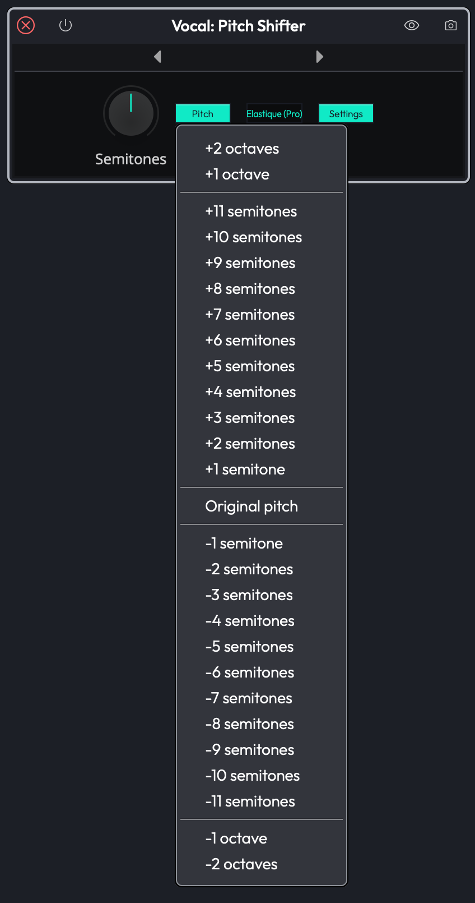

*Pitch Shifter, Set Pitch*

**Mode** (Choices: Elastique (Pro), Elastique (Efficient), Elastique (Mobile),
Elastique (Monophonic), Signalsmith (Default), Signalsmith (Cheaper)): The
pitch-shifting algorithm used on audio. *Elastique (Pro)* gives the best
quality; the *Efficient* and *Mobile* modes and *Signalsmith (Cheaper)* use
less CPU, and *Elastique (Monophonic)* suits single-note sources such as vocals
or bass. (Default: Elastique (Pro))

**Settings**: Opens the options for the *Elastique (Pro)* algorithm.

> 📝 **Note:** Inserted ahead of a MIDI instrument, *Pitch Shifter* works on
the MIDI instead, transposing the notes by the **Semitones** value rounded to
the nearest semitone.

## DJ EQ and DJ Filter

*DJ EQ* and *DJ Filter* are performance effects for hands-on tone sweeps.

*DJ EQ* is a three-band EQ with **Low**, **Mid** and **High** faders that boost
or fully cut each band. Turn a band all the way down to kill it
completely, the way a DJ drops the bass out of a track. Two crossover
controls, **Freq 1** and **Freq 2**, set the frequencies where the bands
divide.

*The DJ EQ*

*DJ Filter* is the classic single-knob DJ filter. The **Freq** control sits
at *Off* in the centre: turn it left and a low-pass filter sweeps the
highs away; turn it right and a high-pass filter sweeps the lows away. **Q**
sets the resonance at the filter's edge, and **Mix** blends the result with
the dry signal.

> 📝 **Note:** The simple *Low/High-Pass Filter* from earlier versions now
lives in the *Legacy* folder. For everyday filtering use the *1-Band
Equaliser*, or the *DJ Filter* for sweeps.

## DJ Tools PRO { #dj-tools }

> 📝 **Edition:** Waveform Pro, or with the DJ Mix Tools Expansion.

The *DJ Tools* (*Fader* and *Crossfader*) turn Waveform's tracks into a
DJ-style mixer. The DJ Mix Tools Expansion that includes them also unlocks
[Stem Separation](stem-separation.md).

*Fader* is an automatable volume fader with a **Position** control and an
adjustable response **Curve**, for riding or programming smooth level
changes.

*The Fader*

*Crossfader* blends between two stereo sources, *A* and *B*. It takes two
stereo inputs and produces one stereo output; the **Position** control fades
from full A on the left, through the centre, to full B on the right.
**Curve** shapes the blend, from a smooth equal-power fade to a sharp cut,
and **Centre Gain** sets the level at the midpoint.

*The Crossfader*

## Text Plugin

The *Text* plugin keeps notes with your Edit as you record, edit and mix.
Drag *Text* from *Waveform > Utility* in the plugin picker to a track, give it
a **Name** and type a **Description**.

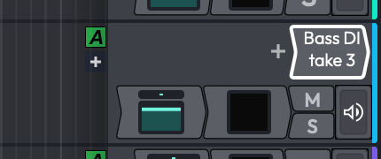

*Text Plugin Example*

The description can be as long as you like: how the recording was made,
which microphones you used, the artist's name or anything else worth noting.
The plugin's **Name** appears on its thumbnail in the mixer. *Text* doesn't
touch the audio, but it reminds you what you were doing when you come back to
a project later.

> 💡 **Tip:** You can enable or disable several plugins at once by
selecting all of them and pressing **F**.

## Guitar IR PRO { #guitar-ir }

> 📝 **Edition:** Waveform Pro, or with the Recording Engineer Expansion. This
> covers both *Guitar IR* and *Dual Guitar IR*.

*Guitar IR* is a convolution plugin. It loads an impulse response (IR), a
short WAV recording that captures the sound of a guitar cabinet, speaker or
room, and applies that character to whatever passes through it. It pairs
with an amp-simulation plugin: run your DI guitar into the amp sim, then into
*Guitar IR* to model the cabinet and microphone.

*The Guitar IR*

Load a WAV file using the IR field, then shape the result with the controls:

- **Gain**: output level, from −12 dB to +6 dB.
- **Low Cut** and **High Cut**: high-pass and low-pass filters that trim the
  response, each adjustable from 10 Hz to 20,000 Hz.
- **Filter Q**: the resonance of the cut filters (0.1 to 14).
- **Mix**: blends the convolved (wet) signal against the dry input, from 0 to
  1.0. It defaults to fully wet (1.0).
- **Normalise**: evens out the loudness of the loaded IR so swapping impulses
  doesn't change your level. On by default.
- **Trim Silence**: removes leading silence from the IR. Off by default.

### Dual Guitar IR

*The Dual Guitar IR*

*Dual Guitar IR* works the same way but hosts two impulse responses (A and
B) at once, so you can blend two cabinets or mic positions for a wider,
fuller tone. As well as the controls above, it has:

- **Width**: spreads the two IRs across the stereo field (defaults to 0.5).
- **Delay**: offsets one IR against the other by up to 200 ms (defaults to 0),
  useful for subtle thickening or comb-filter effects.

## Artisan Collection PRO { #artisan-collection }

> 📝 **Edition:** Waveform Pro.

The *Artisan Collection* is a built-in library of over 180 effects based on
the AirWindows plugins by Chris Johnson. They're grouped into
categories in the plugin picker: *Delay*, *Dither*, *Distortion*, *Dynamics*,
*Emulation*, *EQ*, *Filter*, *Imaging*, *Modulation*, *Reverb*, and *Utility*.

Every *Artisan Collection* effect has a **Dry** level and a **Wet** level
alongside its own parameters, so you can always set how much of the processed
signal is blended with the original.

To use them, go to *Settings > Plugins*, click **Enable internal plugins** and
make sure *Enable Artisan Collection Plugins* is ticked (it's on by default).
After changing it, restart Waveform. Once enabled, the effects
appear under the *Artisan Collection* folder in the plugin picker.

## Master Mix PRO { #master-mix }

> 📝 **Edition:** Waveform Pro and Waveform OEM.

*Master Mix* is a mastering plugin that sits at the end of your signal chain,
usually on the master or output bus, to polish a finished mix. Add it from
*Waveform > Effects* in the plugin picker, then double-click it to open its
window. It combines several mastering stages:

- Two parametric equalisers, one before and one after the dynamics
  processing, for corrective and final tonal shaping. The **Pre** and
  **Post** buttons switch each one in or out.
- Three-band crossover compression: the signal is split into low, mid and
  high bands (**BAND 1**, **BAND 2**, **BAND 3**), each feeding its own
  compressor with a transfer curve you edit by dragging nodes.
- A final **DYNAMICS** stage with soft clipping (**Softclip**) and a noise
  gate (**Gating**).
- Separate left and right **INPUT** and **OUTPUT** levels, each with
  metering.
- A DC filter, switched on with the **DC** button, that removes any DC offset
  from the signal.

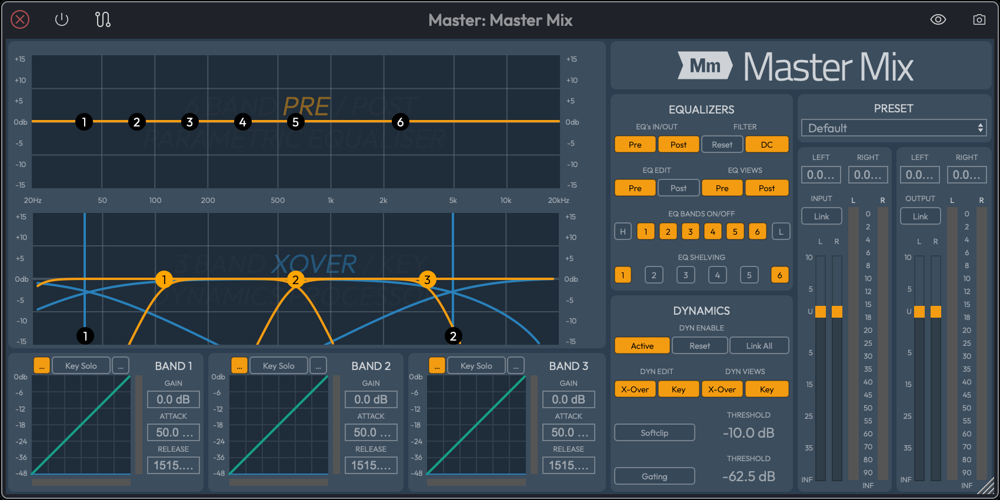

*The Master Mix window*

The **PRESET** box recalls Master Mix's factory presets.

## Saving Presets

Most of the built-in plugins can load, save and delete presets. Your saved
presets are in the Search tab of the Browser: choose **Presets** in the
category list to show only presets (see [Categories](browser.md#categories)).

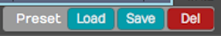

*Load, Save, or Delete Presets*

When you save a preset you can also give it tags, such as Vocal EQ, Guitar
Focus or Bass Boost, to make it quicker to find later.

## Moving On

[Legacy Plugins](legacy-plugins.md) covers the older versions of these
effects that now live in the *Legacy* folder.
