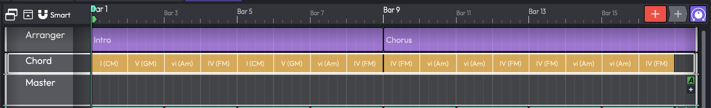
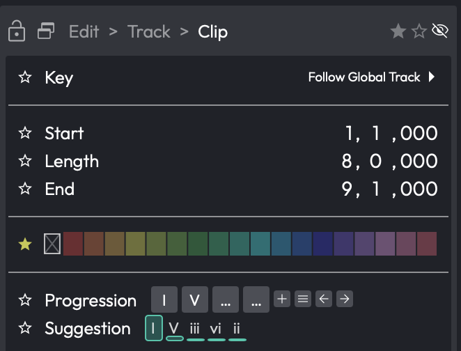

# The Chord Track PRO { #the-chord-track }

> 📝 **Edition:** Waveform Pro, or with the MIDI Producer Expansion.

The Chord track is a global track that maps out your Edit's harmony
over time. It holds Chord clips, and each Chord clip contains a chord
progression. The Chord track makes no sound of its own and hosts no
plugins. Think of it as a harmonic reference for the rest of the Edit.
The [Pattern Generator](pattern-generator.md) can follow it to stay in
harmony, and Audio clips can automatically pitch-shift to match it.

*The Chord track with two Chord clips*

## Showing the Chord Track

The Chord track is hidden by default. There is one Chord track per
Edit, and it appears with the other global tracks below the timeline.
To show or hide it:

-   Choose **Show Chord track** from the Global tracks section of the
    View menu.
-   Or right-click the header of any global track (Tempo, Marker, or
    Arranger) and choose **Show Chord track**.
-   Or use the keyboard shortcut Opt + Cmd + F11 / Ctrl + Alt + F11.

## Inserting Chords

To add a chord to the Chord track, position the cursor where you
want the chord to begin, then do one of the following:

-   Use the **Insert chord** command: Opt + C / Alt + C.
-   Or select the Chord track header and click the **New Chord**
    button in the Actions panel.

A new Chord clip one bar long is inserted at the cursor.

With the Chord track selected, the Actions panel also offers
**Shrink** and **Grow** buttons to change the height of the track.

> ⚠️ **Warning:** Chord clips on the track should not overlap. If they
> do, Waveform shows the message *"This track contains overlapping
> chords. Portions of some chord are ignored."*

## Chord Clip Properties

Select a Chord clip to see its settings in the Actions panel:

**Key**: Sets the key used to spell the clip's chords. The default,
**Follow Global Track**, uses the Edit's global key signature. Choose any
of the twelve chromatic roots to give this clip its own key.

**Scale**: Shown only when **Key** is set to something other than
**Follow Global Track**. Choose from Major, Minor, Ionian, Dorian,
Phrygian, Lydian, Mixolydian, Aeolian, Locrian, Melodic Minor, and
Harmonic Minor.

**Update global track key**: The small arrow button next to the **Key**
control writes the clip's key back to the Edit's global key signature.

**Start / Length / End**: Position and duration of the clip on the
timeline.

**Colour**: Changes the clip's strip colour.

## Building a Chord Progression

The **Progression** section of the Actions panel is where you define
the chords in the clip. A progression can hold up to 64 chords.

*The Progression builder and Suggestion panel*

**Add**: Appends a chord. The menu offers the diatonic triads, sixths,
sevenths, and ninths for the current key, plus any custom chords you
have defined in *Settings > Chords*.

**Menu**: Opens a menu with **Presets** (and **Save as Preset**),
progressions copied from other clips in the Edit, **Popular 3 chord
progressions**, **Popular 4 chord progressions**, and **Clear**.

**Previous / Next**: Step through the popular chord progressions one at
a time.

Each chord in the progression has its own small controls:

-   **Prev / Next**: select the previous or next chord type.
    Shift-click changes the root note instead.
-   **Up / Down**: move the chord up or down an octave. Shift-click
    changes the chord inversion instead.

You can also type chords in from the computer keyboard while the
Progression section has focus: keys 1-7 append the diatonic triads
of the current key, Shift + 1-7 append the corresponding seventh
chords, letters A-G append absolute major chords (with Shift for
the sharpened root, for example Shift + C for C#), and Delete removes the
last chord.

> 💡 **Tip:** The **Suggestion** panel next to the Progression builder
> shows a *Chord Progression Prediction*: a bar chart of the most
> likely next chords given what you have so far. Click a suggestion to
> append it.

## Following the Chord Track

The Chord track only becomes audible through the features that follow
it:

-   The Pattern Generator can generate basslines, arpeggios, and
    chord parts that track the progression.
-   Audio clips PRO can automatically
    pitch-shift to follow the Chord track. This needs Waveform Pro; the
    MIDI Producer Expansion doesn't include it.

The chord types offered throughout Waveform (including the Chord
track) can be customised in
[*Settings > Chords*](reference-settings.md#chords), where you can disable chords
you never use and define your own.
