# Clean-up Editing

Once you have some basic tracks recorded, Waveform's editing tools let
you clean up the clips and fix small problems with the takes. The tools
themselves are covered in [Audio Clips and Editing Audio](audio-clips-and-editing-audio.md);
this chapter works through some practical examples.

> 📝 **Note:** Timing edits are often easier if you move the track you're working on next to the drum track. That way you can compare the timing of your notes with the main rhythmic parts of the song.

## Trimming

The trim handles are a quick way to clean up the beginning and end of a
take. Trim the beginning to keep the track silent until the part comes
in, then trim the end to remove any noise after the song has finished.

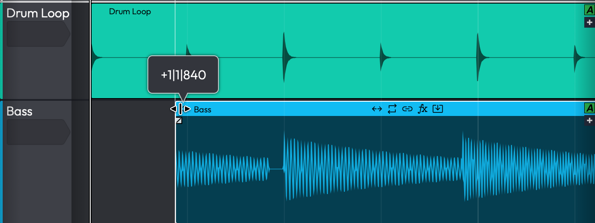

*Trimming an Audio Clip*

To trim, drag a trim handle. With **Snap** on, trimming snaps to the
grid; with **Snap** off, you can trim freely.

> 💡 **Tip:** Hold Cmd / Ctrl while trimming to override snapping temporarily.

You can also trim several Audio clips at once. Select them with
Opt-drag / Alt-drag, then drag the trim handles on any of the selected
clips.

## Correcting Small Timing Problems

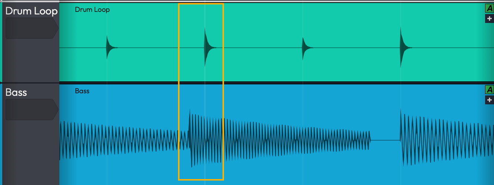

*Bass Note Timing is Early*

In this example, one note of the bass line is early compared with the
drum loop. Ideally you would re-record the part, but if that's not an
option you can fix a small problem like this by editing. Separate the
out-of-time note into its own Audio clip, then move it slightly.

1.  Turn off **Snap**.
2.  Select the Audio clip you want to fix.
3.  Place the cursor right at the beginning of the note that needs
    fixing and press slash ( / ) to split the clip.

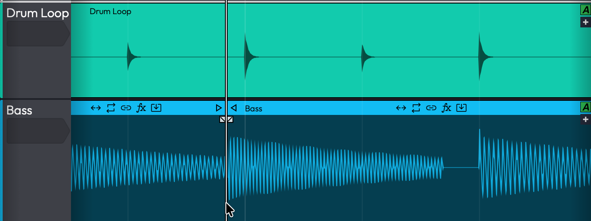

*Split the Beginning of the Note*

4.  Place the cursor just after the note and press slash ( / ) again.
    The bad note is now in its own Audio clip.

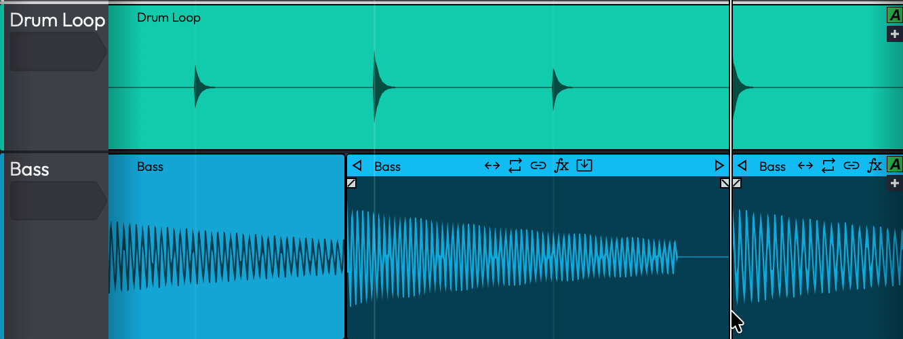

*Split After the Note*

5.  Click the single note to select it, then trim the clip to shorten it a little.

*Trim the Clip*

6.  Zoom in far enough to see how the note lines up with the drums.
    Drag the note to line it up with the correct drum hit.

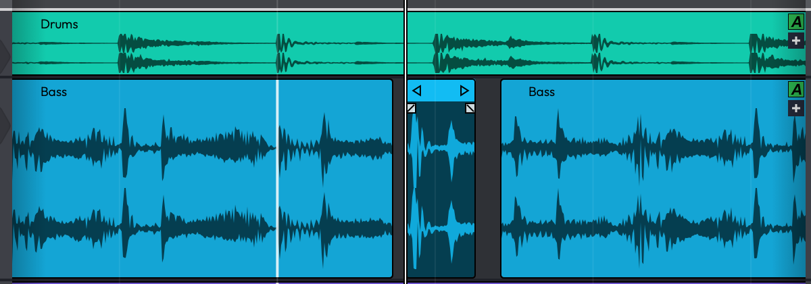

*Drag the Clip to the Correct Time*

7.  Finish the edit by trimming and crossfading into the other notes.

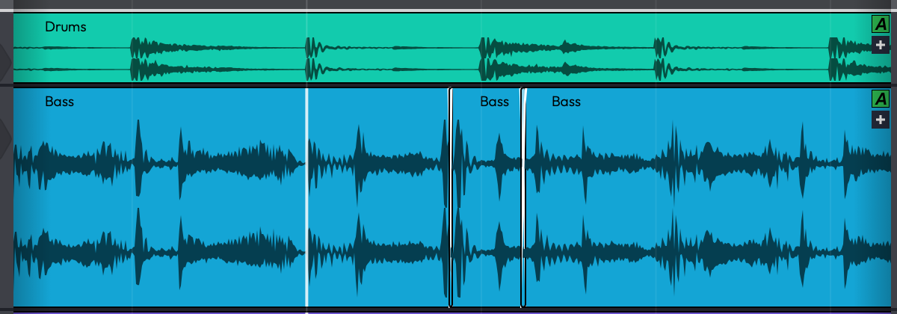

*The Completed Correction*

> 📝 **Note:** Right after a split, both of the resulting clips are selected, and trimming, slipping or moving then applies to both. To work on one clip, click it to select it on its own. Press Escape at any time to deselect everything.

## Correcting Timing by Slip Editing

Another way to correct timing is slip editing, where you "slip" the
waveform inside the Audio clip rather than moving the clip. The key is to
put the first split exactly where you want the note to start.

1.  Turn **Snap** off.
2.  Zoom in enough to see where the note should start and select the
    clip to fix.
3.  Place the cursor exactly where the note should have started and
    press slash ( / ) to split the clip.

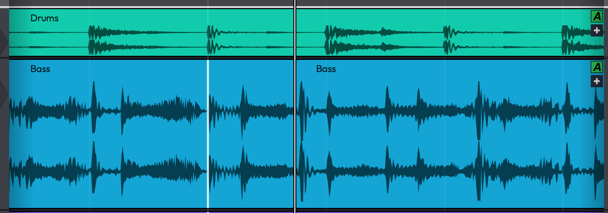

*Split the Clip Where the Note Should Start*

4.  If the note was early, trim back the previous clip to remove the
    extra bit.

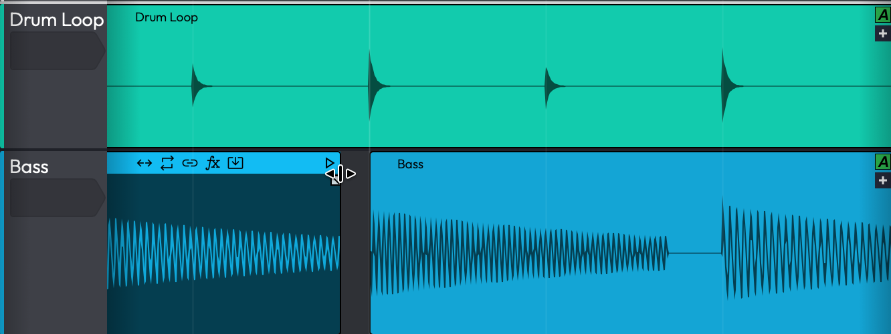

*Trim Back the Extra Bit From the Previous Clip*

5.  Place the cursor at the end of the note and press slash ( / ) to split
    the clip again. The bad note now has its own Audio clip.

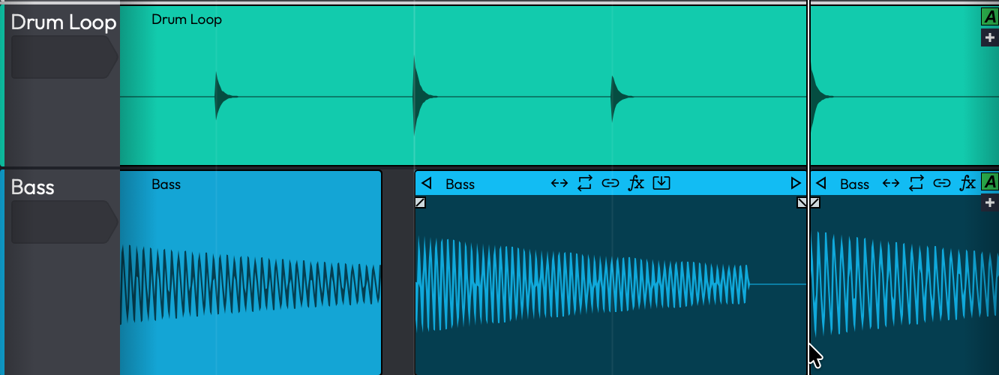

*Split After the Note*

6.  Select only the note you want to adjust, then drag the slip handle
    (the solid box). The waveform slips within the Audio clip. Line it up
    so it starts just after the leading edge of the clip.

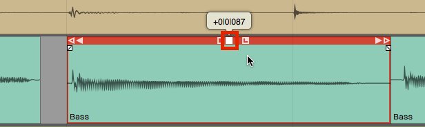

*Drag the Slip Edit Handle to Adjust Timing Within the Clip*

7.  Clean up the edges with trimming and crossfading.

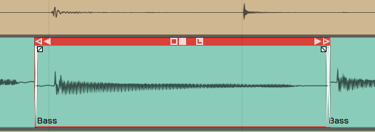

*The Completed Edit*

> 📝 **Note:** With automatic crossfades turned on, moving one clip so it overlaps another creates a crossfade automatically. See [Audio Clips and Editing Audio](audio-clips-and-editing-audio.md) for more about crossfades.

## Fade-outs

To adjust the fade-out at the end of a take, drag the clip's fade handle
to the left.

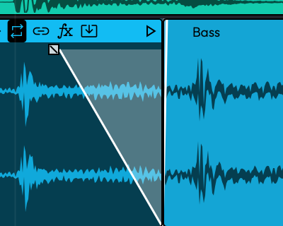

*Adjusting Fade-outs*

To change the shape of the fade-out, choose one of the fade shape
buttons in the Actions panel. The row has eight: the four on the left
set the fade-in shape and the four on the right set the fade-out shape.

*Fade-out shapes in the Actions panel*

## Stretch an Ending Note

If the final note isn't held long enough, you can time-stretch it.
Re-recording the take is better, but if that's not an option, here's a
quick way to lengthen an ending note.

1.  Split the note you want to stretch into its own clip, as in the other
    examples.
2.  Hold Opt / Alt and drag the right trim handle to extend the note to
    the length you want.

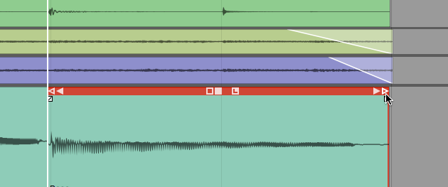

*Hold Opt / Alt While Trimming to Stretch a Clip*

3.  Play it back to check that it sounds clean. The further you stretch
    a note, the more the audio quality can suffer, though it often works
    surprisingly well.

> 📝 **Note:** These tools go beyond cleaning up takes. You can edit Audio clips in detail to change the timing or even the arrangement. While writing, you can use them to build bass lines that lock in tightly with the drums by adjusting the timing, removing notes or shortening them.

## Fixing Clicks at the Edit Points

With this kind of editing, you might occasionally hear a click at the
beginning or end of a clip. It happens when you split the waveform at a
point where there's still some signal. A very short fade at the edge of
the clip fixes it.

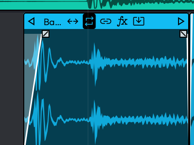

*Example of an Edge Fade*

You could zoom right in and add tiny fades to the beginning and end of
each clip, but it's easier to select the clips and click **Apply Edge
Fades** in the Actions panel. This sets 5 ms fades at the start and
end of every selected clip (fades already longer than that are left
alone).

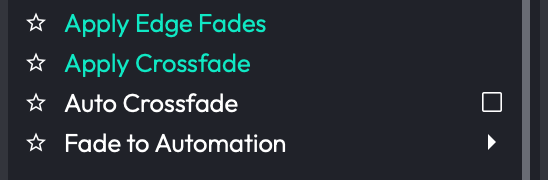

*Apply Edge Fades in the Actions panel*

## Rendering to a Single Audio Clip

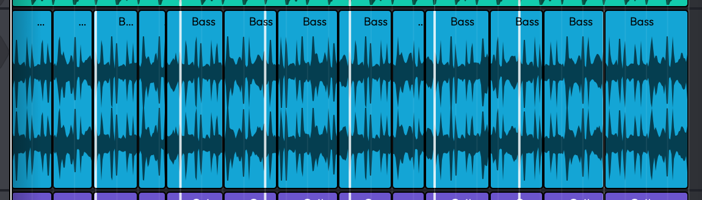

*Chopped Up Audio Clip Following Editing*

If clean-up editing leaves your track in lots of small pieces, you can
render the clips back into a single clip:

1.  Select all the clips you want to combine. One way is to click the
    first clip, then hold Shift and click the last one.

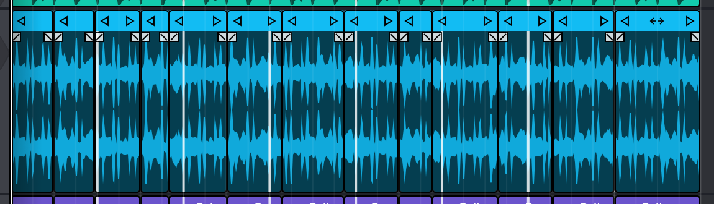

*Selected Clips before Rendering*

2.  In the Actions panel, click **Render Clip** and choose **Merge the
    selected clips**.

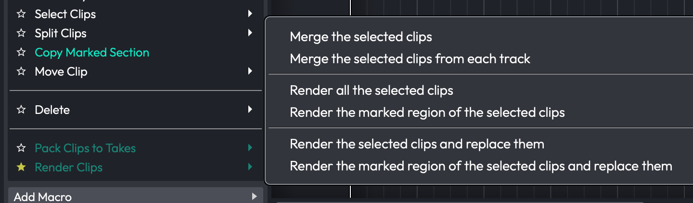

*Render Clip > Merge the selected clips*

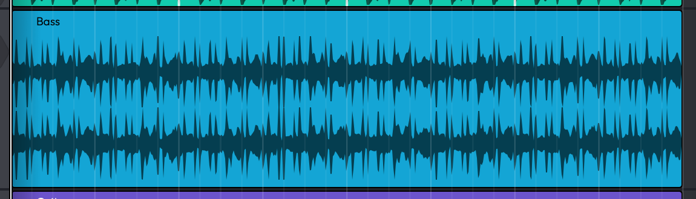

*Audio Clip After Rendering*

**Merge the selected clips** is only offered when every selected clip is an
Audio clip. When the clips sit on more than one track, the menu also has
**Merge the selected clips from each track**, which merges each track's
clips into one clip on that track. With a single clip selected, the
same entry is called **Flatten the selected clip**. Launcher clips can't be
rendered or merged.

> 📝 **Note:** The other entries in the **Render Clip** menu open the Render
dialog set up for the clips, with **Include Tails** off and the result going
onto the clips' track or in place of them. See
[Rendering Clips](rendering-and-stems.md#rendering-clips).

## Moving On

To correct timing by stretching audio to the beat, see
[Warp Time](warp-time.md). For automatic timing correction of whole
takes, see [Groove Doctor](groove-doctor.md) (Waveform Pro or the
Recording Engineer Expansion).
