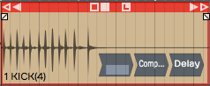

# Clip Effects

[Using Plugins](using-plugins.md) and
[Built-in Effects Plugins](built-in-effects-plugins.md) cover effects
plugins in general. This chapter shows how to put plugins on individual
Audio clips.

## Inserting Plugins on Clips

To insert a plugin on an Audio clip, drag the plugin from the Browser or
the plugin object, and drop it onto the Audio clip. The plugin's
thumbnail appears in the lower right corner of the clip. You can add up
to 10 plugins to make a chain of effects, all working on that one clip.

*Plugins Using Clip Effects*

> 📝 **Note:** Clip effects work with Audio clips, but not MIDI clips or Step
> clips.

> 📝 **Note:** For offline processing that renders into the clip, see
> [Clip Layer Effects](clip-layer-effects.md).

Otherwise, clip plugins work much like plugins in the mixer. Select a
plugin and press F to enable or disable it, or use the **Enabled** button
in the Actions panel.

For third-party plugins, clicking or double-clicking the plugin opens
its user interface.

> 💡 **Tip:** How plugins open depends on a setting in *Settings > General*:
> under **Plugin Windows**, **Open plugin windows by** can be set to either
> **Single-clicking** or **Double-clicking**.

## Removing Clip Plugins

To remove a plugin, click it and press Delete or Backspace. To remove
several at once, hold Cmd / Ctrl while you click them, then press
Delete.

## Creative Uses

Clip effects let you put an effect on just part of a track, even a
single word or phrase. Without them, you'd need to move that piece of
the clip to another track to give it a different effect. This is useful
for an echo throw, where you put an echo on a single word, or for
processing one phrase of a vocal line with a lo-fi effect. Separate the
phrase or word into its own clip, then apply the effect to that short
clip only.

## Echo Throw Example

An echo throw puts an echo on one word, usually the last word of a
phrase:

1.  Separate the final word from the rest of the phrase: position the
    cursor where you want the split and press the slash (/) key.
2.  Drag the Delay plugin onto the new clip.
3.  Set the **Delay** time so the echoes fall in a musically useful
    way, for example on eighth or quarter notes (turn on **Sync** to pick
    note values). Add a little **Feedback** so the echoes die away over
    time.
4.  Play back and adjust the Delay settings until the echo throw sounds
    right.

> 📝 **Note:** A clip's plugins only sound while the clip plays, so the
> echoes stop at the end of the clip. To let them ring out, drag the
> clip's end out over the silence after the word.

The same technique works for lo-fi effects. Apply high-pass and
low-pass filters to cut the highs and lows of a phrase, or add chorus to
a few words in a vocal line.

## Moving On

To process a group of tracks together instead, see
[Folder Tracks](folder-tracks.md) and [Submix Tracks](submix-tracks.md).
