# Clip Launcher PRO { #clip-launcher }

> 📝 **Edition:** Waveform Pro, or with the Launcher Expansion.

The clip launcher lets you trigger clips to play and stop, rather than
having their start and end times fixed on the arrange timeline.

## Playback

> 🎥 [Video explaining clip launcher playback](https://youtu.be/19Wd7HAWzlA)

The clip launcher is in the Mixer, which you can bring into view with
**M**. Show the clip launcher with the **C** (Show clip launcher)
button at the top of the Mixer. **Tab** switches between the Mixer
and the arrangement.

You can drag clips into slots in the same ways as into the arranger:
from the Finder or Windows Explorer, or from the Browser. You can also
copy, paste and drag clips between the clip launcher and the arranger.

The Mixer's **L** (Toggle track height) button switches the slots
between standard and larger row views.

By default, audio thumbnails only appear in the larger row view. To show
them on standard row heights too, set **Clip launcher style** to **Show
thumbnail** in *Settings > Appearance > Clips*.

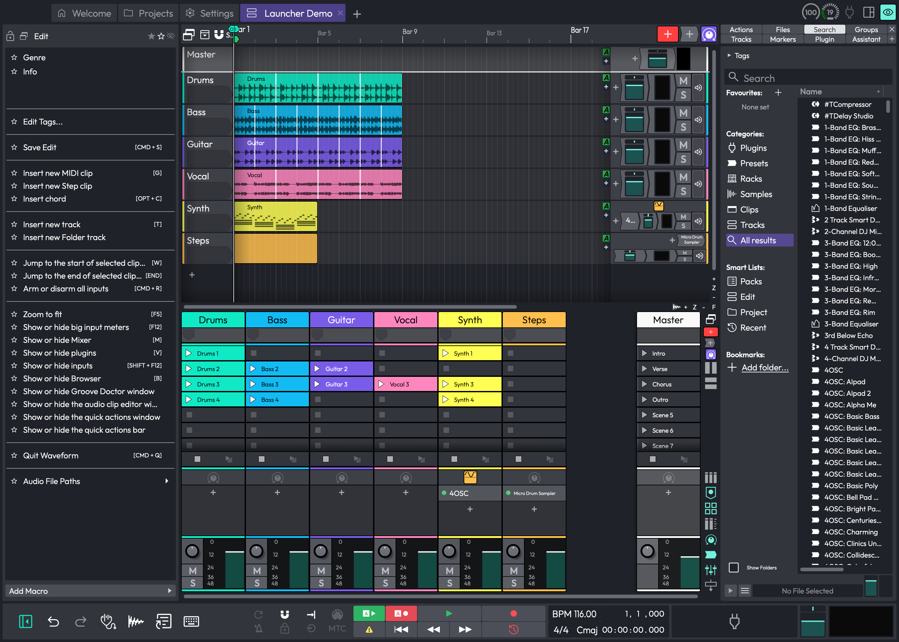

*Clip Launcher Playback*

## Playing and Stopping Clips

To trigger a clip in a slot, press its play button. This also starts
playback in the arranger.

If the Edit is already playing, the clip waits for the next launch
quantisation point before it starts. This is 1 bar by default, and you
can change it with **Global launch quantisation** in the Master track's
Actions panel.

Re-triggering a clip that is already playing starts it again from the
beginning.

To stop a clip, press the track's stop button below the slots. Stopping
is quantised too. The stop button on a Folder track stops every
clip in slots inside the folder, and the one on the Master track stops
every clip in the Edit.

Right-click an empty slot to **Insert MIDI Clip**, **Insert Step Clip**
or **Paste** into it.

> 📝 **Note:** Disabled clips, and clips whose audio file is missing,
show a greyed-out play button and can't be launched.

The clip launcher supports every clip type, so you can play MIDI, Step
and Edit clips as well as Audio clips. Make sure the tracks holding MIDI
and Step clips have instruments on them.

## Scenes

A row of slots across multiple tracks is called a scene. You can trigger
all clips in a scene with the scene buttons on the Master track. They
all start together, quantised from the same point. If launch
quantisation is off, clips start from their beginning as soon as you
launch them.

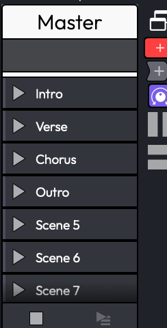

*Clip Launcher Scenes*

When you have content in several scenes, triggering clips in another
scene stops the clip that was playing. This lets you move through the
sections of your song and keep everything in sync.

Launching clips also plays back the arranger transport. To keep launched
clips in sync with the arranger, moving the cursor during playback
waits for the next launch quantisation point. This is the **Quantise
transport position changes** option on the Options menu and the
Timeline's right-click menu (on by default). It only works with a Bars
& Beats timeline. Turn it off to move the cursor straight away. Jumps
to markers wait in the same way (see [Navigating by
Markers](using-markers.md#navigating-by-markers)).

The wait follows the global quantisation too. Shorter quantisation
times give quicker jumps, but your bar positions may drift out of sync.

When the cursor moves, or the arrangement loop wraps round, launched
clips carry on from where they were rather than jumping to a different
point in the clip.

### Managing Scenes

Click the add button below the scene buttons (tooltip *Adds a new scene*) to add a scene,
and drag scenes up or down to reorder them. Select a scene to see its
settings in the Actions panel: its **Name** and **Colour**, plus
**Duplicate** (D), **Insert Scene Before**, **Insert Scene After** and
**Delete** (which
deletes all the selected scenes).

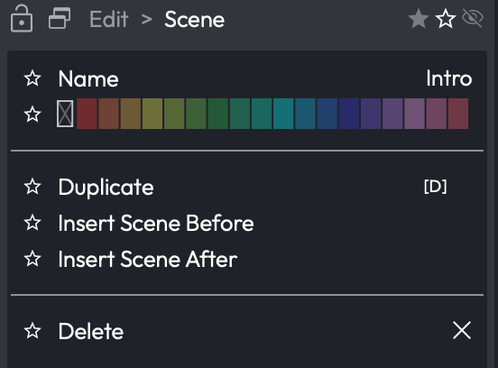

*Scene properties in the Actions panel*

To play the clips on the arranger tracks, use the play-arranger
buttons: the one on each track switches that track
back to its arrangement clips, and the one on the Master track does this
for all tracks. The same switch is the **Playback arranger** property in
a track's Actions panel. Launching a clip turns the track's
arrangement clips off again.

## Clip/Slot Properties

Launcher clips have most of the same properties as arranger clips.
However, you can't adjust their start, or their length if they're
looping, because that depends on when and for how long they are
launched.

The offset property sets where in the launched clip playback starts.

You can adjust the loop start/end points using the Actions panel or the
[Detail Editor](detail-editor.md) (Clip tab).

In the Detail Editor, a looping Audio clip shows a start flag, which sets
where playback starts within the loop, and has no Length property. An
unlooped Audio clip can be longer than its audio file: drag its end flag
past the end of the file, and the editor shows the extra length.

By default, clips follow the global quantisation, but the clip's
**Launch quantisation** property can override it.

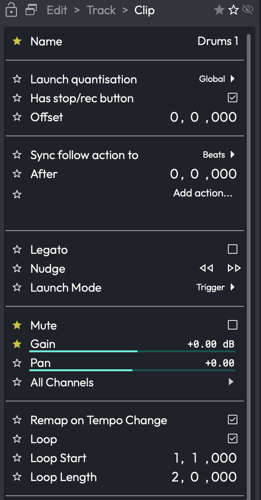

*Clip Properties*

### Legato and Nudge

**Legato**: When Legato is on for a slot, playing that slot takes over the previously playing clip's position. Use it when you have several variations of the same clip and want to switch between them without losing position.

**Nudge**: Moves a clip's play position forwards/backwards by the global quantisation amount.

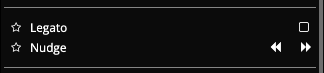

*Legato and Nudge*

### Launch Modes

Set these with the clip's **Launch Mode** property.

**Trigger**: The default mode. Launches the clip when you press the mouse button or controller pad, and ignores the release.

**Gate**: Launches the clip on the press and stops it on the release. Often used for sound effects or one-shot samples.

**Toggle**: Launches the clip on the press, and the next press stops it. The release is ignored.

**Repeat**: Holding down the mouse button or controller pad launches the clip repeatedly at the global quantisation period.

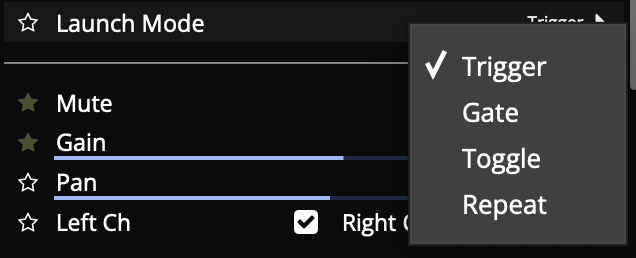

*Launch Modes*

### Slot Properties

Slots have a **Has stop/rec button** property. Turn it off to remove
the slot's stop button. Then, when that slot's scene is launched, a
track that is already playing a clip and has no clip in the new scene
keeps playing it instead of stopping. This is useful for a longer clip
or a loop that repeats through a whole song.

## Recording

> 🎥 [Video explaining recording to the clip launcher](https://youtu.be/sQ3Epfh1zFY)

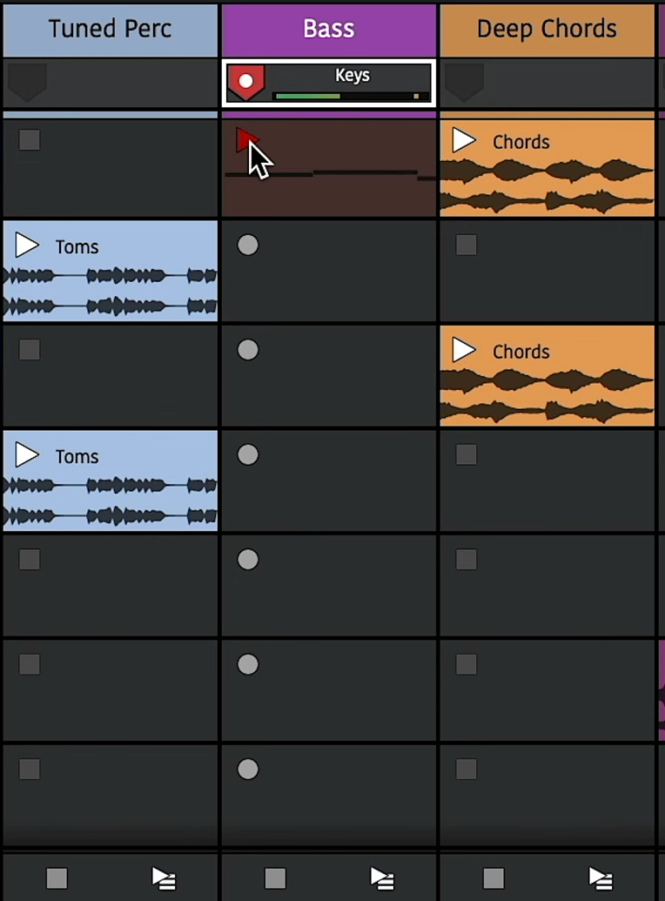

*Clip Launcher Recording*

Recording into empty slots works much like playback, but first you need
to assign an input to a track and arm it, in either the arrangement or
the Mixer. The stop buttons change to record buttons to show the track
is armed.

To record to a slot, press its record button. Recording is quantised the
same way as triggering playback, and you'll hear any count-in you have
set globally. Once the clip appears, play the input to record it. You'll
see a preview of the content as you play.

When you're done, press the track's stop button to stop recording, or
the recording clip's play button to launch it. Recorded clips are
quantised so they play back in time with the song.

Recording to a new scene on a track stops the previous one, so you can
record multiple takes or versions across different scenes.

### Record Length

Select an empty slot and turn on its **Limit record length** property to set how long recordings into that slot are. Recording then stops automatically after that length, which makes it quick to record loops into an arrangement.

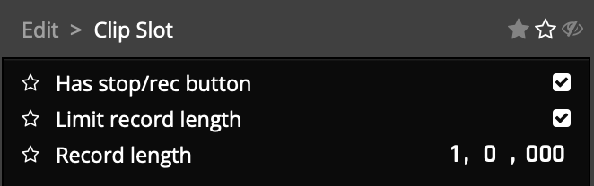

*Record Length Property*

## Performance Recording

> 🎥 [Video explaining capturing a clip launcher performance to the arranger](https://youtu.be/IVMlTjLriuY)

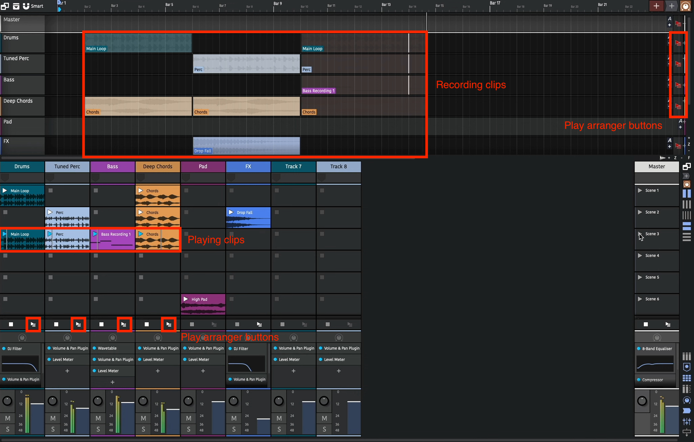

*Clip Launcher Performance Recording*

The clip launcher works well for live performance. Sometimes, though,
you want to capture a performance so you can edit it later. This is
called performance recording. To record a performance, turn on the
global record button. Launched clips are then copied to the arranger as
they play.

When you stop the launched clip, the arranger clip being recorded stops
too. The new clip isn't active yet, because playback is still in the
launcher. Press the track's play-arranger button to hear it.

It sounds the same as the clip did when you launched it: its start, end,
offset and loop boundaries are all kept.

You can record several tracks at once, and the recording captures every
clip or scene you launch.

You can then fine-tune these arranger clips or render the Edit.

## Sequencing (Follow Actions)

> 🎥 [Video explaining clip launcher sequencing and follow actions](https://youtu.be/JYDDkxRHXtM)

The [Playback](#playback) and [Scenes](#scenes) sections show how to
trigger slots and scenes by hand. Follow Actions automate this: they
set which clips launch next and when, so you can build sequences
algorithmically.

Follow actions are in the Actions panel when a clip is selected.

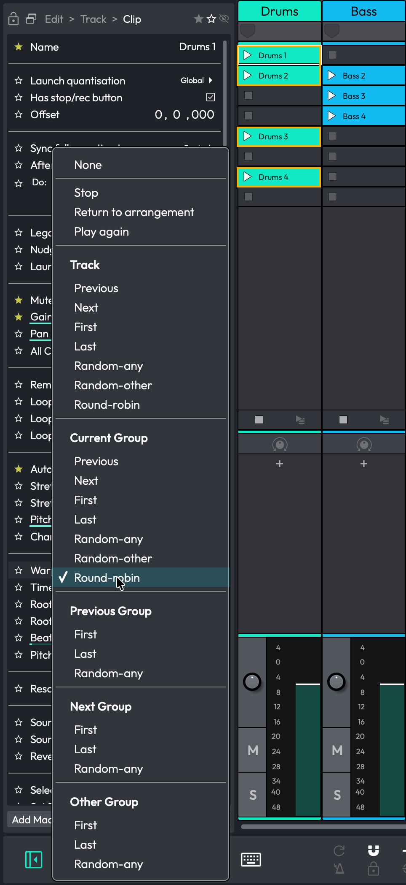

*Clip Follow Actions*

The first property, **Sync follow action to** (**Beats** or **Num loops**),
sets whether the action happens after a number of beats or a number of
loops. Set the number with the **After** property below it. If the clip
isn't looping, the loops option triggers at the clip's end.

### Global Actions

The row below shows the action to perform. Click its button for the
actions menu. At the top are **Stop**, **Return to arrangement** and
**Play again**, which stop the clip, play back the arranger track or
start the clip again from the beginning.

Below them are clip navigation actions in several scopes.

### Track Scope

The "track" scope means all launcher clips on the track are considered
for the action.

The track scope's actions pick the previous or next slot, the first or last slot
in the track, any random slot in the track, any random slot other than
the one playing, or round-robin (the same as next, except that it loops
round to the first slot after the last).

To set the follow actions for several clips at once, select them all.

If the action lands on a slot with no clip, the playing clip stops. In the image above, after the
last clip is played, playback on that track will stop. To loop back
round to the first clip, select **Round-robin**.

### Other Scopes

The other scopes reduce the number of possible clips to choose from. A
group is any number of consecutive clips in the track. The image above
has three groups.

If you set all these clips to **Group: Round-robin**, starting any of
them loops round the clips in its group. For example, after the last
clip in the first group plays, the first clip in that group plays next,
and so on.

The other group scopes work the same way. The actions under
**Previous Group** and **Next Group** pick clips in adjacent groups, and
those under **Other Group** pick from a different group to the currently
playing one.

By grouping related clips, such as variations of a chorus bar, you can
use the scene triggers to move through the sections of a song.

### Action Probabilities

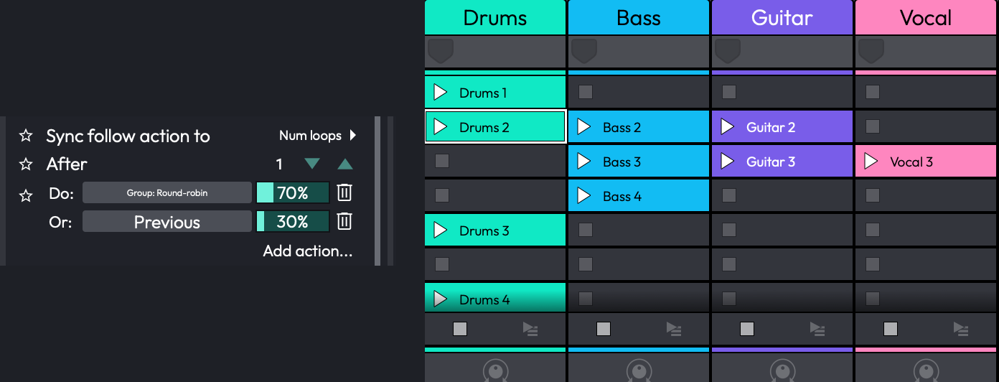

*Clip Follow Action Probabilities*

The clip in the image above has two actions. The slider next to each
action is its "weight", the probability that it will be performed.

Add an action with the **Add action...** button, and move its slider to
change the probability that it's triggered. The probabilities always add
up to 100%, so changing one changes the others. To remove an action,
press its trash can (delete) button.

Combining actions with different probabilities gives you varied musical
progressions. For example, a random walk can be
configured by setting the last three clips to have a 70% chance of
performing the **Round-robin** action and a 30% chance of the
**Previous** action. Play the first clip, and the following clips
usually play in turn, but sometimes playback moves back a scene.

These clip changes can be recorded to the arranger using the global
record button (see [Performance Recording](#performance-recording)). You can then replay the result
without the randomness.

## External Controllers

> 🎥 [Video explaining using the clip launcher with external controllers](https://youtu.be/hW3aw1sACdc)

You can use external controllers to launch clips in much the same way
as in the arrangement.

### Configuration

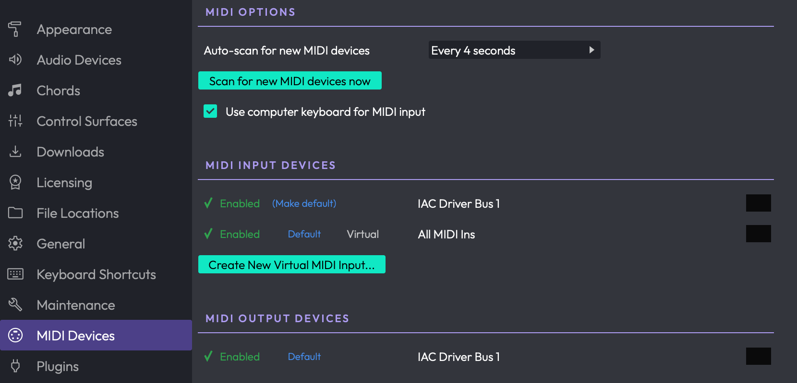

*Controller MIDI Settings*

First, go to *Settings > MIDI Devices*. If your device isn't shown,
press the **Refresh Devices** button. Once it's visible, make sure all
its input and output devices are set to **Enabled** in the list.

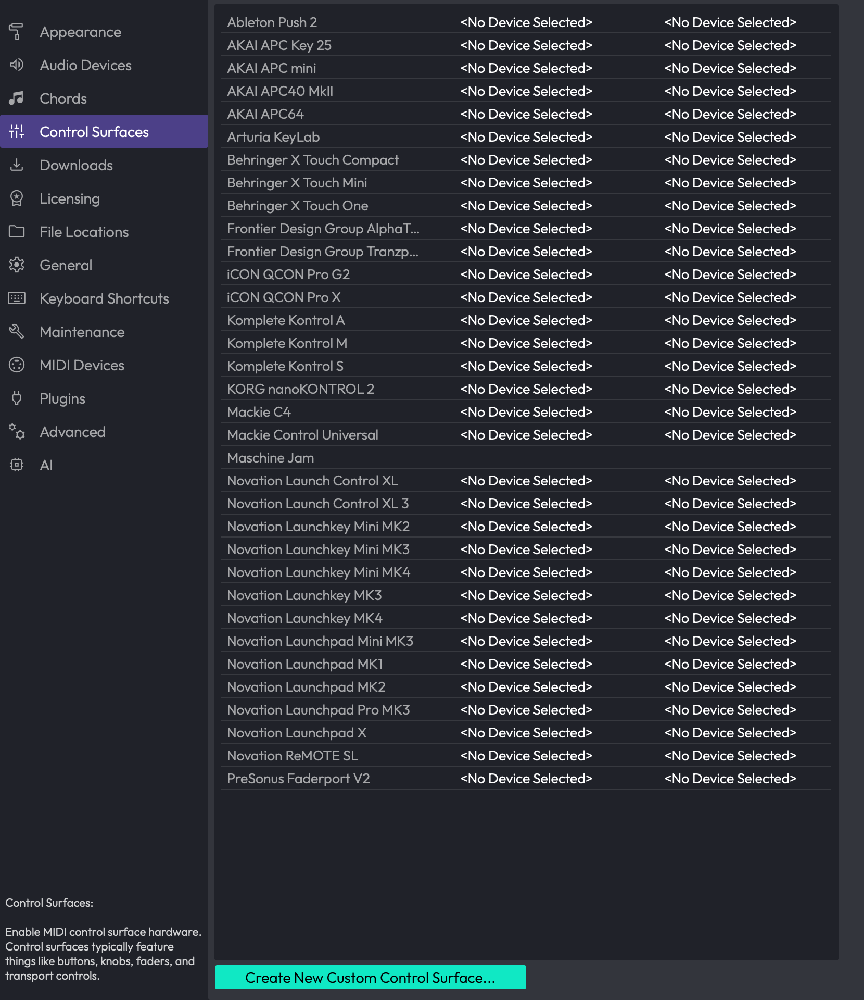

*Control Surface Settings*

Next, go to *Settings > Control Surfaces* and select your device. Make
sure the correct **Input Device** and **Output Device** are selected in
the control surface properties.

You can also pick a highlight colour to mark the controlled clips in the
launcher: select a colour and turn on **Colour Clip Slot Selection**.

### Playback and Recording

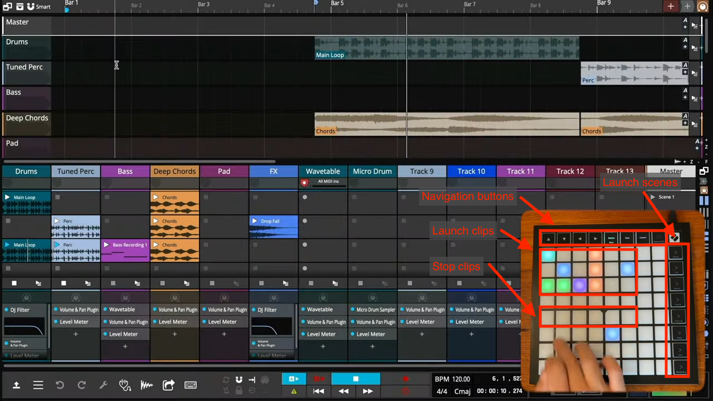

*Control Surface Buttons*

Control surfaces vary by model but most have buttons to launch clips,
launch scenes and navigate around the clip launcher.

Pressing an empty button on a track will stop playing clips on that
track.

If the track is armed for recording, pressing the button corresponding
to an empty slot starts recording into that slot.

Most controllers can also be used as MIDI input devices. Press the
**Note** button at the top to switch the device to MIDI input mode. The
cells can then record MIDI notes into the recording slot. Pressing the **Custom** button can change the
layout to a drum grid.

### Mixer Control

Some devices have a **Mixer Mode** that lets you adjust track and
plugin parameters in your Edit. See your device's user manual for what
it can do.

The Launcher Expansion also unlocks Ableton Link, for syncing tempo with
other apps and devices. See [Ableton Link](reference-settings.md#ableton-link).

## ⚡ Things to Watch Out For

- Clip operations that only make sense in the arrangement aren't offered
  for launcher clips: split, crop, heal, consolidate, reverse, insert
  silence, **Convert to Step Clip**, **Merge**, **Remove Silence** and fades.
- Launcher clips can't be rendered in place or flattened, and Flatten
  leaves them alone.
- A track that is playing its clip launcher renders as silence. The
  Render dialog warns you when this applies. Switch those tracks back to
  **Playback arranger** to render their arrangement.
