# Clip Layer Effects

Clip Layer effects give you quick offline rendering of many common audio
processes, arranged as layers on the clip. You can add, remove and
rearrange layers at will, and the effects render in quickly. Effects are
applied from the top layer down.

Clip Layer effects are particularly useful for clip-based volume
automation, converting to mono and normalising, though they can do much
more.

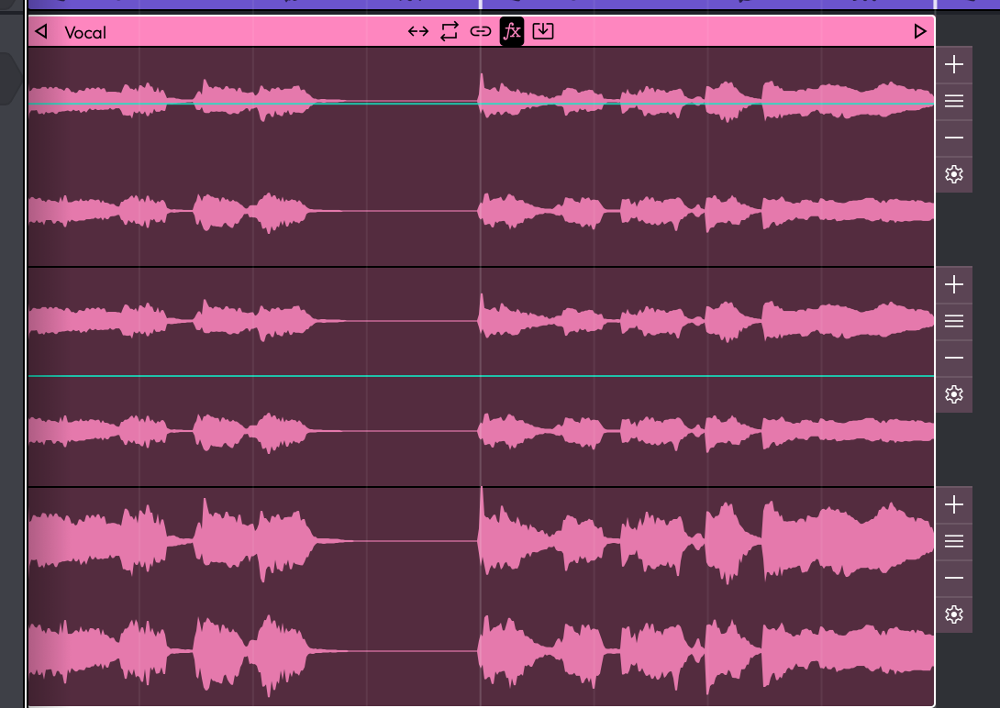

*Example Clip Layers*

To use Clip Layer effects, click the FX button in the header of any
Audio clip (or right-click the clip) and choose **Add clip effect**. The
same menu also has **Remove all clip effects** and **Show clip effects**.

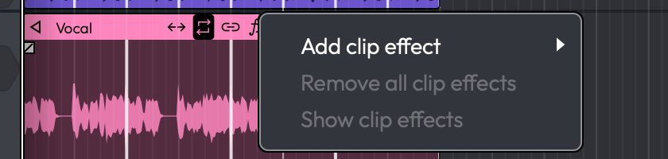

*Audio Clip Header FX Menu*

Then choose an effect from the list. Each one is described below.

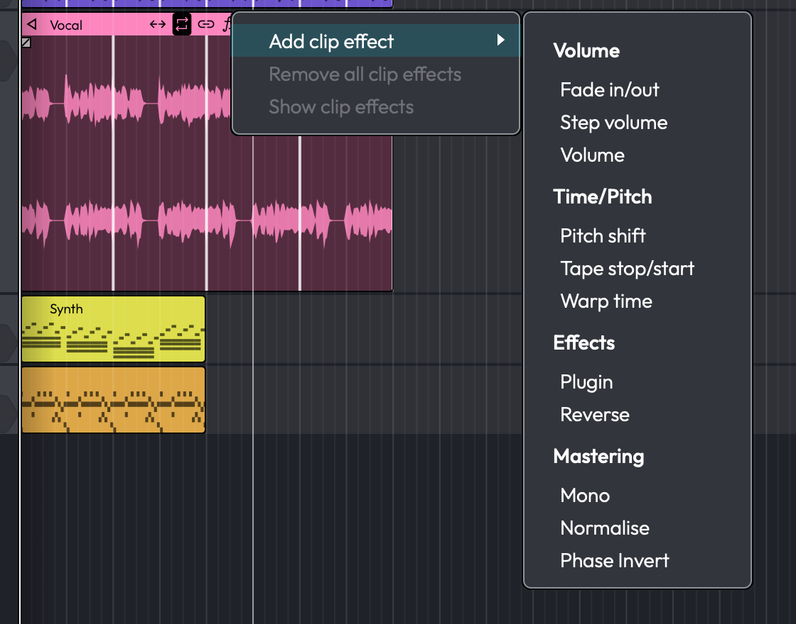

*FX Menu Add Effect Options*

The Clip Layer appears on the clip. When you hover over it, a set of
controls appears to the right, as shown in this diagram.

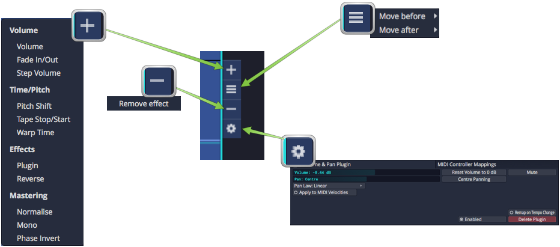

*Clip Layer Controls Diagram*

- **Add** (+): Adds a new layer directly below this one, from the same
  list of effects.
- **Move** (menu icon): The **Move before** and **Move after** submenus list
  the layers by number and type, and plugin layers also show the plugin's
  name. Pick a layer to move this one before or after it.
- **Remove** (-): Opens a menu with **Remove effect**, which deletes the
  layer.
- **Settings** (gear): Shows the layer's settings. Only layers that have
  settings show it.

Plugin layers also have an **A** button. It lists the plugin's
parameters so you can pick which one the layer's curve shows and edits;
parameters that already have a curve are coloured.

> 📝 **Note:** Clip Layer effects don't work in the clip launcher. When
you drag a clip with effects into a launcher slot, Waveform removes its
clip effects and tells you so.

## Volume - Volume

A volume layer is Waveform's way to do clip-based volume automation, and
you may find yourself using it instead of track automation for volume.

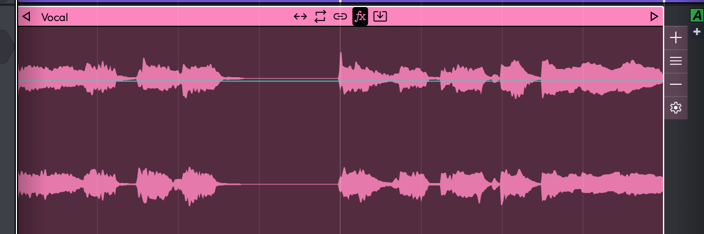

*Volume Clip Layer*

Click the gear icon on a volume layer to see its Volume & Pan control
values in the Actions panel.

To edit the volume automation curve itself, click the curve (at first it
shows as a straight line) and its settings appear in the Actions panel.

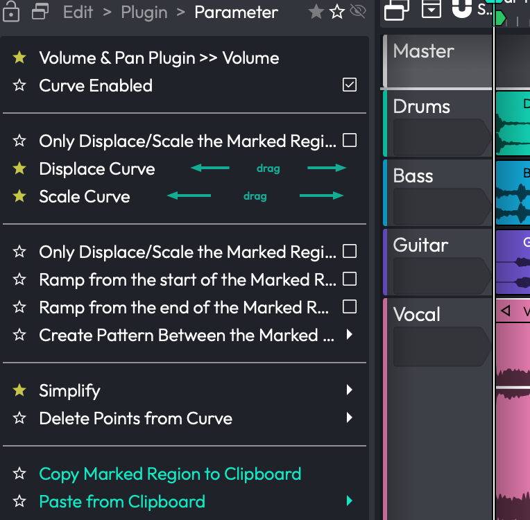

*Volume curve settings in the Actions panel*

> 💡 **Tip:** Everything about editing track automation curves applies to volume Clip Layers too. See [Automation](automation.md).

## Volume - Fade

Fade-ins and fade-outs are also available as layers. Once you've added
the fade layer, drag the left or right fade handle to create the fade-in
or fade-out.

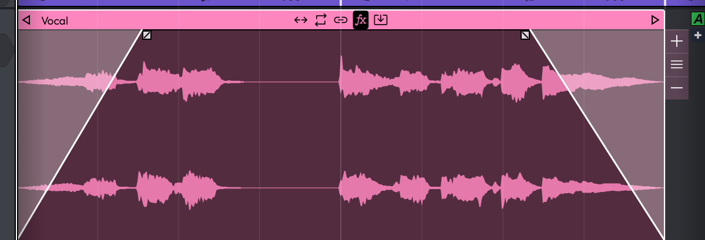

*Fade In/Out*

> 💡 **Tip:** Right-click a fade handle to set the fade shape.

## Volume - Step

Add a step volume layer to rhythmically gate the clip.

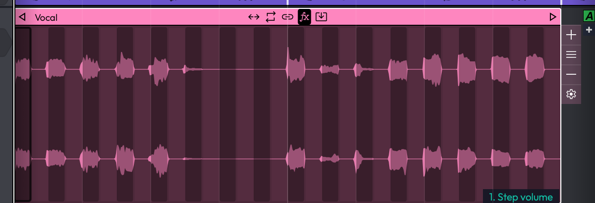

*Step Volume Layer*

With the step Clip Layer in place, click the gear icon at the right of
the layer and use its settings in the Actions panel to set the step size
and divisions. Then edit the grid of steps: click a cell to switch it on
or off, and drag across cells to set them the same way. Hold Shift as you
click or drag to fill cells, or Cmd / Ctrl to clear them.

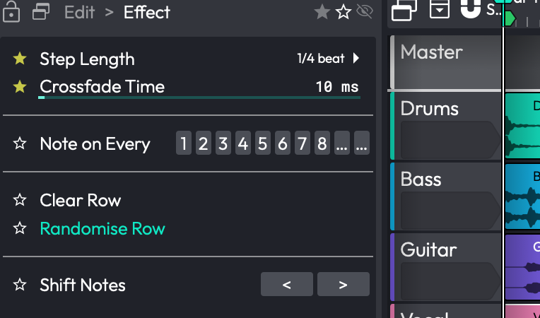

*Step Volume settings*

## Time/Pitch - Pitch Shift

Add a pitch shift Clip Layer to get an automation curve for pitch. Add
points and automate it like any other effect, for anything from simple
pitch offsets to dramatic pitch sweeps.

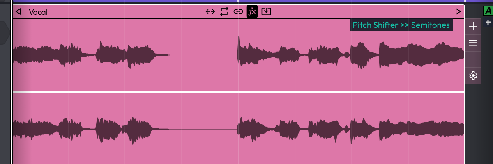

*Pitch Shift Layer*

When you select the pitch curve on the clip, the Actions panel shows the
usual controls for automation curves.

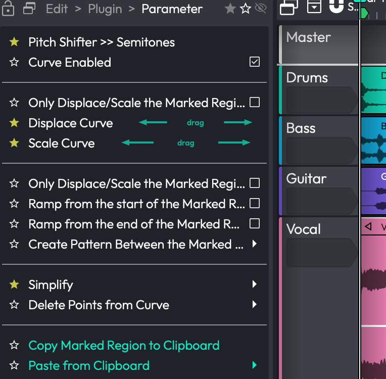

*Pitch Curve settings*

## Time/Pitch - Tape Stop/Start (Pitch Fade)

You can right-click the fade handles on any Audio clip to apply pitch
fades. The Tape Stop/Start layer does the same thing as a Clip Layer
effect.

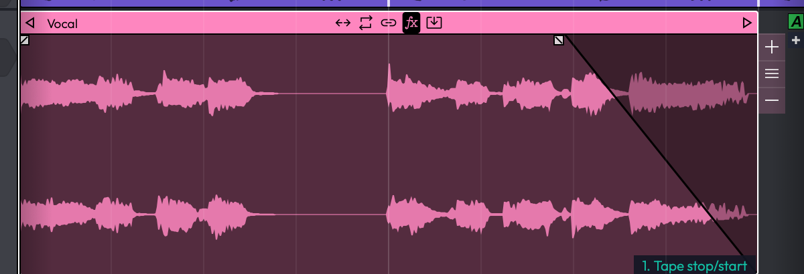

*Tape Stop/Start Layer*

Right-click the fade handle to choose the shape for the curve.

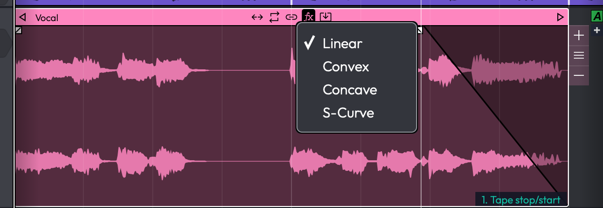

*Tape Stop/Start Fade Options*

## Time/Pitch - Warp Time

You can enable **Warp Time** on the clip itself (from the Actions panel or
the [Detail Editor](detail-editor.md)), or add a warp time Clip Layer.

The header area of the Clip Layer appears shaded. Click anywhere in the
shaded area to add a warp marker.

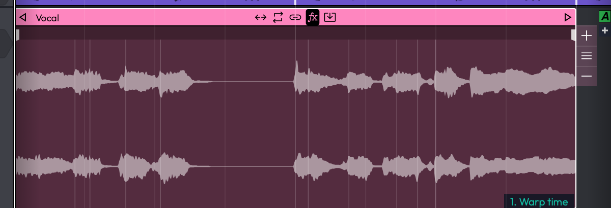

*Warp Time Clip Layer - Click to Add Marker*

Drag a warp marker to time-stretch the audio between warp markers.

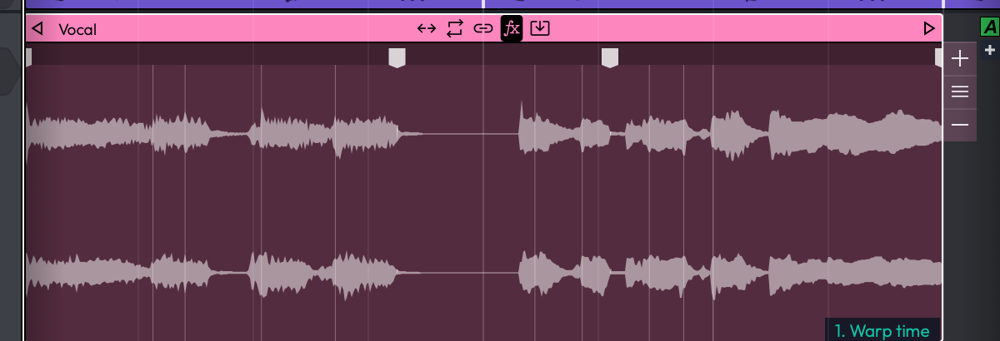

*Drag to Warp*

To remove a warp marker, right-click it and choose to remove that marker
or all markers.

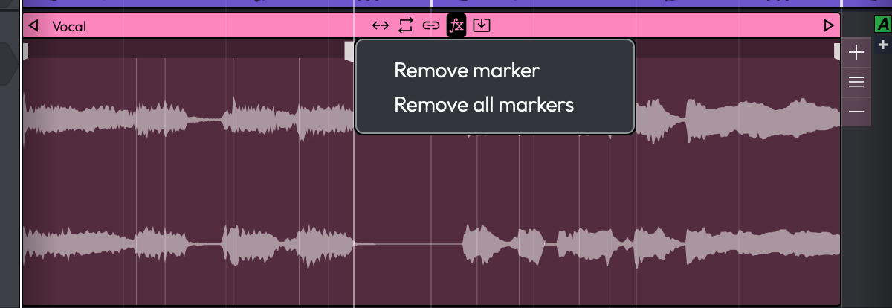

*Right-click to Remove Warp Markers*

The Clip Layer is convenient when you want to align transients to
things happening on other tracks in the Edit, because you see the timing
in relation to the rest of the Edit.

## Effects - Plugin Layer

A plugin Clip Layer lets you put any plugin, including third-party
effects, on a layer.

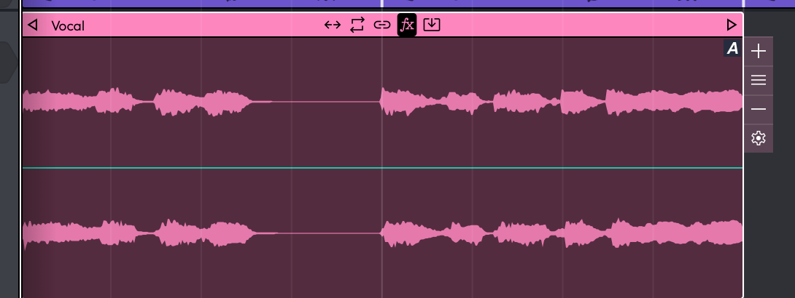

*Plugin Layer*

Waveform asks you to choose a plugin as you add the layer. When you
hover over the layer, a label at its lower right shows the layer's
number and the plugin's name, for example "1. Plugin: Chorus".

The key things to know about plugin Clip Layers:

- Click the gear icon at the right to open the plugin UI. When you tweak
  parameters, the change is rendered in after a few seconds.
- Click the **A** at the top right to show automation curves. Select any
  exposed parameter to make its curve visible, then draw in automation
  with the standard automation editing tools.

> 📝 **Note:** Because of the way rendering works, changes to plugin parameters are hard to audition, so plugin Clip Layers suit applying known presets best. For a lot of real-time tweaking, put the plugin on the clip itself (see [Clip Effects](clip-effects.md)) or on the track instead.

## Effects - Reverse Clip Layer

Add the reverse Clip Layer and the audio in the clip plays backwards.

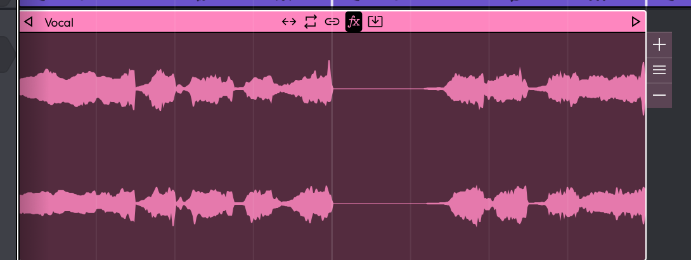

*Reverse Layer*

## Mastering - Normalise Layer

Normalise adjusts the gain of the audio so that it uses all of the
available bit depth, much like "zoom to fit" in image editing software.

To use it, first add a Normalise layer.

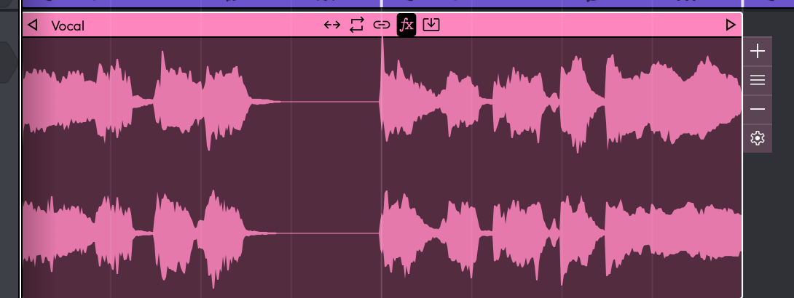

*Normalise Layer*

Then set **Peak level** (-60 to 0 dB) to put the peaks where you want
them. In voiceover work, clients often ask for audio normalised to -3 dB.

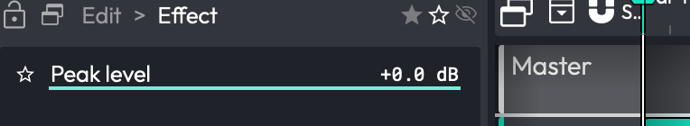

*Normalise Peak level setting*

## Mastering - Mono Layer

The mono Clip Layer is the most convenient way to convert a clip to mono
in Waveform.

First add a mono Clip Layer:

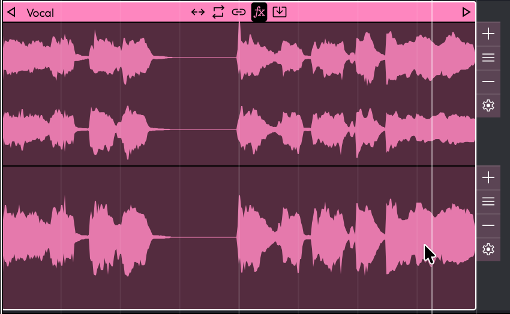

*A stereo Normalise layer above a Mono layer*

Then set **Method** to choose how to render to mono from stereo: **Use
average of all channels**, **Use left channel only** or **Use right channel
only**.

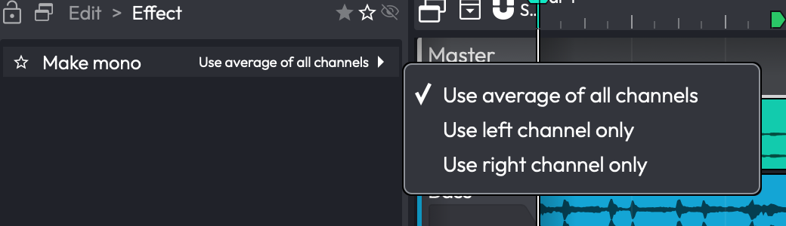

*Mono Options*

> 📝 **Note:** **Use average of all channels** is the usual choice. It mixes the left and right channels together to create a mono version.

## Mastering - Phase Invert Layer

The phase invert Clip Layer flips the polarity of the waveform.

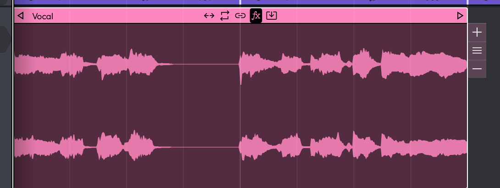

*Phase Invert Layer*

## Moving On

To put plugins directly on individual Audio clips, see
[Clip Effects](clip-effects.md). For more on stretching audio with warp
markers, see [Warp Time](warp-time.md).
