# Comping

Comping is an editing technique where you pick the best phrases from
several takes to build a composite, or "comp": the best possible take.
Engineers have done this for years, and Waveform makes it much easier
than the traditional methods.

Comping typically starts with takes recorded in **Loop** mode, covered in
[Loop Recording](loop-recording.md).

You can also build composites from any collection of tracks with comp
groups; see [Setting up a Comp Group](#setting-up-a-comp-group).

## Copy Your Edit

Before you start comping, make a copy of the Edit, so you can go back
to the raw takes if you later want to build the comp a different way.

> 📝 **Note:** This chapter assumes you've already recorded takes using
the technique in the previous chapter. If not, go back to
[Loop Recording](loop-recording.md) and record some.

The quickest way is *File > Save edit as...*. It suggests a numbered
name; the copy is added to the same Project and becomes the Edit you
keep working on, while the original stays as you last saved it. For a
snapshot of the whole Project, use *File > Backup edit and project
files...* and give the backup a name.

You can also make the copy from the Projects tab:

1.  Save the Edit with *File > Save edit* (Cmd + S / Ctrl + S) when you
    finish loop recording.
2.  Go to the Projects tab and select the correct Edit. In the Controls
    panel, click **Create a Copy**.
3.  Add a revision number to each Edit's name to keep them organised:
    click each Edit, then edit the **Name** property.
4.  On the original Edit, add a comment that says, "This version is
    before comping" or similar.
5.  Close the tab for the original Edit and open the new copied version.

Making copies of your Edits and naming them logically works like a
revision control system: you can always roll back if something goes
wrong or you change your mind.

## Comping Takes

To comp the takes:

1.  Select the Audio clip that contains the takes you want to comp.

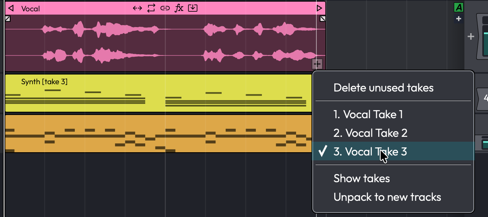

*Takes Follow Loop Recording*

2.  Click the plus (+) icon in the lower right corner of the clip and
    select **Show takes**. The clip expands to show all of the
    individual takes. If you play back over this section of the Edit,
    you hear the last take from loop recording.

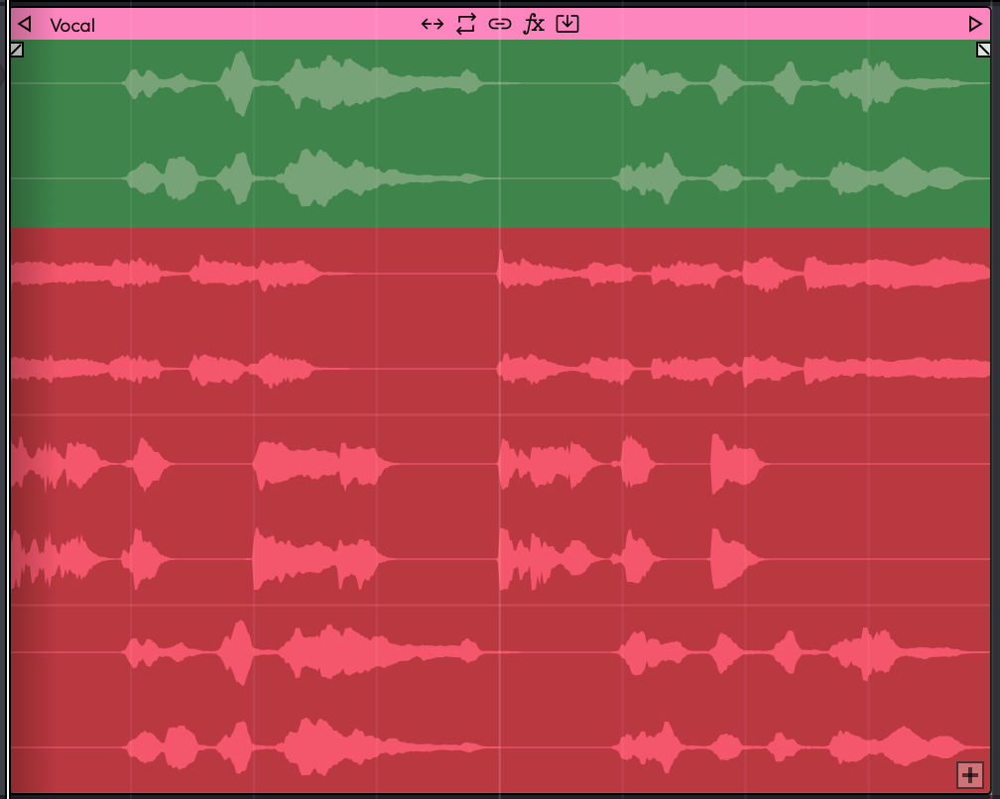

*Takes in the Expanded View*

3.  To build a composite take, click and drag a range over a phrase from
    any take. That phrase is instantly promoted to the active take. This
    drag-to-select action is called "swiping".

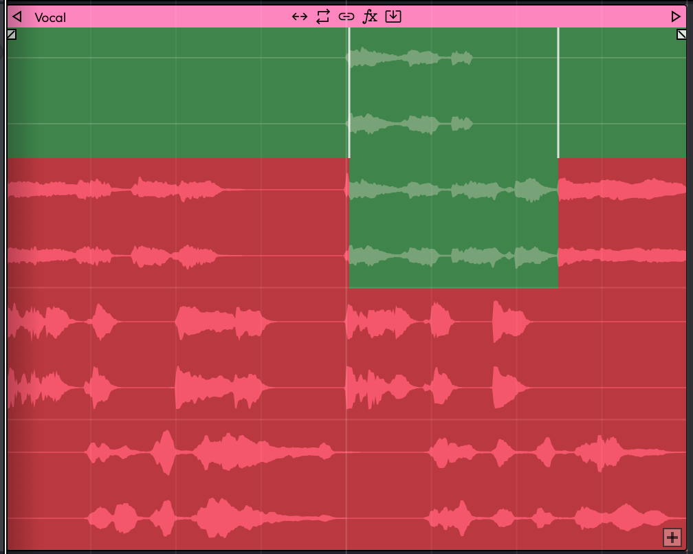

*Swipe a Phrase to Add it to the Active Take*

> 💡 **Tip:** While comping, it helps to have the cursor return to where
playback started whenever you stop. Turn on *Options > Return to start
on play*, so you can audition phrase by phrase without repositioning the
cursor each time.

4.  Keep swiping and auditioning to build up the composite. To switch a
    selected phrase to a different take, click another take, and the
    selection moves to it.

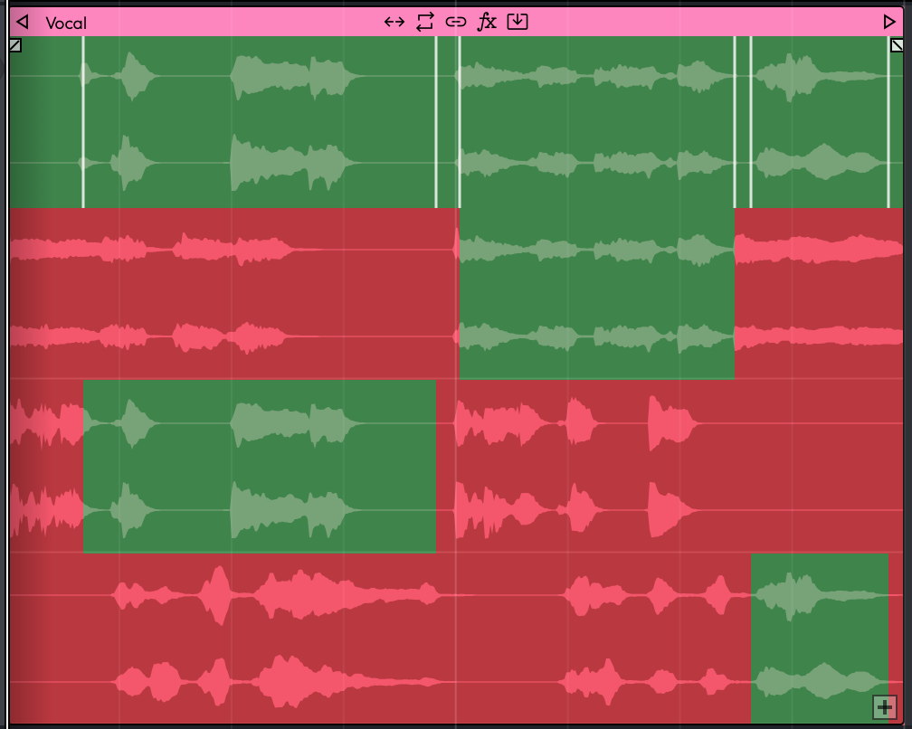

*Building the Composite Take*

5.  If the swipe selection doesn't fully enclose a phrase, drag either
    edge of the selection to trim it.

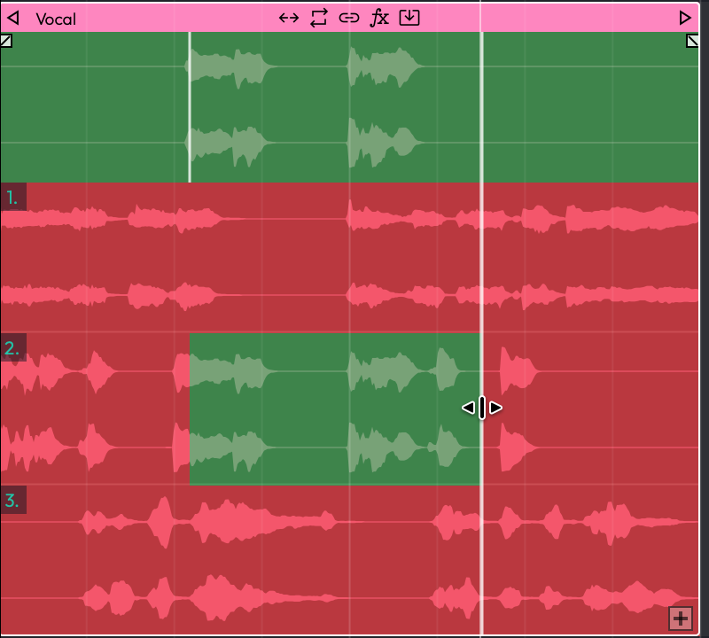

*Trim the Edges of a Selection*

> 📝 **Note:** Sometimes you'll use a little from every take; other
times you'll mostly use one take and fix a couple of bad phrases.

When you've finished, click the plus (+) icon and select **Hide takes**.

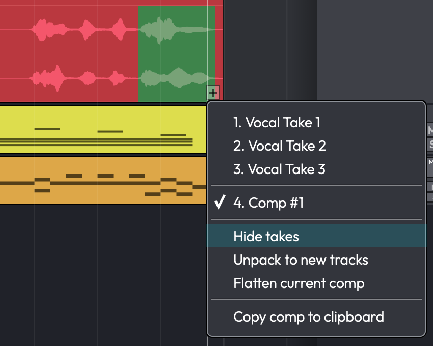

*Hide Takes*

> 💡 **Tip:** After comping, create another copy of the Edit and add a
note that it was saved after comping, so you can roll back if you want
to make changes later.

## Flatten Comp

To remove the underlying takes from the Edit, click the plus (+) icon
on the clip and select **Flatten current comp**. This gives you the
option to delete the source files. The operation is permanent.

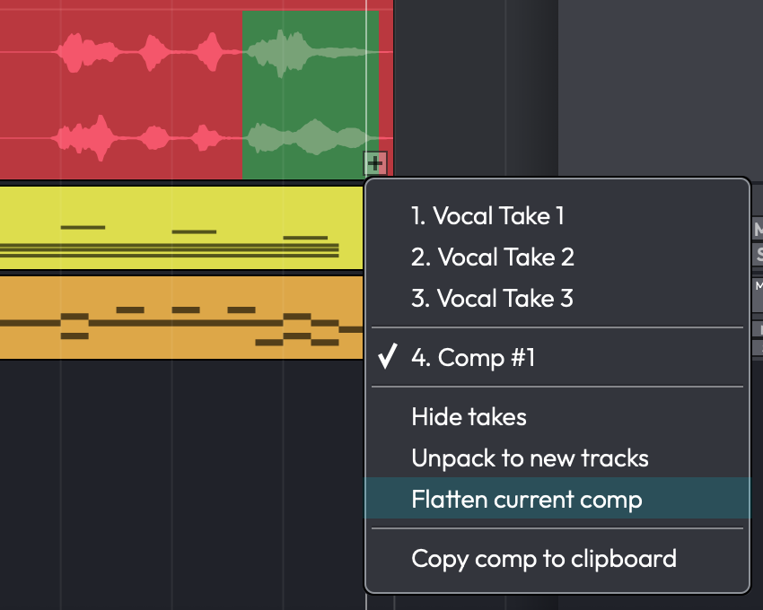

*Flatten Current Comp*

> 💡 **Tip:** Save a copy of the Edit before you flatten the comp. Avoid
the option to delete the source files, because it removes them from your
other saved Edits too.

## Other Takes Menu Options

The plus (+) menu on a clip with takes has a few more items:

- **Unpack to new tracks**: Puts each take on a track of its own, so
  you can edit or mix them separately.
- **Delete unused takes**: Removes the takes you aren't using. It
  appears when a single take is selected rather than a comp.
- **Copy comp to clipboard** / **Paste comp from clipboard**: Copies the
  current comp of an Audio clip, so you can apply the same choices to
  another Audio clip with takes.
- **Create audio comp** (MIDI clips only): **Create a new audio comp
  clip** renders the MIDI takes into a new Audio clip with takes, so you
  can comp them as audio; **Replace with a new audio comp clip** does
  the same and replaces the MIDI clip.

## Setting Up a Comp Group

Comp groups let you swipe comp across any group of tracks. It works
much like comping takes, except that you first add the tracks to a comp
group.

### Select Tracks to Comp

Select all the tracks you want to use to build the composite. These are
typically separate takes of a lead vocal or solo instrument, but any
collection of tracks works.

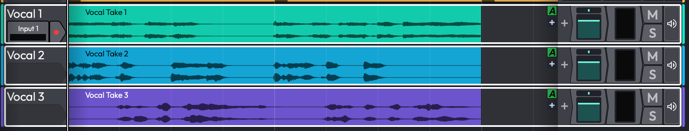

*Select the Tracks to Comp*

### Create a Comp Group

In the Actions panel, open the **Comp Group** menu and select **Add
group**. In the **Add Comp Group** dialog box, the name defaults to
*Comp Group 1*. Change it to something more descriptive if you like,
then click **OK**.

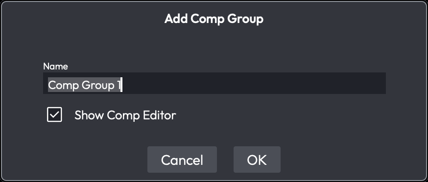

*Creating a Comp Group*

### Add a Track to a Comp Group

Any tracks selected when you create *Comp Group 1* are added to it
automatically. To add another track to it, select the track, open the
**Comp Group** menu and select **Comp Group 1**.

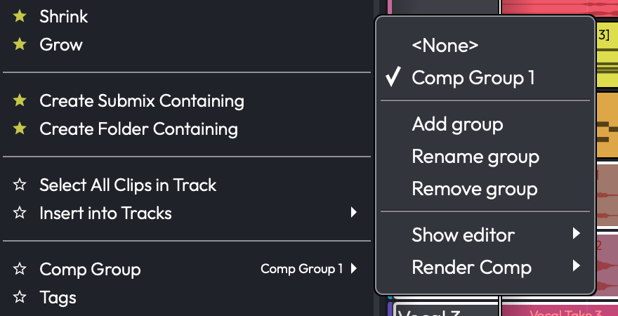

*Adding Another Track to Comp Group 1*

### Removing a Track from a Comp Group

To take a track out of a comp group, select the track, then select
**None** in the **Comp Group** menu.

## Comping Tracks Using a Comp Group

Once a comp group has tracks in it:

1.  Select one of the tracks, then select *Show editor > Edit track
    comps* in the **Comp Group** menu. This puts the tracks into comp
    mode.

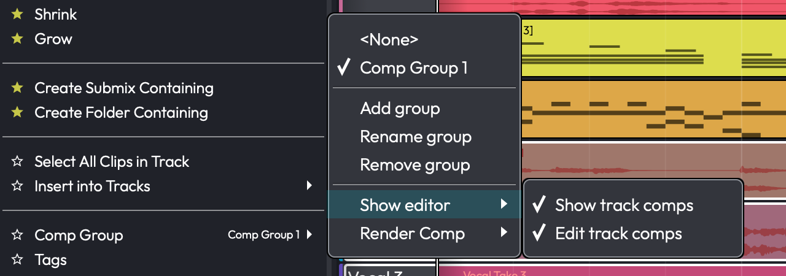

*Enable Comp Mode*

2.  Swipe to select phrases from any of the tracks. Only the selected
    phrases play back.

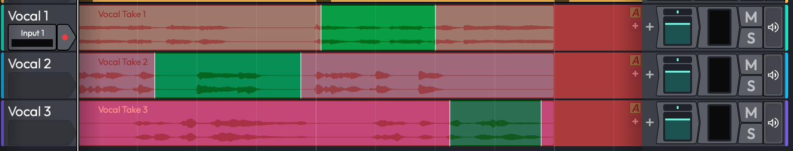

*Swiping Phrases to Create a Composite*

3.  Drag either edge of a selection to adjust it, as when comping takes
    (see [Comping Takes](#comping-takes)).

> 💡 **Tip:** For good control over the silent parts of a comp, add a
blank track to the comp group. To silence a section, swipe over that
range on the blank track.

## More Comp Group Options

The **Comp Group** menu has a few more options for working with comp
groups.

### Show Track Comps

When you turn on comp group editing with *Show editor > Edit track
comps*, **Show track comps** is turned on too. It colour-codes the swipe
selections on the tracks. You can also turn it on by itself, to see the
comp selections with **Edit track comps** off so you don't change them
by accident.

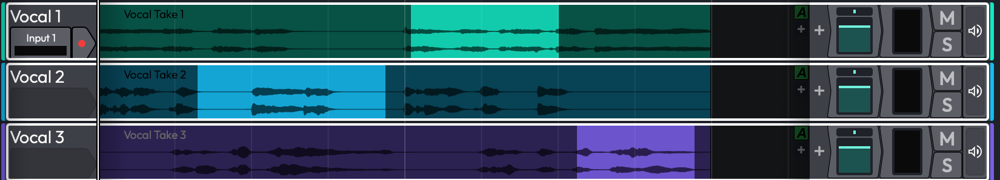

*Show Track Comps*

### Render Comp

When the composite is complete, you can render it to a single track.
The **Comp Group** menu's **Render Comp** submenu has two options for
this. **Render and replace comp group** replaces all the comp group
tracks with the resulting track. **Render comp group to a
new track** leaves the existing tracks in place and adds a new track
with the composite.

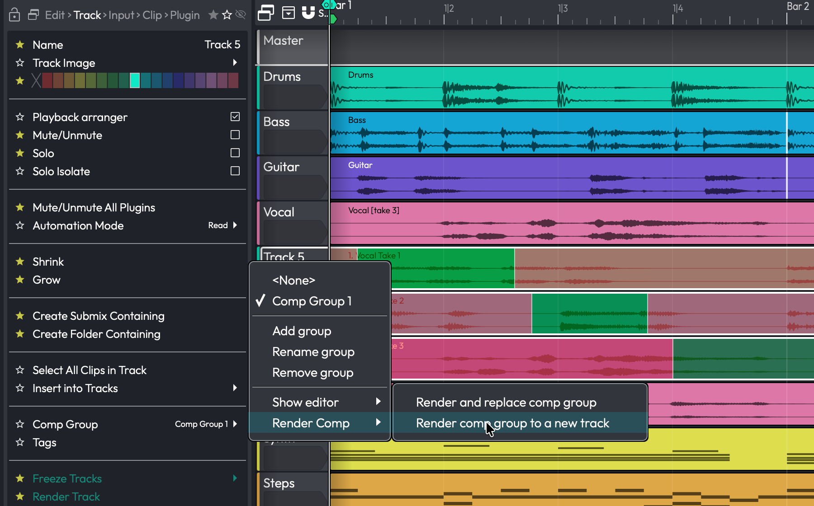

*Rendering a Comp to a New Track*

### Add, Rename, Remove

These options on the **Comp Group** menu add, rename and remove comp
groups.

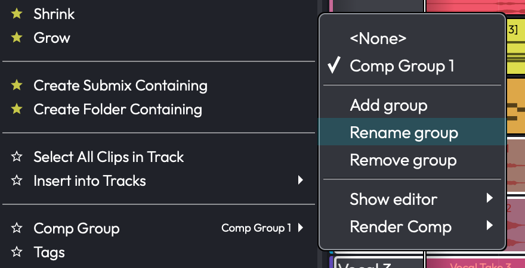

*Comp Group Management Features*

You can have as many comp groups active in the Edit as you want, and
they have uses beyond comping takes. For example, you could comp in
silence on tom tracks instead of gating them, or mash up two beats or
two different songs.

## Moving On

Next, [Using an Amp Simulator Plugin](using-an-amp-simulator-plugin.md)
shows how to record electric guitar directly through an amp simulator.
