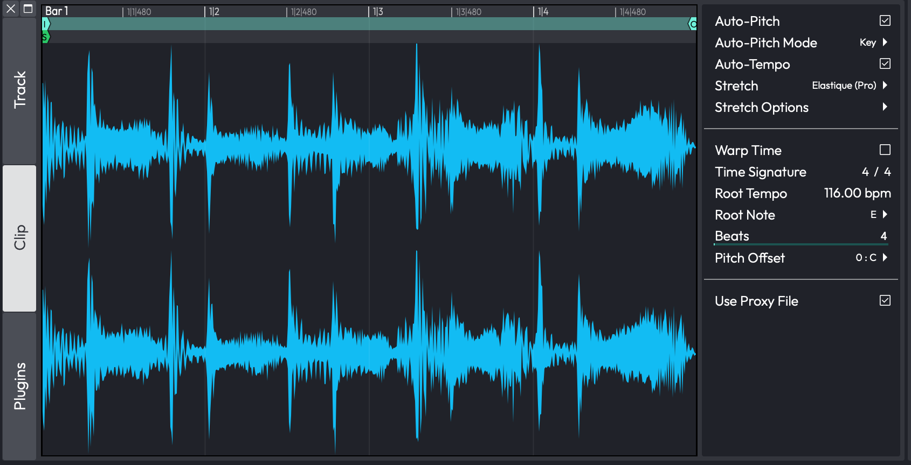
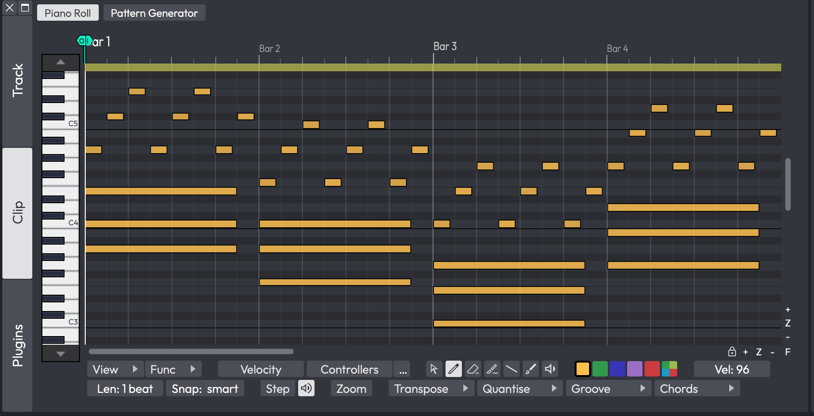

# The Detail Editor

The Detail Editor is a panel for working closely with the currently
selected track or clip. It has three tabs: **Track**, **Clip** and
**Plugins**, chosen with the buttons down its left-hand edge.

## Opening the Detail Editor

Choose *View > Show Content Editor* (the View menu's name for the Detail
Editor), or double-click a clip's header. For MIDI and Step clips the
double-click opens the Detail Editor unless **Double-click MIDI clip
header** in *Settings > General* is set to **Expands for in-line editing**
(see [General settings: MIDI](reference-settings.md#general-midi)). On a Mac, Ctrl + P
also shows or hides it (listed in Keyboard Shortcuts as **Show or hide MIDI
editor**). Windows has no default shortcut, but you can assign one to **Show
or hide Content Editor** in *Settings > Keyboard Shortcuts*.

*The Detail Editor's Clip tab for an audio clip*

*The Clip tab for a MIDI clip, with the Piano Roll and Pattern Generator buttons*

## The Track Tab

The Track tab shows the MIDI editor for all the MIDI clips on the
selected track. If the track has no MIDI clips, the tab shows *Select a
clip to edit*.

Clip automation also lives here, on the right-hand side, where you can
view and edit the automation curves recorded into the selected clip.
See [Clip Automation](automation.md#clip-automation) for how to work with
them.

## The Clip Tab

The Clip tab shows detail for the selected clip, and what you see depends
on the kind of clip. With no clip selected it shows *Select a clip to
edit*.

### Audio Clips

For an Audio clip the tab shows a waveform view of the clip, with the
clip's tempo and pitch settings on the right-hand side, such as
**Auto-Pitch**, **Auto-Tempo**, **Stretch**, **Warp Time**, **Root Tempo**,
**Root Note** and **Beats**. The same settings are also in the Actions
panel.

Flags in the waveform view set the clip's start and end and,
for a looping clip, its loop. A looping clip also shows a start flag that
sets where playback starts within the loop. You can grab a flag anywhere
along it. For a clip in a launcher slot, the end flag can be dragged past
the end of the audio file, and the view follows the extra length.

### Warp Time

When you enable **Warp Time** for an Audio clip, the waveform view in the
Clip tab becomes the zoomable Warp Time editor, where you can add and
drag warp points to bend audio into time. See [Warp Time](warp-time.md)
for the full workflow.

### MIDI Clips

For a MIDI clip, two toggles switch the tab between **Piano Roll**, the
MIDI editor scrolled to the clip, and **Pattern Generator**, which
generates the clip's notes from a pattern. The Pattern Generator applies
to every selected MIDI clip, and when more than one is selected the
toggle shows how many, for example **Pattern Generator (3)**. See
[Pattern Generator](pattern-generator.md).

### Step Clips

For a Step clip the tab shows the Step clip editor. See
[Step Clips](step-clips.md).

## The Plugins Tab

The Plugins tab shows the whole of the selected track's plugin chain and
its modifiers as a row of panels you can open individually, so you can
work on several of them at once. See
[The Plugins Detail Editor](plugins-detail-editor.md) for the full
chapter.

## Moving On

For more on an Audio clip's loop settings, see
[Working With Loops](working-with-loops.md), and for the Plugins tab see
[The Plugins Detail Editor](plugins-detail-editor.md).
