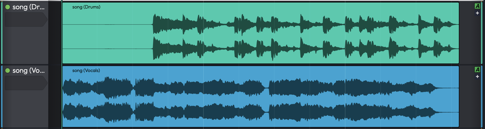
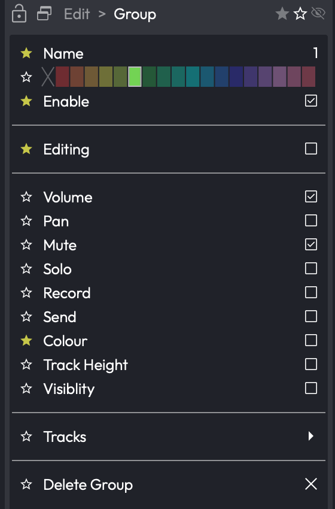

# Edit Mix Groups PRO { #edit-mix-groups }

> 📝 **Edition:** Waveform Pro, or with the Recording Engineer Expansion.

An Edit Mix Group links two or more audio tracks together so that an action you perform on one
member is mirrored on the others. Adjust the fader on a grouped vocal track and every other track in
the group moves with it; mute one and they all mute. This is the classic mixing-console idea of a
fader group, brought into Waveform's mixer. Only audio tracks can join a group.

Exactly *which* actions are linked is up to you. A group is not all-or-nothing: it has ten
independent link toggles plus a master **Enable** switch, so you might link only volume and mute on
one group, while another group links panning, solo and track colour as well. By default a new group
is enabled and links volume and mute; everything else stays off until you turn it on.

*Two audio tracks linked by an Edit Mix Group*

*A selected group's Actions panel, with its link toggles*

## What Gets Linked

Each group has the following toggles in the Actions panel. The **Enable** toggle is the
master switch: when it is off, the group does nothing, regardless of the other settings. Hover over a
toggle to see its tooltip (for example "Link volume operations").

| Toggle | Default | What it links |
|---|---|---|
| **Enable** | On | Master switch: when off, nothing in the group propagates |
| **Volume** | On | Fader moves, applied proportionally (relative balance is preserved) |
| **Mute** | On | Mute state |
| **Editing** | Off | Clip take selection and comp edits for clips at the same timeline position |
| **Pan** | Off | Pan, applied as an offset (relative pan positions are preserved) |
| **Solo** | Off | Solo and solo-isolate |
| **Record** | Off | Record-arm |
| **Send** | Off | Aux Send level and mute |
| **Colour** | Off | Track colour |
| **Track Height** | Off | Track height |
| **Visiblity** | Off | Track visibility (show/hide). The label is spelt this way in the app. |

> 📝 **Note:** Volume is linked proportionally and pan is linked as an offset, so grouped tracks keep
> the relative balance and panning you set up. They do *not* all snap to the same value. The reference
> positions used for this are captured at the moment the group is enabled or a track is added to it.
> Because the link is relative, a group sits on top of your existing mix balance: turning it off leaves
> every track exactly where it was.

## The Group Property Panel

Selecting a group (for example, by clicking its header icon, described below) shows its settings in
the Actions panel. Double-clicking a group in the **Groups** tab of the Browser opens the same
settings in an **Edit / Mix Group** pop-out window.

| Control | Purpose |
|---|---|
| **Name** | A label for the group. If you leave it blank, the group shows its list number instead. |
| Hue picker (no label) | Sets the group's display colour ("Changes the colour of this edit mix group"). |
| **Enable** and the link toggles | The master switch and ten link toggles described in the table above. |
| **Tracks** | A checklist of every audio track in the Edit. Tick a track to add it to the group, untick it to remove it. |
| **Delete** | Removes the group (shown as a red button). Deleting a group never deletes its tracks. |

> 💡 **Tip:** A group with no name displays its position in the list (1, 2, 3...) so you can still tell
> groups apart. Descriptive names such as "Drums" or "BG Vox" make busy groups easier to work with.

## Creating and Managing Groups

### Create a Group

- Select the tracks you want to link and run the command **"Create Edit Mix Group with selected
  tracks"**.
- Or right-click any selected track and choose the same item.
- Or open the **Groups** tab of the Browser and click **"Create New Group"**.

### Add or Remove Tracks

- Use the **Tracks** checklist in the group's settings.
- Or, from a track's Actions panel, click the **Groups** button to add the track to a new group, set
  it to **&lt;None&gt;**, or tick the existing groups it should belong to.
- To take tracks out of every group at once, select them and run **"Remove selected tracks from Edit
  Mix Groups"**. A group that becomes empty as a result is deleted automatically.

### Enable, Disable, and Temporarily Bypass

- Toggle a group on or off with the **Enable** switch in its settings, the per-row **Disable**
  button in the Groups tab, or the command **"Toggle Edit Mix Group enable"** (which works on the
  groups of the currently selected tracks, by majority rule).
- The command **"Temporarily disable Edit Mix Groups"** is a hold-to-bypass action: all groups are
  disabled while you hold the key and restored the moment you release it. This is handy for nudging a
  single track without breaking out of its group.

> 💡 **Tip:** The **Groups** tab of the Browser gives you a single place to see every group in the Edit,
> create new ones, and disable them individually.

## The Track Header Group Icon

Tracks that belong to one or more groups show a small coloured circle in their header. The circle is
divided into one slice per group the track is in, using each group's colour, so you can see at a glance
how a track is grouped. A group that is currently disabled is drawn as an outline rather than a filled
slice. Clicking the icon selects and cycles through the track's groups.

> 📝 **Note:** A single track can belong to several groups at once, which is why the header icon can
> show more than one slice. For example, a kick-drum track might be in both a "Drums" group and a
> "Low End" group.

## Related Features

- **[Submix Tracks](submix-tracks.md)**: route several tracks through a single processed bus. Use a
  submix when you want shared *processing*; use an Edit Mix Group when you want linked *controls* while
  keeping each track's own signal path.
- **[Mixing Down](mixing-down.md)**: the broader mixing workflow that groups fit into.
- **[Rendering Stems](rendering-and-stems.md#rendering-stems)**: in the Render dialog's Advanced mode,
  the **Groups** stems option renders every Edit Mix Group to its own file.
