# The Edit Tab

The Edit tab is where you record, arrange, edit and mix an Edit. This
chapter walks through its layout and the names of its parts, which the
rest of this book uses throughout.

> 📝 **Note:** The keyboard shortcuts in this chapter are the default key
mappings. To follow along, restore them with *Settings > Keyboard
Shortcuts > Reset to Defaults > Restore default Waveform key mappings*.

## The Parts of a Waveform Edit

The Edit tab is made up of several panels: the Browser, the Arrangement
(with an inline mixer beside each track), the Actions panel, the Detail
Editor, the Mixer and the transport bar. All of them except the
transport bar can be shown or hidden from the View menu.

The Detail Editor sits at the bottom of the Edit and shows the selected
clip, track or plugins in more detail (*View > Show Content Editor*). See
[The Detail Editor](detail-editor.md). The Mixer shows every track
as a vertical channel strip (*View > Show Mixer*, or M). See
[The Mixer](#the-mixer-panel) below.

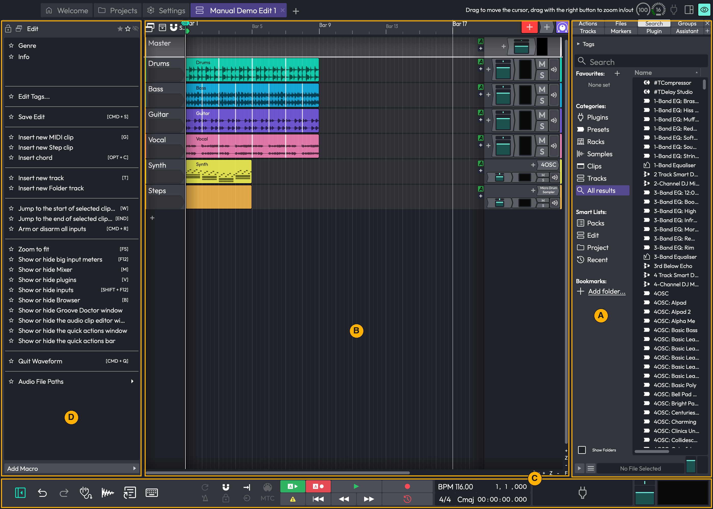

*Parts of the Edit tab: A, Browser. B, Arrangement. C, transport bar. D, Actions panel*

## The Browser

The Waveform Browser sits on the right side of the Edit by default. You
can open or close it by pressing B, by choosing *View > Show Browser*,
or by clicking the eye button at the top right of the window and then
clicking the Browser block. Its tabs give you quick access to actions,
media, plugins, tracks and markers.

> 💡 **Tip:** You can dock the Browser on the left, right or top of the
Edit. Click the eye button at the top right of the window, then drag the
Browser block in the pop-out to the left, right or top edge.

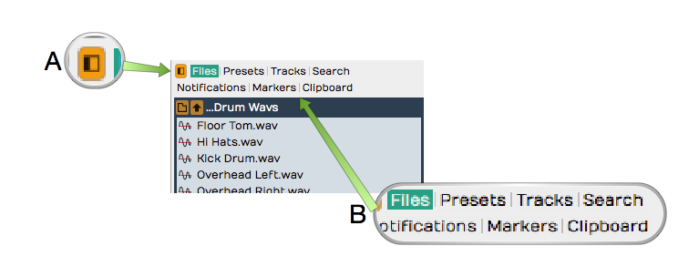

*Browser Open/Close Icon, A. Browser Tabs, B.*

The Browser tabs are:

**Actions**: The Actions tab shows context-sensitive actions and
properties for whatever you currently have selected. See [The Actions
Panel](actions-panel.md) for full details.

**Files**: The Files tab is a filesystem browser for navigating directly
to audio files on your system, the Project folder, or your drives. You
can bookmark folders for quick access to your loop libraries, and
audition files before dragging them in. See
[The Files Tab](browser.md#the-files-panel) in The Browser chapter.

**Search**: The unified Search tab lets you search plugins, plugin
presets, rack presets, samples and loops, clip presets and track presets
in one interface, filtered by category and by tags. This is the main content browser. See [The
Browser](browser.md).

**Groups** PRO: The Groups tab lists your Edit
Mix Groups and lets you create and manage them. It needs Waveform Pro or
the Recording Engineer Expansion. See [Edit Mix Groups](edit-mix-groups.md).

**Tracks**: The Tracks tab lists the tracks in the Edit, each with
**Hide** and **Disable** buttons. To tag tracks, select them and fill in
**Tags** in the Actions panel. The **Tags** box below the list shows the
tags in use; click the ones you want, then turn on **Show Only Tagged
Tracks** to filter the arrangement down to the tracks with those tags.

**Markers**: Use the Markers tab to add bars & beats or timecode markers
to the Marker track. Click a marker's name to jump to it. You can
delete the selected marker, or change its name or marker type, in the
Actions panel.

**Plugin**: The Plugin tab hosts a single plugin running live on the
Edit's main output. Use it for a tuner, analyser or other tool you want
always on hand. It is shown by default; to remove it, turn off
**Show Plugin panel in browser** in *Settings > Plugins* (the change
takes effect the next time you open an Edit). See
[The Plugin Panel](plugin-side-panel.md).

**Assistant**: The Assistant tab hosts the AI Assistant, a chat panel
where you can make natural-language requests. It is shown by default; to
hide it, turn off **Enable AI Assistant** in *Settings > AI*. See
[The AI Assistant](ai-assistant.md).

For more about the Browser, see [The Browser](browser.md).

> 💡 **Tip:** Resize the Browser by dragging its inner edge (the one
facing the arrangement). This helps with the Search tab, whose columns
can otherwise be cut off.

## The Arrangement

The Arrangement is made up of the Timeline, Track Headers & Inputs,
Tracks, and the inline mixer.

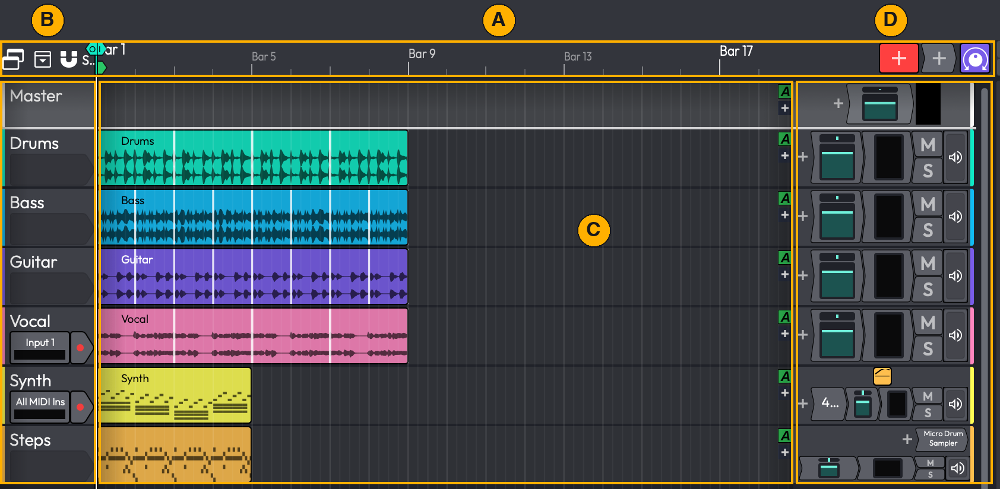

*Parts of the Arrangement: A, The Timeline. B, Track Headers & Inputs. C, Tracks. D, The inline mixer*

### Timeline

The Timeline acts as a ruler, measuring the time of the Edit. It
usually shows bars and beats, but you can right-click it to show seconds
and milliseconds, or seconds and frames, instead.

The Timeline is related to several other onscreen features:

**In marker and Out marker**: The range between the In marker and the
Out marker defines what is called the "marked region" in Waveform. In
other DAWs this is often called the "loop" or "cycle". The marked region
defines looped playback, loop recording, and many of Waveform's editing
options. The keyboard shortcuts are I to position the In marker, and O
to position the Out marker.

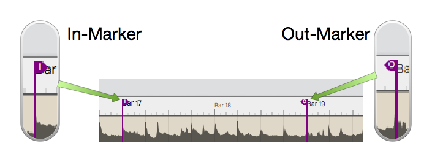

*In marker and Out marker*

**Tempo Track**: When open, the Tempo track appears below the Timeline.
This is where you set the tempo and tempo changes. Press F9 to open or
close it.

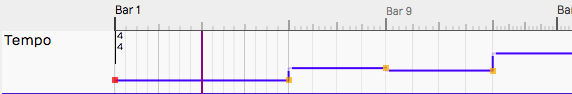

*Tempo Track*

**Marker Track**: The Marker track opens below the Timeline. It can show
bars & beats markers (such as song sections), absolute markers in terms
of hours:minutes:seconds and milliseconds, or both combined. Show or
hide it with F10. The **Cycle Marker track view mode** command steps
through the combined, bars & beats, absolute and hidden views; it has no
default key.

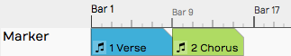

*Marker Track*

**Other Global Tracks**: The Tempo and Marker tracks are two of the
global tracks that sit between the Timeline and your tracks. The
**Master** track is in every edition. The **Chord** track
PRO (Waveform Pro or the MIDI Producer
Expansion) and the **Arranger** track PRO
(Waveform Pro) have their own chapters: [The Chord Track](chord-track.md)
and [The Arranger Track](arranger-track.md). In Waveform Pro the eye
button's pop-out also has an **Overview** block
PRO, a strip that shows the whole Edit. Show or
hide each one from *View > Global tracks*, or hide them all at once with
**Show global tracks** in the same submenu.

**The Clip Object**: The Clip object sits above the right side of the
Timeline. Some Waveform users call it a "clip dragger" or "clip maker".
Drag it to a track to create an empty clip of any of the four types: MIDI
clip, Audio clip, Edit clip, or Step clip. Drop it on the Marker track
to add a bars and beats marker or an absolute timecode marker, or on the
Chord or Arranger track to insert a Chord or Arranger clip.

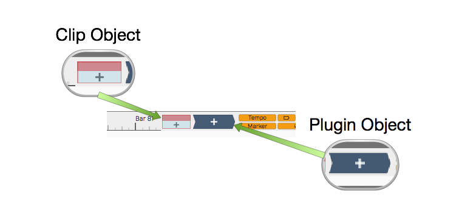

*Clip Object and Plugin Object*

**The Plugin Object**: Drag the Plugin object to the inline mixer of any
track to insert an audio effect plugin or virtual instrument. When you
drop the Plugin object, you get a menu of all available plugins and
instruments. You can control the organisation of the menu from the
*Settings > Plugins* page. Right-click the Plugin object to open the
plugin selector without dragging, or drop it on an Audio clip to add a
clip plugin. See [Using Plugins](using-plugins.md) for more about
inserting and using plugins.

**The Modifier Object**: The small button to the right of the Plugin
object is the Modifier object (*Drag this onto a track to create a new
modifier*). Drop it on a track and choose a modifier type. The LFO is in
every edition; Breakpoint, Step, Envelope follower, Random and MIDI
Tracker need Waveform Pro or the MIDI Producer Expansion. See
[Modifiers](modifiers.md).

### Showing Panels and the CPU Meter

**Show/Hide Panels**: Several areas of the Edit tab can be opened for
use or closed to declutter the screen. Click the eye button at the top
right of the window to open a small map of the window, then click a
block to show or hide that part: the Overview, Arranger, Tempo, Marker,
Chord and Master tracks, the track inputs, the inline mixer, the
Arrangement, the Detail Editor, the Mixer, the Browser, Quick Actions and
the Actions panel. Some blocks only appear in editions that include
those features. Right-click the eye button for the View menu, which has
the same options. These are the default keyboard shortcuts:

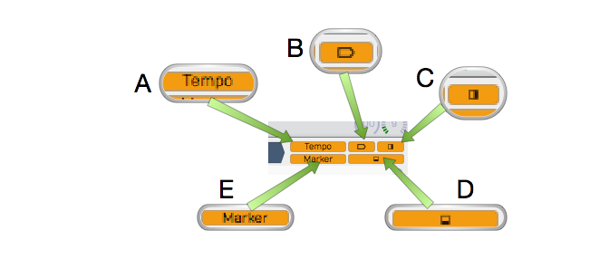

*Show Hide Buttons. A, Show/Hide the Tempo track. B, Show/Hide the Inputs. C, Show/Hide the Mixer, D, Show/Hide the Actions panel, E, Show/Hide the Marker track*

-   Show/Hide Tempo track (F9)
-   Show/Hide Marker track (F10)
-   Show/Hide inputs section (Shift + F12)
-   Show/Hide inline mixer (V)
-   Show/Hide Mixer (M)
-   Show/Hide Browser (B)
-   Show/Hide plugins, Browser and Actions panel (Shift + F11)

The Actions panel has no default key. Use the Actions panel button at
the left of the transport bar or *View > Show Actions*.
Opt + F11 / Alt + F11 locks the Actions panel to the current selection.

**CPU Meter**: To the left of the eye button at the top right of the
window, a round meter shows the audio engine's CPU load as a percentage,
with a ring of segments that runs from green through yellow to red as
the load rises. A warning triangle replaces the number when reading
audio files from disk falls behind. If the load stays near 100%,
Waveform shows a "CPU Overload!" message, turns off running the playback
engine while stopped (press **Panic** to turn it back on) and, if the
overload carries on, stops playback.

Click the meter to open the **CPU Usage** window for the Edit. Its top
rows show the **Sample Rate**, **Block Size** and **Block Duration**,
the average, maximum and minimum load, **X-runs**, and the input and
output latency. Below them, a table lists the Edit's plugins (plus audio
file reading) with each one's track, CPU time, CPU percentage and
latency, and whether its track is monitoring a live input. The buttons
are **Low Latency Monitoring** (disables the highest-latency plugins on
tracks with live inputs), **Freeze Edit to Lower CPU**, **Freeze
Selected Tracks**, **Show Selection In Edit**, **Group by Track**, and
**Disable Selected Plugins** / **Enable Selected Plugins**. The freeze
buttons change to **Unfreeze Edit** and **Unfreeze Tracks** once the
tracks are frozen.

### The Track Section

Tracks appear as parallel lanes that contain and organise clips of
audio and MIDI. Signal flows from left to right: from the inputs, to
the clips for recording, to the inline mixer and its plugins, then on
to the master output. Ordinary tracks can hold any kind of clip: Audio
clips, MIDI clips, Step clips, or Edit clips. To create a new track,
press T. Waveform also has [Folder tracks](folder-tracks.md) and
[Submix tracks](submix-tracks.md) for grouping tracks, and
[automation tracks](automation.md) for automation curves.

**Track Headers**: The leftmost column of the Arrangement forms a list
of track headers. Click the track name in a header to select that
track; more track properties appear in the Actions panel. To rename a
track, right-click the track header and choose **Rename track**. To
reorder tracks, drag a track by its header to a new position.

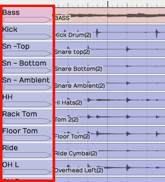

*Track Headers*

**Inputs**: Inputs appear as right-facing rectangular arrows. Click an
input for a menu that includes the available inputs, and use it to set
up a track for recording. More input options are in the Actions panel.
You can also drag an input to another track to continue recording.

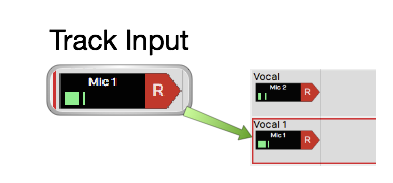

*Inputs*

> 💡 **Tip:** Resize tracks using the zoom tools in the lower right corner of
the arrangement.

### Clips

You can drag in audio files and loops to build your Edit, or record them
directly. The same goes for MIDI clips. Step clips are an in-line step
sequencer, and a variation on MIDI clips. Edit clips embed an entirely
different Edit into your Edit as a single clip. Select any kind of clip
to see more properties and actions in the Actions panel.

**Audio Clips**: Audio clips are created during recording or can be
dragged in from the Browser or desktop. Waveform has tools to split,
combine and reverse Audio clips, or change their pitch, timing or speed.
You can also edit Audio clips with Melodyne to adjust the intonation of
recorded notes. Clip Layer Effects add more ways to process Audio clips;
see [Clip Layer Effects](clip-layer-effects.md).

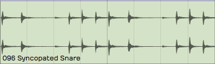

*Audio Clip*

**MIDI Clips**: MIDI clips are the Waveform container for MIDI
performance data. The clips have many of the same editing features as
Audio clips. Expand MIDI clips vertically to see the full in-line piano
roll MIDI editor, which has tools for entering and editing MIDI notes.

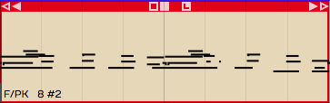

*MIDI Clip*

**Step Clips**: Step clips are an inline step sequencer for entering
MIDI notes on a grid. They suit drum beats and rhythms, and work for
basslines, synth leads and other parts too. Some Waveform users program
complete compositions entirely with Step clips.

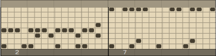

*Step Clip*

**Edit Clips**: An Edit clip embeds an entire Edit into a clip. For
complex drum programming, you can keep all the drums in a separate Edit.
You can also compose songs in blocks: develop the verse, chorus and
bridge in separate Edits and bring them together in another Edit.
Teachers use Edit clips to record several students singing over the
same underlying track.

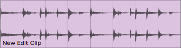

*Edit Clip*

Edit clips behave like Audio clips in the arrangement. The difference
is an extra section in the Actions panel for managing the link to the
underlying Edit.

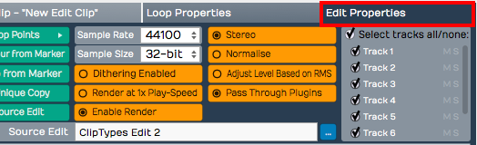

*Edit clip properties*

### The Inline Mixer

Each track has an inline mixer next to its clips in the arrangement.
For each track, signal flows from left to right: input to clips, clips
to inline mixer, inline mixer to the master output. The inline mixer is where you arrange plugins
to build the channel strip the track needs. If the track has MIDI clips,
insert a virtual instrument as its sound source. To EQ a vocal, drop in
an EQ.

The Volume & Pan and Level Meter plugins are installed by default, and
you can remove, reorder or add more instances of them. By default every
track has:

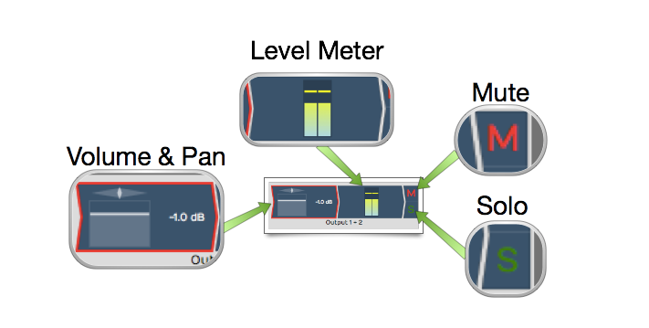

*Inline Mixer Default Setup: Volume & Pan Plugin, Level Meter Plugin, Solo Button, Mute Button*

**Volume & Pan Plugin**: This acts like the channel fader and pan
controls on a conventional mixer. Click either control for a larger
version that makes the level or pan easier to adjust.
Select the plugin to see its full set of properties in the Actions
panel.

**Level Meter Plugin**: The level meter shows the level of audio on the
track. You can add more instances or put the meter anywhere in the
track using drag and drop. You can change the meter response between
Peak, RMS, and Sum & difference from the right-click menu or from the
Actions panel.

**Mute**: The **Mute** button mutes and un-mutes the track. Right-click
the **Mute** or **Solo** button for **Mute**, **Solo** and **Solo
isolate**. The keyboard shortcut for mute is Shift + M.

**Solo**: The **Solo** button silences all other tracks so you can hear
one track at a time. **Solo behaviour** in *Settings > General* (Mixing
Defaults section) sets how **Solo** works when several tracks are soloed
(Choices: Cumulative solo, Exclusive solo; Default: Cumulative solo).
The keyboard shortcut for solo is Shift + S. From the right-click menu
you can choose **Solo isolate**, which keeps the track playing when
another track is soloed. This suits a track set up as an effects bus.

> 💡 **Tip:** Right-click either **Mute** or **Solo** for a menu. From
here you can reset every track with **Reset all muted/soloed/isolated
tracks**, or keep solo isolate and use **Reset all muted/soloed tracks**
(Shift + Opt + M / Shift + Alt + M).

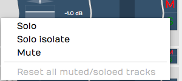

*Mute/Solo Right-Click Menu*

## The Mixer { #the-mixer-panel }

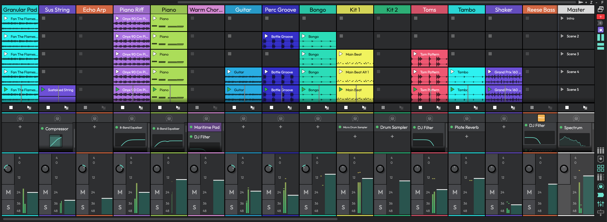

*The Mixer, with a channel strip for every track.*

The Mixer displays every track as a vertical channel strip, like a
hardware mixer. Open it with M, with *View > Show Mixer*, or by clicking the Mixer block in the eye button's
pop-out at the top right of the window. Tab switches between the
Arrangement and the Mixer. The clip launcher grid shown above the strips
needs Waveform Pro or the Launcher Expansion; see
[Clip Launcher](clip-launcher.md).

## Menus

The main menu holds a full set of menus related to the Edit: File, Edit,
Options, Automation, Click, Snap, Sync, Track, Video, View, Help and
Actions. On macOS they are in the menu bar at the top of the screen; on
Windows and Linux they are at the top of the window. This manual refers
to these menus using a path syntax separated by "greater-than" symbols.
For example, to set a one bar count-in, choose *Click > Count-in > 1 bar*.

In the File menu, *File > Close this Edit* closes the Edit's tab, and
*File > Export: Render to a file...* opens the Render dialog (see
[Rendering and Stems](rendering-and-stems.md)).

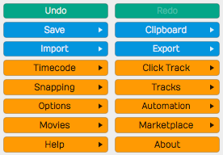

*The Edit menus*

## The Actions Panel

What is shown in the Actions panel depends on what object you have
selected. Each track, input, clip, plugin, rack, and automation point
has its own set of properties and actions. Click to select any object
and the Actions panel automatically switches to show the values and
actions relevant to whatever you have selected. This idea is central to
how Waveform works. The Actions panel is a flat list at the side of the
window, and can also be opened from the
Browser. To show or hide it, click the Actions panel button at the far
left of the transport bar, choose *View > Show Actions*, or click its
block in the eye button's pop-out. Opt + F11 / Alt + F11 locks it to the
current selection.

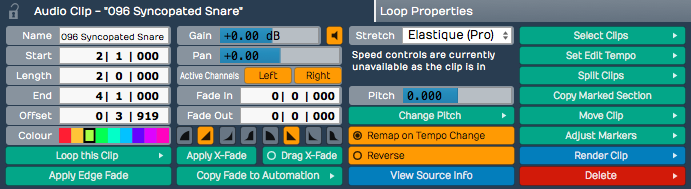

*The Actions panel*

## The Transport Bar

The transport bar runs along the bottom of the window and contains
cursor position information, the Transport, the master plugins, the
master volume control, and a set of global control buttons.

*The transport bar: A, left-hand buttons. B, transport bar buttons. C, the Transport. D, cursor position info. E, master plugins. F, Master level and meter*

**Cursor Position Info**: At one end of the transport bar, a readout
shows the tempo, time signature and key/scale at the cursor position,
next to two clocks that show the location.

-   Click the tempo to type a new BPM (20-300), or drag it to change the
    tempo.
-   Click the time signature or the key to open their actions.
-   Click and edit any part of a clock to move the cursor to that
    location.

You can also drag any of the components of a clock up and down to
move the cursor. The upper clock matches the format you have set for
the Timeline. The lower clock shows seconds when the Timeline shows bars
and beats, and bars and beats otherwise.

**The Transport**: The Transport is made up of nine buttons: **Read**
and **Write** (automation read and write modes), **Play**, **Record**,
**Panic**, **Rewind** (back to the start of the Edit), **Back**,
**Forward** and **Retrospective Record**, which creates clips from
previously captured audio and MIDI input. The **Panic** button resets
Waveform's audio engine. While you are recording, **Abort** and
**Abort & Restart** appear in the lower row. You can assign keyboard
shortcuts to all of them. See
[Recording Audio](recording-audio.md).

**Master Plugins**: The master plugins slot holds up to four plugins for
final processing like compression and limiting. Drop plugins from the
Browser or the Plugin object into it, or right-click it to add one. It
is the same plugin chain as the Master track. To hide the master
plugins, master volume and meter from the transport bar, turn off
**Show master plugins in transport bar** in *Settings > Appearance*.
(Default: on)

**Left-Hand Buttons**: At the left of the transport bar are the Actions
panel button (*Show or hide Actions panel*), **Undo** and **Redo**,
followed by buttons that appear only when their feature is available:
Groove Doctor PRO (*Show or hide Groove Doctor
window*, Waveform Pro or the Recording Engineer Expansion; see
[Groove Doctor](groove-doctor.md)), coloured waveforms
PRO (*Toggles displaying waveforms with
frequency information*, Waveform Pro or the DJ Mix Tools Expansion),
Quick Actions PRO (*Show or hide Quick Actions
window*, Waveform Pro; right-click it for the Quick Actions bar), MIDI
typing (*Show or hide MIDI typing window*) and, when the Edit has a
video, the Video window. Between these and the Loop, Click and other
mode buttons sits the breadcrumb, which opens the action menu for the
current selection (see [The Actions Panel](actions-panel.md)).

**Transport Bar Buttons**: The transport bar includes eight buttons to
access commonly used global on/off functions. See
[Transport Bar Buttons](#transport-bar-buttons) below.

**Master Level**: The Master level sets the final volume of the entire
mix, and its pan control sets the balance between left and right. The
pan control usually stays centred.

**Master Meter**: The Master meter shows the final output level.
Right-click the meter to set the meter mode or reset any overload
indicators.

## Transport Bar Buttons

These buttons toggle some of Waveform's most used functions. Each
description includes the button's shortcut.

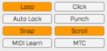

*The transport bar buttons*

**Loop**: **Loop** (L) turns looping between the In marker and Out
marker on and off. This is for both playback and loop recording.
Right-click it for **Loop follows selection**.

**Click**: **Click** (C) turns the metronome click on and off.
Right-click it for the Click menu.

**Auto Lock**: **Auto Lock** is short for "Automation Lock". It locks
automation to clips: when it's on, the automation curves follow the
clips as you move them. The shortcut is
Shift + Cmd + A / Ctrl + Shift + A.

**Punch**: With **Punch** (P) turned on, Waveform only records when
the cursor is between the In marker and the Out marker.

**Snap**: The **Snap** (Q) button turns snap-to-grid on and off.
Right-click it for the Snap menu.

**Autoscroll**: With **Autoscroll** (S) turned on, Waveform pans the
screen to keep the cursor on screen during playback and recording.
Right-click it to choose **Page scroll** or **Stationary cursor**.

**MIDI Learn**: Click **MIDI Learn** to enter MIDI Learn mode. In this
mode you can assign external knobs and faders to on-screen
controls.

**MTC**: With **MTC** enabled, Waveform chases sync to incoming MIDI
Time Code. Unless you are still syncing to tape or hardware sequencers,
leave **MTC** off.

## Moving On

For more on the panels introduced here, see
[The Detail Editor](detail-editor.md), [The Browser](browser.md) and
[The Actions Panel](actions-panel.md).
