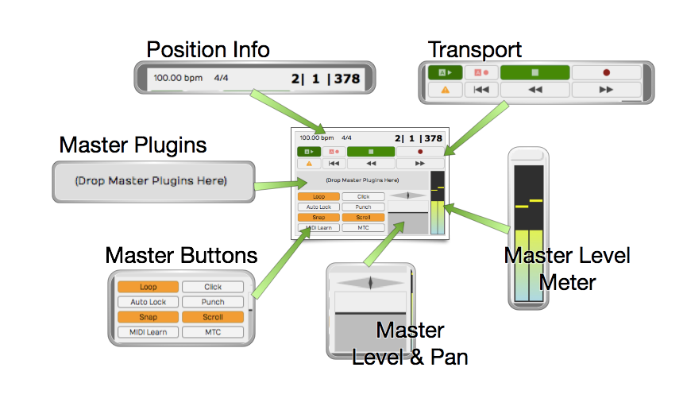

# The Edit Tab

In this chapter you will learn the layout of the Edit tab. The Edit tab
is where most of the action occurs during recording, editing, and
producing your song. This chapter is important, as you will learn the
terminology for the Waveform interface and objects used throughout the
rest of this book.

> 📝 **Note:** The keyboard shortcuts used in the chapter are based on the
default key mappings under *Settings > Keyboard Shortcuts > Reset
to Defaults > Restore default Waveform key mappings*. We've already
mentioned this several times and this might not be the last! If you want
to follow along with the keyboard shortcuts used in this book, make sure
to load the default key-mappings.

## The Parts of a Waveform Edit

The Edit tab is made up of several panels: the Browser, the Arrangement
(with an inline mixer beside each track), the Actions panel, the Detail
Editor, the Mixer and the transport bar. All of them except the
transport bar can be shown or hidden from the View menu.

The Detail Editor sits at the bottom of the Edit and shows the selected
clip, track or plugins in more detail (*View > Show Content Editor*). See
[The Detail Editor](detail-editor.md). The Mixer shows every track
as a vertical channel strip (*View > Show Mixer*, or M). See
[The Mixer](#the-mixer-panel) below.

*Parts of the Edit tab: A, Browser. B, Arrangement. C, transport bar*

## The Browser

The Waveform Browser sits on the right side of the Edit by default. You
can open or close it by pressing B, by choosing *View > Show Browser*,
or by clicking the eye button at the top right of the window and then
clicking the Browser block. The Browser includes a collection of tabs,
giving you quick access to actions, media, plugins, tracks, and markers.

> 💡 **Tip:** You can dock the Browser on the left, right or top of the
Edit. Click the eye button at the top right of the window, then drag the
Browser block in the pop-out to the left, right or top edge.

*Browser Open/Close Icon, A. Browser Tabs, B.*

Here is a short description of each Browser tab:

**Actions**: The Actions tab shows context-sensitive actions and
properties for whatever you currently have selected. See [The Actions
Panel](actions-panel.md) for full details.

**Files**: The Files tab is a filesystem browser for navigating directly
to audio files on your system, the Project folder, or your drives. You
can bookmark folders for quick access to your loop libraries, and
audition files before dragging them in. See
[The Files Tab](browser.md#the-files-panel) in The Browser chapter.

**Search**: The unified Search tab lets you search loops, presets,
plugins, racks, clips, and tracks in one interface, filtered by category
and by tags. This is the main content browser. See [The
Browser](browser.md).

**Groups** PRO: The Groups tab lists your Edit
Mix Groups and lets you create and manage them. It needs Waveform Pro or
the Recording Engineer Expansion. See [Edit Mix Groups](edit-mix-groups.md).

**Tracks**: The Tracks tab lists the tracks in the Edit, each with
**Hide** and **Disable** buttons. To tag tracks, select them and fill in
**Tags** in the Actions panel. The **Tags** box below the list shows the
tags in use; click the ones you want, then turn on **Show Only Tagged
Tracks** to filter the arrangement down to the tracks with those tags.

**Markers**: Use the Markers tab to add bars & beats or timecode markers
to the Marker track. Navigate to any marker by clicking on the marker
name. You can also quickly delete the selected marker, change its name
or marker type in the Actions panel.

**Plugin**: The Plugin tab hosts a single plugin running live on the
Edit's main output. It's handy for a tuner, analyser, or other tool you
want always on hand. It is shown by default; to remove it, turn off
**Show Plugin panel in browser** in *Settings > Plugins* (the change
takes effect the next time you open an Edit). See
[The Plugin Panel](plugin-side-panel.md).

**Assistant**: The Assistant tab hosts the AI Assistant, a chat panel
where you can make natural-language requests. It is shown by default; to
hide it, turn off **Enable AI Assistant** in *Settings > AI*. See
[The AI Assistant](ai-assistant.md).

For much more about the Browser check out [The Browser](browser.md).

> 💡 **Tip:** Resize the Browser by dragging its inner edge (the one
facing the arrangement).
This is particularly helpful when working with the Search tab, which has
numerous search columns that might be hidden.

## The Arrangement

The Arrangement is made up of the Timeline, Track Headers & Inputs,
Tracks, and the inline mixer.

*Parts of the Arrangement: A, The Timeline. B, Track Headers & Inputs. C, Tracks. D, The Mixer*

### Timeline

The Timeline acts as a ruler, measuring the time of the Edit. While it
is commonly set to show the bars and beats of your song, it can also
show seconds and milliseconds or seconds and frames with a simple
right-click selection.

The Timeline is related to several other onscreen features:

**In marker and Out marker**: The range between the In marker and the
Out marker defines what is called the "marked region" in Waveform. In
other DAWs this is often called the "loop" or "cycle." The marked region
defines looped playback, loop recording, and many of Waveform's editing
options. The keyboard shortcuts are I to position the In marker, and O
to position the Out marker.

*In marker and Out marker*

**Tempo Track**: The Tempo track appears below the Timeline, when open.
Here you define the tempo and tempo changes. Open and close the Tempo
track using F9.

*Tempo Track*

**Marker Track**: The Marker track opens below the Timeline. It can show
bars & beats markers (such as song sections), absolute markers in terms
of hours:minutes:seconds and milliseconds, or both combined. Show or
hide it with F10. The **Cycle Marker track view mode** command steps
through the combined, bars & beats, absolute and hidden views; it has no
default key.

*Marker Track*

**Other Global Tracks**: The Tempo and Marker tracks are two of the
global tracks that sit between the Timeline and your tracks. The
**Master** track is in every edition. The **Chord** track
PRO (Waveform Pro or the MIDI Producer
Expansion) and the **Arranger** track PRO
(Waveform Pro) have their own chapters: [The Chord Track](chord-track.md)
and [The Arranger Track](arranger-track.md). In Waveform Pro the eye
button's pop-out also has an **Overview** block
PRO, a strip that shows the whole Edit. Show or
hide each one from *View > Global tracks*, or hide them all at once with
**Show global tracks** in the same submenu.

**The Clip Object**: Above the right side of the Timeline you find the
Clip object. Some Waveform users call the Clip object a "clip dragger"
or "clip maker." All of the terms are descriptive of how it works. Drag
it to a track to create an empty clip of any of the four types: MIDI
clip, Audio clip, Edit clip, or Step clip. Drop it on the Marker track
to add a bars and beats marker or an absolute timecode marker, or on the
Chord or Arranger track to insert a Chord or Arranger clip.

*Clip Object and Plugin Object*

**The Plugin Object**: Drag the Plugin object to the inline mixer of any
track to insert an audio effect plugin or virtual instrument. When you
drop the Plugin object, you get a menu of all available plugins and
instruments. You can control the organisation of the menu from the
*Settings > Plugins* page. Right-click the Plugin object to open the
plugin selector without dragging, or drop it on an Audio clip to add a
clip plugin. Refer to [Using Plugins](using-plugins.md) for much more
about inserting and using plugins.

**The Modifier Object**: The small button to the right of the Plugin
object is the Modifier object (*Drag this onto a track to create a new
modifier*). Drop it on a track and choose a modifier type. The LFO is in
every edition; Breakpoint, Step, Envelope follower, Random and MIDI
Tracker need Waveform Pro or the MIDI Producer Expansion. See
[Modifiers](modifiers.md).

**Show/Hide Panels**: Several areas of the Edit tab can be opened for
use or closed to declutter the screen. Click the eye button at the top
right of the window to open a small map of the window, then click a
block to show or hide that part: the Overview, Arranger, Tempo, Marker,
Chord and Master tracks, the track inputs, the inline mixer, the
Arrangement, the Detail Editor, the Mixer, the Browser, Quick Actions and
the Actions panel. Some blocks only appear in editions that include
those features. Right-click the eye button for the View menu, which has
the same options. These are the default keyboard shortcuts:

*Show Hide Buttons. A, Show/Hide the Tempo track. B, Show/Hide the Inputs. C, Show/Hide the Mixer, D, Show/Hide the Actions panel, E, Show/Hide the Marker track*

-   Show/Hide Tempo track (F9)
-   Show/Hide Marker track (F10)
-   Show/Hide inputs section (Shift + F12)
-   Show/Hide inline mixer (V)
-   Show/Hide Mixer (M)
-   Show/Hide Browser (B)
-   Show/Hide plugins, Browser and Actions panel (Shift + F11)

The Actions panel has no default key. Use the Actions panel button at
the left of the transport bar or *View > Show Actions*.
Opt + F11 / Alt + F11 locks the Actions panel to the current selection.

### The Track Section

Tracks appear as parallel lanes that contain and organise clips of
audio and MIDI. Signal flow follows from left to right from Inputs, to
Clips for recording, to the Mixer and any plugins it uses, then on to
the master output. Ordinary tracks can hold any kind of clip: Audio
clips, MIDI clips, Step clips, or Edit clips. To create a new track,
press T. Waveform also has [Folder tracks](folder-tracks.md) and
[Submix tracks](submix-tracks.md) for grouping tracks, and
[automation tracks](automation.md) for automation curves.

**Track Headers**: The leftmost column of the Arrangement forms a list
of track headers. Select a track by clicking directly on the track name
within the header. Additional track properties appear in the Actions
panel. To rename a track, right-click the track header and choose
**Rename track**. Tracks can be reordered by grabbing any track from the
header and dragging it to a new location.

*Track Headers*

**Inputs**: Inputs appear as right facing rectangular arrows. Click on
an input for a menu of options that includes a selection of available
inputs. Use the menu to set up a track for recording. Additional input
options are available in the Actions panel. You can even drag an input
to another track to continue recording.

*Inputs*

> 💡 **Tip:** Resize tracks using the zoom tools in the lower right corner of
the arrangement.

### Clips

You can drag in audio files and loops to build your Edit, or record them
directly. The same goes for MIDI clips. Step clips are an in-line step
sequencer, and a variation on MIDI clips. Edit clips allow you to embed
an entirely different Edit into your Edit as a single clip. Select any
kind of clip to see more properties and actions in the Actions panel.

**Audio Clips**: Audio clips are created during recording or can be
dragged in from the Browser or desktop. Audio clips are one of the key
elements of a Waveform arrangement. Waveform gives you a rich set of
tools to work with Audio clips to split them, combine them, reverse
them, or change the pitch, timing, or speed. You can also edit Audio
clips with Melodyne to adjust the intonation of recorded notes. Clip
Layer Effects give you even more options to manipulate Audio clips. See
[Clip Layer Effects](clip-layer-effects.md) to learn about this type of
audio processing.

*Audio Clip*

**MIDI Clips**: MIDI clips are the Waveform container for MIDI
performance data. The clips have many of the same editing features as
Audio clips. Expand MIDI clips vertically to see the full in-line piano
roll MIDI editor. The MIDI editor comes with a full set of tools for
editing, entering, and modifying MIDI notes.

*MIDI Clip*

**Step Clips**: Step clips are an inline step sequencer for entering
MIDI notes on a grid. Step clips are ideal for programming drum beats
and rhythms, and they can also be used for basslines, synth leads or
just about anything else. Some Waveform users program complete
compositions entirely with Step clips.

*Step Clip*

**Edit Clips**: An Edit clip embeds an entire Edit into a clip. You can
use Edit clips to separate out all your drum programming to another Edit
as an aid when doing complex drum programming. Use Edit clips to compose
songs in blocks - develop the verse, chorus, and bridge in separate
Edits and bring them together in another Edit. Teachers use it when
recording several students singing over the same underlying track.

*Edit Clip*

Edit clips behave in the arrangement just like Audio clips. How can you
tell the difference? They have an additional section in the Actions panel
to manage the link to the underlying Edit.

*Edit clip properties*

### The Inline Mixer

Each track has an inline mixer next to its clips in the arrangement.
For each track, signal flows from left to right - Input to Track, Track
to Mixer, Mixer to Master. The inline mixer is where you arrange plugins to
create whatever channel strip you need for the track. If you have MIDI
clips on the track then insert virtual instrument as a sound source. If
you need to EQ a vocal, drop in an EQ.

The Volume & Pan and Level Meter plugins are installed by default,
however you can remove, reorder, or even add more instances of them. You
will find the following things on every track by default:

*Mixer Default Setup: Volume & Pan Plugin, Level Meter Plugin, Solo Button, Mute Button*

**Volume & Pan Plugin**: This acts like the channel fader and pan
controls on a conventional mixer. When you click either element, a
larger version pops up allowing you to easily adjust level or panning.
When selected, the full set of properties appears in the Actions panel.

**Level Meter Plugin**: The level meter shows the level of audio on the
track. You can add additional instances or put the meter anywhere in the
track using drag and drop. You can change the meter response between
Peak, RMS, and Sum & difference from the right-click menu or from the
Actions panel.

**Mute**: The **Mute** button mutes and un-mutes the track. Right-click
the **Mute** or **Solo** button for **Mute**, **Solo** and **Solo
isolate**. The keyboard shortcut for mute is Shift + M.

**Solo**: The **Solo** button silences all other tracks so you can hear
one track at a time. **Solo behaviour** in *Settings > General* (Mixing
Defaults section) sets how **Solo** works when several tracks are soloed
(Choices: Cumulative solo, Exclusive solo; Default: Cumulative solo).
The keyboard shortcut for solo is Shift + S. From the right-click menu
you can choose **Solo isolate** which allows the track to continue to
play if another track is soloed. This is particularly useful if a track
is configured as an effects bus.

> 💡 **Tip:** Right-click on either **Mute** or **Solo** to access a menu. From
here you can reset every track with **Reset all muted/soloed/isolated
tracks**, or keep solo isolate and use **Reset all muted/soloed tracks**
(Shift + Opt + M / Shift + Alt + M).

*Mute/Solo Right-Click Menu*

## The Mixer { #the-mixer-panel }

*The Mixer, with a channel strip for every track.*

The Mixer displays every track as a vertical channel strip, as
seen on a real-world, hardware mixer. Open it with M, with
*View > Show Mixer*, or by clicking the Mixer block in the eye button's
pop-out at the top right of the window. Tab switches between the
Arrangement and the Mixer. The clip launcher grid shown above the strips
needs Waveform Pro or the Launcher Expansion; see
[Clip Launcher](clip-launcher.md).

## Menus

The main menu holds a full set of menus related to the Edit: File, Edit,
Options, Automation, Click, Snap, Sync, Track, Video, View, Help and
Actions. On macOS they are in the menu bar at the top of the screen; on
Windows and Linux they are at the top of the window. This manual refers
to these menus using a path syntax separated by "greater-than" symbols.
For example, to set a one bar count-in, choose *Click > Count-in > 1 bar*.

In the File menu, *File > Close this Edit* closes the Edit's tab, and *File > Export: Render to a file...* opens the
Render dialog (see [Rendering and Stems](rendering-and-stems.md)).

*The Edit menus*

## The Actions Panel

What is shown in the Actions panel depends on what object you have
selected. Each track, input, clip, plugin, rack, and automation point
has its own set of properties and actions. Click to select any object
and the Actions panel automatically switches to show the values and
actions relevant to whatever you have selected. This is a key concept
when using Waveform, and is central to its design. The Actions panel is
a flat list at the side of the window, and can also be opened from the
Browser. To show or hide it, click the Actions panel button at the far
left of the transport bar, choose *View > Show Actions*, or click its
block in the eye button's pop-out. Opt + F11 / Alt + F11 locks it to the
current selection.

*The Actions panel*

## The Transport Bar

The transport bar runs along the bottom of the window and contains
cursor position information, the Transport, the master plugins, the
master volume control, and a set of global control buttons.

*The transport bar*

**Cursor Position Info**: At one end of the transport bar, a readout
shows the tempo, time signature and key/scale at the cursor position,
next to two clocks that show the location.

-   Click the tempo to type a new BPM (20-300), or drag it to change the
    tempo.
-   Click the time signature or the key to open their actions.
-   Click and edit any part of a clock to move the cursor to that
    location.

You can also drag any of the components of a clock up and down to
move the cursor. The upper clock matches the format you have set for
the Timeline. The lower clock shows seconds when the Timeline shows bars
and beats, and bars and beats otherwise.

**The Transport**: The Transport is made up of nine buttons: **Read**
and **Write** (automation read and write modes), **Play**, **Record**,
**Panic**, **Rewind** (back to the start of the Edit), **Back**,
**Forward** and **Retrospective Record**, which creates clips from
previously captured audio and MIDI input. The **Panic** button resets
Waveform's audio engine. While you are recording, **Abort** and
**Abort & Restart** appear in the lower row. All of these can be
assigned to keyboard shortcuts for fast access. See
[Recording Audio](recording-audio.md).

**Master Plugins**: The master plugins slot holds up to four plugins for
final processing like compression and limiting. Drop plugins from the
Browser or the Plugin object into it, or right-click it to add one. It
is the same plugin chain as the Master track. To hide the master
plugins, master volume and meter from the transport bar, turn off
**Show master plugins in transport bar** in *Settings > Appearance*.
(Default: on)

**Left-Hand Buttons**: At the left of the transport bar are the Actions
panel button (*Show or hide Actions panel*), **Undo** and **Redo**,
followed by buttons that appear only when their feature is available:
Groove Doctor PRO (*Show or hide Groove Doctor
window*, Waveform Pro or the Recording Engineer Expansion; see
[Groove Doctor](groove-doctor.md)), coloured waveforms
PRO (*Toggles displaying waveforms with
frequency information*, Waveform Pro or the DJ Mix Tools Expansion),
Quick Actions PRO (*Show or hide Quick Actions
window*, Waveform Pro; right-click it for the Quick Actions bar), MIDI
typing (*Show or hide MIDI typing window*) and, when the Edit has a
video, the Video window. Between these and the Loop, Click and other
mode buttons sits the breadcrumb, which opens the action menu for the
current selection (see [The Actions Panel](actions-panel.md)).

**Transport Bar Buttons**: The transport bar includes eight buttons to
access commonly used global on/off functions. See
[Transport Bar Buttons](#transport-bar-buttons) below.

**Master Level**: The Master level provides the final volume adjustment
for the entire mix. The corresponding pan control provides control of
the balance between the left and right signals. For most applications
the Pan control will remain centred.

**Master Meter**: The Master meter shows the final output level.
Right-click the meter to set the meter mode or reset any overload
indicators.

## Transport Bar Buttons

The transport bar buttons include some of the most used functions in
Waveform. This is a description of what these buttons are for along with
the shortcut used to toggle the button.

*The transport bar buttons*

**Loop**: **Loop** (L) turns looping between the In marker and Out
marker on and off. This is for both playback and loop recording.
Right-click it for **Loop follows selection**.

**Click**: **Click** (C) turns the metronome click on and off.
Right-click it for the Click menu.

**Auto Lock**: **Auto Lock** is short for "Automation Lock." As the name
implies, this button locks automation to clips. When on, the automation
curves follow the clips as you move them. The shortcut is
Shift + Cmd + A / Ctrl + Shift + A.

**Punch**: With **Punch** (P) turned on, Waveform will only record when
the cursor is between the In marker and the Out marker.

**Snap**: The **Snap** (Q) button turns snap-to-grid on and off.
Right-click it for the Snap menu.

**Autoscroll**: With **Autoscroll** (S) turned on, Waveform pans the
screen to keep the cursor on screen during playback and recording.
Right-click it to choose **Page scroll** or **Stationary cursor**.

**MIDI Learn**: Click **MIDI Learn** to enter MIDI Learn mode. In this
mode you can easily assign external knobs and faders to on-screen
controls.

**MTC**: With **MTC** enabled, Waveform will chase sync to incoming MIDI
Time Code. Unless you are still syncing to tape or hardware sequencers,
leave **MTC** off.

## Moving On

That was a broad overview of sections, controls, and buttons on the Edit
tab. Next, we start to break all this down so you can have fun making
music with Waveform.
