# Effects Bus Tracks

A *bus track* is a track that several tracks in your Edit share, sometimes
called a master effects bus. The technique comes from the days of large
mixing consoles, when effects like reverb and delay came from outboard
hardware and studios had only a few reverb units and chambers. The
solution was a common bus for each effect, with each track sending the
amount it needed over to that bus.

Waveform works the same way. You dedicate a track to the effect, then use
the Aux Send plugin to send part of the signal from your instrument, vocal
or drum tracks over to the effects bus track.

## Create the Bus Track

Start by creating a new track. The fastest way is to select any track and
press **T**, which adds a new blank track right after it. You can then drag the
new track wherever you like.

Next, click the track name and rename the track by editing **Name** in the
Actions panel. This example uses a reverb, so name it "Master Reverb".

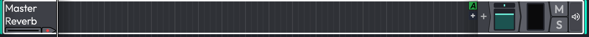

*New, Blank Track*

## Adding the Effect Plugin

Now insert an effect plugin on the bus track. This example uses
Waveform's Reverb.

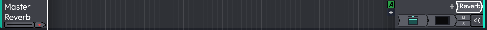

*Insert the Reverb Plugin*

Check that the **Dry Level** fader is all the way down and **Wet Level** is
up, so only the wet signal goes through Reverb. You can tweak the other
parameters later, once you have some sound going through it.

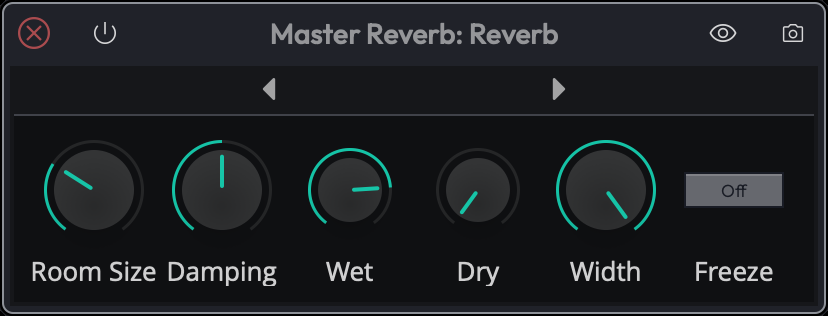

*Set the Mix to 100% Wet*

> 💡 **Tip:** If the plugin you're using has a mix control, set it to 100% wet. You don't want any dry signal mixed back in through a second, parallel path.

## Aux Return Plugin

So far this is an ordinary track. To make it behave like a bus, insert the
Aux Return plugin, one of Waveform's built-in plugins. It pairs with the
Aux Send plugin for exactly this purpose.

Insert the Aux Return plugin to the left of Reverb.

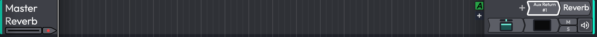

*Insert the Aux Return Plugin*

It's labelled **Aux Return #1** in the Actions panel, and it's
automatically assigned to the next available bus, in this case **Bus #1**.

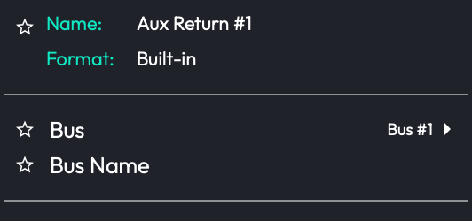

*Automatic Bus Assignment for Aux Return*

Optionally, type something descriptive into the **Bus Name** property,
such as "Verb 1".

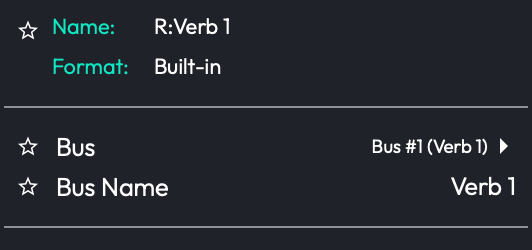

*Adding a Descriptive Bus Name*

The name appears on the plugin thumbnail in the mixer, which makes things
clearer, especially once you have several effects buses.

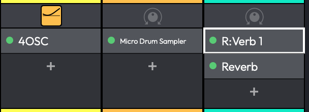

*How the Bus Name Appears in the Mixer*

## Adding Aux Sends to the Channels

With the bus track set up, insert an Aux Send plugin on each track you
want to send to the effect.

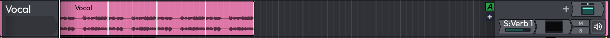

*Insert Aux Send on a Track*

Placement matters here: insert the Aux Send after the Volume & Pan plugin.
That way, as you adjust the track volume, the amount sent to the bus track
changes in proportion. When you pull the volume all the way down, you won't
hear a ghost of that track coming through the effects bus.

> 📝 **Note:** On a conventional mixing console, this position is called "post fader", and hardware consoles have a switch, or sometimes a separate knob, for it. In Waveform you set it by plugin order: put the fader before the Aux Send plugin. For a pre-fader send, such as a headphone mix, drag the Aux Send to the left of Volume & Pan instead. The send level then stays the same when you move the track's fader.

## Adjusting the Send Level

Play the Edit back and set the send level: click the Aux Send plugin and
adjust the **Send level** slider that pops up.

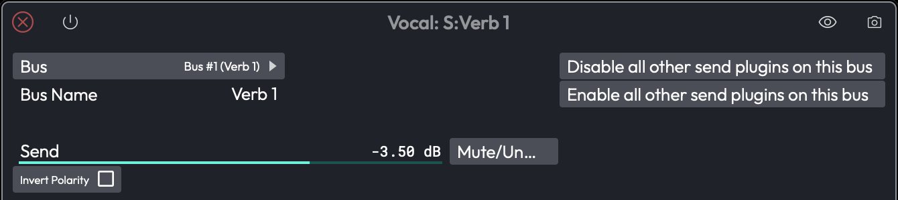

*Adjust the Aux Send Level*

You can also click the Aux Send plugin and adjust **Send** in the Actions
panel. Turn it up for more of the effect and down for less.

The Actions panel has a few more controls for the send. **Mute/Unmute**
drops the send to -100 dB, and clicking it again restores the level it
had. **Invert Polarity** flips the polarity of the signal going to the
bus. **Disable all other send plugins on this bus** turns off every other
Aux Send feeding the same bus, so you hear only this track through the
effect; **Enable all other send plugins on this bus** turns them back on.
Clicking the pair in turn is a quick way to compare one track's send with
the whole bus.

## Assigning the Aux Bus

You can create as many effects bus tracks as your mix needs: perhaps a
reverb for drums, a different reverb for vocals, a delay for vocals and
another delay for guitars. Each extra bus is set up the same way as above.
Make sure each Aux Send and Aux Return is assigned to the right bus number.

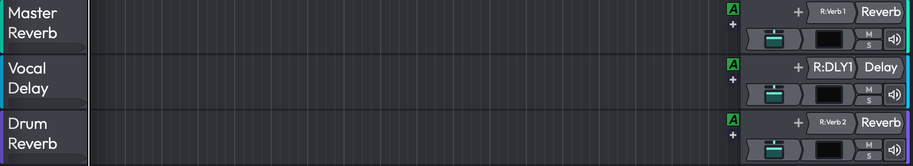

*Setup with Three Bus Effects Tracks*

In this example, Verb 1 uses **Bus #1**, and DLY1 uses **Bus #2** with its
own name.

*Assigning Buses to the Aux Returns*

When you insert an Aux Send on a track, choose the bus for the effect you
want.

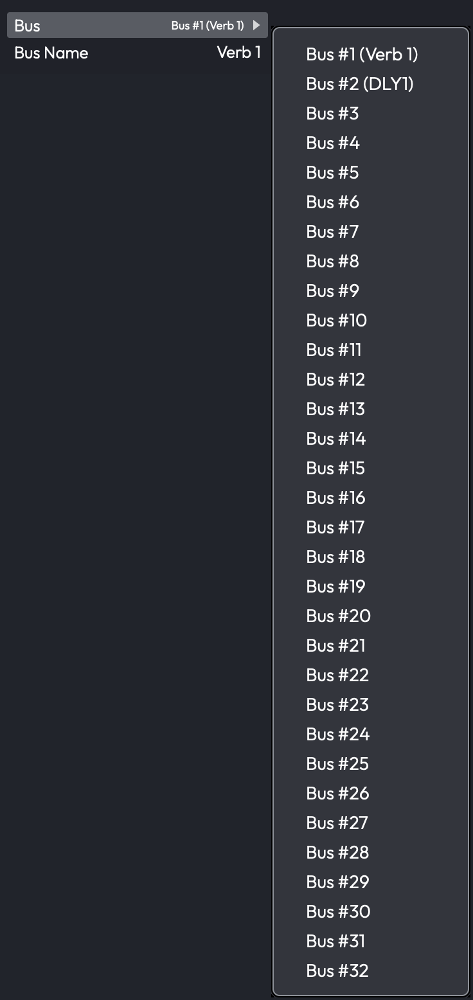

*Selecting the Effects Bus for Aux Send*

> 💡 **Tip:** A track can have more than one Aux Send.

A bus track isn't limited to a single plugin. It can hold a whole effects
chain, for example compression, EQ, reverb or delay.

## Solo Isolate

Bus tracks usually need a special solo mode called Solo isolate. To turn it
on, right-click the **Solo** button on a bus track and choose **Solo
isolate**, or Opt-click / Alt-click the **Solo** button.

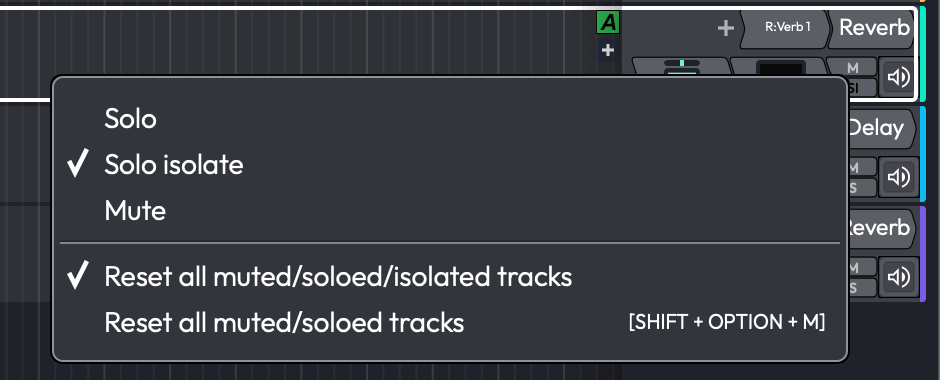

*Enable Solo Isolate on Your Effects Tracks*

The **Solo** button changes from "S" to "SI". With Solo isolate on, this
track is also soloed whenever you solo any other track. That's what you
want, because a soloed track usually needs its send effects with it.
Without Solo isolate on your bus tracks, the effects are muted when you
solo a track.

> 💡 **Tip:** Track tags let you view all the tracks that share a tag. Tag all your effects buses "FX" and you can pull them up together from the Tracks tab in the Browser. Giving your bus tracks their own colour helps too.

## Effects Bus Track Presets

If you often use the same send effects, save your bus tracks as presets
and recall them in later Edits. Right-click the track name and select
*Save preset > Whole track*.

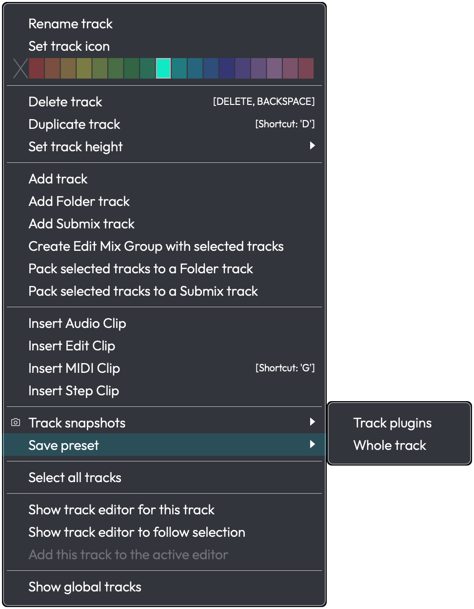

*Saving an Effects Track Preset*

In the **Preset Details** dialog, give the preset a name such as "Master
Reverb". The tags area already contains the tag "Track", and you can add
another, such as "Effects Bus".

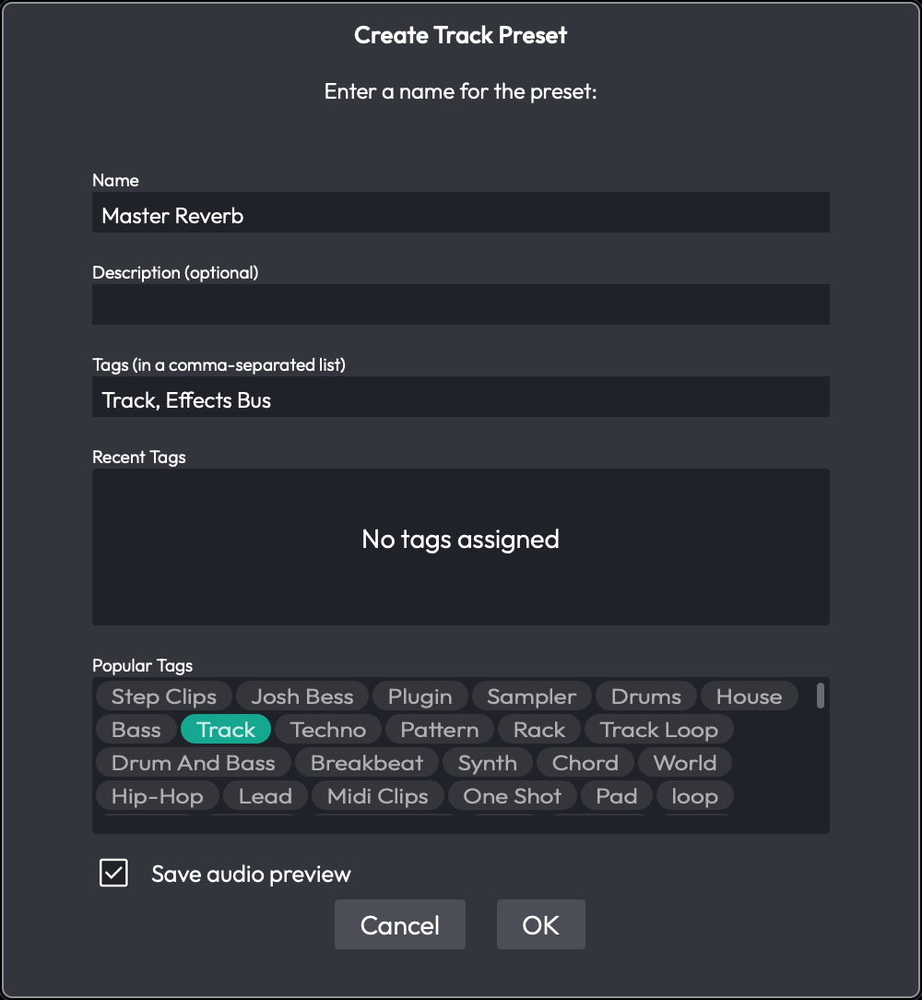

*Preset Details Dialog Box*

Separate tags with a comma, then click **OK**. The next time you want a
similar effects bus track, pick the **Presets** category in the Search tab
of the Browser and filter by "Effects Bus". Drag the preset onto any track
to set it up with your usual effects.

## Moving On

A full mix often has four or more effects buses at once, such as a drum
reverb, a vocal reverb, a stereo delay and a mono slapback delay. Group
the bus tracks together at the top of the Edit, and give them their own
colour, tag and name so they're easy to find.
