# Folder Tracks

A Folder track collects a group of tracks so you can work with them as
a unit. The most obvious use is to collapse related tracks, such as your
drum tracks, so they take up a single row.

Folder tracks also make it easy to apply volume automation, so you can
fade a number of tracks at the same time. You can solo every track in a
folder with a single click, and do basic editing across the included
tracks.

## Creating a Folder Track

To create a Folder track, right-click the track name of any existing
track and select **Add Folder track**. The Folder track appears
below the original track.

*New Empty Folder Track*

Alternatively, right-click the background of the Track section and
choose **Create a new folder track**, or use *Track > Add folder track*
from the main menu.

Each of these methods creates an empty Folder track. To create one that
already contains tracks, see [Creating a Folder Track with Existing
Tracks](#creating-a-folder-track-with-existing-tracks).

## Working with Folder Tracks

### Putting Tracks into a Folder Track

To put a track into a Folder track, drag the track by its name and drop
it on the folder. Just before you drop it, the Folder track glows red
to show it's ready to receive your track.

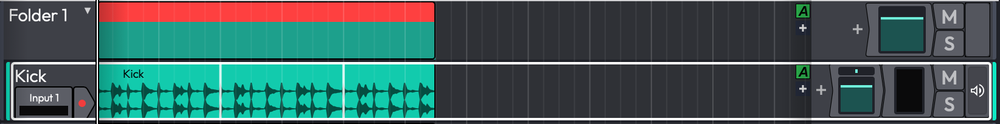

*Folder Track after Dropping in One Track*

If the folder already has tracks in it, drag over the folder and then
downward. A red glowing insertion point shows where your track will go
between the other tracks, so you can get the order you want.

### Naming a Folder Track

You name a Folder track in the same way as any other track. Click the
name area of the track header, then edit **Name** in the Actions panel.
The default names are *Folder 1*, *Folder 2* and so on.

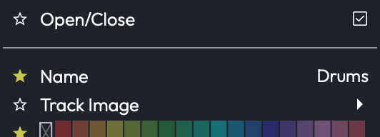

*Naming a Folder Track*

> 💡 **Tip:** A common use of Folder tracks is to organise all of your
drum parts into a single folder, named *Drums*, for example.

### Reordering Tracks within a Folder Track

To reorder the tracks within a Folder track, drag any track to its new
position. The red insertion line shows exactly where the track will go.
If you drop a track directly onto the Folder track, it goes to the top
position.

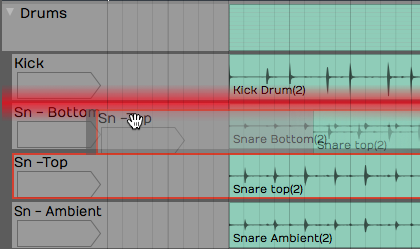

*Reordering Tracks within a Folder*

### Removing Tracks from a Folder Track

To take a track out of its folder, select it and click **Unfolder** in
the Actions panel ("Removes this track from its parent folder"). To take
several out at once, select them, right-click one of their track headers
and choose **Unpack selected tracks from folder**.

### Collapsing and Expanding a Folder Track

Click the small triangle to the left of the Folder track name to expand
or collapse the folder. Collapsing a folder doesn't affect playback: all
the tracks in it still play and respond as normal.

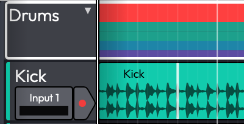

*Expand/Collapse a Folder by Clicking the Triangle*

### Soloing/Muting a Folder Track

Folder tracks have **Solo** and **Mute** buttons like any other track,
but they act on all the tracks in the folder. Click **Solo** on a Folder
track that holds your drums, and all your drum tracks are soloed.
**Mute** likewise mutes all the tracks in the folder.

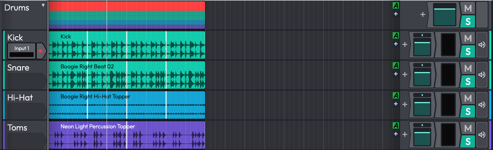

*Folder Track Solo*

> 📝 **Note:** When you solo a Folder track, the tracks in it show a
blinking **Solo** button, which means they're soloed by the Folder track
rather than directly. Click a blinking **Solo** to change it to the
standard solo state with a steady indicator.

Solo and mute alone make it worth setting up a Folder track for each
instrument type, such as drums, guitars, keyboards and vocals.

## The Folder Track VCA

VCA stands for "voltage controlled amplifier", after a similar feature
on automated analogue mixing consoles. The VCA on a Folder track
controls the level of all the included tracks proportionally, giving you
one level control for everything in the folder.

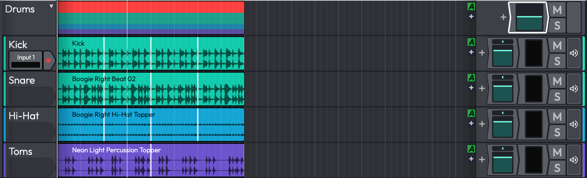

*Folder Track VCA*

No audio passes through the Folder track itself. The VCA acts as a
remote control, proportionally adjusting the Volume & Pan plugins of
all the tracks in the folder. This lets you balance whole groups of
instruments without adding extra buses.

> 📝 **Note:** To keep one track out of the VCA's control, select that
track's Volume & Pan plugin and turn on **Ignore VCA** in the Actions
panel. The option only appears for tracks inside a folder. If a folder
has no VCA, right-click its track header and choose **Insert VCA
plugin...** to add one.

> 📝 **Note:** Adding an effect plugin to a Folder track turns it into a
Submix track, so audio then passes through it. Submix tracks are covered
in the next chapter, [Submix Tracks](submix-tracks.md).

## Creating a Folder Track with Existing Tracks

Multitrack drums often have 10 or more tracks to put into a Folder
track. Rather than drag each track in individually, you can pack them
all into a Folder track at once:

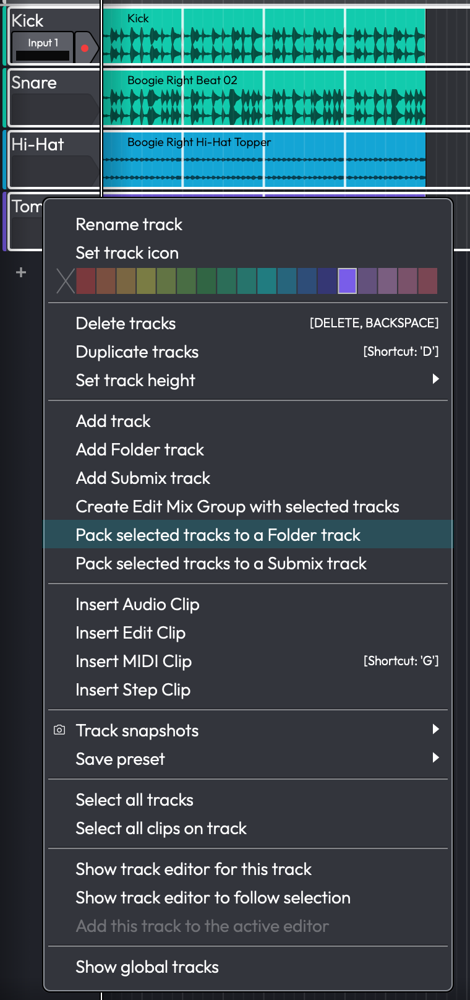

*Create a Folder Track Containing Existing Tracks*

1.  Click the name of the first track, then hold down Shift and click
    the last track. All the drum tracks are highlighted.
2.  Right-click the track name of any of the selected tracks and choose
    **Pack selected tracks to a Folder track** (also in the **Track**
    menu, or use **Create Folder Containing** in the Actions panel). This creates a Folder track containing all of your
    drum tracks.
3.  Select the Folder track and give it a descriptive name in the
    Actions panel.

> 💡 **Tip:** **Pack selected tracks to a Folder track** works for any
related selection of instruments or vocals, not only drums.

## Editing With Folder Tracks

Folder tracks also let you edit the clips on all of their tracks at once.

### Splitting Contained Clips

To split clips across all of the contained tracks, select the Folder
track clip (the collection clip: the summary clip on the Folder track),
position the cursor, then press **/**.

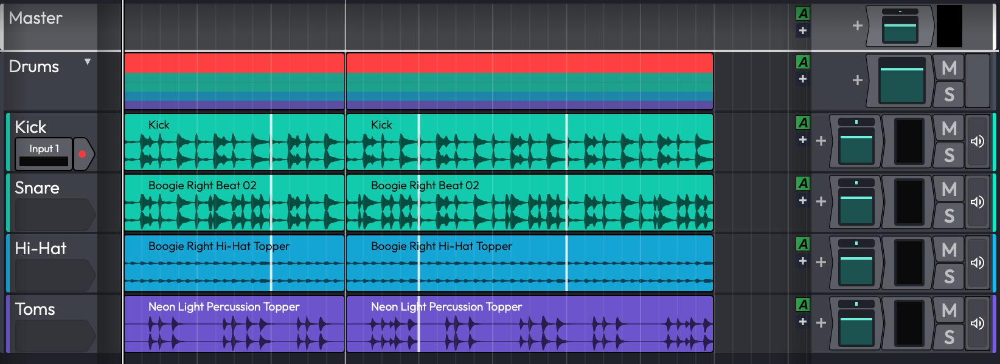

*Split All Clips Within a Folder Track*

### Rearranging

After splitting the Folder track clip, drag the Folder track clips into
any order to rearrange everything in the folder, for example to swap
verse 1 and verse 2. With all your tracks in one Folder track, you can
block-arrange the whole song this way.

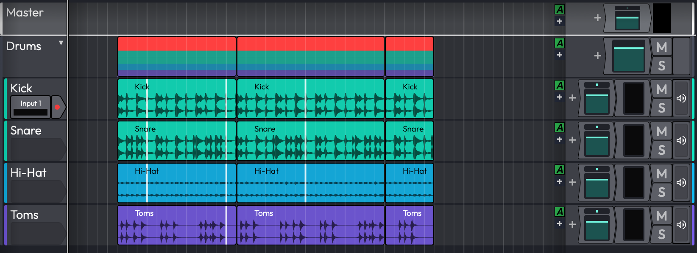

*Rearranging Clips within a Folder Track*

### Trimming

The Folder track clips have trim handles at each end. Drag them to trim
all the included clips.

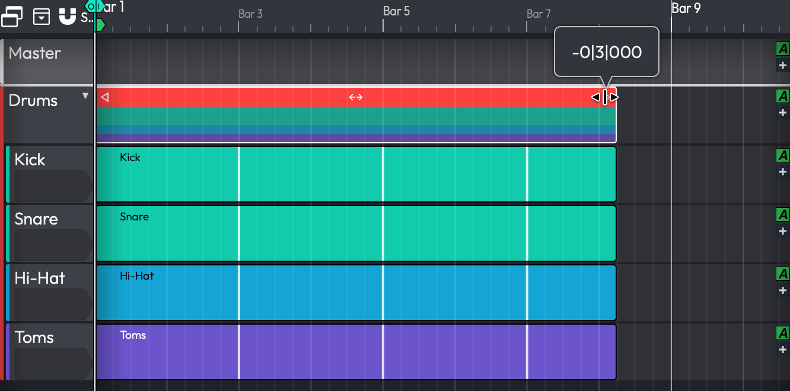

*Trimming Using the Folder Track Clip*

### Deleting

As well as moving and splitting clips, you can delete whole sections of
the contained tracks: separate out a section, select it, and press
**Delete** or **Backspace**.

## Automating a Fade within a Folder Track

You can automate the VCA fader to create fade-outs or fade-ins on
Folder tracks. [Automation](automation.md) covers automation in more
detail. To create a fade-out:

1.  Drag the small "A" icon (the track's automation icon) and drop it on
    the VCA fader, then choose **VCA** from the menu that appears. The
    automation curve for the VCA fader appears on the Folder track.

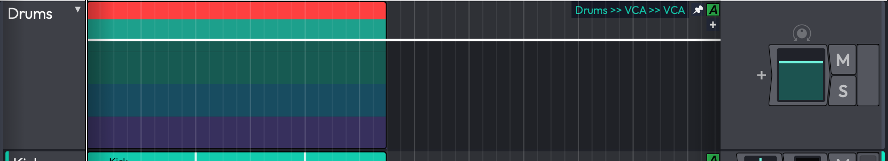

*Activate Automation for the VCA*

2.  Double-click the automation curve to add two points: one before and
    one after the section you want to fade.

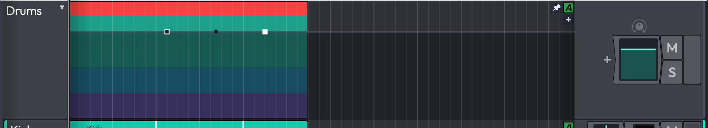

*Add Automation Points to the VCA Curve*

3.  Drag the last point all the way down to the bottom of the clip to
    draw your fade-out.
4.  Drag the curvature point, which appears automatically between the
    two points you added, to adjust the shape of the fade.

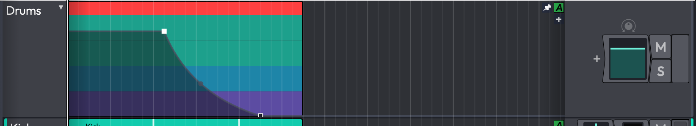

*Customising the Fade with Curvature*

Drag the points further to adjust the speed of the fade until it
sounds right. The automation points snap to the current snap increment;
turn **Snap** off for finer adjustment.

This saves you editing each individual clip to create a fade-out.

## Moving On

For a folder that audio passes through, so you can add effects to the
whole group, see [Submix Tracks](submix-tracks.md).
