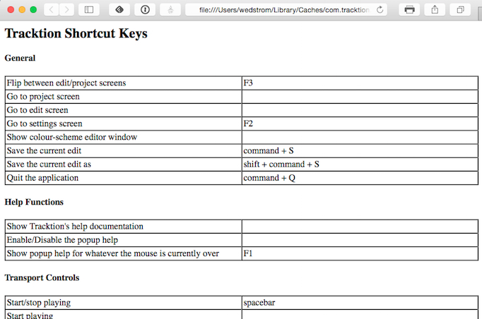
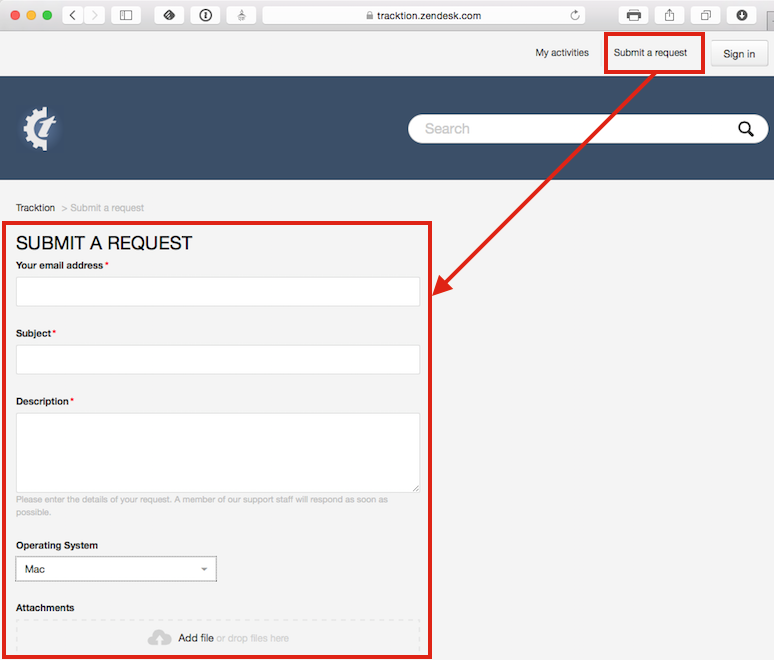

# Getting Help

This chapter lists the ways to get help while you work with Waveform.

## Pop-up Help

The first source of help is pop-up help. Press F1 to view pop-up help
for the item under the pointer. To turn pop-up help off, untick
*Help > Pop-up help > Enable pop-up help*. See
[Pop-up Help](basic-navigation.md#pop-up-help) for an illustrated guide.

## Roll-over Help

Roll-over messages in the upper right describe the item under the
pointer.

## The Help Menu

The **Help** menu collects the built-in sources of help:

| Item | What it does |
|---|---|
| **About Waveform** | Shows the About box, with the version number you'll need for a support request. |
| **Check for updates** | Checks whether a newer version of Waveform is available. |
| *Get help > User guide PDF* | Opens this manual (Shift + F1). |
| *Get help > Tracktion Website* | Opens the software help pages on the Tracktion website. |
| **Pop-up help** | **Enable pop-up help** turns pop-up help on or off, and **Delay pop-up help messages** makes it wait longer before appearing. |
| **Show the First Run Setup panel** | Shows or hides the [First Run Setup](audio-device-setup.md#first-run-setup) panel. |
| **Show the Waveform log file** | Shows the log file in Finder or File Explorer, ready to attach to a support request. |

## Quick Start

If you're new to Waveform, the [Quick Start](quick-start.md) chapter at the
front of this manual is the fastest way to get set up and making music. It
takes you from installing through to your first recording and export,
linking to the fuller chapters as you go. You can also open this manual
at any time from *Help > Get help > User guide PDF*, or by pressing
Shift + F1.

## Ask the AI Assistant

The [AI Assistant](ai-assistant.md), in every edition, can answer
questions about how Waveform works and about your project. Once you've
chosen a profile on the *Settings > AI* page, click the **Assistant** tab
in the Browser and ask in plain language.

## Keyboard Shortcut List

The keyboard shortcut list is a good way to get to know Waveform. Open
*Settings > Keyboard Shortcuts* to see every assignable action, grouped
by category.

*View as HTML Button*

To find a shortcut, type in the page's search box to filter the list by
name, or click the **Press keyboard to filter** box and press a key to see
what it does. To print the list, click **View as HTML...** to load it in your
web browser.

*HTML View of Keyboard Shortcuts Assignments*

## Tracktion Videos

The official [Tracktion YouTube channel](https://www.youtube.com/@TracktionSoftware)
is the best place for video tutorials, feature walkthroughs, and update
overviews, with new videos added regularly. Browse the
[playlists](https://www.youtube.com/@TracktionSoftware/playlists) to find
videos grouped by topic.

The [Tutorial Videos page](https://www.tracktion.com/training/videos) on
the Tracktion website also has a selection of training videos, and
[Groove 3](https://www.groove3.com) has a large library of music
production courses.

## Tracktion Forums

The long-standing official [forum for Waveform
Software](https://www.kvraudio.com/forum/viewforum.php?f=22) is hosted at [KVR](https://www.kvraudio.com). This
is the most active Waveform forum, where you can talk to other users,
Tracktion staff and developers.

There is also a private [Tracktion Users
Group](https://www.facebook.com/groups/Tracktion/) on Facebook. If you
use Facebook, ask to join; Tracktion staff are members too.

The [Waveform Software official Facebook
page](https://www.facebook.com/tracktionsoftware) has updates, news about Waveform, promo
offers and profiles of Waveform artists ("Tracktioneers").

## Tracktion Support

Bug reports and feature requests get resolved fastest when they follow
the checklist below.

[Waveform Request Form](https://tracktion.zendesk.com/hc/en-us/requests/new)

*Waveform Request Form*

Request Form Checklist:

-   Use "FR:" in the title for feature requests
-   Use "BR:" in the title for bug reports
-   Include the Waveform version number (from the Waveform About box)
-   Include your operating system and version
-   Note your system specs like processor type and the amount of RAM
-   List the steps to recreate the bug
-   Attach the log file (*Help > Show the Waveform log file*)
-   Attach or link to a screenshot or screen recording
-   Report one issue at a time

Follow these same guidelines when posting bugs and feature requests to
the [KVR Waveform Software forum](https://www.kvraudio.com/forum/viewforum.php?f=22).

## Moving On

Next, [The Edit Tab](edit-tab.md) explains the layout of the Edit tab,
where most of your work in Waveform happens.
