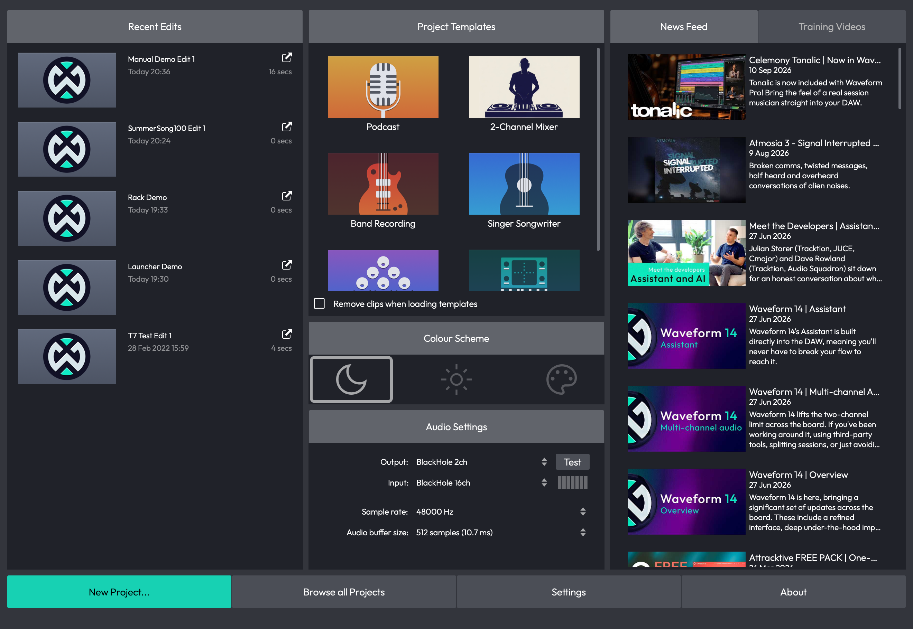
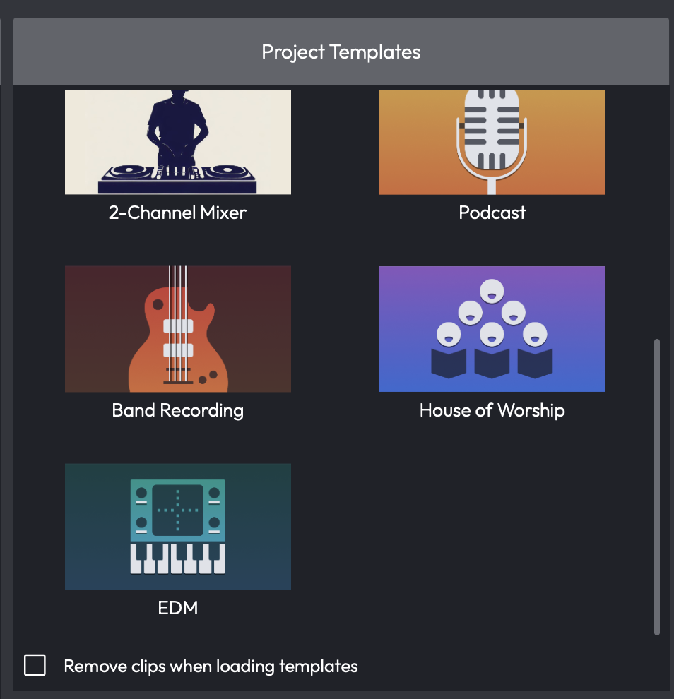
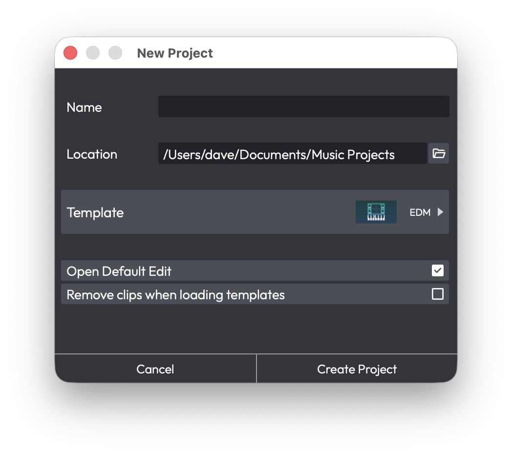
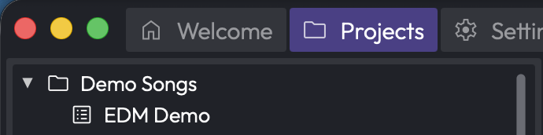

# Demo Projects and Templates

This chapter shows you how to start from ready-made content: demo songs
and project templates.

## Establish a Waveform Projects Folder

Before you start, decide where to keep your Waveform projects. For
example, create a Waveform folder inside your Documents folder, using
Finder (macOS) or File Explorer (Windows).

Waveform has no setting for a projects folder. Instead, you pick the folder
in the **Location** field of the **New Project** dialog, and Waveform
offers the last folder you used the next time you create a project.

## The Welcome Tab

The **Welcome** tab is the first tab in the window. **Upon launch** in
*Settings > General* decides whether Waveform opens on it (see
[Startup](reference-settings.md#startup)).

| Area | What it shows |
|---|---|
| **Recent Edits** | The Edits you've opened most recently, newest first. |
| **Project Templates** | Templates to start a new project from (see below). |
| **Audio Settings** | Your audio device type, devices, sample rate and buffer size, so you can check them before you start. |
| **Colour Scheme** | Buttons for the dark scheme, the light scheme and the Colour Scheme Editor. |
| **News Feed** / **Training Videos** | Tracktion news and tutorial videos. Click an item to open it in your web browser, or hover over it to read its full description. |

*The Welcome tab*

Along the bottom are **New Project...**, **Browse all Projects** (which
opens the Projects tab), **Settings** and **About**.

## Starting From a Template

The quickest way to get something playable is to start from one of the
built-in templates. They include demo songs as well as ready-to-use
starting points for new projects.

Open the **Welcome** tab and look at the **Project Templates** list. Each entry
is a complete project you can use as the starting point for a new one.

*The Project Templates List in the Welcome Tab*

Click a template to open the **New Project** dialog with that template
chosen. Give the project a **Name**, pick a **Location** and click
**Create Project**. The original template is left untouched, so you can
reuse it as often as you like.

> 💡 **Tip:** To keep the template's track and plugin layout but start
> with an empty arrangement, turn on **Remove clips when loading
> templates** (the toggle under the Project Templates list, also in the New
> Project dialog) before you click. The project then opens with its routing
> in place but no clips on the tracks.

*A New Project Created From a Template*

## Demo Songs in Your Projects

Any demo songs bundled with your installation are added to your projects
automatically the first time you run Waveform, so there's nothing to
download. They appear in the **Projects** tab alongside your own work.

> 💡 **Tip:** You can move the demos into a folder in the Projects tab
> to keep them apart from your own work.

*Demo Songs Collected in a Project Folder*

## Moving On

Next, set up your audio interface in
[Audio Device Setup](audio-device-setup.md).
