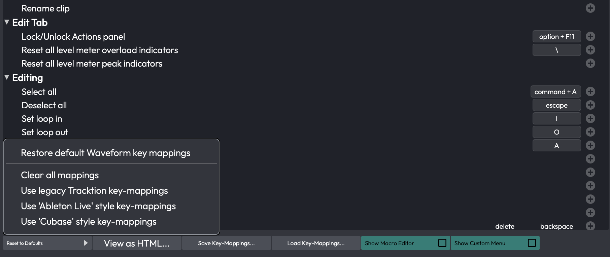

# Introduction

Welcome to the *Waveform User Guide*. This guide helps you learn
Waveform. It suits readers coming from another DAW as well as those
learning computer recording from the ground up, and it works as a
reference once you know your way around. If you already use Waveform or its predecessor,
*Tracktion*, it also covers what has changed. The book started as a
step-by-step guide and has grown into a reference manual.

Waveform has the full range of modern DAW features, along with many
features of its own designed to help with music creation.

Waveform runs on 64-bit versions of macOS and Windows as well as Linux.
All versions are maintained in parallel, so the latest release is
usually the same (or close to it) on all three platforms.

Waveform is available in Free, OEM and Pro editions. Waveform Free
has all the core functionality, including the AI Assistant and the
Pattern Generator. Waveform Pro adds creative tools such as the Chord
track, Groove Doctor, Track Snapshots, Layouts and Quick Actions, the
Wavetable synth and other instruments, the MIDI effects (also available
in the MIDI Producer Expansion) and the Render dialog's Advanced mode.
Many of these can also be added to the other editions with an expansion,
such as the MIDI Producer Expansion or the Recording Engineer Expansion.
The Free edition has no limitation on the number of tracks and supports
third-party plugins, as the Pro edition does. The OEM edition is
included with mixers and audio interfaces from various manufacturers
including Mackie and Behringer.

Throughout this book, a PRO badge marks the
features that aren't in Waveform Free. A badged heading has an **Edition**
line under it naming the editions and expansions that include the
feature. A badged control without a heading of its own names the editions
in the sentence that describes it.

Like its predecessors, Waveform has a single-screen user interface,
with a mixer channel built in to the right of each track. Long-time users
value this left-to-right workflow, and many find it makes more sense than
other designs.

Waveform also has a traditional, console-style Mixer (see
[The Mixer](edit-tab.md#the-mixer-panel)). It's optional, and you can
detach it and move it to another monitor, so you don't have to switch
between the tracks and the Mixer.

Waveform's plugin architecture covers its own built-in
plugins, plugin racks, and third-party plugins in VST, VST3, Audio Units
(macOS), LV2 and, on Linux, LADSPA formats. On Apple Silicon Macs and
Windows it also hosts Cmajor patches.

## What's in the Book?

This book covers the current version of Waveform. If you're new to it,
start with [Quick Start](quick-start.md); if you're upgrading,
[What's New](whats-new.md) lists the recent changes.

The book covers:

-   How to install and set up Waveform
-   How to record audio to tracks
-   How to record MIDI and use virtual instruments
-   How to record with guitar amp simulators
-   How to edit audio
-   How to edit MIDI
-   How to mix with the inline mixer
-   How to insert and use plugin effects
-   How to mix down, and [render stems](rendering-and-stems.md) and other files
-   How to launch clips and scenes with the [clip launcher](clip-launcher.md)
-   How to get help from the [AI Assistant](ai-assistant.md)
-   A reference to settings and options used to configure and customise
    Waveform.

## Video Resources

Tracktion publishes many tutorial videos for Waveform. Videos usually
appear before the matching updates to this guide, so subscribing to the
channel is a good way to keep up:

Tracktion YouTube Channel - [@TracktionSoftware](https://www.youtube.com/@TracktionSoftware)
(browse the [playlists](https://www.youtube.com/@TracktionSoftware/playlists)
for videos grouped by topic)

Groove3.com has some older but still useful content on Tracktion,
including videos on plugin racks, Master Mix and the Tracktion DAW.

Groove 3 - [Groove3.com](https://www.groove3.com)

## Setting the Default Keyboard Shortcuts

This guide uses Waveform's default keyboard shortcuts. If you have
changed them, switch back to the defaults to follow along:

1.  Open *Settings > Keyboard Shortcuts*
2.  Click **Reset to Defaults** at the bottom of the page
3.  Select **Restore default Waveform key mappings**

*Settings Tab: Set the Keyboard Shortcuts to Match this Book*

The default shortcuts are designed for a fast workflow and keep the
commands consistent between Mac and Windows.

## Modifier Keys Conventions

The book uses the following abbreviations for modifier keys:

-   Command: Cmd
-   Control: Ctrl
-   Option: Opt
-   Alt: Alt

In most cases, Cmd on macOS becomes Ctrl on Windows. This manual shows
both in the order Mac / Windows, for example Cmd + C / Ctrl + C.

Here is a longer example:

- Click to select the clip, then copy it using Cmd + C / Ctrl + C.
- Next, position the cursor in the Arrangement where you want to place
    the copy and paste it, using Cmd + V / Ctrl + V.

> 📝 **Note:** Most Linux users will use the 'Meta' key in place of Alt. On a
> typical PC keyboard, Meta is usually the Windows key.

> 📝 **Note:** In some parts of the world, Mac keyboards label the Option
> (Opt) key as Alt. This shouldn't cause much confusion, but I did want
> to acknowledge it.

## Moving On

With the default shortcuts set, Waveform will match the examples in this
book. To start making music, go to [Quick Start](quick-start.md).
