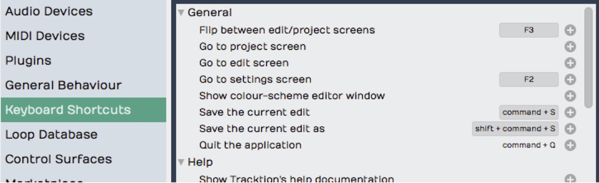
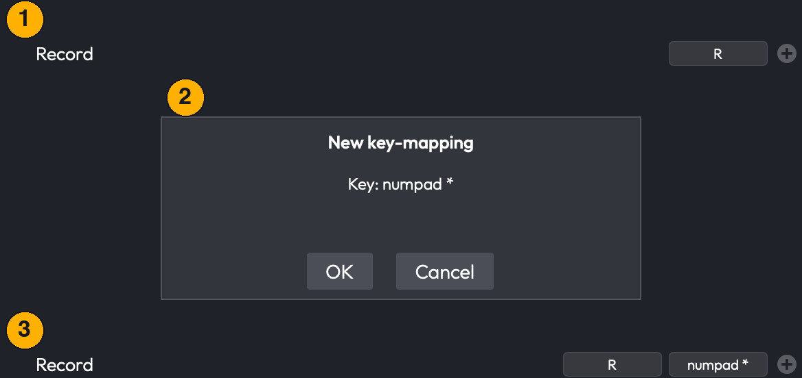
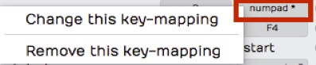
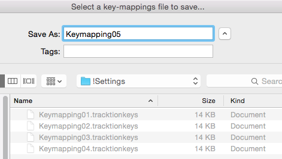
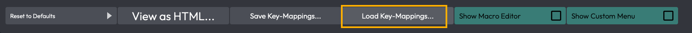
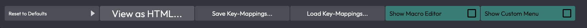
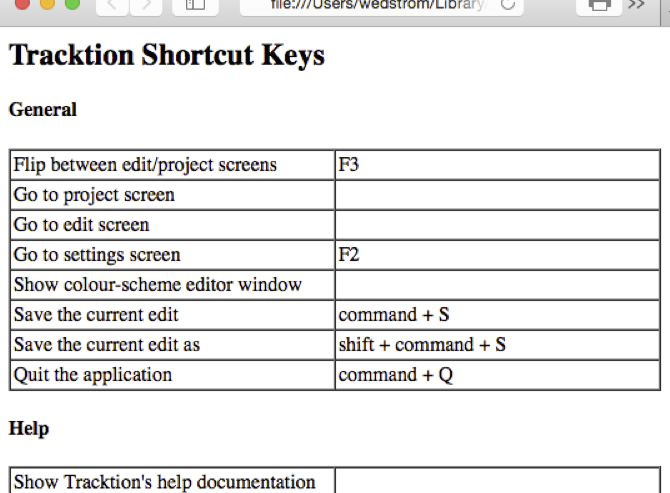

# Keyboard Shortcuts

This chapter shows you how to customise Waveform's keyboard shortcuts.
To go back to the default mapping, as described in the
[Introduction](introduction.md), open *Settings > Keyboard Shortcuts*,
click **Reset to Defaults** near the bottom of the page, and choose
**Restore default Waveform key mappings**.

> 📝 **Note:** The default Waveform key-mapping is used for all examples
> in this book.

## Keyboard Shortcuts Page

The Keyboard Shortcuts page on the Settings tab shows all of the
key-mappings. You can change them to suit the way you work, or to match a
DAW you already know.

*Keyboard Shortcuts Page on the Settings Tab*

An action can have more than one shortcut. For example, you can use one
key on a laptop and a keypad key when you're working at a desktop
computer with an extended keyboard.

## Finding a Shortcut

Type in the page's search box to filter the list. It matches the names,
descriptions and categories of the commands. To find out what a key does,
click the **Press keyboard to filter** box and press the key: the list then
shows only the command mapped to it.

## Using Another DAW's Shortcuts

**Reset to Defaults** loads a complete set of key mappings. As well as
**Restore default Waveform key mappings**, its menu offers **Clear all
mappings**, **Use legacy Tracktion key-mappings**, **Use 'Ableton Live' style
key-mappings** and **Use 'Cubase' style key-mappings**. Each one asks you to
confirm, because it overwrites all your current key mappings, so save them
to a file first (see below) if you might want them back.

## Setting a Keyboard Shortcut

*Map Record to the Asterisk on the Keypad*

For example, to start recording you click the **Record** button in the
transport bar or press R. On a full-size keyboard, you might prefer to
start recording with the asterisk (\*) key on the keypad. To set this up
on a Mac (on Windows, the asterisk is already a default Record key):

*Setting a Keyboard Shortcut*

1.  Click the plus icon at the far right of the action. The **New
    key-mapping** dialog opens.
2.  Press the key or key combination that you want to trigger the
    action. The dialog shows the key and warns you if it conflicts with
    an existing mapping. For this example, press asterisk (\*), then
    click **OK**.

Now, both R and the keypad asterisk (\*) are assigned to the Record
action. Back in the Edit, test this by turning **Record** on and off using
either R or asterisk (\*).

> 📝 **Note:** Keyboard mappings are global. Any changes you make will be
> active for all your Edits.

## Changing a Keyboard Shortcut

To change an existing shortcut, click the key-mapping at the far right of
the action. **Remove this key-mapping** deletes it, and **Change this
key-mapping** opens the **New key-mapping** dialog so you can enter a new
assignment.

*Click to Change or Remove a Key-mapping*

## Saving Keyboard Shortcuts to a File

Once your keyboard shortcuts are set up the way you want, save the whole
key-mapping to a file. If you run Waveform on a different computer, you
can then load the file to get all your assignments back.

*Save Key-Mappings Button*

To save your shortcuts, click **Save Key-Mappings...** and choose a file
name and location. You can store the file anywhere you like. Waveform
key-mapping files have the `.tracktionkeys` extension.

*Save Key-Mappings Dialog Box*

> 💡 **Tip:** Keep these files in a 'settings' folder inside your main
> Waveform folder, with a version number at the end of each file name.
> You can then go back to an earlier version if you change your mind
> about a new keyboard layout.

## Loading Keyboard Shortcuts from a File

On a new installation or a new computer, you can load your custom
key-mapping file. Open *Settings > Keyboard Shortcuts* and click
**Load Key-Mappings...**, find your saved key-mapping file, then click
**Open**. All your key-mappings are restored.

*Load Key-Mappings Button*

## Printing a List of Keyboard Shortcuts

To print a list of your current keyboard shortcuts, click
**View as HTML...** at the bottom of the Keyboard Shortcuts page. This
opens a formatted list of all the current key-mappings in your web
browser, where you can search or print it.

*View as HTML Button*

*HTML View of the Keyboard Shortcuts List*

## Moving On

Waveform's macro scripting lets you go further than keyboard shortcuts.
The **Show Macro Editor** button on this page opens the macro script
editor, and **Show Custom Menu** opens the Custom Menu Editor, where you
build your own *Actions > Custom* menu. See [Macros](macros.md).
