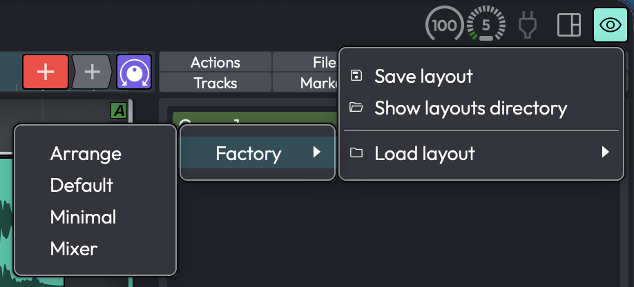

# Layouts PRO { #layouts }

> 📝 **Edition:** Waveform Pro. In Waveform Free and OEM the **Layout** button is hidden and the
> save/load commands do nothing.

A layout saves the way the Edit window is arranged (which panels are showing, how big they are, and
whether they are docked or floating) as a named preset you can recall from a menu. For example, save one
layout set up for *tracking*, and a *mixing* layout with the Mixer enlarged and the Browser hidden, then
switch between them.

Layouts only change the *appearance* of the window. They never change your audio, MIDI, clips,
plugins, or any other project data.

*The Layout menu*

## What a Layout Stores

A layout captures the state of the arrangement window's panels:

- The visibility, size, and docked/floating state of the Overview, Detail Editor, Mixer, Arrangement,
  and Browser, the global tracks (tempo, arranger, chord), the control/input/plugin strips, and the
  Quick Actions bar and Quick Actions window.
- The active Browser tab and the marker-track mode.
- The mixer strip layout: track width, big/small meters, and which mixer sections (inputs,
  modifiers, overview, clips, plugins, outputs, levels) are shown.

> 📝 **Note:** A layout doesn't store the arrange zoom level, per-track visibility, track heights,
> the cursor position, or the open/floating state of the Actions panel. Recalling a layout rearranges
> the panels; it leaves your view of the tracks themselves as it was.

> 📝 **Note:** Layouts are global (application-wide), not saved inside a project. The same set of
> layouts is available in every Edit, and applying one to the current Edit has no effect on other Edits
> you have open.

## Saving and Loading Layouts

The **Layout** button (the dashboard icon at the right-hand end of the window's tab bar, next to the
eye button, with the tooltip *"Load or save the current view as a layout preset"*) opens this menu:

| Item | What it does |
|---|---|
| **Save layout** | Saves the current window arrangement as a named layout. |
| **Show layouts directory** | Opens the folder that holds your layout files in Finder or File Explorer. |
| **Load layout** | A submenu listing your saved layouts, plus a **Factory** submenu of the shipped ones. Click one to apply it. |

When you choose **Save layout** a dialog titled *"Save Preset"* appears, prompting *"Enter a name for the
preset:"* with the current Edit's name filled in. Type a name and click **Save**. If a layout with that
name already exists, Waveform asks *"A preset with this name already exists, do you want to overwrite
it?"* with **Overwrite** and **Cancel** buttons.

> 💡 **Tip:** You can also open an Edit straight into a chosen layout. Click the **+** (New Tab) button,
> or right-click an Edit's tab. Each Edit listed under **Recent Edits** and in the project submenus has
> three buttons: the first opens it in the default view, the second in the Mixer layout, and the eye
> button lets you pick a layout to open it with.

To use keyboard shortcuts instead, assign the commands **"Show the save view state dialog"** and
**"Show the view state menu"** in *Settings > Keyboard Shortcuts*. Neither has a default shortcut.

## Factory Layouts

Waveform ships with four ready-made layouts under the **Factory** submenu of **Load layout**:

- **Default**
- **Arrange**
- **Mixer**
- **Minimal**

If any of them is missing, Waveform reinstalls it the next time you launch, but it never overwrites an
existing factory file.

## Managing Layouts

There is no in-app way to rename or delete a layout. Use **Show layouts directory** to open the folder of
saved layouts, then rename or delete the `.view` files in Finder or File Explorer.
Any subfolders you create become submenus in the **Load layout** list, which is handy for keeping sets of
layouts organised.
