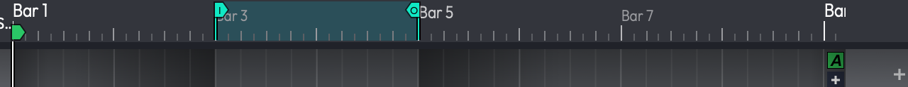
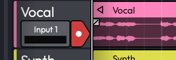
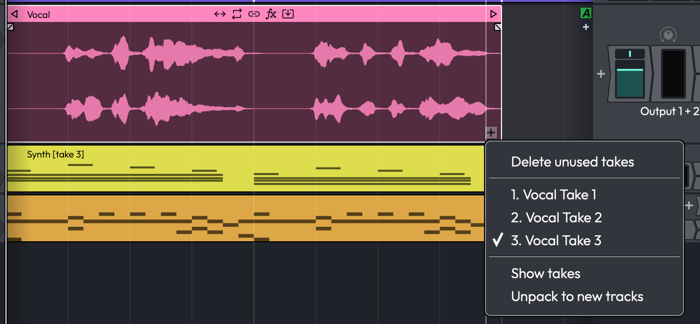

# Loop Recording

Loop recording is a quick way to record several takes of a part onto a
single track. Afterwards, you pick the best take and make it active, so
it's the one you hear during playback.

Loop recording also sets you up for Waveform's comping tools. With
comping, you go phrase by phrase through the takes, choose the best parts
and build a composite take. See [Comping](comping.md).

## Getting into Loop Recording Mode

To loop record, turn on **Loop** (L) in the transport bar. When you then
click **Record**, Waveform records only between the In marker and Out
marker. The transport loops between the two markers, recording take
after take until you click **Stop**.

*Turn on Loop for Loop Recording Mode*

## Loop Recording Step-by-Step

1.  Set the In marker and the Out marker over the range you want to loop
    record. To set the In marker, position the cursor and press I. To
    set the Out marker, position the cursor at the end of the loop and
    press O.

    

    *Set the In Marker and Out Marker*

    > 📝 **Note:** The count-in from the **Click** menu works for loop
    > recording. For a running start before the first take, set
    > *Click > Count-in* to **1 bar** or **2 bars**. The count-in plays
    > once, not before every pass of the loop.

2.  Configure the input and check your levels, as for
    [standard recording](recording-audio.md).

    

    *Configure the Input for Recording*

3.  Click **Record** (R) on the transport bar to start recording.

When the cursor reaches the Out marker, Waveform loops back for the next
take. You can record as many takes as you like.

## Selecting the Best Take

After loop recording, the takes are stacked within the Audio clip. The
last take you recorded is the one you hear during playback, called the
"active take". To make a different take active, click the plus (+) sign
in the lower right corner of the clip and pick it from the list of takes.
You can audition each take this way and keep your favourite.

*Choosing the Active Take*

> 💡 **Tip:** Takes recorded this way are ready for
> [Comping](comping.md).

## Unpacking Takes to Tracks

To work with your loop-recorded takes as separate audio tracks, click
the plus (+) sign and select **Unpack to new tracks**.

*Unpack Takes to Tracks*

This converts an Audio clip full of takes into a series of tracks, each
with its own Audio clip. You can then use normal audio editing to move
them around, chop them up, or arrange them into a song.

## Moving On

Next, [Comping](comping.md) shows how to build a composite take from
your loop-recorded takes.
