# Macros

As well as programmable keyboard shortcuts, Waveform has a full macro
programming environment. If the standard keyboard shortcuts don't do
what you need, you can write macros that combine actions in new ways,
and assign keyboard shortcuts to them.

Macros don't have to be assigned to keyboard shortcuts. You can always
run them from the **Actions** menu in the main menu, which saves
remembering shortcuts for macros you only use occasionally.

## Macro Editor

To open the Macro Editor, open *Settings > Keyboard Shortcuts* and
click **Show Macro Editor** at the bottom right of the page.

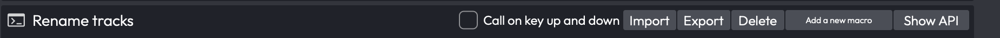

*The Macro Editor*

Drag the line between the Macro Editor and the keyboard shortcuts list
to change the editor's height. The Macro Editor is a basic text editor
for entering and editing macro scripts.

**Call on key up and down**: Normally a macro runs once, when its key is
pressed. Turn this on to run it on both the key press and the key
release; the script can check `Tracktion.isKeyDown` to tell the two
apart. (Default: off)

> 💡 **Tip:** With the Macro Editor open, click some of the existing
keyboard shortcuts. The Macro Editor shows the underlying code, which
helps you learn the syntax of the actions each shortcut triggers.

## Creating a Macro

To create a new macro, click **Add a new macro** on the Macro Editor.
This adds a new macro named "Untitled Macro" to the bottom of the
keyboard shortcuts list under the Macros section.

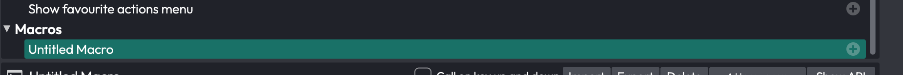

*Adding a New Macro*

The name is selected as soon as the macro is created, so start typing
to give it a suitable name.

In the body of the macro, type a list of actions, separated by
semicolons. The easiest way to build a macro is from the right-click
menu, described in [Programming a Macro](#programming-a-macro).

To show a macro in the Actions panel whenever you select a particular
type of item, see [The Actions Panel > Adding Macros](actions-panel.md#adding-macros).

## Deleting a Macro

You can't delete the built-in keyboard shortcuts, but you can delete
any macro you create: select it in the keyboard shortcuts list and click
**Delete** in the Macro Editor.

## Programming a Macro

The simplest macro is made up of a single action. You can pick any
available action by right-clicking the Macro Editor and navigating
through the three collections of actions listed under its **Actions**
heading. Select an action and its code is inserted into the script.

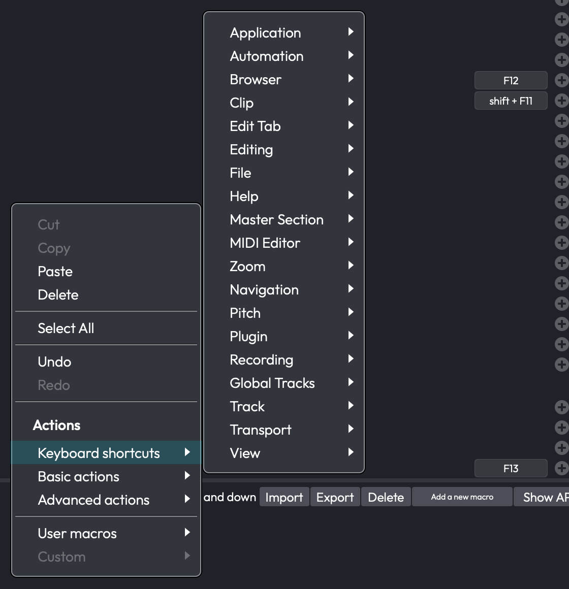

*Selecting Actions from the Macro Editor Right-click Menu*

-   **Keyboard shortcuts** includes all the built-in keyboard
    shortcuts shown on the Keyboard Shortcuts page.
-   **Basic actions** includes actions that don't necessarily have
    pre-assigned shortcuts.
-   **Advanced actions** includes actions that manipulate selected
    objects and even display messages on the screen, for more advanced
    scripts.

Below these, the **User macros** and **Custom** submenus let you insert
your own macros and the items from your Custom Menu.

## Running a Macro

There are several ways to run a macro:

1.  Assign it to a keyboard shortcut, in the same way as the built-in
    shortcuts: find the macro in the list, click the "+" at the far
    right and enter the key combination.
2.  Choose *Actions > User macros* from the Edit tab's main menu, where
    all your custom macros appear automatically, and select the one you
    want to run.

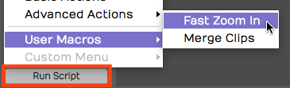

*Running macros from Actions > User macros*

3.  Add macros to the Custom Menu. Click **Show Custom Menu** at the
    bottom of the Keyboard Shortcuts page to open the Custom Menu
    Editor, then drag your macros (or any built-in actions) into it.
    You can arrange the menu by drag and drop, and add and rename
    groups. Open the Custom Menu from the Edit tab's main menu:
    *Actions > Custom*.

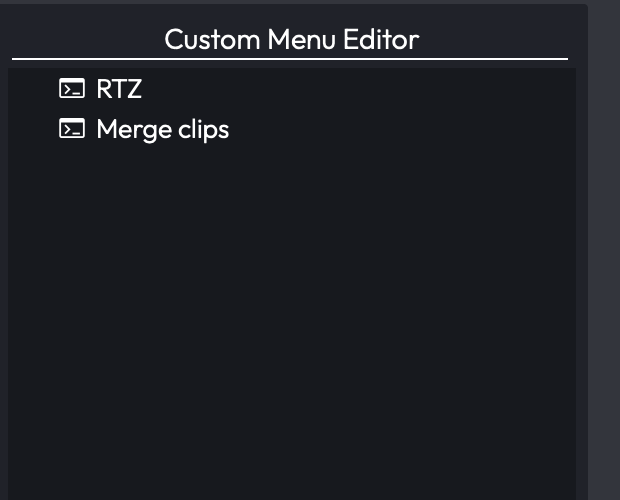

*The Custom Menu Editor*

## JavaScript Programming

As well as step-by-step lists of actions, you can write macros in
JavaScript, with loops and conditions. The Macro Editor colour-codes the
elements of the script.

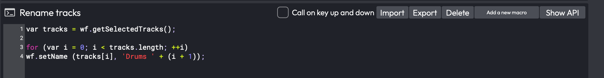

*JavaScript Macro Example*

> 📝 **Note:** Waveform actions are methods written in 'dot' notation:
the word Tracktion, a dot, then the method, followed by one or more
parameters in brackets.

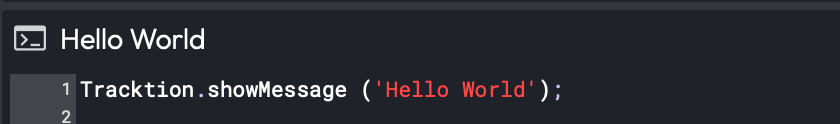

*Macro Actions 'dot' Notation Syntax*

### The wf and render Objects

Alongside `Tracktion`, every macro can use the `wf` object, a newer API
that works with handles to tracks, clips and plugins. It is the
preferred API for track, clip and plugin work, and handles from either
object can be passed to the other. This macro renames the selected
tracks:

```js
var tracks = wf.getSelectedTracks();

for (var i = 0; i < tracks.length; ++i)
    wf.setName (tracks[i], 'Drums ' + (i + 1));
```

A `render` object is also available for rendering from a script.

Click **Show API** in the Macro Editor to open the full reference for
all three objects in your web browser.

## Hover Tooltip

Hover over an action in the Macro Editor for a second or two to see a
tooltip explaining which parameters it takes and, if it returns values,
their syntax. These tooltips are the quickest guide to how each action
works.

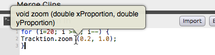

*Hover Over an Action for a Tooltip*

In this example, the tooltip shows that the zoom action takes
two double precision numeric parameters. The first is the x-proportion
(the amount of horizontal zoom), and the second is the y-proportion (the
amount of vertical zoom, the track height).

## RTZ Macro Example

By default, Waveform has no true return-to-zero (RTZ) keyboard
shortcut. The built-in command stops at the In marker first, so you need
to press it twice to get back to zero. A macro that runs the action
twice always returns the cursor to the start of the Edit.

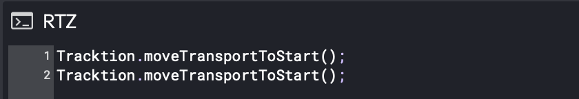

*True Return-to-Zero Macro Example*

For example, you could assign the RTZ macro to the **Home** key.

## Merge Clips Macro Example

Merging clips is another task you may do often. Normally you select the
clips on a track that you want to combine into a single clip, click
**Render Clips** in the Actions panel and choose **Merge the selected
clips**. If you do this frequently, assign a key to the built-in
**Merge selected clips** command in *Settings > Keyboard Shortcuts*, or
call `Tracktion.mergeSelectedClips();` as one step of
a longer macro. Pick a free key: Cmd + G / Ctrl + G is already used by
**Group clips**.

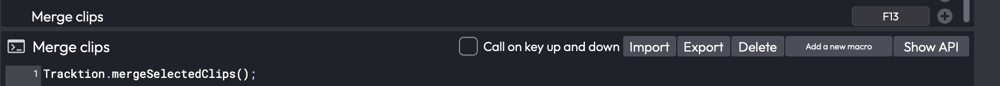

*Merge Clips Macro Assigned*

## Importing and Exporting Macros

Macros are plain text, so you can copy and paste them in and out of the
Macro Editor. Waveform also has buttons to import and export macro
scripts as XML files with a `.tracktionscript` extension, and you can
drag script files onto the Keyboard Shortcuts page to import them.

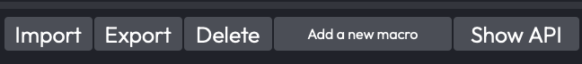

*Script Import and Export Buttons*

## Example Scripts

These example scripts from Waveform's engineers will get you started:

```js
// Rename Clips From Track
var tracks = Tracktion.getSelectedEditElements ('track');

for (var i = 0; i < tracks.length; ++i)
{
   var track = tracks[i];
   var trackName = Tracktion.getName (track);
   var clips = Tracktion.getClipsFromTracks (track);

   for (var c = 0; c < clips.length; ++c)
   {
      var clipName = trackName + " " + (c + 1);
      Tracktion.setName (clips[c], clipName);
   }
}
```

```js
// Reset Tracks Solo/Mute
var tracks = Tracktion.getEditElements ('track');
Tracktion.setSolo (tracks, false);
Tracktion.setSoloIsolate (tracks, false);
Tracktion.setMute (tracks, false);
```

```js
//Next Active Automation Parameter
var track = Tracktion.getTrackFromSelectedObject();
Tracktion.changeActiveAutomationParameter (track, 1);
```

```js
// Insert Plugin with Preset
var track = Tracktion.getTrackFromSelectedObject();
var plugin = Tracktion.insertPlugin (track, "Massive", 0, "AudioUnit");
var preset = Tracktion.getPresetFromLibrary ("Massive All Souls");
Tracktion.setPluginPreset (plugin, preset);
```

```js
// Jump to tab 2
var index = Tracktion.getWindowTabIndex();
var delta = 2 - index;
Tracktion.changeWindowTabIndex (delta);
```

```js
// Rename Selected Tracks
var tracks = Tracktion.getSelectedEditElements ('track');
Tracktion.setName (tracks[0], 'Kick');
Tracktion.setName (tracks[1], 'Snare');
Tracktion.setName (tracks[2], 'Hats');
// etc.
```

```js
// Save Selected Plugins as Preset
var plugins = Tracktion.getSelectedEditElements ('plugin');
Tracktion.saveObjectsAsPreset (plugins);
```

## More Code Samples

```js
/* Park the In-Marker & Out-Markers
Parks the In-marker and Out-marker at Zero then Restores Cursor Position. I wrote this macro to help a KVR forum member find a quick way to hide the In-marker and Out-marker.
*/
var SavePosition = Tracktion.getPosition ('cursor');
Tracktion.moveTransportToStart();
Tracktion.moveTransportToStart();
Tracktion.markIn();
Tracktion.markOut();
Tracktion.setPosition ('cursor', SavePosition);
```

```js
 /* Search Plugins
 Opens the Browser to the Search tab, enables the Plugin searching while disabling searching for Presets and Loops.
 */
 Tracktion.showSidePanel ('search'); // Opens Browser to the Search tab
 Tracktion.enableSearchLibrary ('plugin', true);
 Tracktion.enableSearchLibrary ('preset', false);
 Tracktion.enableSearchLibrary ('loop', false);
 Tracktion.setSearchPanelText ('');  // loads blank text so you can start typing the search term right away
```

```js
// Rename selected clips to 'Drums'
var clips = Tracktion.getSelectedEditElements ('clip');
for (var i = 0; i < clips.length; ++i)
    Tracktion.setName (clips[i], 'Drums');
```

```js
// Rename selected tracks to 'Drums'
var tracks = Tracktion.getSelectedEditElements ('track');
for (var i = 0; i < tracks.length; ++i)
    Tracktion.setName (tracks[i], 'Drums');
```

## Moving On

For every available action and object, click **Show API** in the Macro
Editor. To run macros from the selection-aware Actions panel, see
[The Actions Panel](actions-panel.md#adding-macros).
