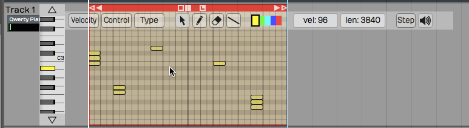

# MIDI Editing

In this chapter you will learn MIDI editing. There are two aspects to
MIDI editing. You can, of course, edit individual MIDI notes, but you
can also edit the MIDI clip. Editing a MIDI clip is similar to editing
an Audio clip, but with a few key differences. We will go over both
approaches in this chapter.

Many of the tools for working with clips work much like they do with
Audio clips. Each MIDI clip header has several drag handles. Let's take
a look at how they work.

## Trimming MIDI Clips

To trim a MIDI clip, drag one of the trim handles left or right. The
trim handles are the hollow arrows at the left and right of the MIDI
clip header.

*Trim MIDI Clips by Dragging a Trim Handle*

> 📝 **Note:** One difference between Audio clips and MIDI clips is that the
MIDI clips don't have fade handles.

## Moving MIDI Clips

To move a MIDI clip forward or backward in time, drag from the header
area. Don't drag starting from any of the icons, but instead drag from
the blank space in the header area.

*Moving a MIDI Clip*

## Moving a MIDI Clip Track-to-Track

To move a MIDI clip track-to-track, grab the header area and drag it up
or down. To move track-to-track without affecting the timing, hold down
Shift as you drag.

## Slip Editing MIDI Clips

The three solid color handles are used for slip editing: left arrow,
right arrow, and the box. The essential tool for slip editing is the
solid box in the center of the header. Grab the solid box and drag, in
order to slip edit the notes within the frame of the window.

*MIDI Clip Slip Handles*

Use the left solid arrow to slip the notes later in time, while leaving
the ending of the clip anchored. The right solid arrow works the
opposite way. You can slip the end of the clip, while leaving the
beginning of the clip anchored.

## Reframing a MIDI Clip

The hollow box tool in the center of a MIDI clip allows you to reframe
the entire window of the clip, leaving the notes in their original
place. This is done by dragging the hollow box left or right.

## Splitting a MIDI Clip

To split a MIDI clip, select it then position the cursor at the time you
want to make the split. Press the slash key (/). This is the exact same
workflow you use for splitting Audio clips.

*Split MIDI Clips Using the Slash Key*

You can also split using the **Split Clips** action in the
[Actions panel](actions-panel.md), which offers **Split clips at cursor
position**, **Split clips at mark-in point** and **Split clips at mark-out
point**. Launcher clips can't be split, so the action isn't shown for them.

*The Split Clips Action in the Actions Panel*

> 📝 **Note:** As you split MIDI clips, any notes that are sustained across
the split area are separated into two notes.

You can even split a mixture of Audio clips and MIDI clips across
multiple tracks, by selecting a combination of them at once.

## The MIDI Note Editor

As you increase the vertical size of a track holding MIDI clips, you'll
see that there's a point at where it switches to the inline MIDI note
editor. This gives you a detailed view of the notes contained
within the MIDI clip. This type of view is commonly called a piano roll
view (PRV).

*The MIDI Note Editor*

Another way to see the notes is to double-click the MIDI clip header. By
default this opens the clip in the MIDI editor in the
[Detail editor](detail-editor.md) at the bottom of the Edit.

> 📝 **Note:** Clip header double-click behaviour depends on a global
setting. Go to `Settings > General`, MIDI section, and find
**Double-click MIDI clip header** (Choices: Expands for in-line editing,
Opens the MIDI editor, Opens the MIDI editor (in-line editing disabled)).
Choose *Expands for in-line editing* to make a double-click toggle the
track height for inline editing instead. (Default: Opens the MIDI editor)

## Setting the Number of Octaves & Note Height

You can adjust how many octaves you see on the MIDI editor with
**Default MIDI editor vertical scale** (Choices: 2 octaves, 4 octaves,
6 octaves, Full scale) in `Settings > General`, MIDI section. By default
it is set to *2 octaves*, a reasonable starting point. You can also
right-click the piano keyboard and choose **Show 1 octave**,
**Show 2 octaves**, **Show 3 octaves**, **Show 4 octaves** or
**Show full scale**.

*Default MIDI Editor Vertical Scale Setting*

To fine tune the vertical size of MIDI notes, drag the arrows above and
below the piano graphic.

*Use Arrows to Adjust Vertical Size*

## Mouse Wheel Options for MIDI Editing

You can use your mouse wheel to scroll vertically within the MIDI
editor. During mixing you may prefer to disable this function, in order
to prevent scrolling within the MIDI clips unintentionally.

*Mouse Wheel MIDI Scrolling Setting*

Having MIDI scrolling on suits MIDI editing. The setting is
**Allow wheel to scroll within MIDI clips** in `Settings > General`,
Mouse section. (Default: on)

## Basic MIDI Editing - Pitch

Next, let's look at the tools for editing the actual MIDI notes. In
general, editing works by selecting notes and then doing an action.

*Select a Note and Drag Up or Down to Change Pitch*

The most basic edit? Click a note to select it. Drag it up or down to
change the pitch.

## Note Expression

Each note can carry its own expression curve, drawn in a lane that
appears above or below the note. There are three types: **Pitchbend**
(+/-48 semitones), **Timbre** (0-100%) and **Pressure** (0-100%). This
gives you detailed control over performance details and articulations.

*Drawing Note Expression*

To show the lane, select a single note and turn on
**Show Note Expression** in the Actions panel. The lane appears for the
full length of the note, showing Pressure, or the type you used last.

*Show Note Expression and Keep on Selected Note in the Actions Panel*

**Keep on Selected Note**: Keeps the lane on the selected note. Turn it
off and the lane follows whichever note the mouse is over. (Default: on)

Select the Pencil or Line tool and click-drag over the lane to draw a
curve. Use the Eraser tool to remove part of it.

> 📝 **Note:** You need the Pencil or Line tool to draw note expression.

The curve is drawn in steps that follow the MIDI editor's snap setting.
With Smart snap the step size follows the zoom level, so zoom in to draw
a more detailed curve.

*Choosing the Note Expression Type*

To change the type, click the lane's **Menu** button and choose
Pitchbend, Timbre or Pressure. The lane's **Close** button hides it.

Two more actions in the Actions panel work on the selected notes:
**Scale Pitch Bend** scales their pitch-bend values, and
**Remove Note Expression** deletes all of their note expression. To
record note expression from an MPE controller, turn on
**Record MPE to Note Expression** for that MIDI input device; devices
that Waveform already knows are MPE record to note expression
automatically.

> 📝 **Note:** Only instruments that support MPE respond to note
expression.

## Nudging Notes

Nudging works much like it does for Audio clips and MIDI clips. You hold
down Shift and use the arrow keys. Shift-up and Shift-down change the
pitch. Shift-left and Shift-right change the timing.

Nudging is particularly helpful when changing the pitch, since there
there's no chance of altering the timing of the note.

> 💡 **Tip:** Cmd + Z / Ctrl + Z works as undo for most editing operations.

## Note Length

You can trim the length of a note by grabbing the right edge and
dragging it left or right.

*Trimming a MIDI Note*

## Snapping During Note Editing

Many of these editing operations will snap to the grid as long as you
have *Snap* enabled. To edit freely, disable *Snap*. The keyboard
shortcut Q enables or disables snapping.

*Note Editing Will Snap if *Snap* is On*

## Copying and Duplicating Notes

To copy a note, hold down Cmd / Ctrl and drag the note to create a copy.
Another way to do this is with the *Duplicate* keyboard shortcut. First
select the note that you would like to copy, make sure the cursor is
where you'd like the copy placed and then hit the keyboard shortcut D.

*Copying a Note*

## Adjusting Pitch and Velocity

Another way to adjust pitch and velocity is to select the note and then
edit the values directly in the Actions panel. Both *Pitch* and *Velocity* can
easily be edited this way.

*Adjust Pitch and Velocity in the Actions Panel*

## Note Start, Length, & End

You can also make very precise adjustments to the *Length*, *Start
Time*, and *End Time* by editing the values directly in the Actions
panel for the selected note.

*Start, Length, & End Settings in the Actions Panel*

## The Pencil Tool

The pencil tool is used to draw in notes. Select the pencil tool
and then start painting in notes where you'd like them to appear on the
piano roll.

*Draw in New Notes with the Pencil Tool*

## The Eraser Tool

Use the eraser tool to swipe over any series of notes that you would
like to erase.

*The Eraser Tool*

## The Line Tool

There's also a line tool. We usually recommend using this for drawing in
controllers, but it is also possible to use it for notes as well. Draw a
line to create a stepped series of notes.

*Draw a Series of Notes with the Line Tool*

## Note Colors

The color selection along the top edge of the MIDI editor allows you to
select set a note color. Select a group of notes, click on a color and
then it will change those notes to that color. It doesn't affect
playback, but it gives you a way to visually organize a sequence. For
example, when programming drums you could make snares, hi-hats, and kick
drum all different colors.

*Note Colors*

## Selecting Multiple Notes

Selecting multiple notes is easy. Use the arrow tool and drag a
selection around any group of notes that you'd like to select together.

*Note Multiple Selection*

You can also add or remove notes from a multiple selection by holding
down Shift (or Cmd / Ctrl) then clicking additional notes you'd like to
toggle in and out of the selection.

To select an entire row of notes that are the same pitch, hold down Cmd
/ Ctrl and click on the PRV keyboard key corresponding to that row of
notes; doing so selects the full row of notes.

*Selecting a Row of Notes with Cmd / Ctrl*

Once you have a multiple selection, move all the notes in time or by
pitch by dragging with the arrow tool. Alternatively, you can change
values in the Actions panel that will apply to all notes in the selection.
Nudge also works on well on a multiple selection of notes (Shift plus
the arrow keys).

## Editing the Note Velocity

To quickly change the velocity of a note, select the note and then
choose a value from the **Vel** button in the MIDI editor toolbar (it
shows the current value, for example "Vel: 96"). The menu offers 16 to
112 in steps of 16, plus 127. The value you choose is applied to the
selected notes and is also used for new notes.

*Quickly Set Note Velocity*

If you choose **Other...** from the menu, the "Enter Note Velocity..."
dialog lets you type whatever value you want from 0 to 127. Click
**Set Velocity** to apply it.

*The Other... Velocity Dialog*

> 💡 **Tip:** You can also adjust velocity by dragging. Select a note,
then hold Shift as you drag up and down over the note. Watch the
*Velocity* value change in the Actions panel as you drag.

## Step Entry Mode

When the **Step** button is on (Opt + Cmd + S / Ctrl + Alt + S), the
MIDI clip goes into step entry mode. Set the length and velocity first
with the toolbar's **Len** and **Vel** buttons. Each note or chord you
play to the track is then entered at the cursor position with that
length and velocity, and the cursor moves to the end of the new note, so
it advances by the **Len** value. The cursor has to be inside the clip.
Press the backtick key (`` ` ``) to insert a rest of the same length.

To use the velocities you actually play instead of the **Vel** value,
turn on **Use incoming velocities for MIDI step entry** in
`Settings > General`, MIDI section.

*Step Entry Mode*

## Hearing Notes While Editing

You have the option to trigger notes that are being moved so you can
hear the pitch. Turn this on or off with the speaker button right after
**Step** in the MIDI editor toolbar (Opt + Cmd + E / Ctrl + Alt + E).
This is separate from the Note Preview tool, which also has a speaker
icon.

*Enable Speaker Button to Trigger Notes During Editing*

## The Velocity Editor

You can edit MIDI note velocity from the velocity area below the PRV.
Click the **Velocity** button in the MIDI editor toolbar
(Opt + Cmd + V / Ctrl + Alt + V) to show the velocity editor. For the
selected note, grab the stalk which represents the velocity and drag it
up or down. You will notice the *Velocity* value moving in the Actions
panel for that note as you drag.

*The Velocity Editor*

You can also edit multiple velocities together by first selecting
several velocities. Say we want to edit the velocity of all the C4s.
Hold down Cmd / Ctrl and select all the C4s, then, just grab one of them
and they will all adjust together.

## Editing other Controller Data

You can use a view similar to the velocity editor with any kind of
controller. Click **+** next to the **Controllers** button in the MIDI
editor toolbar to choose one: the **Control Changes** submenu lists the
CC numbers, followed by **Program Change**, **Aftertouch**,
**Channel Pressure**, **Pitch Wheel** and **SysEx Events**. Each choice
adds a lane, and you can stack several. The **Controllers** button
(Opt + Cmd + C / Ctrl + Alt + C) shows or hides the lanes. Each lane
header has a **Menu** button to change its type and a **Close** button
to remove it.

*Editing Other Controller Data*

Example editing aftertouch: In the MIDI editor click
*+ > Channel Pressure*. Now the channel pressure data will appear in the
same way velocity appears.

## The MIDI Event List

For surgical, numbers-first editing, open the **MIDI Event List**. It's
a floating, resizable table of every event in the currently selected
MIDI clip, and it follows your selection: click a different clip and
the list updates to match. The list and the piano roll share a
selection, so a note you highlight in one is highlighted in the other.

Available in Waveform Pro and with the MIDI Producer Expansion.

Open it with the command **Show or hide the MIDI Event List window**, or
from the View menu's **Show MIDI Event List** item.

*The MIDI Event List window*

Across the top is an **add-event** menu (Add note, Controller, Program
Change, Aftertouch, Pitch Wheel, Channel Pressure, or SysEx) alongside
**Transpose**, **Quantise**, **Groove**, and **Chords** menus that act
on the selected events. Along the bottom are seven filter toggles
(**Notes, Controller, Program Change, Aftertouch, Pitch wheel, Channel
Pressure, SysEx**), all on by default, so you can hide event types you
don't want to wade through.

The columns change with the event type:

- **Notes**: a mute toggle, Time, Type, Pitch (0-127), Velocity
  (0-127), Release velocity (0-127), and Length.
- **Controllers**: Time, Type, Controller type (Program Change,
  Aftertouch, Pitch Wheel, Channel Pressure, or CC 0-127), and Value
  (0-16383).
- **SysEx**: Time, Type, and an editable Data field.

> 💡 **Tip:** The Event List is the place to type exact values. It's handy
> when you need a controller at precisely 64, or a note nudged to an
> exact tick that's awkward to hit by dragging.

## MIDI Controller Mappings

The **MIDI Controller Mappings** window lets you drive plugin parameters
from a hardware MIDI controller's knobs and faders. Each row binds one
incoming MIDI controller (CC) to one parameter in your edit.

Open it from the Automation menu's **Create MIDI controller mappings…**
item, or with the command **Show MIDI controller mappings window**.

*The MIDI Controller Mappings window*

When you first open it the window looks empty. That is normal. There is
always one blank row waiting at the bottom of the list, and that row is how
you add a mapping. Click either half of it to begin (see below); as soon as
you fill a row in, a fresh blank row appears beneath it, ready for the next
mapping. So the "empty" window already contains everything you need to start.

Each row has two halves:

- **Left half (the controller)**: Click it to enter MIDI-learn (the
  cell reads **(Move a MIDI controller)**); the next CC that arrives
  from your hardware is captured and bound to this row.
- **Right half (the parameter)**: Click **Choose Parameter…** for a
  hierarchical menu of everything you can map: Master Plugins, Plugin
  Racks, and each track's plugins and their parameters, plus an **Add all
  parameters** shortcut. The same menu saves, loads, and deletes
  presets.

> 💡 **Tip:** To set up a controller quickly, click the right half of the
blank row, open a plugin's submenu, and choose **Add all parameters**. A
row is created for every parameter of that plugin in one step. Then
MIDI-learn the hardware controllers you want for each.

Press **Delete** with a row selected to remove that mapping. There's
always a blank row at the bottom ready for the next binding. Mappings
belong to the edit you set them up in, while presets are global and
available to every edit.

> 📝 **Note:** The window shows mappings for the focused edit only, and
> it doesn't switch when you change focus to a different edit.

## The SysEx Lane

System Exclusive (SysEx) messages are manufacturer-specific MIDI data,
often used to recall a hardware synth patch or send a device-specific
command. Waveform shows them on a dedicated controller lane in the MIDI
editor, where each SysEx event appears as a **diamond** on a timeline.

Open the lane by clicking **+** next to **Controllers** and choosing
**SysEx Events** (or choose it from an existing lane's **Menu**). The
lane header has a **Close** button and a **Menu**.
Use the Select, Pencil, and Eraser tools to place, move, and delete
events (a pencil click creates a new event with four zero bytes), and
snapping applies just as it does elsewhere in the editor.

> 📝 **Note:** The lane is for placing and timing SysEx events. To edit
> the actual bytes of a message, select it and edit **SysEx Data** in the
> Actions panel, or use the **Data** field in the MIDI Event List
> (described above).

## Moving On

Next, [Pattern Generator](pattern-generator.md) builds parts for you,
and [Quantizing MIDI Notes](quantizing-midi-notes.md) covers timing
correction.

