# MIDI Editing

MIDI editing works at two levels: the clip itself (trimming, moving,
slip editing and splitting) and the notes inside it (the piano roll,
velocity, controllers and the Event List). Editing a MIDI clip is similar
to editing an Audio clip, with a few key differences.

Each MIDI clip header has several drag handles, which work much like
those on Audio clips.

## Trimming MIDI Clips

To trim a MIDI clip, drag one of the trim handles left or right. The
trim handles are the hollow arrows at the left and right of the MIDI
clip header.

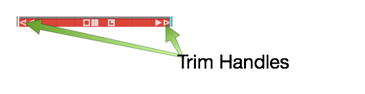

*Trim MIDI Clips by Dragging a Trim Handle*

Hold Opt / Alt while you drag a start or end handle to stretch the clip's
contents to the new length instead.

> 📝 **Note:** Unlike Audio clips, MIDI clips don't have fade handles.

## Moving MIDI Clips

To move a MIDI clip forward or backward in time, drag from the header
area. Start the drag from blank space in the header, not from one of
the icons.

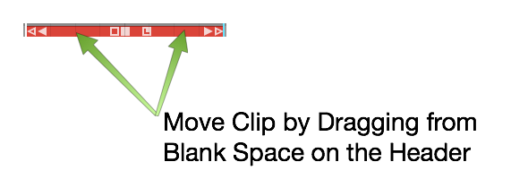

*Moving a MIDI Clip*

## Moving a MIDI Clip Track-to-Track

To move a MIDI clip to another track, drag its header up or down. To
move track-to-track without affecting the timing, hold down
Shift as you drag.

## Slip Editing MIDI Clips

The three solid colour handles are for slip editing: left arrow, right
arrow and the box. The main one is the solid box in the centre of the
header: drag it to slip the notes inside the clip, while the clip's
start and end stay where they are.

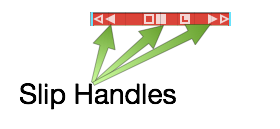

*MIDI Clip Slip Handles*

Use the left solid arrow to slip the notes later in time while the end
of the clip stays anchored. The right solid arrow works the opposite
way: it slips the end of the clip while the start stays anchored.

## Reframing a MIDI Clip

Drag the hollow box in the centre of a MIDI clip left or right to
reframe the entire window of the clip, leaving the notes in their
original place.

## Splitting a MIDI Clip

To split a MIDI clip, select it, put the cursor where you want the
split and press the slash key (/), the same as for Audio clips.

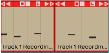

*Split MIDI Clips Using the Slash Key*

You can also split using the **Split Clips** action in the
[Actions panel](actions-panel.md), which offers **Split clips at cursor
position**, **Split clips at mark-in point** and **Split clips at mark-out
point**. Launcher clips can't be split, so the action isn't shown for them.

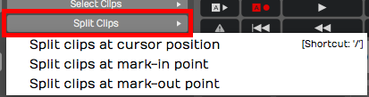

*The Split Clips Action in the Actions panel*

> 📝 **Note:** As you split MIDI clips, any notes that are sustained across
the split area are separated into two notes.

You can also split a mixture of Audio clips and MIDI clips across
multiple tracks by selecting them together.

## The MIDI Note Editor

As you increase the height of a track holding MIDI clips, at a certain
point it switches to the inline MIDI note editor, a detailed view of the
notes in the clip. This type of view is commonly called a piano roll
view (PRV).

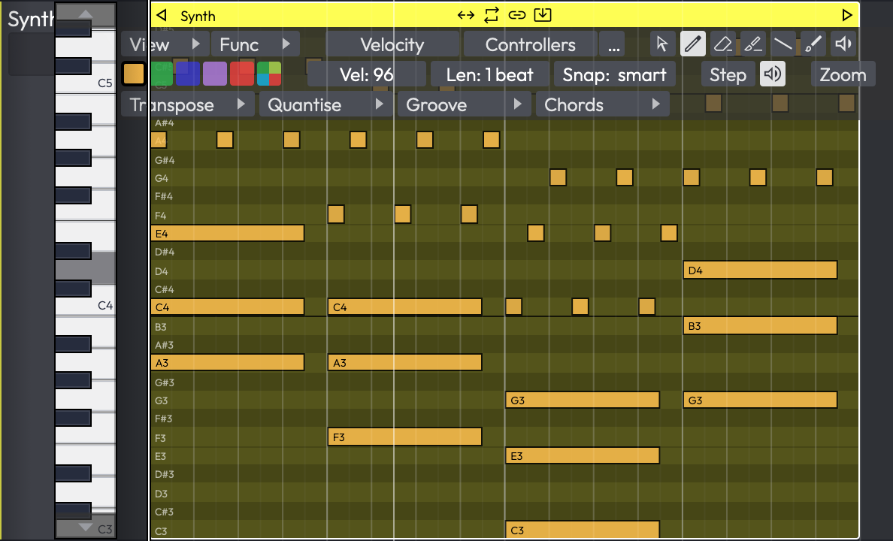

*The MIDI Note Editor*

Another way to see the notes is to double-click the MIDI clip header. By
default this opens the clip in the MIDI editor in the
[Detail Editor](detail-editor.md) at the bottom of the Edit.

> 📝 **Note:** Clip header double-click behaviour depends on a global
setting. Go to *Settings > General*, MIDI section, and find
**Double-click MIDI clip header** (Choices: Expands for in-line editing,
Opens the MIDI editor, Opens the MIDI editor (in-line editing disabled)).
Choose **Expands for in-line editing** to make a double-click toggle the
track height for inline editing instead. (Default: Opens the MIDI editor)

You can also open it with *View > Show Content Editor*. In the Detail
Editor's **Clip** tab, a MIDI clip gets two pills at the top left:
**Piano Roll** shows the note editor, with the same toolbar and tools as
the inline editor, and **Pattern Generator** switches the tab to the
[Pattern Generator](pattern-generator.md). With several MIDI clips
selected the second pill reads **Pattern Generator (N)**, because the
generator works on all of them. See [The Detail Editor](detail-editor.md).

## Setting the Number of Octaves & Note Height

You can adjust how many octaves you see on the MIDI editor with
**Default MIDI editor vertical scale** (Choices: 2 octaves, 4 octaves,
6 octaves, Full scale) in *Settings > General*, MIDI section. By default
it is set to **2 octaves**, a reasonable starting point. You can also
right-click the piano keyboard and choose **Show 1 octave**,
**Show 2 octaves**, **Show 3 octaves**, **Show 4 octaves** or
**Show full scale**.

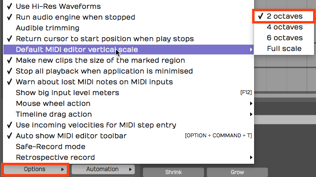

*Default MIDI Editor Vertical Scale Setting*

To fine-tune the vertical size of MIDI notes, drag the arrows above and
below the piano graphic.

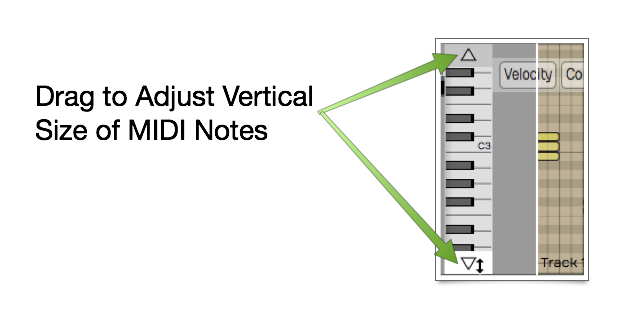

*Use Arrows to Adjust Vertical Size*

## Mouse Wheel Options for MIDI Editing

You can use your mouse wheel to scroll vertically within the MIDI
editor. During mixing you may want to turn this off so you don't
scroll inside MIDI clips by accident.

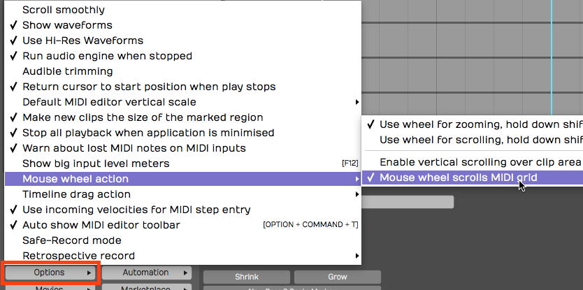

*Mouse Wheel MIDI Scrolling Setting*

Leave it on while you edit MIDI. The setting is
**Allow wheel to scroll within MIDI clips** in *Settings > General*,
Mouse section. (Default: on)

## The MIDI Toolbar

The toolbar runs along the top of the MIDI editor. In the inline editor
it appears automatically while **Automatically show MIDI editor
toolbar** is on in *Settings > General*, MIDI section (Default: on).
Opt + Cmd + T / Ctrl + Alt + T turns that on and off. From left to right:

| Control | What it does |
| --- | --- |
| **View** PRO | **Drum grid** for the selected tracks, and which note rows to show: **Show all notes**, **Show notes in key**, **Show notes in use** or **Show named notes**. |
| **Func** PRO | **Duplicate MIDI Notes**, **Duplicate MIDI Notes (Last Bar)**, and **Lock CC data to notes**, which moves controller data along with the notes you drag. |
| **Velocity**, **Controllers**, **+** | Show the velocity lane and the controller lanes, and add a controller lane. See [The Velocity Editor](#the-velocity-editor) and [Editing Other Controller Data](#editing-other-controller-data). |
| Tool buttons | The editing tools. See [The Editing Tools](#the-editing-tools). |
| Colour swatches | The note colour. See [Note Colours](#note-colors). |
| **Vel**, **Len** | The velocity and length for new notes. See [Editing the Note Velocity](#editing-the-note-velocity) and [Note Length](#note-length). |
| **Snap** | The note-editing grid. See [Snapping During Note Editing](#snapping-during-note-editing). |
| **Step**, speaker | Step entry, and hearing notes as you edit them. See [Step Entry Mode](#step-entry-mode) and [Hearing Notes While Editing](#hearing-notes-while-editing). |
| **Zoom** | Zooms to fit all notes, or the selected notes. |
| **Transpose**, **Quantise**, **Groove**, **Chords** | Menus that act on the selected notes. See [Quantising MIDI Notes](quantizing-midi-notes.md) and [The Chord Track](chord-track.md). When the editor is narrow the toolbar wraps onto extra rows, and these four are the first to be left out if it still doesn't fit. |

> 📝 **Edition:** **View**, **Func** and the Knife tool need Waveform Pro
> or the MIDI Producer Expansion.

## Basic MIDI Editing - Pitch

Most note edits work the same way: select the notes, then act on them.

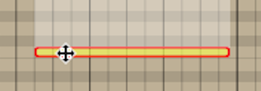

*Select a Note and Drag Up or Down to Change Pitch*

The most basic edit is a pitch change: click a note to select it, then
drag it up or down.

## Note Expression

Each note can carry its own expression curve, drawn in a lane that
appears above or below the note. There are three types: **Pitchbend**
(+/-48 semitones), **Timbre** (0-100%) and **Pressure** (0-100%). They
give you detailed control over performance and articulation.

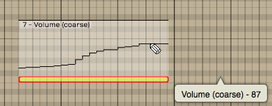

*Drawing Note Expression*

To show the lane, select a single note and turn on
**Show Note Expression** in the Actions panel. The lane appears for the
full length of the note, showing Pressure, or the type you used last.

*Show Note Expression and Keep on Selected Note in the Actions panel*

**Keep on Selected Note**: Keeps the lane on the selected note. Turn it
off and the lane follows whichever note the mouse is over. (Default: on)

Select the Pencil or Line tool and click-drag over the lane to draw a
curve. Use the Eraser tool to remove part of it.

The curve is drawn in steps that follow the MIDI editor's snap setting.
With Smart snap the step size follows the zoom level, so zoom in to draw
a more detailed curve.

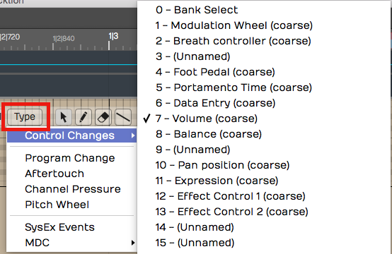

*Choosing the Note Expression Type*

To change the type, click the lane's **Menu** button and choose
**Pitchbend**, **Timbre** or **Pressure**. The lane's **Close** button hides it.

Two more actions in the Actions panel work on the selected notes:
**Scale Pitch Bend** scales their pitch-bend values, and
**Remove Note Expression** deletes all of their note expression. To
record note expression from an MPE controller, turn on
**Record MPE to Note Expression** for that MIDI input device; devices
that Waveform already knows are MPE record to note expression
automatically.

> 📝 **Note:** Only instruments that support MPE respond to note
expression.

## Nudging Notes

Nudging selected notes works like nudging clips: hold Shift and use the
arrow keys. Shift-up and Shift-down change the pitch. Shift-left and
Shift-right change the timing. To move only the start of the notes, use
Opt + Cmd + Left or Right / Ctrl + Alt + Left or Right.

Nudging is especially useful for pitch changes, because it can't alter
the note's timing.

> 💡 **Tip:** Cmd + Z / Ctrl + Z works as undo for most editing operations.

## Note Length

You can trim the length of a note by grabbing its right edge, or its
left edge, and dragging it left or right. Hold Cmd / Ctrl while you drag
an edge to strum the selected notes instead.

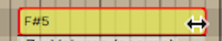

*Trimming a MIDI Note*

The **Len** button in the toolbar (it shows the current value) sets the length of new notes. It offers 1 tick,
fractions of a beat from 1/96 to 1/2, and 1 to 12 beats. **Other...**
asks for a length in MIDI ticks.

**Auto update on note resize**: When ticked, resizing a single note sets
**Len** to that note's new length, so the next note you draw matches it.
(Default: on)

## Snapping During Note Editing

Many of these edits snap to the grid while **Snap** is on. To edit
freely, turn **Snap** off. Press Q to turn snapping on or off.

The toolbar's **Snap** button sets the grid the MIDI editor snaps to,
and shows it, for example "Snap: smart". **Smart** (the default) follows
the zoom level, so the grid gets finer as you zoom in. You can also pick
a fixed resolution, and turn on **Triplet** for a triplet grid.

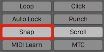

*Note editing snaps when Snap is on*

## Copying and Duplicating Notes

To copy a note, hold Cmd / Ctrl and drag it. You can also use the
**Duplicate** keyboard shortcut: select the note, put the cursor where
you want the copy and press D.

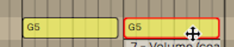

*Copying a Note*

## Adjusting Pitch and Velocity

You can also select a note and edit its **Pitch** and **Velocity**
values directly in the Actions panel.

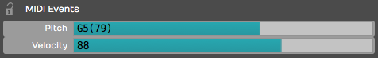

*Adjust Pitch and Velocity in the Actions panel*

## Note Start, Length, & End

For precise adjustments, edit the **Length**, **Start Time** and
**End Time** values for the selected note in the Actions panel.

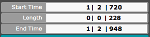

*Start, Length, & End Settings in the Actions panel*

## Note Actions in the Actions Panel

With notes selected, the [Actions panel](actions-panel.md) shows more
than their values. **Mute** and **Note-off Velocity** sit with Pitch and
Velocity; Mute notes is also Opt + Cmd + M / Ctrl + Alt + M, and
Opt + V / Alt + V randomises the velocity of the selected notes.

Below the times are menus that change the selected notes: **Transpose**,
**Quantise**, **Apply Groove**, **Equalise** (sets them all to the same
length), **Mirror** (flips them vertically or horizontally), **Insert
Chord** and **Modify Notes**. **Select Notes** picks other notes based on
the current selection. **Create Preset** turns the notes into a bass or
chord preset, and **Add Custom Chord** saves them as a chord for the
[Pattern Generator](pattern-generator.md). Quantise and Groove are
covered in [Quantising MIDI Notes](quantizing-midi-notes.md).

## The Editing Tools

The tool buttons sit in the middle of the toolbar. You can also pick a
tool from the right-click menu in the note area, or with a shortcut.

| Tool | What it does | Shortcut |
| --- | --- | --- |
| **Selection** | Selects multiple notes or controllers. | Opt + Cmd + 1 / Ctrl + Alt + 1 |
| **Pencil** | Draws and moves notes and controllers. | Opt + Cmd + 2 / Ctrl + Alt + 2 |
| **Eraser** | Deletes notes or controllers. | Opt + Cmd + 3 / Ctrl + Alt + 3 |
| **Knife** PRO | Cuts notes. | Opt + Cmd + 7 / Ctrl + Alt + 7 |
| **Line** | Draws lines of notes or controllers. | Opt + Cmd + 4 / Ctrl + Alt + 4 |
| **Melody Paint** | Toggles notes on and off to create melodies. | Opt + Cmd + 5 / Ctrl + Alt + 5 |
| **Note Preview** | Previews all the notes at the current time. | Opt + Cmd + 6 / Ctrl + Alt + 6 |

## The Pencil Tool

Use the Pencil tool to draw notes: select it, then paint notes where
you want them on the piano roll.

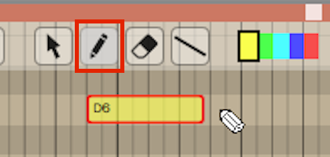

*Draw in New Notes with the Pencil Tool*

## The Eraser Tool

Swipe the Eraser tool over any notes you want to erase.

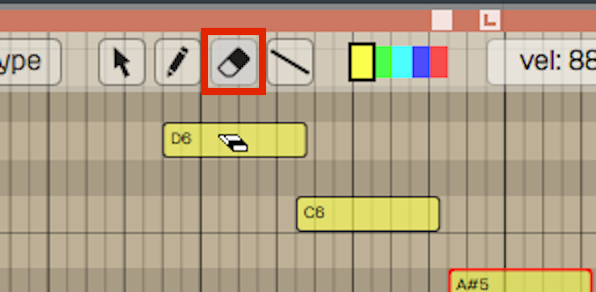

*The Eraser Tool*

## The Line Tool

The Line tool suits controller curves best, but it also draws notes:
drag a line to create a stepped series of notes.

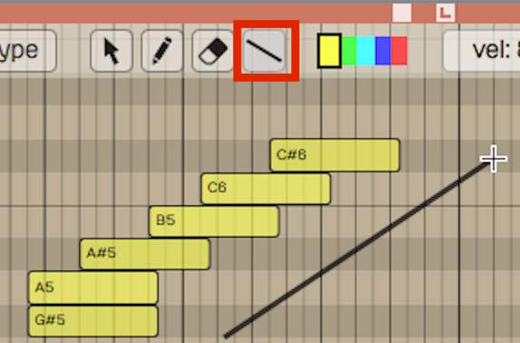

*Draw a Series of Notes with the Line Tool*

## Note Colours { #note-colors }

The colour swatches in the toolbar set a note colour: select notes and
click a colour. New notes use the chosen colour too. Colour doesn't
affect playback, but it helps you organise a sequence visually. For
example, when programming drums you could give the snares, hi-hats and
kick drum different colours.

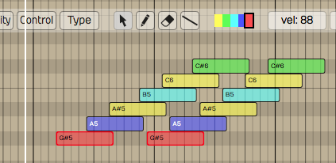

*Note Colours*

## Selecting Multiple Notes

To select several notes, drag a box around them with the Selection
tool.

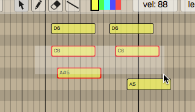

*Note Multiple Selection*

To add notes to the selection or remove them from it, hold Shift (or
Cmd / Ctrl) and click them.

To select every note of one pitch, hold Cmd / Ctrl and click that
note's key on the piano roll keyboard.

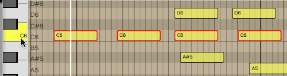

*Selecting a Row of Notes with Cmd / Ctrl*

Once you have a multiple selection, drag with the Selection tool to
move all the notes in time or pitch, or change values in the Actions
panel to apply them to every selected note. Nudging (Shift plus the
arrow keys) also works on a multiple selection.

## Editing the Note Velocity

To change the velocity of a note, select it and choose a value from the
**Vel** button in the MIDI editor toolbar (it shows the current value,
for example "Vel: 96"). The menu offers 16 to
112 in steps of 16, plus 127. The value you choose is applied to the
selected notes and is also used for new notes.

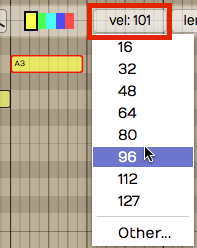

*Quickly Set Note Velocity*

If you choose **Other...** from the menu, the "Enter Note Velocity..."
dialog lets you type any value from 0 to 127. Click
**Set Velocity** to apply it.

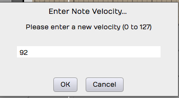

*The Other... Velocity Dialog*

> 💡 **Tip:** You can also adjust velocity by dragging. Select a note,
then hold Shift as you drag up and down over the note. Watch the
**Velocity** value change in the Actions panel as you drag.

## Step Entry Mode

When the **Step** button is on (Opt + Cmd + S / Ctrl + Alt + S), the
MIDI clip goes into step entry mode. Set the length and velocity first
with the toolbar's **Len** and **Vel** buttons. Each note or chord you
play to the track is then entered at the cursor position with that
length and velocity, and the cursor moves to the end of the new note, so
it advances by the **Len** value. The cursor has to be inside the clip.
Press the backtick key (`` ` ``) to insert a rest of the same length.

To use the velocities you play instead of the **Vel** value,
turn on **Use incoming velocities for MIDI step entry** in
*Settings > General*, MIDI section.

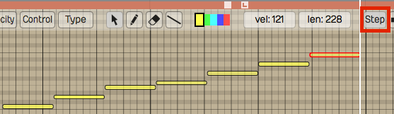

*Step Entry Mode*

## Hearing Notes While Editing

Waveform can play notes as you move them, so you hear the pitch. Turn
this on or off with the speaker button right after
**Step** in the MIDI editor toolbar (Opt + Cmd + E / Ctrl + Alt + E).
This is separate from the Note Preview tool, which also has a speaker
icon.

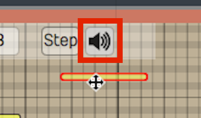

*Enable Speaker Button to Trigger Notes During Editing*

## The Velocity Editor

You can edit MIDI note velocity from the velocity area below the PRV.
Click the **Velocity** button in the MIDI editor toolbar
(Opt + Cmd + V / Ctrl + Alt + V) to show the velocity editor. For the
selected note, drag its velocity stalk up or down. The note's
**Velocity** value in the Actions panel follows as you drag.

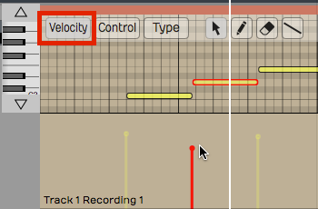

*The Velocity Editor*

To edit several velocities together, select the notes first. For
example, to change all the C4 velocities, Cmd-click / Ctrl-click the C4
key to select the row, then drag any one stalk.

## Editing Other Controller Data

You can use a view similar to the velocity editor with any kind of
controller. Click **+** next to the **Controllers** button in the MIDI
editor toolbar to choose one: the **Control Changes** submenu lists the
CC numbers, followed by **Program Change**, **Aftertouch**,
**Channel Pressure**, **Pitch Wheel** and **SysEx Events**. Each choice
adds a lane, and you can stack several. The **Controllers** button
(Opt + Cmd + C / Ctrl + Alt + C) shows or hides the lanes. Each lane
header has a **Menu** button to change its type and a **Close** button
to remove it.

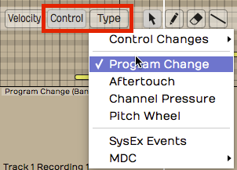

*Editing Other Controller Data*

For example, to edit channel aftertouch, click *+ > Channel Pressure* in the
MIDI editor. The channel pressure data then appears in a lane, the same
way velocity does.

## The MIDI Event List PRO { #the-midi-event-list }

> 📝 **Edition:** Waveform Pro, or with the MIDI Producer Expansion.

To edit events as numbers in a table, open the **MIDI Event List**. It's
a floating, resizable table of every event in the currently selected
MIDI clip, and it follows your selection: click a different clip and
the list updates to match. The list and the piano roll share a
selection, so a note you highlight in one is highlighted in the other.

Open it with the command **Show or hide the MIDI Event List window**, or
from *View > Show MIDI Event List*.

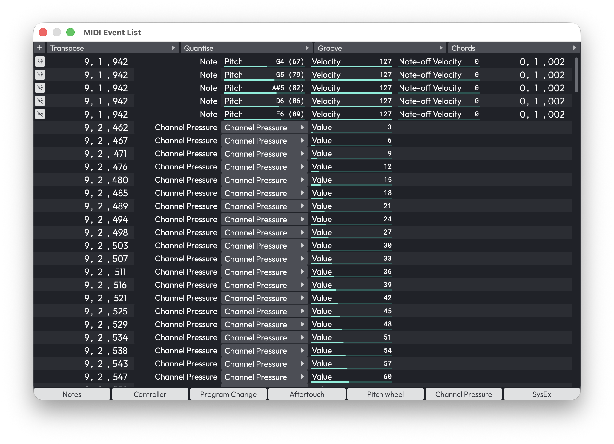

*The MIDI Event List window*

Across the top is an **add-event** menu (Add note, Controller, Program
Change, Aftertouch, Pitch Wheel, Channel Pressure, or SysEx) alongside
**Transpose**, **Quantise**, **Groove**, and **Chords** menus that act
on the selected events. Along the bottom are seven filter toggles
(**Notes, Controller, Program Change, Aftertouch, Pitch wheel, Channel
Pressure, SysEx**), all on by default, so you can hide event types you
don't want to wade through.

The columns change with the event type:

- **Notes**: a mute toggle, Time, Type, Pitch (0-127), Velocity
  (0-127), Release velocity (0-127), and Length.
- **Controllers**: Time, Type, Controller type (Program Change,
  Aftertouch, Pitch Wheel, Channel Pressure, or CC 0-127), and Value
  (0-16383).
- **SysEx**: Time, Type, and an editable Data field.

> 💡 **Tip:** Use the Event List to type exact values, such as a
> controller at precisely 64, or a note nudged to an exact tick that's
> awkward to hit by dragging.

## The SysEx Lane

System Exclusive (SysEx) messages are manufacturer-specific MIDI data,
often used to recall a hardware synth patch or send a device-specific
command. Waveform shows them on a dedicated controller lane in the MIDI
editor, where each SysEx event appears as a **diamond** on a timeline.

Open the lane by clicking **+** next to **Controllers** and choosing
**SysEx Events** (or choose it from an existing lane's **Menu**). The
lane header has a **Close** button and a **Menu**.
Use the Selection, Pencil, and Eraser tools to place, move, and delete
events (a pencil click creates a new event with four zero bytes), and
snapping applies as it does elsewhere in the editor.

> 📝 **Note:** The lane is for placing and timing SysEx events. To edit
> the actual bytes of a message, select it and edit **SysEx Data** in the
> Actions panel, or use the **Data** field in the
> [MIDI Event List](#the-midi-event-list).

## MIDI Controller Mappings

The **MIDI Controller Mappings** window lets you drive plugin parameters
from a hardware MIDI controller's knobs and faders. Each row binds one
incoming MIDI controller (CC) to one parameter in your Edit.

Open it from *Automation > Create MIDI controller mappings...*,
or with the command **Show MIDI controller mappings window**.

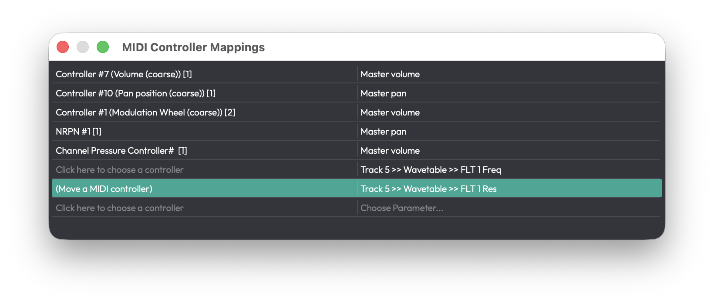

*The MIDI Controller Mappings window*

The window looks empty when you first open it, but the last row is
always a blank one: click either half of it to add a mapping. Each time
you fill a row in, a new blank row appears below it.

Each row has two halves:

- **Left half (the controller)**: Click it to enter MIDI-learn (the
  cell reads **(Move a MIDI controller)**); the next CC that arrives
  from your hardware is captured and bound to this row.
- **Right half (the parameter)**: Click **Choose Parameter...** for a
  hierarchical menu of everything you can map: Master Plugins, Plugin
  Racks, and each track's plugins and their parameters, plus an **Add all
  parameters** shortcut. The same menu saves, loads, and deletes
  presets.

> 💡 **Tip:** To set up a controller quickly, click the right half of the
blank row, open a plugin's submenu, and choose **Add all parameters**. A
row is created for every parameter of that plugin in one step. Then
MIDI-learn the hardware controllers you want for each.

Press **Delete** with a row selected to remove that mapping. Mappings
belong to the Edit you set them up in, while presets are global and
available to every Edit.

> 📝 **Note:** The window shows mappings for the focused Edit only, and
> it doesn't switch when you change focus to a different Edit.

## Moving On

Next, [Pattern Generator](pattern-generator.md) builds parts for you,
and [Quantising MIDI Notes](quantizing-midi-notes.md) covers timing
correction.
