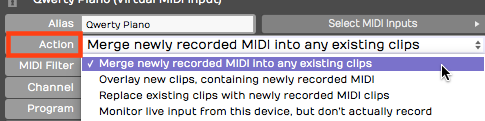
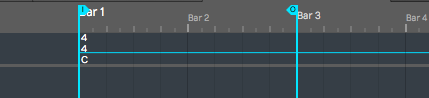
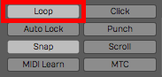
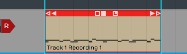
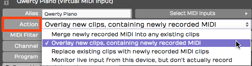
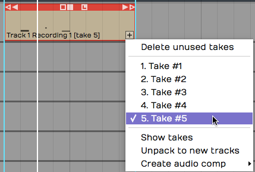
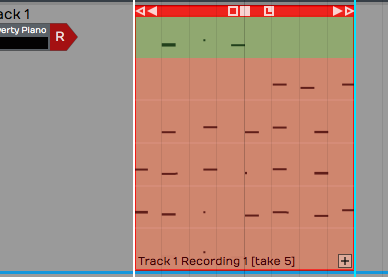
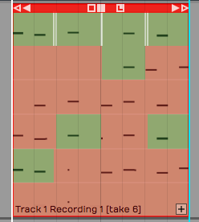
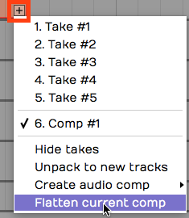
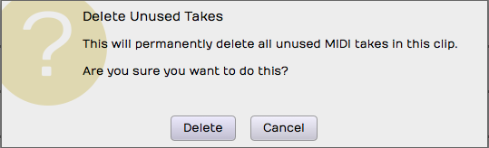

# MIDI Loop Recording

This chapter covers loop recording with MIDI. Loop recording in merge
mode is useful for layering up a drum part, or building a chord over a
couple of passes through the loop.

Waveform can also loop record MIDI to layers, so you can build a
composite MIDI performance the same way as with audio.

## Loop Recording in Merge Mode

[MIDI Recording](midi-recording.md) introduced MIDI merge mode. To loop
record in merge mode:

1.  Click the track input, then in the Actions panel set **Action** to
    **Merge newly recorded MIDI into any existing clips**. This puts the
    track into MIDI merge mode.

    

    *MIDI Merge Mode*

2.  Set the In marker and the Out marker over the area you want to loop.

    

    *Set the In Marker and Out Marker*

3.  Turn on **Loop** (L).

    

    *Enable Loop*

4.  Start recording and play. Each time Waveform cycles through the
    loop, you hear what you played in the previous passes. Keep adding
    passes until you're happy with the part.
5.  Stop recording by clicking **Record** again or pressing the
    **Space bar**.

*MIDI Clip After Recording*

You now have a single MIDI clip containing the part you built up over
the recording passes.

This technique is particularly useful for programming drum parts,
especially if drumming isn't your main skill. For example, play the
hi-hat on the first pass, add the kick and snare on the second, then add
a crash on the downbeat.

## Recording to Prepare for MIDI Comping

Comping is usually associated with audio recording and editing. You
record several takes of a part, then use editing tools to pick the best
phrases from each take.

To prepare to comp with a MIDI recording, leave everything set up the
same way as for merge mode, but change the **Action** parameter to
**Overlay new clips, containing newly recorded MIDI**.

*Enable Overlay Mode*

Set the In marker and Out marker and turn **Loop** on. Click **Record**
and play a performance during each cycle through the loop.

When you stop, the MIDI clip has a separate take for each loop pass, as
in audio loop recording.

## Comping MIDI Takes

To see the takes, click the takes button (+) in the lower right corner
of the MIDI clip. The menu lists all your takes. Choose one to make it
the active take.

*Takes Following Loop Recording*

You can also expand the view to show all the takes below the track.
Click the takes button (+) and choose **Show takes**.

*View After Choosing Show Takes*

This also puts you in comping mode. Swipe over the phrases you want to
keep to build a composite from the best parts of each take.

*Comping the Takes*

## Flattening the Composite to a Single Clip

Once you have the composite assembled, you can convert it to a single
MIDI clip. Click the takes button (+) and select **Flatten current comp**, then
click **Delete** in the **Delete Unused Takes** dialog to go ahead.

*Flattening the MIDI Composite*

> 📝 **Note:** You can't flatten the takes to a single MIDI clip without
> deleting the unused ones, but you can **Undo** the flatten afterwards.

*Delete Clips Warning Message*

## Moving On

Loop recording and comping work for MIDI just as they do for audio.
Next, [MIDI Editing](midi-editing.md) shows how to edit MIDI clips and
notes.
