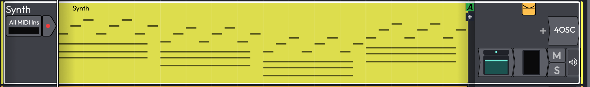
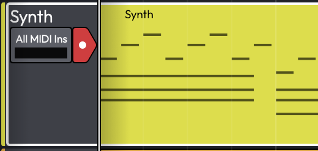
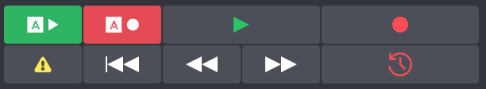
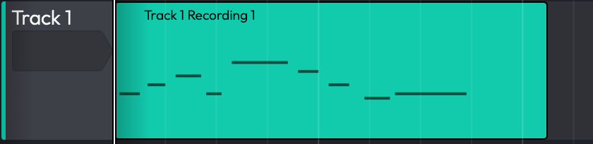
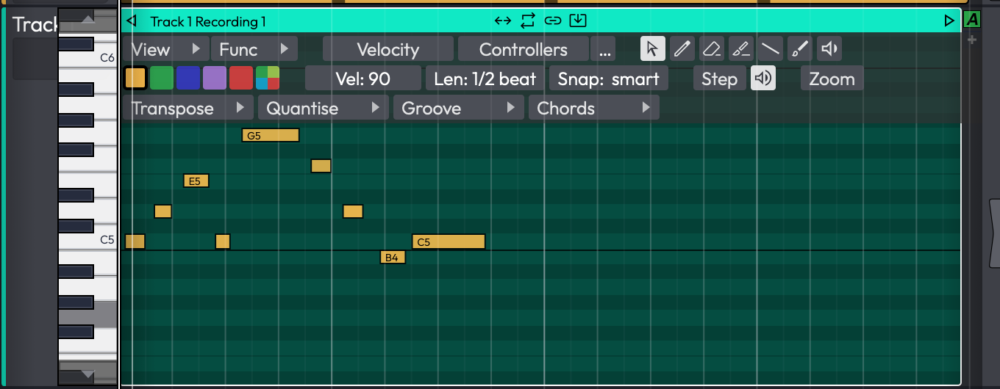
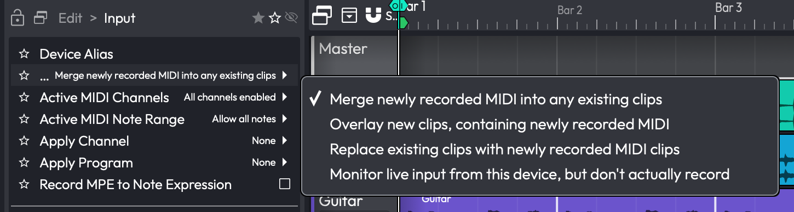
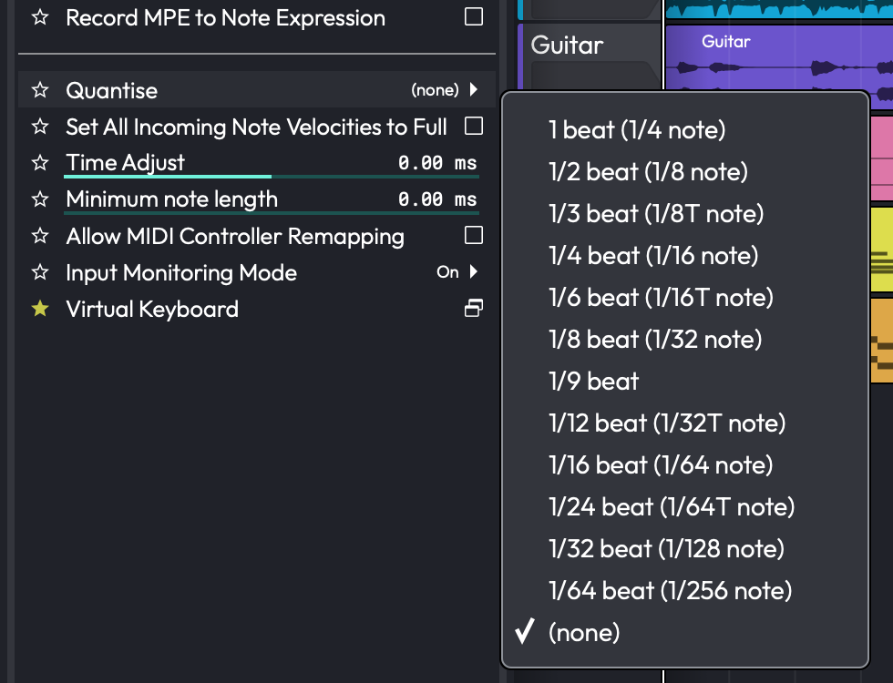

# MIDI Recording

This chapter covers recording a MIDI performance from your controller,
which could be a keyboard or any other instrument that sends MIDI note
data, and explains the MIDI recording modes. Setting up a MIDI controller
is covered in [MIDI Setup](midi-setup.md).

## Setting up a Track

Waveform has no special type of MIDI track: any track can hold Audio,
MIDI or Step clips. To record MIDI, pick an unused track or create a new
one, and set its input to your MIDI controller. Play a few notes on the
controller to check that there's MIDI activity.

*A Track Set Up for MIDI Recording*

To hear any sound, insert a virtual instrument. Drag the plugin object
to the inline mixer, or find the synth in the Search tab of the Browser
and drag it to your track's inline mixer. Dropping it to the left of the
Volume & Pan plugin suits most setups. As soon as you drop it, the
instrument's interface opens, so you can choose a suitable preset for the
part.

If you don't hear anything when you play your controller, go back to
[MIDI Setup](midi-setup.md) and check that the MIDI input is set up
correctly.

## Recording a MIDI Performance

Recording MIDI is very much like recording audio:

1.  Enable the track for recording by clicking the red R on the track
    input.

*Enable Recording*

2.  In the transport bar, click the red **Record** button to start
    recording, or press R.

*Start Recording*

3.  Play your MIDI performance.

*MIDI Recording in Process*

4.  Press R again or the Space bar to stop.

> 💡 **Tip:** To record your MIDI performance with a metronome click,
configure and enable **Click** as described in [Working
with the Click](recording-audio.md#working-with-the-click).

## Playing Back a MIDI Performance

If everything went to plan, you now have a MIDI clip showing the notes
you played. Zoom the track vertically and, at a certain height, the MIDI
clip switches to MIDI editor mode, where you can edit the notes (see
[MIDI Editing](midi-editing.md)).

*MIDI Clip Following Recording*

Place the cursor before the new MIDI clip and press the Space bar to
play it back. You hear the performance exactly as you played it.

> 💡 **Tip:** If you don't like what you recorded, select the MIDI clip and press Backspace to delete it.

## Piano Roll View

As described in [Playing Back a MIDI Performance](#playing-back-a-midi-performance),
MIDI clips switch to edit mode once you expand the track far enough.
Waveform's MIDI editor is what's commonly called a piano roll view (PRV):
it shows the notes next to a vertical piano keyboard on the left.

*Track Expanded to the MIDI Editor*

> 📝 **Note:** The PRV shows the timing of notes against the timeline and their pitch against a piano keyboard. The length of each note shows how long it's held in musical time.

The MIDI editor has everything you need to edit MIDI data. You can add,
delete, copy and duplicate notes, and work with velocity and other
controller values. [MIDI Editing](midi-editing.md) goes into the
details.

## MIDI Record Modes: The Action Property

Select a MIDI input and find **Action** in the Actions panel. Its
dropdown offers several record modes.

*MIDI Record Modes*

### Merge Mode

By default, **Action** is set to **Merge newly recorded MIDI into any
existing clips**. If you rewind and record some more notes, they're
merged into the MIDI clip from the first pass. Nothing you recorded
before is replaced; the new notes are added to the original MIDI clip.

If you spoil an otherwise good performance in merge mode, press
Cmd + Z / Ctrl + Z to undo the new notes.

> 💡 **Tip:** Merge mode helps when you build up a part pass by pass, particularly a drum part where you add more hits on each pass.

### Replace Mode

To replace what you played before, change the input's **Action** in the
Actions panel to **Replace existing clips with newly recorded MIDI
clips**. When you record, the new recording creates a new MIDI clip that
overwrites what you had as it goes. The original clip isn't actually
erased: if any part of it is still visible, you can trim its edges to
expose the original data. **Undo** also takes you back to where you
started if things don't go well.

> 📝 **Note:** Replace mode is like recording onto tape: recording something new erases the section you record over.

### Overlay Mode

Set **Action** to **Overlay new clips, containing newly recorded MIDI**.
As you record, a new MIDI clip is stacked on top of the original clip,
and on playback you hear both clips mixed together.

### Monitor Only

With **Action** set to **Monitor live input from this device, but don't
actually record**, you still hear the input play through the track, but
nothing from this device is recorded when you press Record. Use it for a
controller you want to play along on without adding its notes to the
take.

## MIDI Input Quantise { #midi-input-quantize }

To find MIDI input quantise, click the input and find the **Quantise**
property. Its dropdown offers a wide range of beat subdivisions.

You're choosing a subdivision of the beat, not the bar. For example, to
quantise your input to the nearest eighth note, choose **1/2 beat**, not
**1/8 beat**, because an eighth note is half a quarter note (in 4/4
time).

*Input Quantise Options*

Input quantising doesn't happen in real time. While you record, you hear
the notes exactly as you play them, but on playback they're all snapped
to the **Quantise** value.

The results can sound unnatural, because input quantise moves both the
start and the end of each note. Notes get stretched out and tend to sound
mechanical, so input quantise suits drum programming better than a piano
part.

To quantise after recording, for example with Apply Groove, see
[Quantising MIDI Notes](quantizing-midi-notes.md).

## Moving On

To record MIDI in a loop, see [MIDI Loop Recording](midi-loop-recording.md).
