# MIDI Setup

This and the next few chapters cover MIDI recording and editing. The
first step is to set up a MIDI keyboard so you can play notes into
Waveform. If you don't have one, you can enter notes by hand in the MIDI
editor, or use the computer keyboard as a virtual MIDI device.

The example here uses an external USB keyboard controller, but other
types of controller are set up in much the same way.

## MIDI Drivers

Your controller might need drivers. Check the manufacturer's website
for drivers for your model and operating system, then download and
install them with Waveform closed.

## Set Up the MIDI Inputs

Go to *Settings > MIDI Devices*. The page lists every MIDI input and
output connected to your system, so what you see depends on your
devices. Click the
toggle next to each entry to switch it between **Enabled** and
**Disabled**.

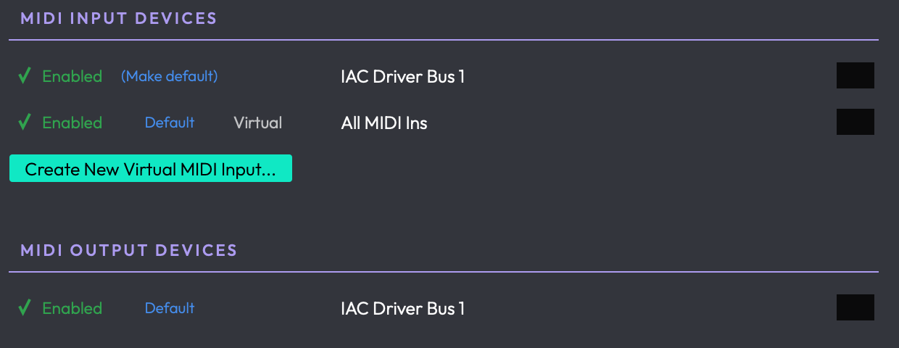

*Click to Enable/Disable MIDI Inputs and Outputs*

> 💡 **Tip:** If your devices aren't listed, check that the controller
is connected and powered, then that the latest drivers are installed.
You can click **Scan for new MIDI devices now** at any time to scan for
connected MIDI devices.

## Naming MIDI Inputs/Outputs

In *Settings > MIDI Devices*, click a MIDI input or output in the
list, then edit **Device Alias** in the panel on the right to give it a
friendly name. Naming it after the connected controller makes it easy to
recognise.

> 💡 **Tip:** You can also edit **Device Alias** from the Edit tab, by
selecting the input and changing it in the Actions panel. Each device has
only one alias, so a change made in either place applies everywhere.

## Disabling Unused MIDI Inputs

Your audio interface might also have hardware MIDI In and Out
connections for older controllers that don't support USB. If you don't
plan to use them, leave them disabled. In this example the interface's
MIDI ports are disabled.

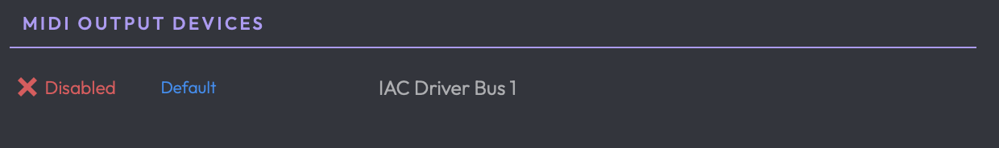

*Disable Unused MIDI I/O*

Disabled ports don't appear in the input list when you set up a track.

## Configuring the Track

Back in your Edit, choose a blank track or create a new one.

1.  Click an input and select the MIDI input that matches the
    controller you just configured.

*Select the MIDI Input Device*

2.  Play some notes on your keyboard. The track's meter shows the MIDI
    activity.

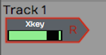

*Input Meter Activity*

3.  With the input selected, set **Input Monitoring Mode** to On (or
    Auto) in the Actions panel. You can also right-click the input and
    use the **Live Input Monitoring** submenu.

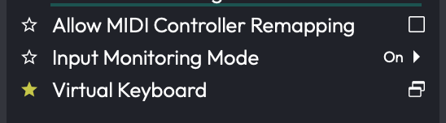

*Enable MIDI Input Monitoring*

MIDI events from your keyboard now come into the track and pass through
to the virtual instrument, which you'll set up next.

## Insert a Synth Plugin

To hear what you play, insert a virtual instrument. Use the Search tab
of the Browser to find a synth plugin. This example uses 4OSC, found
under *Waveform > Instruments*.

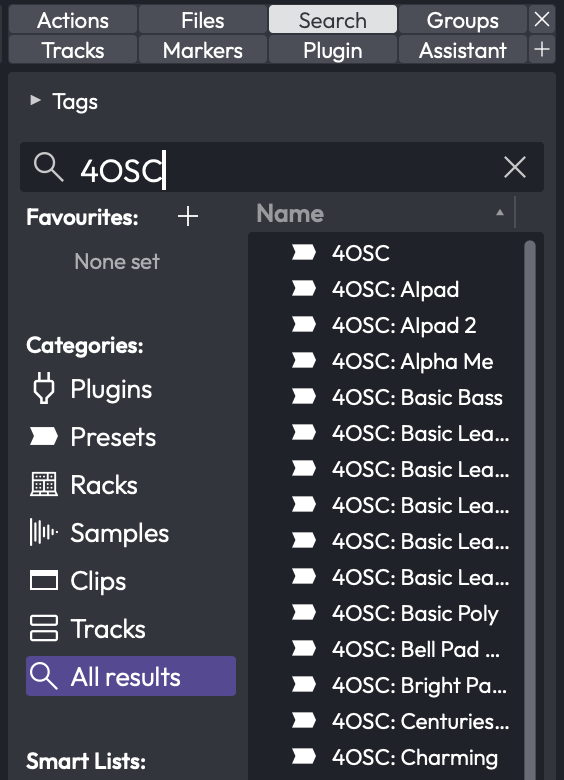

*Search for a Synth Plugin*

1.  Insert your synth plugin ahead of the Volume & Pan plugin in the
    signal path. In this example, 4OSC is dropped to the left of
    Volume & Pan.

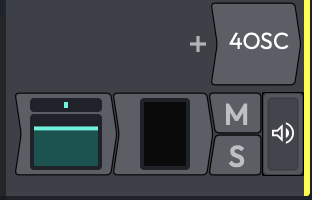

*4OSC installed in the mixer*

2.  Play some notes on your keyboard. You should now hear the synth.

> 📝 **Note:** There's no difference between a MIDI track and an audio
track in Waveform. To configure a MIDI track, set a MIDI input and insert
a virtual instrument plugin as the sound source. When you record your
performance, you get a MIDI clip instead of the Audio clips in the
earlier chapters.

## Using a Virtual Keyboard

If you don't have a physical MIDI keyboard, you can still play notes. To
play from your computer's keyboard, use the MIDI Typing window described
in the next section. To play with the mouse, use the on-screen
**Virtual Keyboard**.

Select a MIDI input on a track and click **Virtual Keyboard** in its
Actions panel. A small piano keyboard opens. Click its keys to send
notes into that input, as if they came from the device itself.

> 💡 **Tip:** Click the lock icon at the top of the Actions panel to keep it
> showing the input while you click elsewhere in the Edit, and click it
> again to unlock. The command is **Lock/Unlock Actions panel** (Opt + F11 /
> Alt + F11). The lock is on the dedicated Actions panel, not the Browser's
> **Actions** tab.

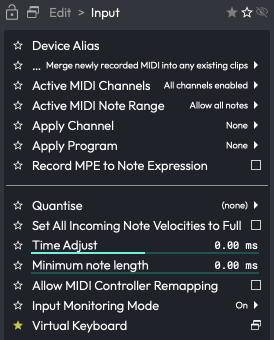

*Lock the Actions panel while you play*

A virtual MIDI input is something different: it duplicates input from
your other MIDI devices, so one track input can receive from several of
them.

1.  Go to *Settings > MIDI Devices*.
2.  Click **Create New Virtual MIDI Input...**

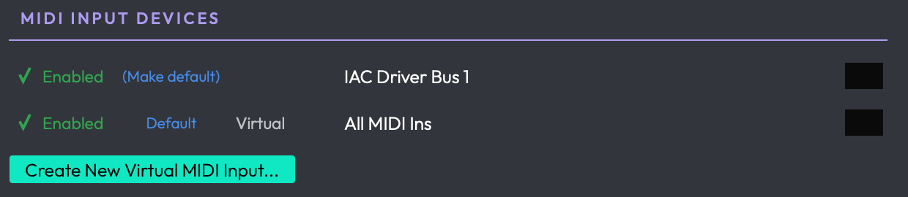

*Create New Virtual MIDI Input*

3.  Enter a name into the **Virtual MIDI device** dialog box and click
    **Create**.

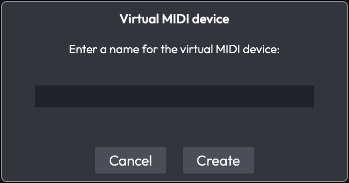

*Name the Virtual MIDI Device*

4.  Back in your Edit, choose the new device as a track's input. Use
    **Select MIDI Inputs** in its Actions panel to choose which devices
    it receives from.

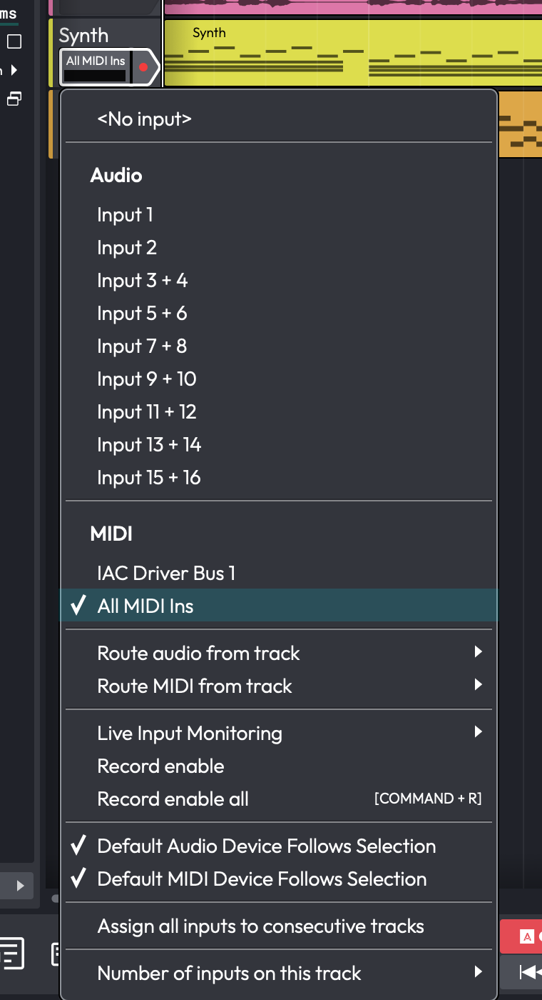

*Select the Virtual Device as the Input*

## The MIDI Typing Window

The **MIDI Typing** window lets you play notes from your computer
keyboard: a small floating window with on-screen octave and velocity
controls. It's handy when you want to audition or
record an idea and don't have a controller plugged in.

Show it with the command **Show or hide the MIDI Typing window**, or
from the View menu's **Show MIDI Typing** item (which appears only when
the **Use computer keyboard for MIDI input** setting is on; see
[Reference: Settings > MIDI Devices](reference-settings.md#midi-devices)).

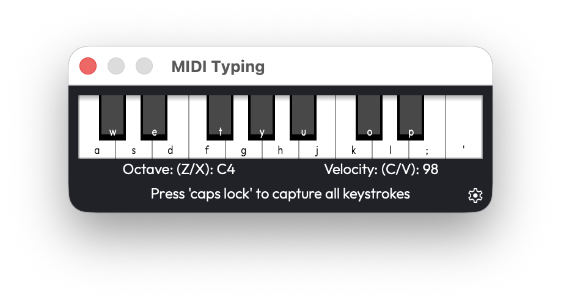

*The MIDI Typing window*

Typing is armed by **Caps Lock** (or by giving the window focus). Once
armed, the keys `a w s e d f t g y h u j...` play a piano layout. The
window also has:

- **Octave**: Press **Z** or **X** to shift down or up. (Range 0-9, Default: 5)
- **Velocity**: Press **C** or **V** to lower or raise it in steps of 5. (Range
  0-127, Default: 98)

A gear icon opens a list where you can remap the keys.

> 📝 **Note:** Notes from the MIDI Typing window always play on MIDI
> channel 1. There's no channel selector.

## Managing Hardware Patch Names

If you play external hardware synths, Waveform can show their patches by
name instead of by raw program number. The **MIDI program names** dialog
manages these named patch lists.

There's no menu command or shortcut for it; you reach it from a MIDI
output device. Go to *Settings > MIDI Devices*, click a MIDI **output** device,
and in the panel on the right pick a set from **Program Names**. The
rows below it manage the sets: **Add** creates a named set from a
preset, **Edit** opens the dialog to modify the selected set, and
**Delete** removes it. **Edit** and **Delete** only appear for sets you can
change.

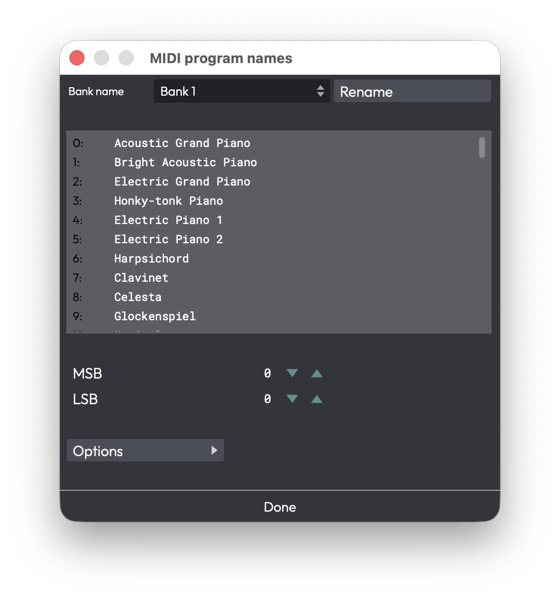

*The MIDI program names dialog*

Inside the dialog:

- **Bank name**: A dropdown for the 16 banks, with a **Rename**
  button.
- **Program name list**: 128 editable rows; press **Tab** to advance to
  the next one.
- **MSB / LSB**: The bank-select bytes for the current bank. (MSB
  0-128, LSB 0-256)
- **Options** menu: Use zero based numbering, Set current bank to
  general MIDI names, Reset current bank, Clear current bank, **Export
  all banks...** (to a `.trkmidi` file), and **Import all banks...** (from `.trkmidi` or
  `.midnam`).

Click **Done** to save. These patch lists are shared across all your
Edits.

## Synchronisation

If you run Waveform alongside timecode-aware gear such as a hardware
recorder, a video deck or another DAW, you can lock the two together so they play in step. The
**Sync** menu holds the project-wide settings for this: a timecode
offset, MIDI Timecode (MTC) input and MIDI Machine Control (MMC). A
typical use is chasing an external MTC master, so Waveform follows that
device as it starts, stops and locates.

**Sync** is one of the Edit tab's main menus. It's also in the menu that
the **Menu** button on the transport bar opens.

There's no default keyboard shortcut for the Sync menu or its items. If
you use them often, assign one in *Settings > Keyboard Shortcuts*.

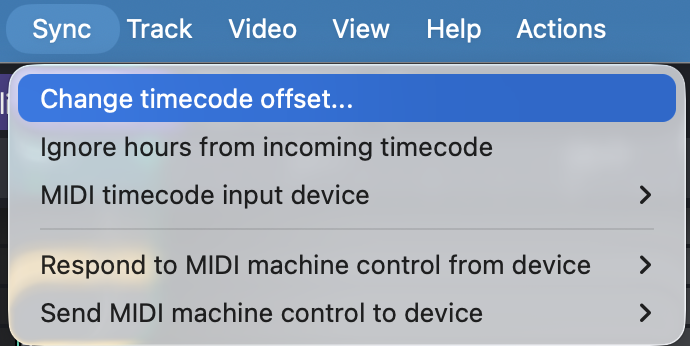

*The Sync menu on the Edit tab*

### Setting a Timecode Offset

1.  Open *Sync > Change timecode offset...*.
2.  In the **Change MIDI timecode offset** dialog, type the offset using
    the timecode field.
3.  Click **OK**. Incoming and outgoing timecode is now shifted by that
    amount, which is handy when your external source starts a few frames
    away from where you want Waveform's transport to land.

### Chasing External MTC

1.  Enable the MIDI input that carries timecode (*Settings > MIDI
    Devices*), as described in [Set Up the MIDI Inputs](#set-up-the-midi-inputs).
2.  Open *Sync > MIDI timecode input device* and pick that device. Set
    it to **&lt;None&gt;** to stop chasing.
3.  If the master sends an hour value you don't want to follow, turn on
    **Ignore hours from incoming timecode**.

### Menu Reference

- **Change timecode offset...**: opens the **Change MIDI timecode offset**
  dialog. (Default: 0)
- **Ignore hours from incoming timecode**: a toggle; when on, the hours
  field of incoming MTC is ignored. (Default: off)
- **MIDI timecode input device**: the MIDI input Waveform chases for
  MTC, or **&lt;None&gt;**.
- **Respond to MIDI machine control from device**: the MIDI input
  whose MMC transport commands (play/stop/locate) Waveform obeys, or
  **&lt;None&gt;**.
- **Send MIDI machine control to device**: the MIDI output to which
  Waveform sends MMC transport commands, or **&lt;None&gt;**.

> 📝 **Note:** The MTC input and MMC device lists only show inputs and
> outputs you've already enabled. If a device is missing, enable it on
> the *Settings > MIDI Devices* page first.

> 💡 **Tip:** This menu is for making Waveform *follow* external timecode.
> To make Waveform the *master* instead, turn on **Send MIDI Timecode**
> on the MIDI output that's wired to your gear (see
> [Reference: Settings > MIDI Devices](reference-settings.md#midi-devices)).

## Moving On

The next chapter, [MIDI Recording](midi-recording.md), shows how to
record a MIDI performance onto the track.
