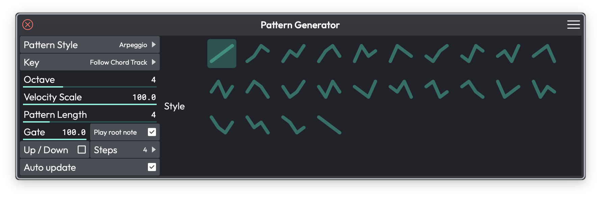

# Pattern Generator

The Pattern Generator builds MIDI notes for you (arpeggios, chords,
basslines, and melodies) directly inside any MIDI clip. It's a great
way to sketch ideas quickly, follow your project's harmony, or get past
a blank canvas. The notes it creates are real, editable MIDI; once
they're generated you can tweak them like anything else you'd draw by
hand.

This is available in all editions. The one exception is the *Follow
Chord Track* key option, which needs Waveform Pro or the MIDI Producer
Expansion.

*The Pattern Generator window*

## Opening the Pattern Generator

Select a MIDI clip, then either:

- Click **Pattern Generator** in the Actions panel to open it in a
  pop-out window.
- In the Detail editor's Clip view, click **Pattern Generator** (next
  to **Piano Roll**) to show the same page inline.

## Choosing a Pattern Type

The **Pattern Style** menu sets what the generator
produces. (Choices: None, Arpeggio, Chords, Bassline, Melody) (Default:
None)

- **None**: Generation off. The clip keeps whatever notes are already
  in it.
- **Arpeggio**: Spreads the current chord into a stepped pattern.
- **Chords**: Lays the chords down as block chords.
- **Bassline**: Builds a single-note bass part from the progression.
- **Melody**: Generates a melodic line within the key.

When you pick a type, a set of controls appears below it. Some are
shared by every type; others are specific to the mode you chose.

## Shared Controls

These appear for every pattern type (except None).

**Key**: Where the generated notes get their pitch reference. (Choices:
Follow Chord Track, Follow Global Track, or one of the twelve chromatic
roots) (Default: Follow Global Track). *Follow Chord Track* ties the
pattern to the harmony you've laid out on the Chord Track and needs
Waveform Pro or the MIDI Producer Expansion; *Follow Global Track*
tracks the edit's global key.

**Scale**: The scale used when you've chosen a fixed root rather
than following a track. (Only shown when Key is set to a specific root.)

**Progression**: A chord-progression builder shared with the Chord
Track. Add chords (triads, 6ths, 7ths, 9ths, or custom), drop in popular
3- and 4-chord progressions, and save or load presets. A **Suggestion**
predictor sits alongside it, showing likely next chords as a bar chart
so you can build a progression a chord at a time. See
[The Chord Track](chord-track.md) for the full walkthrough of this
builder. It works the same way here.

**Octave**: Shifts the generated notes up or down by octaves.

**Velocity Scale**: A scaling factor applied to the velocities of the
generated notes.

**Gate**: How long each note plays relative to its step (shorter gates
give a more staccato feel).

**Auto update**: Regenerates the pattern automatically whenever you
change a setting. (Default: on)

> ⚠️ **Warning:** With *Auto update* on, regenerating the pattern
> overwrites any manual edits you've made to the notes. If you want to
> hand-tweak the result, turn *Auto update* off first.

## Arpeggio

In addition to the shared controls, Arpeggio adds:

- **Style**: A grid of arpeggio patterns to choose from.
- **Pattern Length**: How many steps before the pattern repeats.
- **Play root note**: Includes the chord's root note in the pattern.
- **Up / Down**: The direction the arpeggio travels.
- **Steps**: The number of steps in the pattern.

## Chords

- **Chord Preset**: How the chords are voiced and placed.
- **Octave Up / Octave Down**: Adds another copy of the chord's bottom
  note an octave above or below.
- **Spread**: Moves the chord's second note up an octave, for a more
  open voicing.

## Bassline

- **Bass Preset**: The rhythmic and melodic shape of the bass part.

## Melody

- **Note Length**: The length of the generated melody notes.
- **All notes in key**: Lets the melody use every note in the key
  rather than a restricted set.
- **Randomise Notes**: Generates a fresh variation of the melody.

> 💡 **Tip:** The first time you use Melody mode you'll see a hint to
> paint notes in and out with the paint tool. You can steer which
> pitches the generator favours by drawing them in or erasing them.

## ⚡ Things to Watch Out For

- **Several clips at once.** With more than one MIDI clip selected, the
  page applies to all of them, but only shows the shared settings
  (Pattern Style, Key, Scale, Progression, Octave, Velocity Scale and
  Auto update).

## Moving On

The Pattern Generator shares its Progression builder with the Chord
Track, so the two work nicely together: set up your harmony on the
Chord Track, then have each clip's generator follow it.
