# Quantising MIDI Notes

Quantising corrects the timing of your MIDI performances. At its
simplest, it snaps each note to the nearest position on a grid defined by
the bars and beats of your song. Waveform sets that grid in musical
increments such as quarter notes and eighth notes, but expresses them as
divisions of a beat.

Groove templates take quantising further. They quantise to timing that
isn't perfectly straight, most often to add swing, so you can give a
performance the feel you want.

## How to Quantise

In a MIDI clip, select the notes you want to quantise. To quantise all
of them, use select all (Cmd + A / Ctrl + A). Then click **Quantise** in
the Actions panel or in the MIDI editor's toolbar to see the quantise
actions.

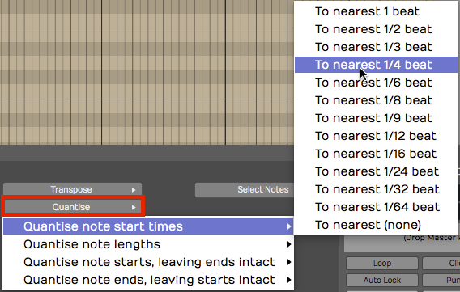

*MIDI Quantise Actions*

There are five quantise actions: **Quantise note start times**,
**Quantise note lengths**, **Quantise note start and end times**, **Quantise
note starts, leaving ends intact** and **Quantise note ends, leaving
starts intact**. The most common is the first, **Quantise note start
times**. To complete the action, pick the beat division to use.

The beat divisions can be a little confusing, because Waveform shows
musical divisions as fractions of one beat. For example, to quantise to
eighth notes in 4/4 time, select **To nearest 1/2 beat**, since half a
beat is an eighth note. To quantise to sixteenth notes, select **To
nearest 1/4 beat**.

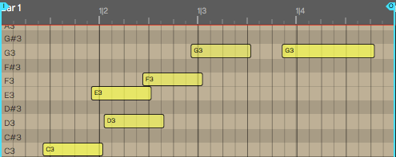

*MIDI Notes Before Quantising*

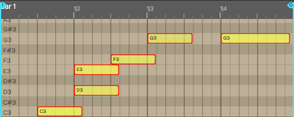

*MIDI Notes After Quantising Note Starts to Nearest 1/2 Beat*

Quantising tightens the performance straight away by snapping each note
to the nearest increment of the division you chose.

> 📝 **Note:** If a note was played so far off that it snaps to the wrong position, fix it by hand in the MIDI editor.

> 💡 **Tip:** Some styles of music rely on perfectly quantised timing and others don't. To fix timing errors but keep a more natural feel, edit the timing note by note with **Snap** turned off. Groove quantising also gives you other options for
"quantising with feel"; see [Quantising with Groove](#quantising-with-groove).

## Quantising Note Lengths

When you quantise note lengths, each note becomes the full length of the
chosen note value.

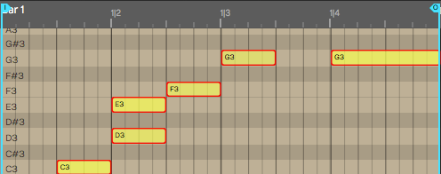

*Note Lengths Quantised to 1/2 beat*

On a piano part, this can sound choppy and unnatural. If the
playing is that inconsistent, try quantising the note lengths to 1/4 beat
(a sixteenth note) instead.

Quantising note lengths usually isn't necessary. It can help on drum
parts, because it lets each drum hit play out its full attack and decay.

## Quantising with Groove

Quantising with groove can be as simple as choosing a preset or as
detailed as programming your own groove template. You can apply groove to
both MIDI clips and Step clips (see [Step Clips](step-clips.md)).

To start with the basics, select the notes to quantise and click
**Apply Groove** in the Actions panel, or **Groove** in the MIDI editor's toolbar.

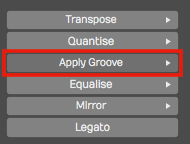

*Apply Groove in the Actions panel*

A menu of groove templates appears, each applying fine adjustments to
the timing. When you choose one, a **Groove strength**
window asks how strongly to apply it (0 to 100). Waveform remembers the
last strength you used. The older templates with a fixed strength in
their name (such as **Swing 1/2 60%**) are in the **Legacy groove
templates** submenu, and apply straight away.

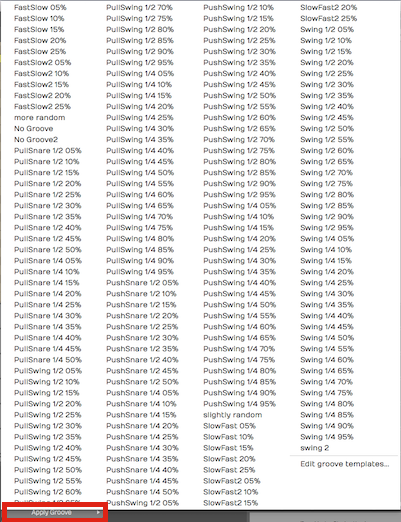

*Apply Groove Presets in Options*

The most common use is swing: delaying the eighth notes that follow the
four main beats of a bar. For standard swing, choose **Swing 1/2**, where
1/2 means half a beat, or eighth-note swing in musical terms. For a
groovy swing, try **Swing 1/2** with a strength of 60.

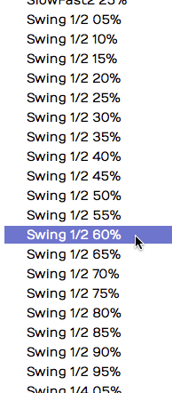

*Groove Presets for Swing*

> 📝 **Note:** In 4/4 music, eighth note timing is counted 1 & 2 & 3 & 4 &.
In swing timing, the "&" beats are delayed. The groove strength sets
how much delay, from subtle (low values) to dramatic (high values).

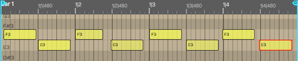

*Before Applying Groove*

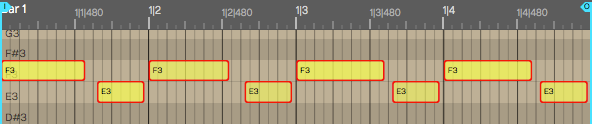

*After Applying Groove: Swing 1/2 at 60% Strength*

After you apply swing, all the "and" notes sit a little late. Waveform
also adjusts the note lengths to match, as shown above.

## Clip Quantise and Groove

**Quantise** and **Apply Groove** change the selected notes. A MIDI clip can
also quantise and groove its notes as it plays, leaving the notes
themselves untouched. Select the clip and use these settings in the
Actions panel:

**Quantise**: The quantise resolution the clip applies on playback.

**Quantise Amount**: How tightly the notes are pulled to the **Quantise**
grid. (Range: 0-100)

**Groove**: The groove template the clip applies on playback.

**Groove Amount**: How strongly the groove is applied. Shown only when
the chosen template takes a strength. (Range: 0-100)

Because the notes don't move, you can change or remove these at any time
and the original timing comes back.

## Defining Groove Templates

For more control, build your own grooves in the Groove Template Editor.
Choose **Edit groove templates...** at the bottom of the **Apply Groove**
menu, or *View > Open Groove template editor* in the main menu.

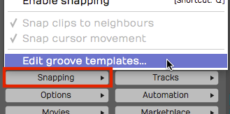

*View > Open Groove template editor*

Click any of the presets in the editor to see how it's built.

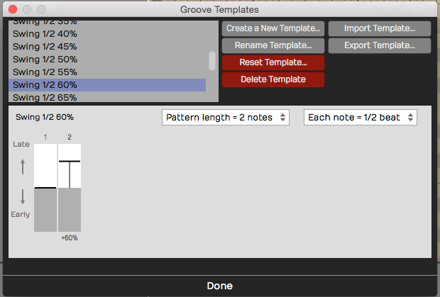

*Groove Template Editor*

In the image above, the legacy **Swing 1/2 60%** template is selected,
which matches the swing used for the examples in this chapter. A groove
template consists of a pattern length, a note subdivision and the timing
for each note. For each step of the pattern, you choose how far that note
falls 'early' or 'late' relative to perfect timing.

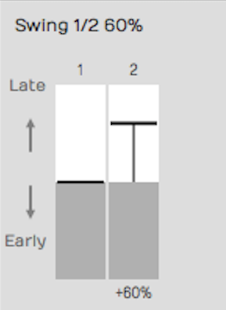

*Swing 1/2 60% Template Example*

The figure above shows a basic swing beat, with each 'and' eighth note
delayed. The more delay you put on those eighth notes, the stronger the
swing feel.

## Complex Groove Templates

A groove template can have as many steps as you like, so you can dial in
exactly the feel you want. For example, to vary the swing within a bar,
create a template with eight notes, each with a slightly different swing.

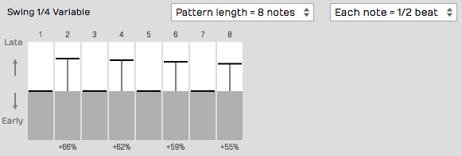

*Groove Template with Variable Swing*

You can also create a groove that pushes the timing over two bars to add
excitement and tension, like the **Fast Slow 2** template.

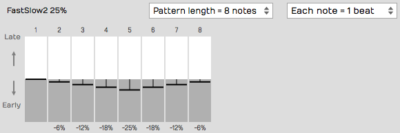

*Fast Slow 2 Groove Template*

> 💡 **Tip:** A 'No Groove' template is a handy way to remove the effect of a groove, particularly on Step clips; see [Step Clips](step-clips.md).

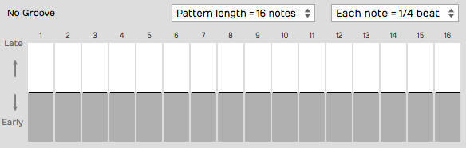

*Creating a 'No Groove' Template*

## Managing Groove Templates

The **Groove Templates** window has buttons to **Create a New Template...**,
**Rename Template...**, **Import Template...** and **Export Template...**.
Exported templates have the `.trkgroove` file extension, and you can share
them with other Waveform users or installations.

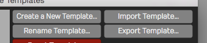

*Create, Rename, Import, or Export Groove Templates*

While editing a groove template, you can reset it with **Reset
Template...**. This removes the early and late timing from the pattern
but leaves the length and note division settings as they are.

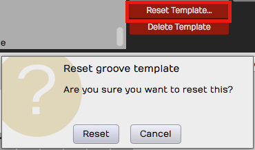

*Resetting a Groove Template*

To delete a groove template you don't need, use **Delete Template**.

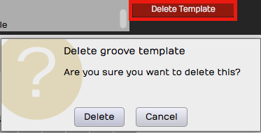

*Deleting a Groove Template*

### Making Templates From a Performance

You can also capture the timing of a real performance as a template.
Select a MIDI clip and click **Extract groove from MIDI clip** in the
Actions panel. Waveform asks for a name, then saves the timing of the
clip's notes as a new groove template that you can apply to other MIDI
clips, Step clips and audio. For audio, Groove Doctor's **Extract groove**
mode does the same from the beat transients; see
[Groove Doctor](groove-doctor.md) (Waveform Pro, or with the Recording
Engineer Expansion).

## Moving On

Next, see [Step Clips](step-clips.md).
