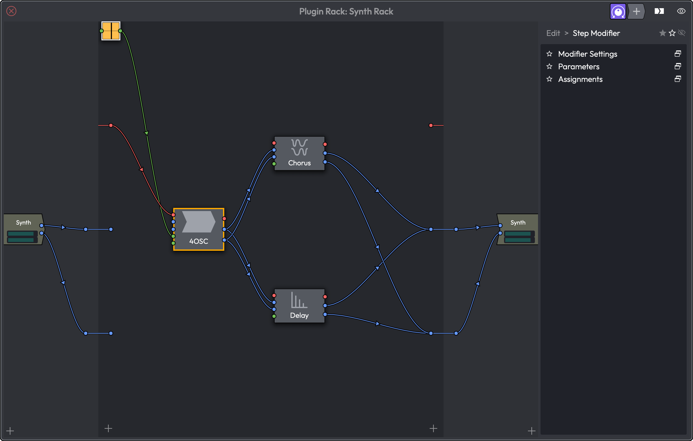

# Plugin Racks

Plugin Racks let you group multiple plugins inside a single container and wire them up however you like. If you have ever wanted to run effects in parallel, create a shared reverb bus, set up side-chain processing, or build a multi-channel effects unit, racks are how you do it.

*The Rack Editor showing a 4OSC synth routed through multiple effects in parallel, with a Step Modifier controlling parameters.*

## What Are Racks?

Instead of being limited to a simple linear chain of effects on a track, a rack gives you a 2D canvas where you can connect plugins in series, in parallel, or in any combination. You can feed one plugin's output into two others, mix signals back together, route side-chains between tracks, and more.

The key idea is the separation between the **Rack Type** and the **Rack Instance**.

The **Rack Type** is the definition. It holds the actual plugins and all the connections between them. Think of it as the blueprint.

A **Rack Instance** is what you place on a track to use that rack. It is the bridge between your track's audio and the rack's processing. You can place multiple instances of the same rack on different tracks, and they all share the same plugin graph. Each instance just picks which of the rack's inputs and outputs it connects to, and can set its own levels and wet/dry mix independently.

This is particularly useful for things like multi-channel processing, shared reverb buses, or any scenario where you want several tracks feeding into the same set of effects without duplicating plugins.

## Creating a New Rack

There are several ways to create a rack, depending on your starting point.

### From Scratch

1. Open the **Plugin Browser**.
2. Find the **Plugin Racks** category.
3. Drag **Create New Empty Rack** onto a track's plugin area.

This creates a new empty Rack Type with a default stereo input pair (left and right), a MIDI input, and matching outputs. A Rack Instance is automatically placed on the track you dropped it onto.

### From a Preset

1. Open the **Plugin Browser**.
2. Look under **Plugin Racks > New from preset**.
3. Drag the preset onto a track.

This creates a new Rack Type pre-loaded with the preset's plugins and connections. Waveform ships with a few built-in rack presets, and any racks you have saved as presets will also appear here.

### By Wrapping Existing Plugins

If you already have plugins on a track that you would like to move inside a rack:

1. Select one or more plugins on a track's plugin chain.
2. Right-click and choose **Wrap this plugin in a new rack plugin** (or **Wrap these plugins in a new rack plugin** if you selected multiple).

Waveform creates a new rack, moves the selected plugins inside it, and automatically wires everything up to match the original signal flow. This is often the most natural way to create racks: start with a working chain, then wrap it when you need more flexibility.

### Multi-Out Racks

For plugins with more than one set of outputs (like multi-output drum samplers or orchestral instruments):

1. Right-click the plugin on a track.
2. Choose **Create a multi-out Rack for this plugin**, or **Create a multi-out Rack for this plugin inside a submix**.

Waveform wraps the plugin in a rack and adds a new audio track below for each of the plugin's extra outputs, each with a Rack Instance routed to that pair of rack channels. The plugin becomes the rack's default plugin (see [Default Plugin View](#default-plugin-view)), so opening the rack shows the plugin's own window. The submix version also moves the original track and the new tracks into a new submix track. The same two options are in the plugin's Actions panel, where the second one reads **Create a multi-out Rack in a submix for this plugin**.

When you add a plugin like this to a track, Waveform asks **Create Multi-out Wrapper?** and offers **Add single plugin**, **Create multi-out wrapper** and **Create multi-out wrapper in submix**. Tick **Don't show again** to stop the question; plugins are then added on their own.

> 📝 **Note:** A track with a [Freeze Point](utility-plugins.md#freeze-point) can't be frozen while plugins before the Freeze Point feed other tracks through a rack, as the extra tracks of a multi-out rack do. Waveform shows a message naming the tracks it would affect.

> 💡 **Tip:** You can also import rack configurations by dragging .trkpreset files directly onto the main window or a track.

### Adding Another Instance

Every rack already in the Edit is listed by name in the Plugin Browser's **Plugin Racks** category. Drag one onto another track to add a second instance of the same rack. In the Rack Editor, the **+** button on the input or output panel has an **Add to track** submenu that places a new instance on any audio track. The Stack Editor's detail panel also has a "Drag here to insert an instance of this rack..." area you can drag onto a track.

## The Rack Editor Views

Racks offer multiple ways to view and edit their contents. You can switch between them at any time using the view button (the eye icon) in the editor window's title bar.

> 📝 **Edition:** The Rack Editor and the Default Plugin view are in every edition. The view button, the Stack Editor and the Faceplate view need Waveform Pro, or the MIDI Producer or DJ Mix Tools Expansion. Without them, the Rack Instance's **Select Rack view to use** submenu (see [Other Controls](#other-controls)) still lists every view, but **Show Stack Editor** and **Show Rack Faceplate** open the Rack Editor.

### Rack Editor: The Graphical Node View

This is the default view and the most flexible. It presents the rack as a 2D canvas where plugins appear as rectangular nodes and connections appear as curved lines between them.

The layout, from left to right:

- **Input panel**: shows how each Rack Instance (each track using this rack) maps to the rack's input channels. Each track entry has level sliders for adjusting the input gain.
- **Central canvas**: the main area where plugins live as draggable nodes with connection points (called nodules) on their left and right edges.
- **Output panel**: the mirror of the input panel, showing output mappings and levels.

The title bar has a toggle button for showing or hiding the I/O panels. An Actions panel on the right of the window shows the controls for the currently selected element.

### Stack Editor: The Linear View PRO { #stack-editor-the-linear-view }

The **Stack Editor** presents plugins in a vertical list, one on top of another, like a traditional effects chain. This view works best when your rack's plugins are connected in a simple series, with one feeding into the next.

You can drag plugins up and down to reorder them, and the rack automatically rewires the connections to match the new order. Each plugin in the stack can be expanded to show its controls or minimized down to just its name bar.

> 📝 **Note:** If the rack has routing that is not a simple series chain (for example, parallel connections or disconnected plugins), the Stack Editor shows a warning triangle. In this case, automatic connection management will not work, and the stacked order may not reflect the actual signal flow.

A common approach is to start with the Rack Editor for initial setup and wiring, then switch to the Stack Editor for day-to-day tweaking once everything is connected.

### Faceplate View PRO { #faceplate-view }

The **Faceplate** view shows only the controls you have placed on the rack's faceplate, without the plugins and wiring. You build the faceplate on the **Faceplate** page of the Rack Instance's Actions panel, or the **Faceplate** tab of the Stack Editor's detail panel. See [Faceplates](faceplates.md).

> 📝 **Edition:** Waveform Pro, or with the MIDI Producer or DJ Mix Tools Expansion.

### Default Plugin View

You can designate any single plugin inside the rack as the "default plugin." When you switch to this view, the rack window shows that plugin's native UI directly, as if you had opened the plugin on its own.

This is handy when your rack wraps a single main plugin with some auxiliary processing around it and you mostly just want quick access to the main plugin's controls.

To set or change the default plugin, open the view menu (eye icon) and choose a plugin from the **Set default plugin** submenu, which lists every plugin inside the rack. The same menu has **Show default plugin** to switch to this view, alongside **Show Rack Editor**, **Show Stack Editor** and **Show Rack Faceplate**. You can also open a plugin's own window from inside the rack and choose **Set this as default Rack plugin** from its view menu (the eye button). That route works in every edition, as does **Show Default Plugin** in the Rack Instance's **Select Rack view to use** submenu.

## Working with Connections

Connections are the heart of a rack. Each connection links an output pin on one element to an input pin on another.

### Connection Types

There are three types of connections, each drawn in a different color:

- **Audio connections**: carry the audio signal between plugins or between the rack's I/O and plugins. These are the most common.
- **MIDI connections**: route MIDI data. MIDI always uses pin 0.
- **Modifier connections**: link modifiers (like LFOs or envelope followers) to plugin parameters for modulation. These appear in a distinct color to help you tell them apart from audio and MIDI wiring.

### Making Connections

To create a connection, click and drag from a nodule (the small circle on the edge of a plugin node) to another compatible nodule. Audio outputs connect to audio inputs, MIDI to MIDI, and so on.

To delete a connection, drag it away from its endpoint and release into empty space.

> 💡 **Tip:** Right-click a plugin inside the rack editor to find **Connect to Rack inputs** and **Connect to Rack outputs**. These auto-wire the plugin to the rack's I/O channels, saving you from connecting each pin manually.

### Side-Chain Routing

To set up a side-chain from another track:

1. Right-click an input nodule on a plugin inside the rack.
2. Choose **Use this input as a side-chain from:** in the menu.
3. Select the track and channel you want to feed in: **Left**, **Right**, or **Left + Right** when the plugin has a second input.

This lets you route audio from any audio or submix folder track in your edit into a specific plugin input within the rack. Waveform automatically creates a Rack Instance on the source track and wires up the appropriate channels for you.

### Bulk Wiring Operations

For complex racks, the right-click context menu on the editor background (or the **Clear Wiring** and **Connect Wires** buttons in the Actions panel on the right of the Rack Editor window, shown when you select the rack background) provides several time-saving operations:

- **Clear all wiring**: removes every connection in the rack.
- **Clear all plugin wiring**: removes only connections between plugins, leaving the rack's input and output mappings intact.
- **Clear all input wiring** / **Clear all output wiring**: removes connections to or from the rack's I/O channels specifically.
- **Connect inputs sequentially** / **Connect outputs sequentially**: auto-maps multiple rack instances to sequential channels. Handy when you are using a rack with many I/O channels spread across several tracks.

## Managing Input and Output Channels

Every rack starts with a default set of channels: a MIDI channel plus a stereo audio pair (left and right) for both inputs and outputs.

You can add more channels, up to a maximum of 64 audio channels on each side. This is useful for multi-channel processing or for creating racks that accept side-chain inputs from other tracks.

To manage channels, right-click the rack editor background or use the buttons in the Rack Editor window's Actions panel (select the rack background). From there you can:

- **New Input Channel** / **New Output Channel**: adds a named channel. You will be prompted to enter a name.
- **Rename Input Channel** / **Rename Output Channel**: changes the channel name that appears in routing menus.
- **Delete Input Channel** / **Delete Output Channel**: removes a channel and any connections to it.

> 📝 **Note:** Channel names are what you will see in the Rack Instance routing dropdowns on each track, so give them meaningful names. "Kick Sidechain" is a lot more helpful than "Input 3."

## Adding Plugins Inside a Rack

There are a few ways to get plugins into a rack:

- **Drag from the Plugin Browser** onto the rack editor canvas or stack editor list.
- **Drag from a track's plugin chain** into the rack editor. The plugin moves into the rack.
- **Right-click the editor background** and choose **Add plugin** to open the plugin selection menu.
- **Paste from the clipboard** if you have copied a plugin.

When you add the very first plugin to an empty rack, you will be asked: **"Do you want to auto-connect this plugin?"** Choosing yes automatically wires the rack's inputs to the plugin's inputs and the plugin's outputs to the rack's outputs, including MIDI. For a single-plugin rack, this is exactly what you want.

> 📝 **Note:** Not every plugin type can go inside a rack. Most notably, you cannot nest racks: a Rack Instance cannot be placed inside another rack.

## Modifiers Inside Racks

Racks can contain **Modifiers**: LFOs, envelope followers, random generators, step sequencers, breakpoint oscillators, and MIDI trackers. These are modulation sources that can automatically vary plugin parameters over time. The LFO is in every edition; the other five need Waveform Pro or the MIDI Producer Expansion. See [Modifiers](modifiers.md).

You add a modifier by dragging the modifier button in the rack editor's title bar (next to the plugin button, tooltip "Drag this onto a track to create a new modifier") onto the canvas.

Once placed, a modifier shows up as a draggable node with its own connection points. You connect a modifier's output to a plugin parameter by dragging from the modifier's output nodule to a parameter input on any plugin in the rack. Modifier connections appear as distinct colored curves to help distinguish them from audio and MIDI wiring.

To assign a modifier to a new parameter, drag to the **New modifier assignment** input on any plugin, which opens a parameter picker where you can search and select the parameter you want to modulate.

When you select a modifier in the Rack Editor, the Actions panel on the right of the window shows three pages you can pop out: **Modifier Settings**, **Parameters** and **Assignments**.

## Macro Parameters PRO { #macro-parameters }

**Macro Parameters** let you expose a set of hand-picked controls for a rack, so you can adjust multiple plugin parameters from a single knob or slider. This is especially useful when you want to simplify a complex rack down to a few key controls.

> 📝 **Edition:** Waveform Pro, or with the MIDI Producer Expansion.

To set up macros, switch to the Stack Editor, show its detail panel with the detail button in the title bar, and open the **Macro Parameters** tab. From there you can create new macros, name them, and assign each macro to one or more parameters from any plugin inside the rack. This tab is only in the Stack Editor's detail panel: the Rack Editor's Actions panel doesn't have it.

## Rack Instance Controls

When you select a Rack Instance on a track's plugin chain, the Actions panel shows its routing and level controls.

### Routing

**Input Channels** (Choices: 1-32): How many of the track's channels feed into the rack. (Default: 2)

**Output Channels** (Choices: 1-32): How many channels come back from the rack to the track. (Default: 2)

Each channel then has its own group of rows, numbered from 1:

**Ch N Input Goes to**: Which of the rack's named input channels this track channel feeds into. (Default: the rack input with the same number)

**Ch N Output Comes From**: Which of the rack's named output channels feeds back into this track channel. (Default: the rack output with the same number)

You can set any of these to "<none>" to disconnect a channel entirely.

**Add Channel Mapping**: Adds another numbered channel group to this instance.

**Remove Channel Mapping**: Removes the last channel group. Only shown when the instance has more than one.

### Levels

**Ch N Input Level**: Attenuates or boosts the signal going into the rack on that channel, from -100 dB to +12 dB. (Default: 0 dB)

**Ch N Output Level**: Controls the signal coming back from the rack on that channel, same range. (Default: 0 dB)

**Link Inputs**: When on, all the input levels move together. Shown under channel 1. (Default: on)

**Link Outputs**: When on, all the output levels move together. Shown under channel 1. (Default: on)

**Wet**: How much of the processed (rack output) signal comes through. (Default: 1.0 / full)

**Dry**: How much of the original unprocessed signal passes through. (Default: 0.0 / silent)

The input and output levels, Wet and Dry can be automated. The routing choices can't.

### Other Controls

**Name**: Renames the Rack Type itself, so the new name shows on every instance.

**MIDI Controller Mappings**: A page you can pop out from the Actions panel to map MIDI controllers to the rack instance's parameters. See [MIDI Controller Mappings](midi-editing.md#midi-controller-mappings).

**Faceplate** PRO: A page you can pop out to edit the rack's faceplate. Needs Waveform Pro, or the MIDI Producer or DJ Mix Tools Expansion.

**Enabled**, **Remap on Tempo Change** and **Delete**: The same rows every plugin shows in the Actions panel.

To choose which view a rack opens in, right-click the Rack Instance on the track and use the **Select Rack view to use** submenu: **Show Rack Editor**, **Show Stack Editor**, **Show Rack Faceplate** or **Show Default Plugin**.

## Unwrapping a Rack

If you decide you no longer need the rack structure and just want the plugins back on your track as a normal chain:

1. Right-click the Rack Instance on the track's plugin chain.
2. Choose **Replace rack with plugins**.

This extracts all plugins from the rack (ordered by their left-to-right position on the rack editor canvas), inserts them sequentially into the track's plugin chain, and removes the Rack Instance. If this was the last instance of that Rack Type in the edit, Waveform asks whether you would like to remove the now-unused Rack Type as well.

You can also select individual plugins within the rack from the right-click menu using **Select one of the plugins in this rack**, which is helpful for quickly jumping to a specific plugin's settings.

## Presets

Rack configurations can be saved as presets and reloaded later. When you save, the entire rack state is captured: all plugins, their settings, positions, and connections.

To save a rack as a preset, switch to the Stack Editor, show its detail panel with the detail button in the title bar, and use the **Preset** row: the save button's menu has **Create new preset...** (and **Export...** to save a rack file), and the folder button's menu has **Import...**. You will be prompted to give the preset a name and optionally add tags. The Preset row is only in the Stack Editor's detail panel, so saving rack presets this way needs Waveform Pro, or the MIDI Producer or DJ Mix Tools Expansion.

Saved presets appear in the Plugin Browser under **Plugin Racks > New from preset**. Loading a preset creates a new Rack Type in the current edit.

> ⚠️ **Warning:** Presets that contain modifier or macro assignments cannot be applied to an existing rack. If you try, you will see a message asking you to create a new rack from the preset instead. This is because modifier connections reference internal identifiers that cannot be reliably remapped onto an existing rack.

## ⚡ Things to Watch Out For

- **Shared state with multiple instances.** Because all instances of a rack share the same Rack Type, any changes you make to the plugins or connections inside the rack affect every track using it. The only things that are per-instance are the I/O routing, levels, and wet/dry mix.

- **Removing the last instance prompts for cleanup.** When you remove the last Rack Instance of a type from your edit, Waveform asks whether you would also like to delete the Rack Type itself. If you say no, the Rack Type remains in your edit but will not be actively used. You can still create new instances of it later from the **Plugin Racks** category of the Plugin Browser (see [Adding Another Instance](#adding-another-instance)).

- **Deleting a Rack Type is permanent.** When you delete a Rack Type with the **Delete Rack** button in the Rack Editor window's Actions panel (or the Stack Editor's detail panel), all instances of that rack are also removed from every track in the edit. This action cannot be undone.

## Moving On

For more on how audio routing works across your project, see [Submix Tracks](submix-tracks.md) and [Effects Bus Tracks](effects-bus-tracks.md). For details on the individual plugins you can use inside racks, see [Using Plugins](using-plugins.md) and [Built-in Effects Plugins](built-in-effects-plugins.md). [Faceplates](faceplates.md) and [Modifiers](modifiers.md) cover those features in detail.
