# Recording Audio

This chapter shows you how to record your own instruments and vocals
into Waveform: how to set up track inputs, and how to use the built-in
metronome as a reference click to keep your recordings in time.

## Configure the Input

Set up your audio interface first, as described in
[Audio Device Setup](audio-device-setup.md).

> ⚠️ **Warning:** Before you record, run **Auto-Detect** with a hardware
loopback so that new recordings line up with existing tracks, and run it
again whenever you change your interface or buffer size. See
[Calibrating Input Latency Compensation](audio-device-setup.md#calibrating-input-latency-compensation).

## The Input Object

The input section sits at the far left of every track. Each track has
an input object that looks like a rectangular arrow pointing right.

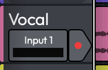

*Track Input Object*

> 💡 **Tip:** If you don't see the input objects, click the eye button
at the top right of the Edit tab and click the inputs button (the small
tag icon to the left of the track names) in the panel that opens, or
press Shift + F12.

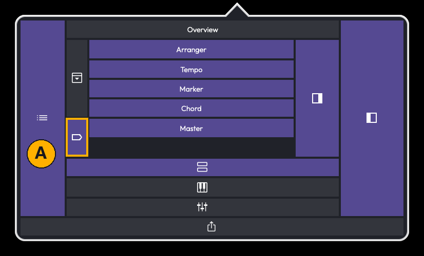

*Show/Hide Inputs button (A) in the eye button panel*

Click an input object for a menu of options, and choose which hardware
input this track records from. You can choose **No input** or any input
on your audio interface. In the picture it's set to **Input 1**.

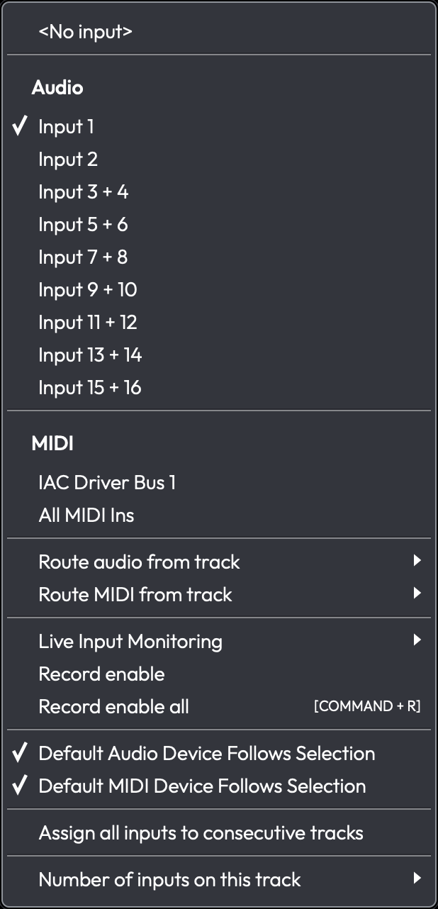

*Input Menu*

The input menu also has these items:

- **Route audio from track** / **Route MIDI from track**: record the
  output of another track instead of a hardware input.
- **Live Input Monitoring**: the input's monitoring mode (see
  [Live Input Monitoring](#live-input-monitoring)).
- **Record enable**: arms or disarms this input, like the **R** button.
- **Record enable all**: arms or disarms every input (see
  [Enable Recording for All Inputs at Once](#enable-recording-for-all-inputs-at-once)).
- **Default Audio Device Follows Selection** / **Default MIDI Device
  Follows Selection**: when on, selecting a track that has no input
  gives it the default audio or MIDI input. (Default: on)
- **Assign all inputs to consecutive tracks**: see
  [Setting Up Inputs for Multi-track Recording](#setting-up-inputs-for-multi-track-recording).
- **Number of inputs on this track**: see [Number of Inputs](#number-of-inputs).

Once you've chosen an input, the input object shows the input name, a
live input meter and the record arm **R** button, and the input's full
set of properties appears in the Actions panel.

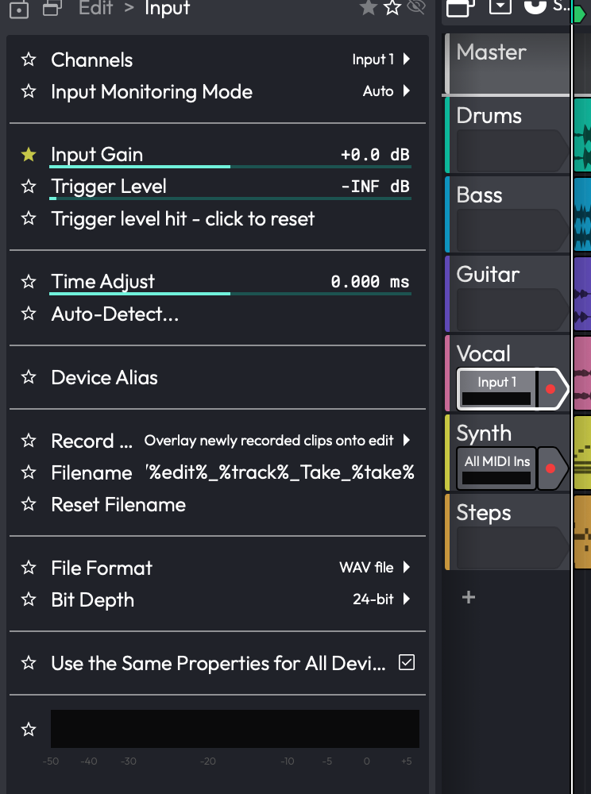

*Input Controls & properties*

## Customising Input Names Globally

You can give inputs friendlier names than the defaults with the
**Device Alias** property.

To change an input's alias, open *Settings > Audio Devices*. Select an
input in the **Input Channel Groups** list and edit the **Device Alias**
name in its properties.

You can also edit it from the Edit: select an input and change **Device
Alias** in the Actions panel. It is the same setting either way, so the
new name applies to every Edit, not just the current one. For example,
you could name an input after the microphone plugged into it.

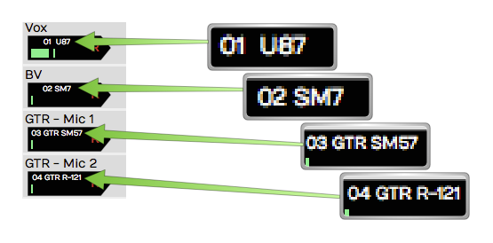

*Customised Input Names Using the Device Alias Property*

## Input Properties

Select an audio input to see its properties in the Actions panel:

**Channels**: The set of device channels this input uses.

**Input Monitoring Mode** (Choices: On, Auto, Off): Whether the input is
played through Waveform. See [Live Input Monitoring](#live-input-monitoring).
(Default: Auto)

**Input Gain**: Gain applied to the input signal before it's recorded,
from -12 to +12 dB. (Default: 0 dB)

**Trigger Level**: Recording waits until the input reaches this level,
from -51 to 0 dB. At -50 dB or below, recording starts straight away.
The **Close Gate** button next to it lets you audition the trigger
level. (Default: -50 dB)

**Time Adjust**: Shifts newly recorded clips to correct for latency,
from -500 to +500 ms. Click **Auto-Detect...** to measure it (see
[Calibrating Input Latency Compensation](audio-device-setup.md#calibrating-input-latency-compensation)).
(Default: 0 ms)

**Device Alias**: The name shown for this input (see above).

**Record Mode** (Choices: Overlay newly recorded clips onto edit,
Replace old clips in edit with new ones, Don't make recordings from
this device): What happens to existing clips when you record over them.
(Default: Overlay newly recorded clips onto edit)

**Filename**: The pattern used to name new recordings. It can contain
tokens such as `%edit%`, `%track%`, `%date%`, `%time%` and `%take%`.
**Reset Filename** puts the default pattern back.

**File Format** and **Bit Depth**: The file type and bits per sample
for new recordings. (Default bit depth: 24-bit)

**Use the Same Properties for All Devices**: When on, changes to these
settings apply to every audio input.

The large meter at the bottom is described in [Input Meters](#input-meters).

## About MIDI Inputs

The input menu also lists MIDI interface inputs. Waveform doesn't
have separate audio and MIDI tracks: any track can hold Audio clips or
MIDI clips. Set the input you need and insert the right kind of
plugins.

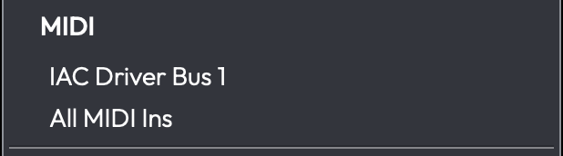

*MIDI Devices on the Inputs Menu*

A track behaves like an audio track if you set an audio input, and
like a MIDI track if you set a MIDI input and insert a virtual
instrument plugin.

## Setting Up Inputs for Multi-track Recording

Choose **Assign all inputs to consecutive tracks** from the input menu
to give each input its own track, one after another. This sets you up
for multi-track recording in one step, which helps when you record a
live performance through a digital mixer with a lot of inputs.

*Assign All Inputs from the Input Menu*

## Number of Inputs

You can set up more than one input on a single track, up to four. Choose
**Number of inputs on this track** from the input menu and pick 1-4.

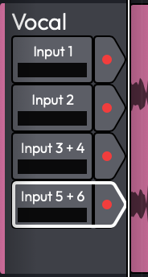

*Assign up to Four Inputs to One Track*

If you record with more than one input armed, you get a separate clip
for each, stacked on the track.

This is handy when you audition microphones and preamps: set up several
recording chains on one track, then arm the input you want to try. To
switch to a different mic and preamp combination, arm a different
input.

> 📝 **Note:** Normally an input can only be on one track at a time. In
Waveform Pro, turning on **Allow inputs to appear on multiple tracks**
PRO in [*Settings > General*](reference-settings.md#track-inputs)
lets one input feed several tracks, and adds **Assign this input to
consecutive tracks** to the input menu.

## Enable a Track for Recording

To enable (arm) a track for recording, click **R** on the input
object. The R lights up to show that the track is armed.

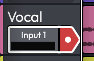

*Input Armed for Recording*

Test the input signal: play a note on the guitar, or have the singer
sing something into the microphone. The meter on the input should move.
If it doesn't, check the input level on your hardware, and make sure
phantom power is on if the mic needs it.

> 💡 **Tip:** Once recording has started you can still click **R** to enable
and disable recording on the fly, for manual punch-in and punch-out
recording. This video explains [Punch
In/Out on the Fly.](https://w-edstrom.wistia.com/medias/wgjyszl1i6)

## Hit Record

With the input set up, click **Record** (R) in the transport bar to
start recording. Waveform draws the waveform on the track as you record.
Press the Space bar to stop.

Recording always starts at the cursor position. The other ways to stop
or abandon a recording are described later in this chapter.

> 💡 **Tip:** By default you still hear the existing clips on a track
while you record onto it. For tape-style recording, where they go
silent, turn on **Mute track contents whilst recording**
PRO in [*Settings > Advanced*](reference-settings.md#audio-engine).
It's available in Waveform Pro.

## Enable Recording for All Inputs at Once

When you record many inputs at once, you can arm all the tracks
together with **Record enable all** (Cmd + R / Alt + R) in the input
menu. You can also use it during recording to start and stop recording
without stopping the transport.

## Input Meters

Click an input to select it. The Actions panel shows a large meter,
which is a good guide when you set the input level.

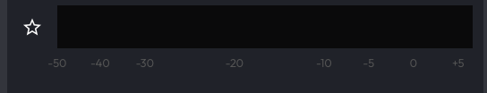

*Large input meter in the Actions panel*

> 💡 **Tip:** As a rule of thumb, set the input level so that it hovers
around the middle of this meter's range. Adjust it with the gain
controls on your audio interface or preamp.

To see large meters for all the tracks at once while you record several
inputs, press F12. Waveform switches to "big meters" mode and draws a
very large meter over each track.

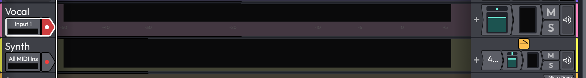

*Big Meters Mode*

> 📝 **Note:** The big meters hide the clips on the tracks, so turn
them off again (F12) when you aren't recording.

## Dragging the Input Object Track to Track

You can drag an input object from one track to another. For example,
say you recorded something on track one and now want to record
something else with the same microphone on track two. Drag the input
object from track one to track two, and the input is set up there
straight away.

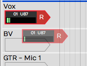

*Dragging an Input to Another Track*

## Renaming a Track

To rename a track, click the track name, then edit the **Name**
property in the Actions panel. A quick way is to click **Name**, press
Tab and start typing. The new name is set as soon as you tab away from
**Name** or click elsewhere in Waveform.

## Recording Steps in Review

To test your recording setup:

1.  Arm the track or tracks for recording by clicking **R** on the track
    input.
2.  Make sure **Loop** is turned off in the transport bar.

    > 📝 **Note:** Waveform supports loop recording, which is covered in
    [Loop Recording](loop-recording.md).

3.  Rewind the cursor to the start of the Edit with the rewind button
    (Home) in the transport bar.
4.  Check that **Click** (C) is turned off in the transport bar for
    now.
5.  Click **Record** (R) in the transport bar, and play or sing into
    the input.

    > 📝 **Note:** As you record, the meters move and the waveform starts
    to draw on the Audio clip.

6.  Press the Space bar to stop recording.
7.  Rewind, then press the Space bar to play back what you just
    recorded.

> 💡 **Tip:** If a take isn't going well, press **Abort** or **Abort &
Restart** in the transport bar. These buttons only appear during
recording.

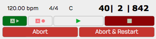

*Abort and Abort & Restart During Recording*

## Working with the Click

An audible timing reference often helps while you record. Waveform's
built-in metronome gives you a steady click for this.

### Enabling the Click

To enable the metronome click, turn on **Click** (C) in the transport
bar. Its settings are in the Click menu: open it from the main menu at
the top of the window, or right-click the **Click** button in the
transport bar. The options are:

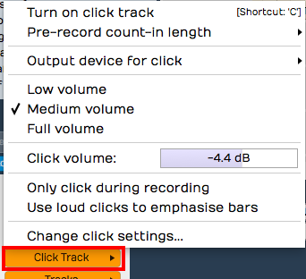

*Click Settings*

**Click**: Turns the click on or off, the same as pressing C or
clicking the **Click** button in the transport bar.

**Click volume**: Sets the volume of the click, from -14 dB to 0 dB.

**Count-in**: Starts the click a little before the cursor position when
you record, so you have time to get into the groove before you play.
Choose the count-in length from *Click > Count-in*: **None**, **1
bar**, **2 bars** or **2 beats**.

With count-in enabled, you hear the click during recording. If the
cursor is at the beginning of the Edit, you hear the count-in and then
the cursor starts moving. If the cursor is not at the start, it jumps
back by the count-in length and plays from there.

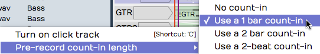

*Count-in Options*

**Click during playback**: To hear the click during playback as well,
tick *Click > Click during playback*. With it unticked, you only hear
the click while recording.

**Emphasize downbeats**: Enable *Click > Emphasize downbeats* to hear
the downbeat of each bar clearly. Waveform then uses a different sound
for the first beat of each bar.

**Click sound**: To change the click sounds, choose *Click > Click
sound...*. This opens the **Click Track Settings** dialog box, where you
can choose the audio files for the normal and emphasised beats. Leave
the **File** properties blank to use the default sounds.

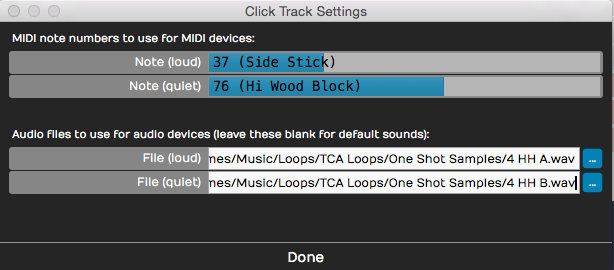

*Configuring the Click Sound*

You can also play the click on an external MIDI sound module. If you
do, set the MIDI note numbers in the **Click Track Settings** dialog
box.

**Click output device**: To send the click somewhere other than your
main speakers, choose *Click > Click output device...*. By default this
is set to **(Default audio output)**. You can pick any audio output on
your system, or any MIDI output. A MIDI output should lead to a sound
module of some sort, and you set the note numbers as described under
**Click sound** above.

## Listening on Headphones While Recording

Ideally, you monitor what you're recording through headphones, and set
the level and mix on your audio interface rather than in Waveform. Most
audio interfaces let you mix your live input with the playback of
earlier tracks, using the interface's own mixer to balance the two.

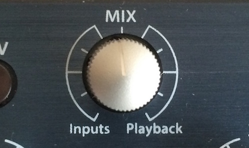

*Audio Interface Mix Knob*

Simple audio interfaces have a mix knob that blends the inputs (your
mic) with playback (the tracks you've already recorded). For a vocal,
for example, set the knob about halfway: half of what you hear is the
live mic, and half is playback from Waveform.

Some audio interfaces have no mix knob on the front panel. Instead they
come with an application, run alongside Waveform, that has a virtual
mixer. You use it to set up your headphone mix separately from the
recording software.

## Live Input Monitoring

Sometimes you need to monitor the input through Waveform rather than
through your interface. The two main cases are playing through virtual
instruments, and playing through virtual guitar amps while you record.
Those are covered in [MIDI Recording](midi-recording.md) and
[Using an Amp Simulator Plugin](using-an-amp-simulator-plugin.md). To
try live monitoring:

1.  Turn off any direct (hardware) monitoring on your audio interface,
    so that anything you hear comes through Waveform. Then set up a
    track, arm it for recording, and play something into the input with
    a mic, guitar or other instrument.
2.  Select the input and find the **Input Monitoring Mode** option in
    the Actions panel. You can also set it from the input menu, under
    **Live Input Monitoring**. **On** always plays the input through
    Waveform, **Auto** plays it only while the input is armed for
    recording, and **Off** never does. (Default: Auto) With **On** or
    **Auto** and the track armed, you should hear the input going
    through Waveform and back out to your speakers (or headphones).

The downside is latency: a delay between when you play or sing a
note and when you hear it in your headphones. At high buffer settings
it sounds like an annoying slapback echo. At lower buffer settings it
can sound hollow when you sing with headphones on. When you play an
instrument, you might not notice anything at all.

To hear the effect of latency clearly, turn the buffer size up to 1024
or more. You'll hear a noticeable delay between when you sing, speak or
play a note and when you hear it.

> 📝 **Note:** Latency is more of a problem for singers than for
guitarists and other instrumentalists. Your voice reaches your ear
through your skull with no latency at all. Mixed with a slightly
delayed copy through the interface and software, it can sound hollow or
"phasey." This isn't recorded, but it can put you off while you
perform.

So use live input monitoring when you need it, for guitar amp
simulators and virtual instruments. For ordinary vocal and instrument
recording, your audio interface's zero-latency monitoring is usually
the better choice.

## If at First You Don't Succeed

With a track armed, click **Record** and play. Press **Record** a
second time (or the Space bar) to stop. If you don't like the take,
select the Audio clip and press Delete or Backspace, or press **Undo**
(Cmd + Z / Ctrl + Z) to undo it. Then rewind and try again.

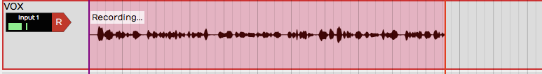

*Recording in Process*

## Abort Record and Delete the Take

The quickest way to throw away a failed take is **Abort recording,
discard takes**. With a single keystroke (F4) it stops recording,
discards the take and puts the cursor back where recording started,
ready for another try. The
**Abort** button in the transport bar does the same thing.

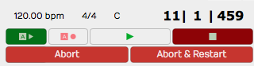

*Abort Buttons on the Transport During Recording*

**Abort recording, discard takes, restart** does the same, then
drops straight back into recording. During recording it appears in the
transport bar as the **Abort & Restart** button. Its default shortcut is Ctrl + Alt + R on
Windows; on a Mac it has none, but you can assign one in *Settings >
Keyboard Shortcuts*.

## Recording a Stereo Signal

To record a pair of microphones or a stereo source such as a
keyboard, make the input stereo on the *Settings > Audio Devices*
page. Under **Input Channel Groups**, click
the **Channels** button on the input's row and choose **Stereo** (or
**Mono** to go back). Layouts with more than two channels need Waveform
Pro or the Surround Expansion. You can also pick which channels an input
uses from its **Channels** property.
See [Channel Groups](audio-device-setup.md#channel-groups) for more on
the device settings.

You now have one stereo input in place of two mono ones, and it
appears in the Edit when you choose a track's input.

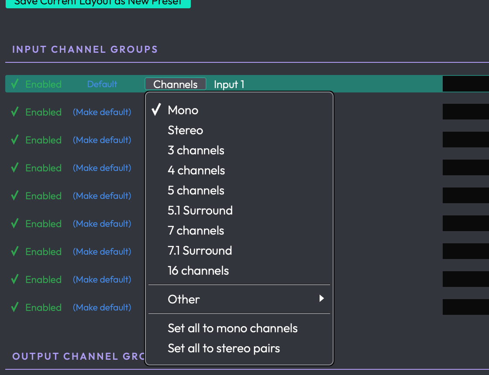

*Making an Input Stereo*

Recording from a stereo input gives you a stereo clip that shows both
the left and the right waveforms.

## Retrospective Record

Sometimes a practice take is the best one, or a singer comes in with a
pickup just before the downbeat you started recording on. Retrospective
record keeps a recording buffer running for every track that has an
input set up, so you can get that audio back.

Retrospective record is on by default, with a 30 second buffer. To
change the buffer size or turn it off, choose *Options > Retrospective
record* from the main menu and pick **Disabled**, **30 second buffer**,
**1 minute buffer**, **2 minute buffer**, **5 minute buffer** or **10
minute buffer**. The 30-second buffer is usually enough to save
chopped-off pickups or endings. For live shows or speeches, set it to
10 minutes.

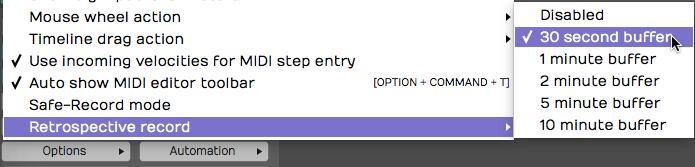

*Enabling Retrospective Record*

To recover the audio, click the **Retrospective Record** button in the
transport bar (it is hidden while you are recording). Waveform adds the
buffered audio and MIDI as clips on the right tracks. If you click
**Retrospective Record** while the transport is still running, the
audio lines up with the timeline. If you click it with the transport
stopped, the audio is placed at the cursor, and you need to line the
clip up yourself.

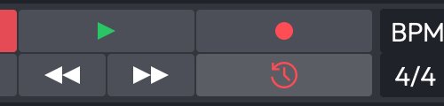

*Click the Retrospective Record Button*

Retrospective record uses very little CPU, so you can leave it on as
a safeguard.

## Safe-Record Mode

For shows, long recordings, or any time you leave your computer
recording unattended, turn on Safe-Record mode (*Options > Safe-Record
mode*).

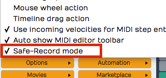

*Safe-Record Mode*

In Safe-Record mode, you start recording in the normal way, but as
soon as recording starts Waveform shows the Safe-Record dialog box. You
can't do anything in Waveform, including stopping the recording,
until you enter the four-key shortcut.

To stop recording in Safe-Record mode, press Shift + Opt + Cmd + R /
Ctrl + Shift + Alt + R.

*How to Exit Safe-Record Mode*

These are the default keys, and you can change them to any other
combination you like.

## Moving On

Next, [Recording Overdubs](recording-overdubs.md) walks through
recording a simple song, overdubbing new parts on top of a drum loop.
