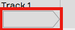
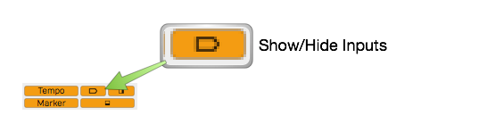
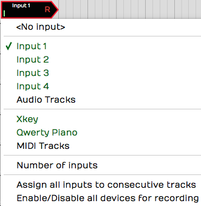
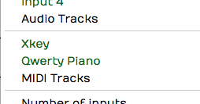
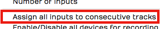
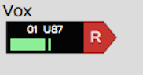
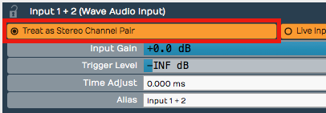
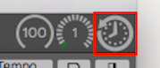

# Recording Audio

Now it's time to learn how to record your own instrument or vocal tracks
into Waveform. First, you will learn how to configure track inputs for
recording. Next, you will learn how to use Waveform's built-in metronome
to provide a reference click, in order to to keep your recordings in
time.

## Configure the Input

Set up your audio interface first, as described in
[Audio Device Setup](audio-device-setup.md).

> ⚠️ **Warning:** Before you record, run **Auto-Detect** with a hardware
loopback so that new recordings line up with existing tracks, and run it
again whenever you change your interface or buffer size. See
[Calibrating Input Latency Compensation](audio-device-setup.md#calibrating-input-latency-compensation).

## The Input Object

At the far left of every track, you will find the input section. Each
track has an input object that looks like a rectangular arrow pointing
right.

*Track Input Object*

> 💡 **Tip:** If you don't see the input objects, click the **Show/Hide
Inputs** (Shift + F12) button at the top right corner of the Edit tab.

*Show/Hide Inputs Button*

Click on an input object to see a menu of options. From the menu, select
which hardware input to use for recording to this track. You can set it
to **No input** or select any input from your audio interface. In this
case it's set to **Input 1**.

*Input Menu*

The input menu also has these items:

- **Route audio from track** / **Route MIDI from track**: record the
  output of another track instead of a hardware input.
- **Live Input Monitoring**: the input's monitoring mode (see
  [Live Input Monitoring](#live-input-monitoring)).
- **Record enable**: arms or disarms this input, like the **R** button.
- **Record enable all**: arms or disarms every input (see
  [Enable Recording for All Inputs at Once](#enable-recording-for-all-inputs-at-once)).
- **Default Audio Device Follows Selection** / **Default MIDI Device
  Follows Selection**: when on, selecting a track that has no input
  gives it the default audio or MIDI input. (Default: on)
- **Assign all inputs to consecutive tracks**: see
  [Setting Up Inputs for Multi-track Recording](#setting-up-inputs-for-multi-track-recording).
- **Number of inputs on this track**: see [Number of Inputs](#number-of-inputs).

When you select an input, the input object shows the input name, a
real-time input meter, and the record arm **R** button. Also, a full set
of input properties appears in the Actions panel.

*Input Controls & properties*

## Customising Input Names Globally

If you are happy with the default input names that's great, however, you
can customise them with friendlier names using the **Device Alias** property.

To change an input's alias, open *Settings > Audio Devices*. Select an
input in the **Input Channel Groups** list and edit the **Device Alias**
name in its properties.

You can also edit it from the Edit: select an input and change **Device
Alias** in the Actions panel. It is the same setting either way, so the
new name applies to every Edit, not just the current one. As an example,
you could use this to indicate the microphone plugged into that input.

*Customised Input Names Using the Device Alias Property*

## Input Properties

Select an audio input to see its properties in the Actions panel:

**Channels**: The set of device channels this input uses.

**Input Monitoring Mode** (Choices: On, Auto, Off): Whether the input is
played through Waveform. See [Live Input Monitoring](#live-input-monitoring).
(Default: Auto)

**Input Gain**: Gain applied to the input signal before it's recorded,
from -12 to +12 dB. (Default: 0 dB)

**Trigger Level**: Recording waits until the input reaches this level,
from -51 to 0 dB. At -50 dB or below, recording starts straight away.
The **Close Gate** button next to it lets you audition the trigger
level. (Default: -50 dB)

**Time Adjust**: Shifts newly recorded clips to correct for latency,
from -500 to +500 ms. Click **Auto-Detect...** to measure it (see
[Calibrating Input Latency Compensation](audio-device-setup.md#calibrating-input-latency-compensation)).
(Default: 0 ms)

**Device Alias**: The name shown for this input (see above).

**Record Mode** (Choices: Overlay newly recorded clips onto edit,
Replace old clips in edit with new ones, Don't make recordings from
this device): What happens to existing clips when you record over them.
(Default: Overlay newly recorded clips onto edit)

**Filename**: The pattern used to name new recordings. It can contain
tokens such as `%edit%`, `%track%`, `%date%`, `%time%` and `%take%`.
**Reset Filename** puts the default pattern back.

**File Format** and **Bit Depth**: The file type and bits per sample
for new recordings. (Default bit depth: 24-bit)

**Use the Same Properties for All Devices**: When on, changes to these
settings apply to every audio input.

The large meter at the bottom is described in [Input Meters](#input-meters).

## About MIDI Inputs

Notice that on the input menu, you can choose MIDI interface inputs.
There's really no difference between an audio and a MIDI track. A track
can contain Audio clips or MIDI clips. You just need to set the input
appropriately and insert the correct kind of plugins.

*MIDI Devices on the Inputs Menu*

In essence a track behaves like an audio track if you set an audio
input; it works like a MIDI track if you set a MIDI input and insert a
virtual instrument plugin.

## Setting Up Inputs for Multi-track Recording

It's very convenient to assign all inputs to consecutive tracks using
**Assign all inputs to consecutive tracks** from the input menu. It does
exactly what the name says, allowing you to quickly set up for
multi-track recording. This is great if you're setting up to record a
live performance through a digital mixer with a lot of inputs.

*Assign All Inputs from the Input Menu*

## Number of Inputs

You can set up more than one input on a single track, up to four. Choose
**Number of inputs on this track** from the input menu and pick 1-4.

*Assign up to Four Inputs to One Track!*

Now, if you record with more than one input armed, you will get a
separate clip for each. This results in a stack of Audio clips.

A good use of this feature is to have several recording chains
configured and ready to go, when auditioning microphones and preamps.
Simply arm the input you want to try and away you go. It makes it super
efficient to switch to a different mic/preamp combination by simply
arming the desired input.

> 📝 **Note:** Normally an input can only be on one track at a time. In
Waveform Pro, turning on **Allow inputs to appear on multiple tracks**
PRO in [*Settings > General*](reference-settings.md#track-inputs)
lets one input feed several tracks, and adds **Assign this input to
consecutive tracks** to the input menu.

## Enable a Track for Recording

To enable (arm) a track for recording, click the **R** symbol on the input
object. The R illuminates to indicate that the track has been armed for
recording.

*Input Armed for Recording*

Test the input signal. If you're using a microphone or a guitar, play a
note or have the singer sing something. You should see the meter moving
on the input while testing. If not, check your input level on the
hardware and make sure phantom power is on if necessary for the mic.

> 💡 **Tip:** Once recording has started you can still click **R** to enable
and disable recording on the fly. This allows you to do manual punch-in
and punch-out style recording. Here is a video that explains [Punch
In/Out on the Fly.](https://w-edstrom.wistia.com/medias/wgjyszl1i6)

## Hit Record

With the input setup done, recording is a matter of clicking **Record**
(R) in the transport bar. While recording, Waveform draws the waveform on
the track. To stop recording press Space bar.

Recording always starts at the cursor position. There are several ways
and options to stop recording which will be explained in a bit.

> 💡 **Tip:** By default you still hear the existing clips on a track
while you record onto it. For tape-style recording, where they go
silent, turn on **Mute track contents whilst recording**
PRO in [*Settings > Advanced*](reference-settings.md#audio-engine).
It's available in Waveform Pro.

## Enable Recording for All Inputs at Once

If you are doing multitrack recording with many inputs you can arm all
the tracks at once from the input menu using the option **Record enable
all** (Cmd + R / Alt + R). You can even use this
on the fly during recording to start and stop recording without stopping
the transport.

## Input Meters

Click on an input to select it. Notice the large meter in the Actions
panel. This gives you a good reference for setting up the input level.

*Large input meter in the Actions panel*

> 💡 **Tip:** As a rule of thumb, you want to set input level to hover around
the middle of the range shown on this meter. The input level is adjusted
using the gain controls on your audio interface or preamp.

If you're doing multi-track recording and you want to see large meters
for all the tracks at once, press F12. Waveform will go into "big
meters" mode. This superimposes a very large meter onto each track.

*Big Meters Mode*

> 📝 **Note:** The big meters obscure your view of clips on the tracks, so
you will want to toggle it off (F12) when not recording.

## Dragging the Input Object Track to Track

Here's a unique aspect of the input objects. You can drag the input
object from track to track. For example, say you recorded something on
track one, and now you want to record something else using the same
microphone onto track two. Simply, grab the input object and drag it
from track one to track two. The set up is done instantly.

*Dragging and Input to other Track*

> 📝 **Note:** Dragging the input track to track is a really useful function
in Waveform. Once you start using this feature you will miss it when you
record with any other DAW!

## Renaming a Track

To rename a track, click directly on the track name, then edit the
**Name** property in the Actions panel. A really quick way to do this
is to click **Name**, press Tab, and start typing. As soon as you tab off
the **Name** property or click elsewhere in Waveform, the new track name
will be set.

## Recording Steps in Review

Here is a review of all the steps needed to test your recording setup:

1.  Arm the track or tracks for recording by clicking **R** on the track
    input.
2.  Make sure **Loop** is turned off in the transport bar.

    > 📝 **Note:** Waveform supports loop recording, which is covered in
    [Loop Recording](loop-recording.md).

3.  Make sure the cursor is rewound to the beginning by clicking
    **Return-to-zero** (Home) in the transport bar.
4.  Verify that **Click** (C) is turned off (for now) in the transport
    bar.
5.  Click **Record** (R) in the transport bar. Play something into the
    input using your instrument or your voice depending on the kind of
    input selected.

    > 📝 **Note:** As you record, you'll see the meters and you'll also see the
    waveform start to draw on the Audio clip.

6.  Press Space bar to stop recording.
7.  To hear what you recorded, click rewind then press Space bar to play.
    You should be able to hear what you just recorded.

> 💡 **Tip:** If your recorded take just isn't really going well, you can
press **Abort** or **Abort & Restart** in the transport bar. These options
only appear during recording.

*Abort and Abort & Restart During Recording*

## Working with the Click

While recording, it's often very helpful to have an audible timing
reference. Waveform has a built-in metronome that offers a steady click
for just this purpose.

### Enabling the Click

To enable the metronome click, turn on **Click** (C) in the transport
bar. That turns it on, but the setup is in the Click menu. Open it from
the main menu at the top of the window, or right-click the **Click**
button in the transport bar. Here are explanations for the options:

*Click Settings*

**Click**: Another way to enable or disable click is to open the Click
menu and select **Click**. That does the very same thing as pressing C
or clicking the **Click** button in the transport bar.

**Click volume**: Adjust the volume of the click using the **Click
volume** slider in the Click menu. It goes from -14 dB to 0 dB.

**Count-in**: While recording, you can have the click start a bit before
the cursor position. This gives you time to get into the groove before
performing. Enable the count-in from *Click > Count-in*. Select from
**None**, **1 bar**, **2 bars**, or **2 beats** for the count-in length.

With count-in enabled, you will hear the click during recording. If the
cursor is at the beginning of the Edit, you will hear the count-in then
the cursor will start moving. If the cursor is not at the start, it will
actually jump back by the count-in length and play from there.

*Count-in Options*

**Click during playback**: If you want to hear the click during
playback, make sure *Click > Click during playback* is ticked. With it
unticked, you only hear the click while recording.

**Emphasize downbeats**: To clearly hear the downbeat of each bar,
enable *Click > Emphasize downbeats*. With that enabled, Waveform uses a
different sound for the first beat of each bar.

**Click sound**: To change what sounds are used for the click, select
*Click > Click sound...*. This opens the **Click Track Settings** dialog
box. From here, you can change the samples used to make the click
sound. Just select the audio files for the normal and emphasised
beats. If you leave the **File** properties blank, you will get the
default sounds.

*Configuring the Click Sound*

Not too many people still do this, but it's possible to use an external
MIDI sound module for your click sound. If you are inclined to do that,
you can set the MIDI note numbers in the **Click Track Settings** dialog
box.

**Click output device**: If you want to redirect your click so it's not
coming through your main speakers, look at the click output device
options (*Click > Click output device...*). Normally and by default this
is set to **(Default audio output)**. You can pick any audio output on
your system or even any MIDI output. If you select a MIDI output, it
should be a sound module of some sort. When using MIDI for the click,
you can set the click sound note numbers as explained under **Click
sound** above.

Using a click is an essential reference tool for studio recording, so it
is great to have a synchronised click built-in and ready to go.

## Listening on Headphones While Recording

Ideally, you will monitor what you're recording through headphones, and
set up the level and mix on your audio interface outside of Waveform.
Most audio interfaces give you the ability to mix your live input with
the playback from previous tracks. You use the mixer on the audio
interface to balance the live input sound with the sound being played
back by Waveform.

*Audio Interface Mix Knob*

Simple audio interfaces have a mix knob that allows you to mix between
the inputs (your mic) and playback (previously recorded tracks). For
example, when recording a vocal leave the mix knob just about in the
middle. Half of what you hear is the live input off your mic, the other
half is what's being played back from Waveform.

Some audio interfaces do not have a specific knob on the front panel to
control the mixer level, and instead have an application that you run
alongside Waveform that features a virtual mixer. These applications
allow you to set up the monitor mix in your headphones separately from
what's happening in the recording software.

## Live Input Monitoring

There are situations where you need to use live input monitoring through
Waveform, rather than through your interface. The two main use cases for
that are when playing through virtual instruments, or virtual guitar
amps while recording. Those are covered in
[MIDI Recording](midi-recording.md) and
[Using an Amp Simulator Plugin](using-an-amp-simulator-plugin.md), but
here are a few points for those curious about such things.

1.  **Disable hardware monitoring.** To try live monitoring through
    Waveform, first turn off any direct monitoring on your audio
    interface, so that anything you hear comes through Waveform. Then
    set up a track and arm it for recording, and play something into
    the input using a mic, guitar, or other instrument.
2.  **Enable live input monitoring.** Now make sure the input is
    selected and look for the **Input Monitoring Mode** option in the
    Actions panel. You can also set it from the input menu, under
    **Live Input Monitoring**. **On** always plays the input through
    Waveform, **Auto** plays it only while the input is armed for
    recording, and **Off** never does. (Default: Auto) With **On** or
    **Auto** and the track armed, you should hear the input going
    through Waveform and back out to your speakers (or headphones).

The downside is latency. You might possibly notice a delay between when
you play a note and when you hear it. It's a time lag between you sing
and when you hear it in your headphones. At high buffer settings it will
sound like an annoying delay slap or echo. At lower buffer settings it
might sound like a hollowness if you are singing with headphones on.
When playing an instrument, you might not hear any problem at all.

To really hear the effect of latency, try turning the buffer size up to
1024 or even more. Then as you play you'll hear a noticeable delay
between when you sing, speak or play a note and when you hear it.

> 📝 **Note:** Latency delay is more of a problem for singers than it is for
somebody playing guitar or another instrument. The sound of your voice
is coupled through your skull right into your ear with zero latency.
When combined with your voice slightly delayed through the interface and
software the result might seem hollow or "phasey." This won't be
recorded, but might throw you off during recording.

Why then would you ever use live input monitoring? You need it for
guitar amp simulators and for virtual instruments. For normal vocal and
instrument recording, it may be preferable to use your audio interface
to provide zero latency monitoring.

## If at First You Don't Succeed

With a track armed, hit **Record** and record away. Press **Record** a
second time (or Space bar) to stop recording. If you don't like what
you've recorded select the Audio clip and press Delete or Backspace.
Rewind and try again! You can alternatively press **Undo** (Cmd + Z /
Ctrl + Z) to undo the last recording take.

*Recording in Process*

## Abort Record and Delete the Take

If you are impatient to delete a failed recording take, then you will
love this feature: **Abort recording, discard takes**. With a single
keystroke (F4) you cancel the take, throw it out, rewind to the
beginning, and get set to try again. The **Abort** button in the
transport bar does the same thing.

*Abort Buttons on the Transport During Recording*

There is a variation on this feature: **Abort recording, discard takes,
restart**. That does the same thing, but then drops right back into
recording. This action appears in the transport bar during recording as
the **Abort & Restart** button. Its default shortcut is Ctrl + Alt + R on
Windows; on a Mac it has none, but you can assign one in *Settings >
Keyboard Shortcuts*.

## Recording a Stereo Signal

If you are recording a pair of microphones or a stereo source like a
keyboard, you can make an input stereo. This is done on the
*Settings > Audio Devices* page. Under **Input Channel Groups**, click
the **Channels** button on the input's row and choose **Stereo** (or
**Mono** to go back). Layouts with more than two channels need Waveform
Pro or the Surround Expansion. You can also pick which channels an input
uses from its **Channels** property.
See [Channel Groups](audio-device-setup.md#channel-groups) for more on
the device settings.

Now instead of two inputs, you have one stereo input. This will appear
over in the Edit when you select inputs for a track.

*Making an Input Stereo*

When you record from a stereo input, you'll wind up with a stereo clip
showing both the left and the right waveforms.

## Retrospective Record

You know how there are times where you wish you were recording because a
practice take was so amazing? Or maybe a singer sings a pickup just
before the downbeat. Waveform's "Retrospective Record" feature actually
keeps a recording buffer running for any track that has an input set up.

Retrospective record is on by default, with a 30 second buffer. To
change the buffer size or turn it off, choose *Options > Retrospective
record* from the main menu and pick **Disabled**, **30 second buffer**,
**1 minute buffer**, **2 minute buffer**, **5 minute buffer** or **10
minute buffer**. We find that the 30-second buffer is usually enough to
safe-guard against chopped off picks or endings. For live shows or
recording speeches, set it to 10 minutes.

*Enabling Retrospective Record*

To recover lost audio, simply click the **Retrospective Record** button
in the transport bar (it is hidden while you are recording). The
buffered audio and MIDI will be added as clips to the appropriate
tracks. If you click the button while the transport is still running,
the audio will be synchronised to the timeline. If you click it with the
transport stopped, the audio will be placed at the cursor. In that case you will need to manually
align the clip to the track.

*Click the Retrospective Record Button*

Retrospective record doesn't consume much CPU and is a great safeguard
against losing important audio or a killer take.

## Safe-Record Mode

When recording shows, doing long recordings, or if you ever need to
leave your computer unattended while it's recording, consider enabling
Safe-Record mode (*Options > Safe-Record mode*).

*Safe-Record Mode*

In Safe-Record mode, you start recording in the normal way. However,
as soon as recording starts, Waveform shows the Safe-Record modal
dialog box. You can't do anything in Waveform including stop the
recording without entering the four key shortcut.

To get out of Safe-Record mode, press Shift + Opt + Cmd + R / Ctrl +
Shift + Alt + R.

*How to Exit Safe-Record Mode*

Those are the defaults, but you can change those to any other crazy key
combination you want.

## Moving On

That was a lot of information about recording audio in Waveform. In the
next chapter we will continue on with
[Recording Overdubs](recording-overdubs.md).
