# Recording Overdubs

This chapter walks through recording a simple song one part at a time.
[Recording Audio](recording-audio.md) explains how to use the **Click**
feature as a metronome while recording; here a drum loop is the tempo
reference instead, and you overdub guitars and bass on top of it.

> 💡 **Tip:** For overdubs, record wearing headphones with your main
speakers off. This stops sound bleeding from one track to the next, for
cleaner mixing later on.

By the end of the chapter, the Edit has these tracks:

-   Track 1: Drum Loop
-   Track 2: Acoustic Guitar
-   Track 3: Acoustic Guitar - Double
-   Track 4: Bass

## Set Up the Drum Loop

1.  Set the tempo: click the tempo (e.g. 77 BPM) in the transport bar,
    then edit the **BPM** value in the Actions panel.

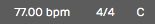

*Click BPM to Edit Tempo*

2.  Drag in a loop from the Browser, for example a two-bar loop. This
    creates an Audio clip. The example uses Track 1 for the loop,
    renamed to "DrumLoop".

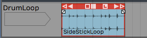

*Start With a 2-Bar Drum Loop*

> 💡 **Tip:** If the loop doesn't align to the bars correctly, hold Opt / Alt
and drag the right trim arrow until it does.

3.  Click the L icon on the Audio clip to switch it to looping mode,
    then drag the right trim handle to roll out as many copies of the
    loop as you want.

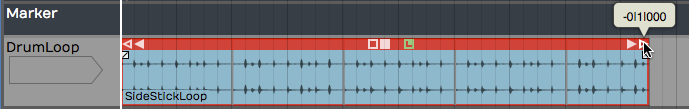

*Roll Out Repeats of the Drum Loop*

## Get Ready to Record

1.  Set up the input. In this example, the drum loop is on the first
    track, and the second track records the acoustic guitar rhythm part
    from **Input 1**, where the mic is connected.

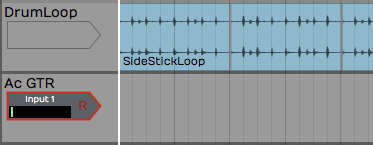

*Configure the Input*

2.  Turn off the **Loop** button in the transport bar, as this example
    doesn't use loop recording.
3.  Turn off **Click**, because the drum loop track is the timing
    reference.
4.  Set a two-bar count-in: choose *Click > Count-in > 2 bars* from the
    main menu.

## Record the Rhythm Guitar Part

1.  Use your audio interface's mix knob or app to balance the level of
    the guitar mic with the level of the drum loop track. On the guitar mic
    input, set **Live Input Monitoring** to Off (right-click the input,
    or use **Input Monitoring Mode** in the Actions panel).
2.  Arm the track for recording by clicking the R icon on the input.
    The input's meter moves when you play a chord.
3.  Test the input level by playing at the loudest level you plan to use
    for the track. Adjust the level using the gain control on the audio
    interface.
4.  Check that the cursor is at the beginning of the Edit. If it isn't,
    press **Home**.
5.  Press **Record** (**R**) in the transport bar and record a take of
    your song. Press **Space bar** at the end to stop recording.

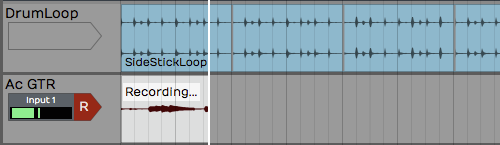

*Recording the Guitar Part*

> 💡 **Tip:** If recording doesn't go as planned, delete the Audio clip and
try again. See [Deleting Clips](audio-clips-and-editing-audio.md#deleting-clips)
for several ways to do this.

> 📝 **Note:** If you hear a strange phasing sound as you play, you
probably have **Live Input Monitoring** on while also monitoring through
your audio interface. Set **Live Input Monitoring** to Off.

## Doubling the Rhythm Guitar

1.  Rewind and play back the rhythm guitar part you've recorded. Use the
    Volume & Pan plugins in the inline mixer to balance it with the drum
    loop.
2.  Drag the Input object to the next track to double the rhythm
    guitar. Track 3 is now ready to record an overdub.

> 💡 **Tip:** Lowering the original track by 3-6 dB with its Volume & Pan
plugin can help it balance with your live mic.

3.  Rewind, then click **Record** in the transport bar.

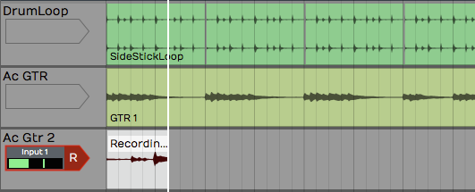

*Recording the Second Guitar Part*

4.  Play back the new recording and balance it with the original guitar
    track. For a wide stereo effect from the doubled part, pan the two
    tracks to opposite sides with the **Pan** slider in the Volume & Pan
    plugin.

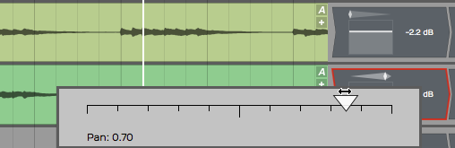

*Panning Guitar Parts Left and Right*

## Overdub a Bassline

You can record the bass by plugging it directly into the audio
interface, with no amp or mic.

First, find the input on your interface that accepts a direct 1/4" high
impedance connection. It's often marked guitar, gtr or hi-z, and you
sometimes need to engage a switch or button for high impedance mode.
Your bass or electric guitar sounds better with hi-z mode on.

1.  Connect your bass to the interface with a normal 1/4" to 1/4"
    guitar cable.

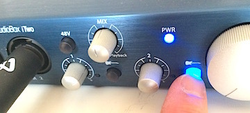

*Engage High Impedance Mode on Your Audio Interface*

2.  From here, recording works the same as with a mic. Select the
    correct input, then use the gain knob on the audio interface to give
    the bass a good level without lighting the interface's clip LED.
3.  Arm the input for recording if it isn't already. Balance the levels
    of the existing tracks so you can hear them as well as what you're
    playing on the bass.
4.  Rewind and press **Record**. If the take doesn't go well, stop, press
    **Undo** and try again.

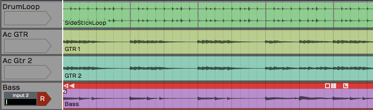

*Overdubbed Bass Line*

> 💡 **Tip:** If you get a good take but think you can do better, don't
delete the clip. Drag the input to another track and try again, muting
the original track or clip so you don't hear it while you record. The
first take might turn out to be the best.

## Rename Tracks

As you record overdubs, name your tracks to stay organised. Click the
track name, then edit the **Name** property.

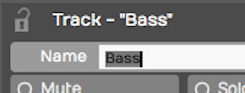

*Renaming a Track*

> 💡 **Tip:** When you rename several tracks, moving the mouse between
each track and the Actions panel gets tedious. Instead, click the track
name and press **Tab**, which puts the focus straight on the **Name**
property, ready for typing.

## Adding Additional Tracks

If you don't have enough tracks in your Edit, there are several ways
to add more:

1.  Select any existing track and press **T** to create a new track
    directly below it.
2.  Right-click any blank space and select **Create a new track**, or
    right-click a track header and select **Add track**.
3.  Select *Track > Add track* from the main menu, or *Track > Add
    several tracks* to add 2 to 14 new tracks in one go.

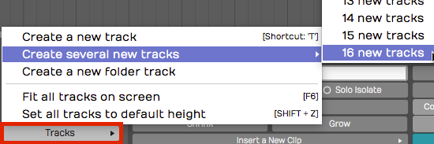

*Create Tracks from the Track Menu*

> 💡 **Tip:** As with most things in Waveform, you can undo creating
tracks with the **Undo** button (Cmd + Z / Ctrl + Z). To remove a track from
your Edit, select it and press **Delete** or **Backspace**.

## Rearranging Tracks

To rearrange the tracks, drag a track by its header and drop it in the
new position. As you drag, a glowing bar between tracks shows where it
will go. Release the mouse when the bar is in the right spot.

## Adjust the Mix

You can now adjust the levels of all the recorded tracks, or carry on
overdubbing vocals, keyboards or other instruments. As you add tracks,
reduce the level of each to avoid overloading the master level.

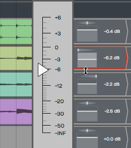

*Adjust the Mix*

> 💡 **Tip:** If you overload the master meter, reset the overload
indicators with the backslash key (**\\**).

## Moving On

Next, [Clean-up Editing](clean-up-editing.md) covers tidying up the clips
you've recorded.
