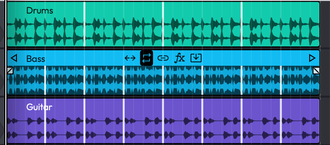
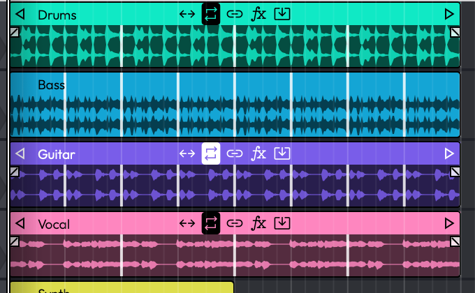
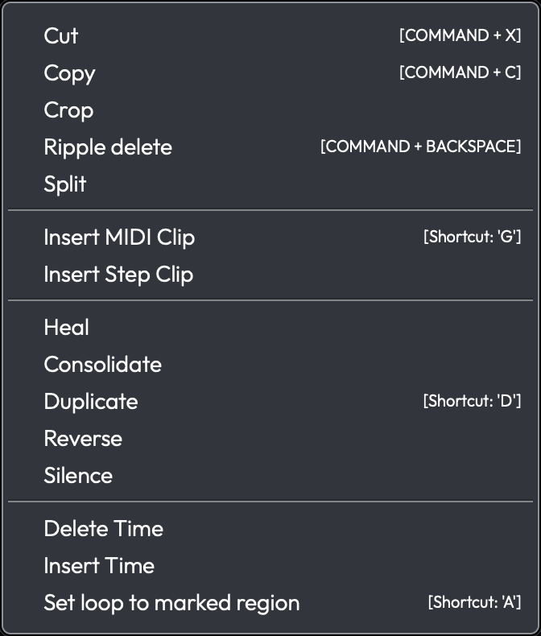
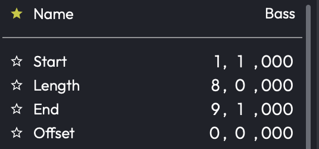
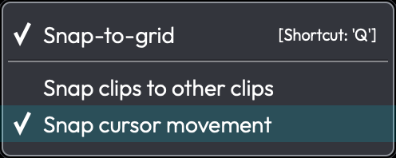
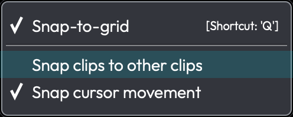
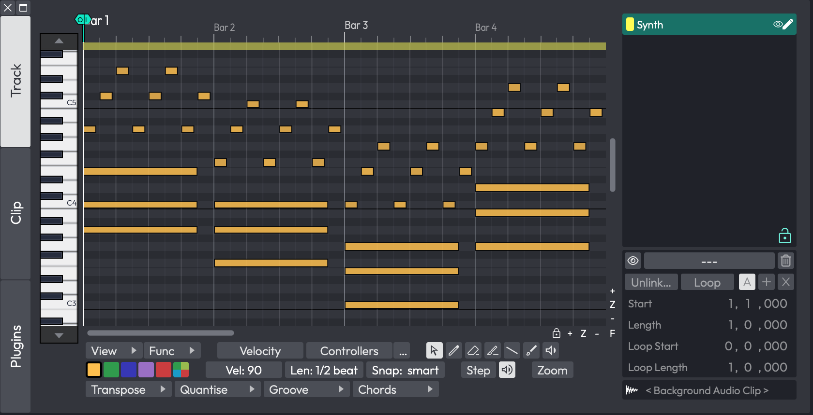

# Selecting and Snapping

This chapter covers selecting clips and groups of clips, snapping them
to the bars and beats of your song, and nudging them. The examples use
Audio clips and MIDI clips, but most of the techniques also apply to Step
clips, Edit clips and markers.

## Selecting a Clip

To select a clip, click it. The clip is highlighted and its properties
appear in the Actions panel.

*A Selected Clip*

## Auditioning a Clip

To audition a clip, double-click it. Playback starts where you
double-clicked. Click within the clip to jump to a new spot as playback
continues, and click anywhere outside the clip to stop. Moving pointers
above and below the clip show the playback position.

*Audio Clip Being Auditioned*

Auditioning solos the clip: everything else in the Edit is muted while
it plays.

## Selecting Multiple Clips

To select more than one clip, hold Cmd / Ctrl and click each clip you
want to add to the selection.

*Multiple Clips Selection*

With several clips selected, you can work on them as a group, for
example dragging, duplicating or deleting them. Clip editing is covered
in [Audio Clips and Editing Audio](audio-clips-and-editing-audio.md). To
clear a multiple selection, press Esc.

You can also make a multiple selection with the lasso tool:

*Multiple Selection with Lasso*

1.  Hold Opt / Alt until you see a plus cursor.
2.  Drag to draw a yellow box. Anything the box touches is selected.

> 💡 **Tip:** To refine a multiple selection, hold Cmd / Ctrl and click any clip you want to deselect.

## Shift Selecting Clips

Shift-select is a quick way to select a run of adjacent clips:

1.  Select the first clip.
2.  Hold Shift and click the last clip. This selects the first clip, the
    last clip and all the clips in between.

Shift-select works for clips on a single track and across several tracks.

> 💡 **Tip:** Shift-select also works for many other kinds of Waveform object, including Browser lists and tracks.

## Deselecting Clips

Press Esc at any time to deselect everything.

> 💡 **Tip:** Esc also clears selections of other objects, such as plugins and tracks.

## Working With a Marked Region

A marked region is a time range drawn across one or more tracks. By default,
dragging across an empty part of the tracks area draws one over the tracks you
drag across. If you've set the tracks area to select clips instead (see
[Mouse settings](reference-settings.md#mouse)), hold Shift + Opt / Shift + Alt
while you drag. Shift + Opt / Shift + Alt dragging in the Timeline marks every
visible track. Drag either edge of the region to resize it, and Cmd-click /
Ctrl-click a track within its time span to add or remove that track.

Right-click inside the region to open its menu. Most commands act only on the
clips that overlap the region on the tracks it covers. Delete Time and Insert
Time change the whole Edit. Launcher clips are always left alone.

*The marked region menu*

- **Cut** (Cmd + X / Ctrl + X): Copies the parts of clips inside the region to
  the clipboard and removes them, leaving a gap.
- **Copy** (Cmd + C / Ctrl + C): Copies the parts of clips inside the region to
  the clipboard.
- **Crop**: Trims each overlapping clip so only the part inside the region is
  left.
- **Ripple delete** (Cmd + Backspace / Ctrl + Backspace): Deletes everything
  inside the region on its tracks, automation included, and moves later clips
  on those tracks left to close the gap.
- **Split**: Splits the overlapping clips at both edges of the region.
- **Insert MIDI Clip** (G) and **Insert Step Clip**: Add a new clip that fills
  the region on each of its tracks. If a track is selected, the clip goes on
  the selected track instead. Only shown when you right-click a track that can
  hold MIDI.
- **Heal**: Renders the Audio clips that overlap the region on each track into
  one Audio clip, running from the start of the first to the end of the last.
- **Consolidate**: Renders the audio inside the region on each track into one
  Audio clip exactly the length of the region.
- **Duplicate** (D): Copies the parts of clips inside the region and pastes
  them straight away, in the place Paste would put them (usually the
  cursor), not directly after the region.
- **Reverse**: Reverses the part of each Audio clip inside the region, splitting
  the clip at the region's edges first.
- **Silence**: Mutes the part of each clip inside the region, splitting the clip
  at the region's edges first.
- **Delete Time**: Removes the region's time from the whole Edit (every track,
  automation, and tempo and pitch changes), so everything after it moves
  earlier.
- **Insert Time**: Inserts empty time the length of the region at its start,
  across the whole Edit, pushing everything after it later.
- **Set loop to marked region** (A): Sets the loop range to match the region.
- **Insert automation shape**: Draws a repeating Sin, Square, Triangle, Ramp
  Up or Ramp Down shape into the region on the automation curve the track is
  showing. Only shown when you right-click a track with an automation curve
  visible. See [Editing Automation](automation.md#editing-automation).

> 📝 **Note:** Heal, Consolidate and Reverse only work on Audio clips. MIDI and
Step clips in the region are skipped.

## Using Snap-to-Grid

Snap-to-grid lines clips and notes up with musical time, so you can
align them quickly and accurately.

### Enable/Disable Snap-to-Grid

To turn snap-to-grid on or off, click the **Snap** button (Q) in the
transport bar. The button is highlighted while snap-to-grid is on.
Right-click the **Snap** button to open the Snap menu, with
**Snap-to-grid**, **Snap clips to other clips** and **Snap cursor movement**.

*Snap button in the transport bar*

Pressing Q also toggles **Snap**, and so does *Snap > Snap-to-grid* in
the main menu.

> 💡 **Tip:** The shortcut Q is short for quantise, since snap-to-grid is a form of quantising. You can remap it to another key if you like.

### About Snap Resolution

The snap resolution depends on the zoom level. Zoomed right out, it
might be one bar, and the further you zoom in, the finer it gets.

*Hover Over Timeline to See Snap Resolution*

> 💡 **Tip:** To see the current snap resolution, hover the mouse pointer over the Timeline. A label appears showing, for example, **Snap resolution: Bar**, **Snap resolution: Beat**, or
**Snap resolution: 1/2 beat**.

### Snapping Clips to the Grid

As you drag a clip, it snaps to the grid increments. To see exactly
where it lands, watch the **Start** value in the Actions panel.

*The clip's Start value in the Actions panel*

> 📝 **Note:** Snap-to-grid aligns the beginning of a clip with a grid line. Snapping also applies to editing operations such as trimming.

### Snapping the Cursor to the Grid

Snapping can also affect the cursor. Turn on *Snap > Snap cursor
movement* and the cursor snaps to the grid, at the resolution set by the
zoom level.

*Snap cursor movement in the Snap menu*

To try it, zoom out until the snap resolution is "Beat", then move the
cursor around. It snaps to the nearest beat.

> 💡 **Tip:** To see exactly where the cursor is, look at the time display in the transport bar.

### Snapping Clips to Other Clips

**Snap clips to other clips** is another snap behaviour. With it off,
clips snap to the grid as normal. With *Snap > Snap clips to other clips*
turned on, clips snap to other clips, as if they were magnetically
attracted to each other. This is useful whenever you want to arrange
clips end to end, for example when editing voiceover tracks.

*Snap Clips to Other Clips Option*

> 💡 **Tip:** **Snap clips to other clips** only works while snap-to-grid is
on. To snap clips to other clips with snap-to-grid off, hold Opt / Alt
while you drag the clip. Press it after the drag has started, because
holding it as you start the drag makes a copy of the clip. With
snap-to-grid on, holding Opt / Alt or Shift during the drag does the
opposite: the clip snaps to the grid but not to other clips. Here you
hold the key while dragging a clip, unlike the Opt / Alt lasso, which starts on an empty part of a track.

### Overriding Snap-to-Grid

Hold Cmd / Ctrl while you drag to override snap-to-grid temporarily. You can then
position clips freely without turning **Snap** off.

## Nudging Clips

To move clips with the keyboard, select them and press Shift + Right
Arrow or Shift + Left Arrow. Each nudge moves the clips by one grid
increment. To nudge clips from track to track, use Shift + Up Arrow and
Shift + Down Arrow.

Nudging is handy for moving large selections of clips over, for example
to add a song section or make room for an intro.

> 📝 **Note:** Nudging works the same whether snapping is on or off: it always moves by the grid increment.

## Nudging Notes

Snapping is useful with Audio clips, and even more so with MIDI notes.
MIDI editing has its own chapter, [MIDI Editing](midi-editing.md), but
here is a preview of nudging notes.

*The Waveform MIDI Editor*

Double-click the header of a MIDI clip to open it in the MIDI editor in
the [Detail Editor](detail-editor.md). MIDI notes respect the snap resolution
just like clips: drag a note and it snaps by the current grid increment,
for example a bar. To nudge notes earlier or later by the grid increment,
hold Shift and press the Left Arrow or Right Arrow.

## Moving On

To start editing Audio clips, see
[Audio Clips and Editing Audio](audio-clips-and-editing-audio.md).
