# Step Clips

At first sight, a Step clip is a MIDI step sequencer: you click cells to
turn notes on and off. Step clips go further than that, and you can use
them to build drumbeats, synth lines and bass lines.

This tutorial is a good introduction to working with Step clips:

[Video: Explaining Step Clips](https://youtu.be/pB1GfjwHAgQ)

## Step Clips Overview

Step clips work like a special type of MIDI clip, but the notes sit on a
grid where each column is a 'step', a fixed musical increment. By
default there are 16 steps, as on many drum machines and step
sequencers, so in 4/4 there are four steps per beat. You can change
this, but it's a good starting point.

These are the key parts of a Step clip:

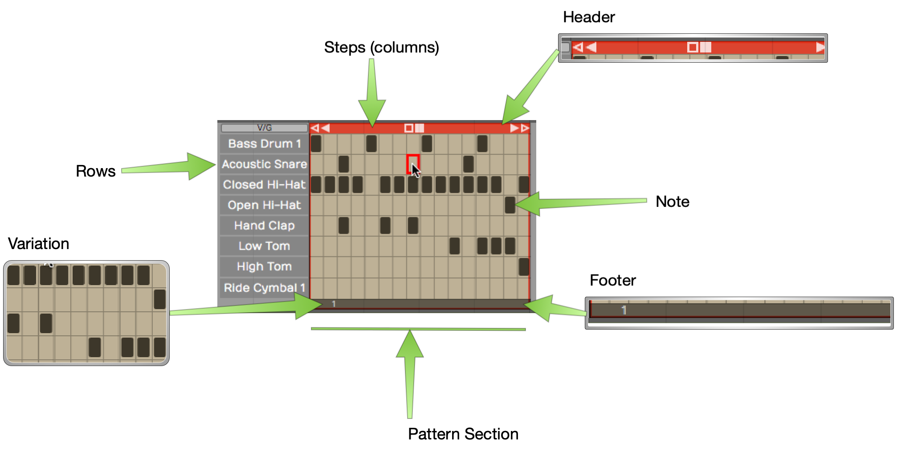

*Parts of a Step Clip*

**Step clip**: You can add, delete and copy Step clips just like MIDI
clips. They are always in loop mode, so you can drag the right trim
handle to roll out repetitions. Like MIDI clips, they need a synth
plugin to make sound.

**Header**: Click the Step clip header to select the clip and show its
settings in the Actions panel. Drag the header to move the clip earlier
or later in time, or to another track. Right-click the header for a
menu of the most used options.

**Footer**: Click the Step clip footer for a menu, and for more options
in the Actions panel. These options are for working with variations and
pattern sections.

**Variation**: A variation is a table of rows and columns (steps). It
looks like a small spreadsheet: click a cell to trigger a note at that
step, and click an active cell again to turn it off. A Step clip can
hold any number of variations.

**Step**: A step is one column of the grid that makes up a variation. A
variation is defined by how many steps it has and what each step
represents musically. By default a new variation has 16 steps with a
step length of 1/4 beat.

**Row**: Each row plays a single MIDI note. Rows belong to the whole
Step clip, so the row assignments are the same for every variation in
the clip. You can send rows within one Step clip to different MIDI
channels or virtual instruments (see
[Step Clip Row Actions](#step-clip-row-actions)).

**Note**: A note is the cell where a step and a row cross. You program
a variation by clicking notes to toggle them on or off.

**Section**: By default, a Step clip has a single pattern section, which
holds one variation. To make a longer Step clip, add more pattern
sections. Each pattern section is assigned a variation.

**Variation number**: Variations are numbered within each Step clip. The
variation number appears on the footer of each pattern section.

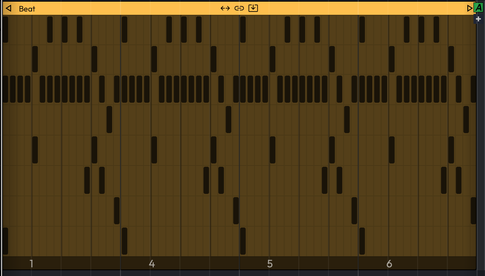

*A Step Clip with Four Pattern Sections*

> 💡 **Tip:** Think of a Step clip as a sequence of pattern sections,
each assigned to a variation. You can assign the same variation to more
than one pattern section.

> 📝 **Note:** A Step clip can contain variations that aren't assigned to
any pattern section.

## Inserting a Step Clip Into the Edit

There are several ways to put a Step clip on a track.

As with every other kind of clip, you can drag the Clip object to a
track and choose **Insert Step Clip** from the menu.

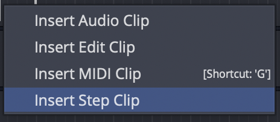

*Insert by Dragging the Clip Object*

You can also right-click the track at the point where you want the clip
and choose **Insert Step Clip** from the right-click menu.

Or select the track, place the cursor where you want the clip to start,
then right-click the track header and choose **Insert Step Clip**.

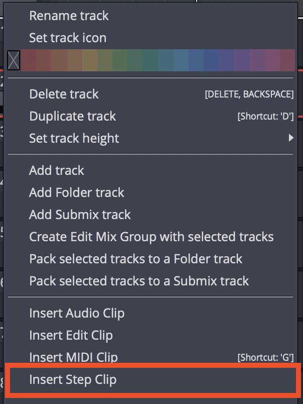

*Right-click Track Header*

From the track's actions: select the track by clicking its name, then
in the Actions panel click *Insert a New Clip > Insert Step Clip*.

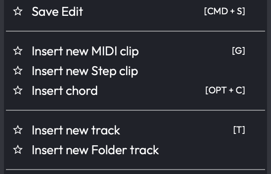

*Insert from Track Actions*

Finally, you can drag in a Step clip preset as a starting point. Step
clip presets are clip presets, so in the Search tab of the
[Browser](browser.md) choose **Clips** under **Categories**, or search
for "Step Clip".

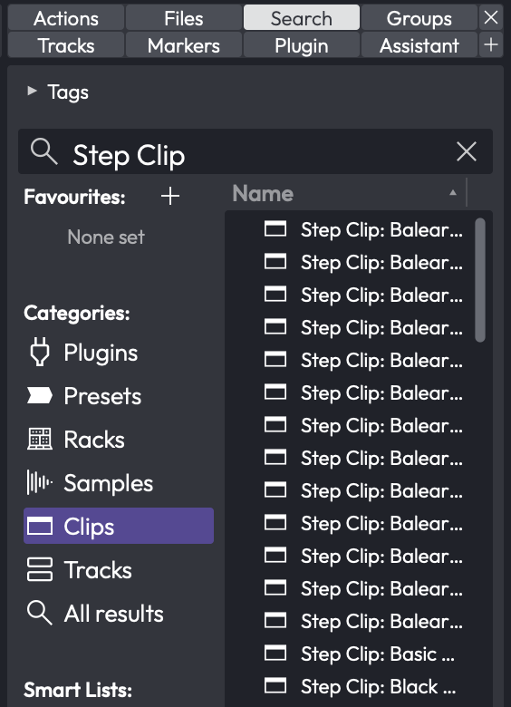

*Use a Step Clip Preset from the Browser*

Waveform comes with a wide range of Step clip presets.

## Programming a Drum Beat with a Step Clip

When you insert a new Step clip, its rows are already assigned to
General MIDI drum notes, so you can start programming beats straight
away.

> 💡 **Tip:** Use one of the Waveform drum instruments: Micro Drum Sampler
(every edition), or Drum Sampler or Multi Sampler (Waveform Pro, or with
the MIDI Producer Expansion or the Synth Pack Expansion). Add the
instrument first and load a preset drum kit, then insert a blank Step
clip. The row names will match the pad names of the preset.

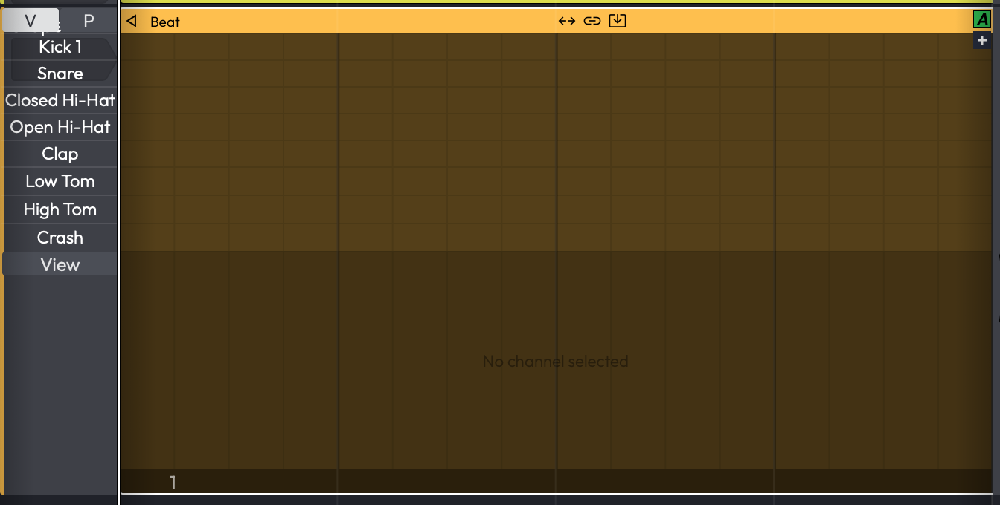

*Default Step Clip*

To program a drum beat with a Step clip:

1.  Insert a drum instrument on a track and select a preset.
2.  Insert a Step clip on the track.
3.  Set the In marker and Out marker around the Step clip and turn
    **Loop** on.
4.  Start playback, and click the note cells to turn notes on and off.

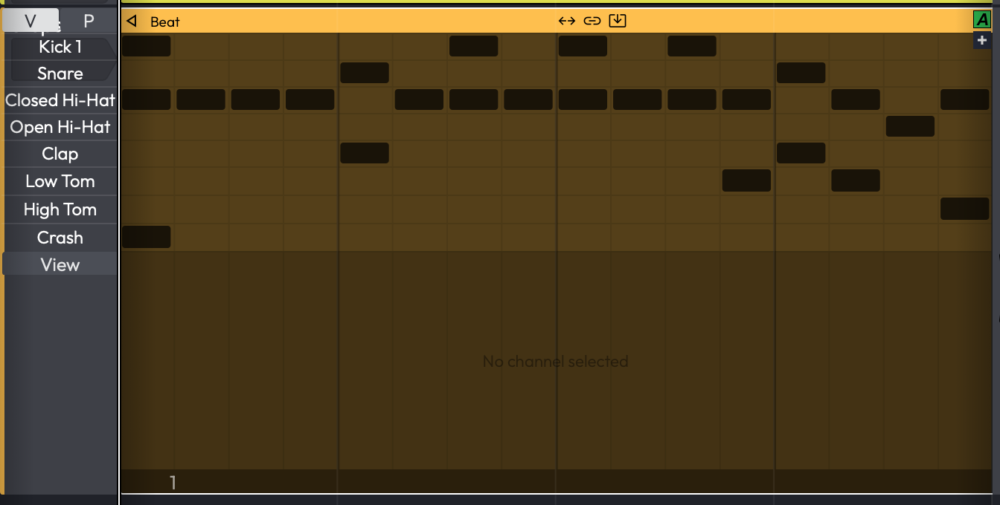

*Programming a Step Clip*

Click a cell to flip it on or off, or drag across cells to paint
several. Hold Shift while you click or drag to turn cells on, or hold
Cmd / Ctrl to turn them off. Right-click a cell for the pattern
section's menu.

Double-click a Step clip to open it in the [Detail Editor](detail-editor.md)
at the bottom of the window. If **Double-click MIDI clip header** in
*Settings > General* is set to **Expands for in-line editing**, a
double-click makes the track taller instead, so you can edit the clip in
place.

You hear each change as you toggle notes, so you can build the
variation while it plays.

**Video Clip:** This video overview shows how all of this works.

[Step Clips Overview](https://w-edstrom.wistia.com/medias/pjf2cdmm4t)

## Step Clip Actions

A Step clip has a header like those of MIDI clips and Audio clips.
Click the header to show all the clip's actions and settings in the
Actions panel. These are the most important ones for Step clips:

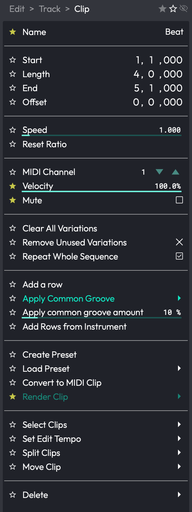

*Click the Header for Step Clip Actions*

**Name**: Give your Step clip a descriptive name. The name is used as
the basis for preset names, so it helps when you save the clip as a
preset.

**Colour**: Gives your Step clip its own colour.

**Clear All Variations**: Clears all the notes from all variations in
this Step clip.

> ⚠️ **Warning:** **Clear All Variations** clears every variation, whether
you can see it or not. If you change your mind straight away, press
**Undo** (Cmd + Z / Ctrl + Z).

**Remove Unused Variations**: A Step clip can string together a series
of pattern sections, each assigned to a variation. **Remove Unused
Variations** removes any variation that no pattern section uses.

**Add a row**: Adds a new row at the bottom of the Step clip. You can
also insert a row from the right-click menu of the Step clip header or
of a row header.

**Apply Common Groove**: Applies a groove template to every row in the
Step clip, usually to add swing. The basic swing templates are the most
common choice. You can also set the groove for each row separately (see
[Step Clip Row Properties](#step-clip-row-properties)). Older templates
are in the **Legacy groove templates** submenu, and **Edit groove
templates...** opens the groove template editor (see
[Quantising MIDI Notes](quantizing-midi-notes.md)).

**Apply common groove amount**: At the minimum, the groove template
chosen in **Apply Common Groove** has no effect. Raise it for a stronger
feel.

**Speed** and **Reset Ratio**: **Speed** stretches the patterns and
their notes by a ratio, so the clip plays faster or slower than its
steps suggest. **Reset Ratio** puts it back to the default.

**MIDI Channel**, **Velocity** and **Mute**: **MIDI Channel** sets the
MIDI channel for every row in the clip. **Velocity** scales the
velocities of all the notes the clip plays (0-100, where 100 leaves them
unchanged). **Mute** silences the clip.

**Add Rows from Instrument**: Appears when the track's instrument has
named notes, such as a loaded drum kit. It adds a row for each named
note.

**Render Clip**: Use any of the **Render Clip** options to convert a
Step clip to an Audio clip. Each option opens the Render dialog, which
puts the result on this track or in place of the clip. See
[Rendering Clips](rendering-and-stems.md#rendering-clips).

The Actions panel also has the clip operations that every kind of clip
shares: **Select Clips**, **Set Edit Tempo**, **Split Clips** and
**Move Clip**.

**Convert to MIDI Clip**: Converts the selected Step clips to MIDI
clips, so you can carry on editing in the MIDI editor's piano roll.

**Create Preset**: Saves the Step clip (its rows, variations and notes)
as a preset. You can find presets by searching in the Browser.

**Load Preset**: Shows a menu of your Step clip presets. Choose one to
apply it to the selected Step clip.

**Delete**: Deletes the selected Step clip. You can also select the
Step clip and press Delete, Backspace or Cmd + X / Ctrl + X.

> 💡 **Tip:** Like any other clip, Step clips can be copied (Cmd + C /
Ctrl + C), pasted (Cmd + V / Ctrl + V) or duplicated (D).

Right-click the Step clip header for a menu of the most used actions.

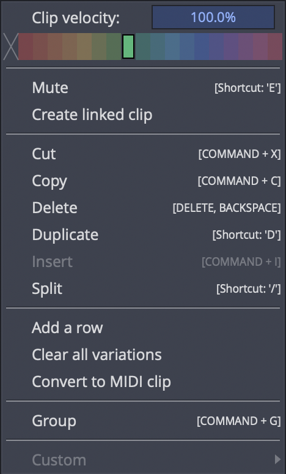

*Step Clip Header Right-click Menu*

> 📝 **Note:** A Step clip in a [clip launcher](clip-launcher.md) slot
shows launcher actions (launch quantisation, looping, follow and
trigger actions) in place of the start, length and end times. The clip
launcher needs Waveform Pro, or the Launcher Expansion.

## The Step Clip Footer

Clicking the Step clip footer selects that pattern section and its
variation. The footer shows the active variation number.

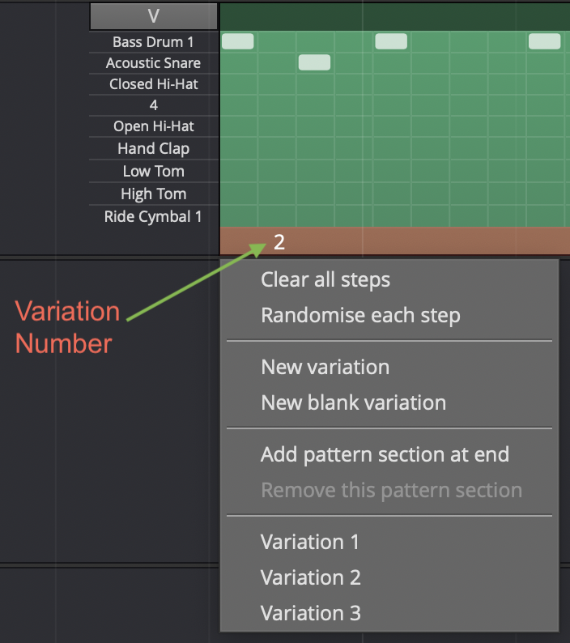

*Section Footer Right-click Menu*

If a Step clip has more than one pattern section, click a section's
footer to select it. Right-click a footer (or click it when the clip is
already selected) to open its menu. All of the actions also appear in
the Actions panel.

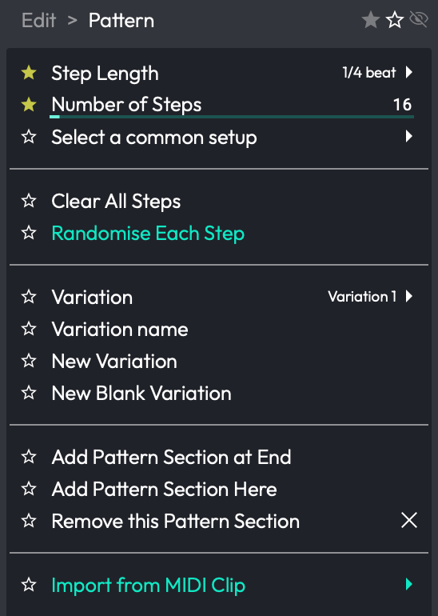

*Step Clip Footer Shows Variation & Pattern Section Options*

> 📝 **Note:** When a footer is selected, the title line of the Actions
panel shows the pattern section and variation numbers, for example
"Section 1 (Variation 8)."

## Variation Options

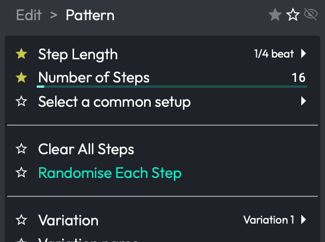

*Variation Options in the Actions Panel*

**Variation**: Sets which variation this pattern section uses. It shows
the current one, for example "Variation 2". You can also set this from
the footer's right-click menu.

**Variation name**: An optional name for this variation. The name
appears in the variation menus.

**Step Length**: By default, the step length is a quarter of a beat, so
each beat is divided into four steps, giving a 16-step sequencer.
Changing it affects this variation only, not the whole Step clip.

**Number of Steps**: The number of steps in the variation. The default
is 16. With a step length of a quarter beat and **Number of Steps** set
to 16, each beat in 4/4 is divided into four steps and the variation is
one bar long. This is the most common step sequencer setup.

**Select a common setup**: Offers preset combinations of **Step
Length** and **Number of Steps** for one-bar or two-bar variations.

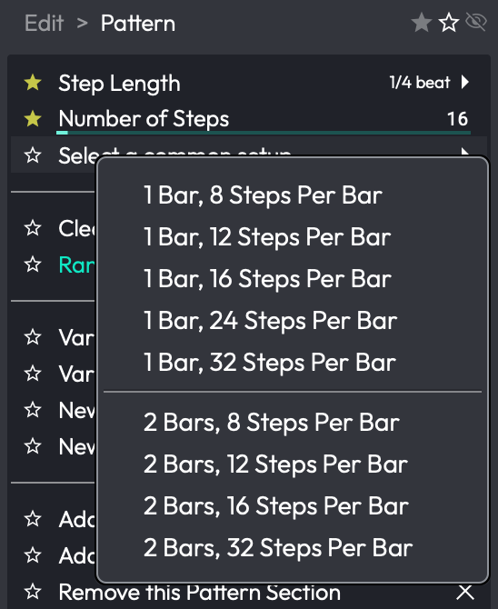

*Select a Common Setup in the Actions Panel*

## Step Clip Variation Actions

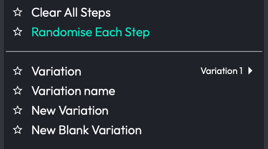

*Variation Actions*

**Clear All Steps**: Turns off every note in the variation, so you can
start again.

**Randomise Each Step**: Randomly turns notes on and off at each step of
the variation, which can be a quick source of ideas.

**New Variation**: Copies the current variation to a new one. The
variation number is assigned automatically.

**New Blank Variation**: Creates a new blank variation and makes it
active. The variation number is assigned automatically.

**Video Clip:** [Step Clips Randomise Each
Step](https://w-edstrom.wistia.com/medias/ztgsqpw2y5)

> 📝 **Note:** You can also randomise a single row of notes (see
[Step Clip Row Actions](#step-clip-row-actions)).

## Step Clip Pattern Section Actions

These options are in the Actions panel when a Step clip footer is
selected. Some are also in the footer's right-click menu.

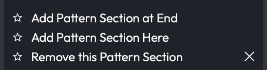

*Step Clip Section Actions*

**Add Pattern Section Here**: Inserts a new pattern section with a copy
of the variation, and pushes any later pattern sections to the right.

**Add Pattern Section at End**: Adds a new pattern section at the end,
with a copy of the variation.

> 💡 **Tip:** You choose which variation each pattern section uses.
Click the footer and select a variation.

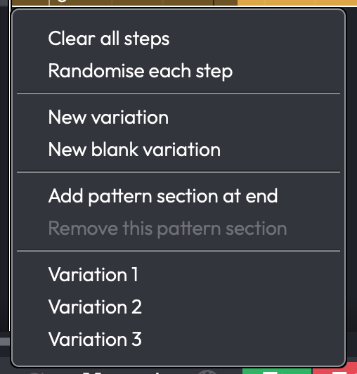

*Choosing a Variation for a Pattern Section*

**Remove this Pattern Section**: Select a pattern section by clicking
its footer, then choose **Remove this Pattern Section** from the menu or
the Actions panel. This doesn't remove any variations: they're still
there and can be assigned to other pattern sections.

## Step Clip Row Properties

Each row of a Step clip has a name, and a set of actions that change the
notes on that row across all the pattern sections. You can send
individual rows to separate MIDI channels, or route them to different
virtual instruments with **Set Destination** (see
[Step Clip Row Actions](#step-clip-row-actions)).

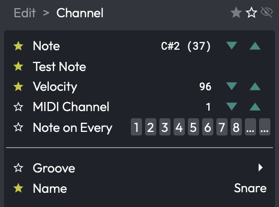

*Step Clip Row Properties*

These are the properties of a Step clip row:

**Note**: Sets the row's MIDI note. If you know the note value, enter it
here. You can also drag the yellow arrow along the virtual keyboard in
the Actions panel to the note you want, and hear each note as you drag.

**Velocity**: Sets the maximum MIDI velocity for the row. In the Step
clip's [velocity and gate editor](#velocity-and-gate-editor), you can
set each note to a percentage of this value. The default **Velocity** is
96.

**Test Note**: Click **Test Note** to hear the row's note on the track's
instrument. Clicking the row's name in the clip does the same.

**MIDI Channel**: Sets the output MIDI channel. With a multi-timbral
virtual instrument, this chooses which of its instruments the row
plays.

**Note on Every**: **Note on Every** is followed by a series of buttons
that complete the sentence "Note on every (blank) steps." For example,
click **2** for "Note on every 2 steps."

**Groove**: You can set the groove for a whole Step clip with **Apply
Common Groove** (see [Step Clip Actions](#step-clip-actions)), or for a
single row with **Groove**. Groove is actually stored per row: applying
a common groove sets every row to the same template, and that template
then shows here.

**Groove Amount**: Appears when the row's groove template supports it.
At 0 the groove has no effect; raise it for a stronger feel.

> 📝 **Note:** Groove is most often used to add swing. Choose **Basic 8th
Swing** or **Basic 16th Swing** to get started.

**Video Clip:** [Step Clip
Groove](https://w-edstrom.wistia.com/medias/ad5zrq9oux)

**Name**: The row's name. Row names appear along the left of a Step clip
when you hover over it. To rename a row, select it and edit **Name** in
the Actions panel, or right-click the row and choose **Rename row**.
Rows are often named after drum sounds such as "Kick" or "Snare".

## Step Clip Row Actions

These actions are in the Actions panel when a Step clip row is selected.
The main ones are also in the row header's right-click menu.

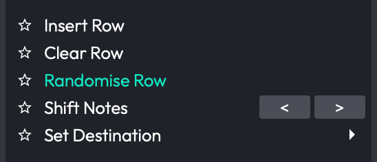

*Step Clip Row Actions*

Right-click a row's name in the clip for a menu with **Clear row**,
**Randomize row**, **Rename row**, **Note on every**, **Shift left**,
**Shift right**, **Delete row** and **Insert row**. Each works like the
matching action below, across all the pattern sections.

In Waveform Pro, or with the MIDI Producer Expansion, you can also drag
a row's name up or down to reorder the rows PRO.

**Insert Row**: Select a row and click **Insert Row** to add a new row
straight after it. Rows are numbered from the top down, so the rows
below are renumbered.

**Clear Row**: Erases all the notes on that row.

**Randomise Row**: Randomly turns each step in the row on or off, in the
variations of all the pattern sections.

**Shift Notes**: The left and right arrow buttons after **Shift Notes**
move the row's notes one step left or right per click.

**Set Destination**: Routes the selected row to a different virtual
instrument (its tooltip reads "Automatically route this channel to a
plugin"). For example, your bass drum could be played by EZdrummer
while your hi-hat is played by Drum Sampler, and a hand clap by another
instrument again.

> 📝 **Note:** To make this work, Waveform wraps the virtual instruments
in a plugin rack. It handles the details for you when you apply **Set
Destination**.

**Video Clip:** [Route Step Clips to Different Synths
Video](https://w-edstrom.wistia.com/medias/vncjr2ilh9)

## Deleting a Row

Select any row in your Step clip and click **Delete Row** to remove the
whole row. The rows below are renumbered to keep them in order.

*Delete Row in the Actions Panel*

> 💡 **Tip:** If you aren't using all eight default rows, use **Delete
Row** to remove the spare ones and save space on screen. You can add a
row again at any time with **Insert Row**.

## Velocity and Gate Editor

The velocity and gate editor adds dynamics and feel to your Step clips.
Click the **V** button in the upper left corner of any Step clip and the
editor appears below the patterns, showing the velocity of each note on
the selected row.

In Waveform Pro, or with the MIDI Producer Expansion, two more buttons
sit next to it: **P** PRO toggles the
[probability editor](#probability-editor), and **View**
PRO (below the row names) chooses which rows to
show.

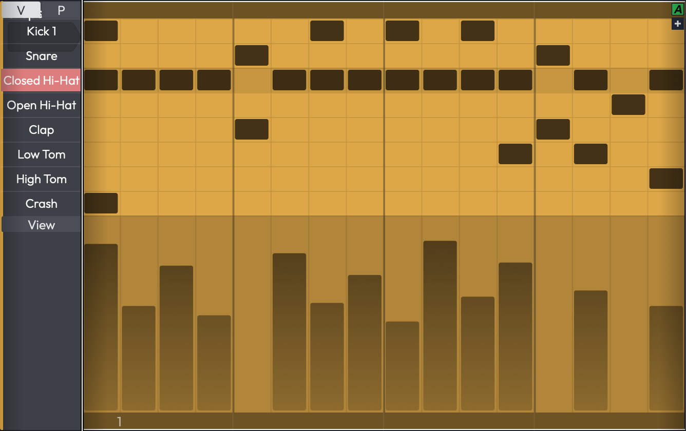

*Step Clip Velocity Gate Editor*

To use it:

1.  Click **V** at the upper corner of the Step clip to toggle the
    editor. If you don't see it, make the track a little taller until it
    appears.
2.  Select one of the rows in your Step clip by clicking its name. The
    editor shows the velocity of each note as a bar graph. Click or drag
    within a velocity bar to adjust its percentage.

    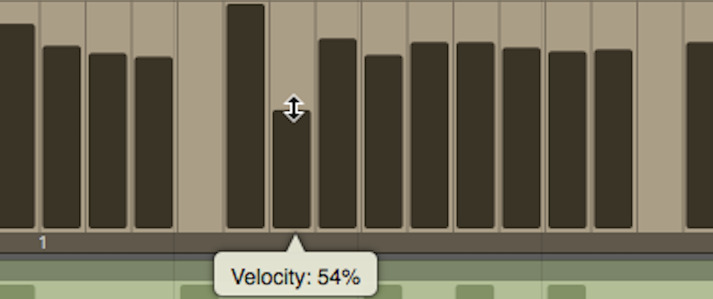

    *Adjusting a Velocity Bar in the Velocity and Gate Editor*

    > 📝 **Note:** The bar height is a percentage of the row's
    **Velocity** in the Actions panel. It starts at 100%. To make the
    notes hit harder, raise the row's **Velocity** and then adjust the
    percentages to taste.

3.  Drag across the bars to paint velocities for a whole run of notes.
    This helps on busy rows such as hi-hats or snares. Hold Shift while
    you drag to change only the velocity, so you don't catch a bar's
    gate edge by accident.

    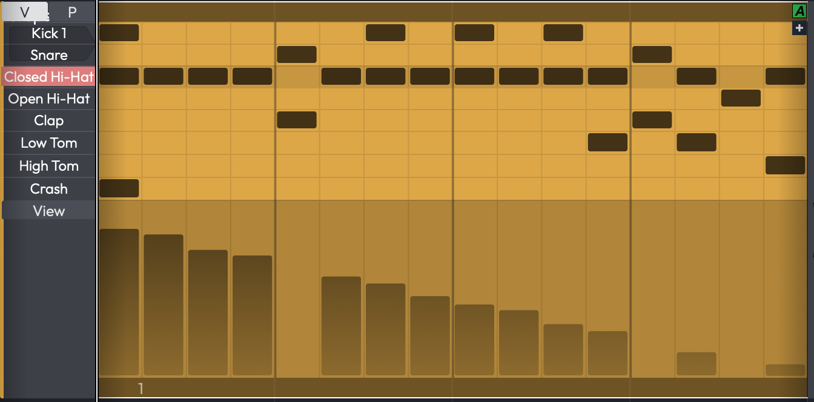

    *Adjusting a Series of Velocities with Shift Drag*

4.  Drag the right side of any velocity bar to narrow it and shorten
    the note's gate. Hold Opt / Alt to change only the gate. Use this
    for gated, glitchy notes, or to tighten up the hits.

    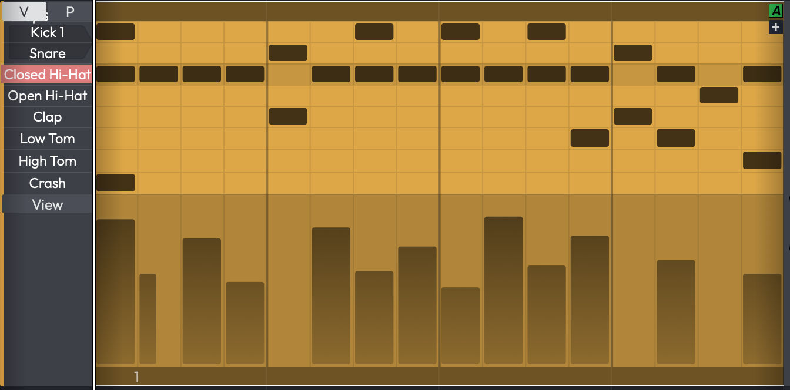

    *Adjusting Note Gating in the Velocity and Gate Editor*

Hold Cmd / Ctrl while you click or drag to set a velocity on a step
that has no note yet, which turns that note on.

**Video Clip:** [Step Clip
Velocity/Gate](https://w-edstrom.wistia.com/medias/mz2dg3v98s)

## Probability Editor PRO { #probability-editor }

> 📝 **Edition:** Waveform Pro, or with the MIDI Producer Expansion.

The probability editor sets the chance that each note plays, so a
pattern can vary every time it loops.

1.  Click **P** in the upper left corner of the Step clip. It replaces
    the velocity and gate editor below the patterns.
2.  Select a row by clicking its name.
3.  Click or drag the bars to set each note's chance of playing. A
    bubble shows the value, for example "Probability: 75%".

Hold Cmd / Ctrl while you click or drag to set a probability on a
step that has no note yet, which turns that note on.

### Choosing Which Rows to Show

Click **View** below the row names to choose which rows the clip shows:
**Show all notes**, **Show notes in key**, **Show notes in use** or
**Show named notes**.

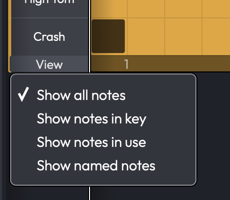

*The View Menu*

## Looping Step Clips

Step clips are always in loop mode. Drag the right trim handle at any
time to loop the clip over part or all of your song. MIDI clips and
Audio clips, by contrast, have a loop mode that you can switch on to
roll out repetitions with the right trim handle.

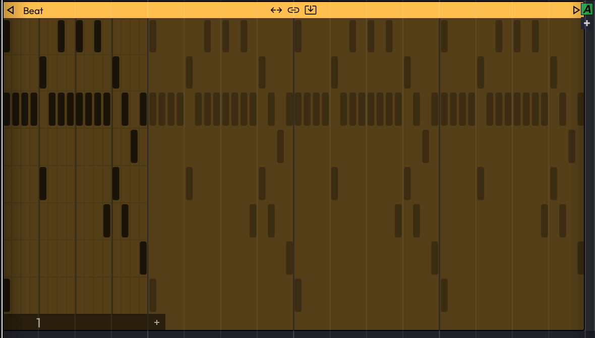

*Looping a Step Clip*

If your Step clip loops only the last pattern section, enable **Repeat
Whole Sequence** in the Actions panel.

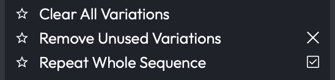

*Enable Repeat Whole Sequence*

## Convert a Step Clip to a MIDI Clip

For more detailed editing, convert your Step clip to a MIDI clip and use
the MIDI editor. Right-click the Step clip header and choose **Convert
to MIDI clip**. A MIDI clip replaces the Step clip.

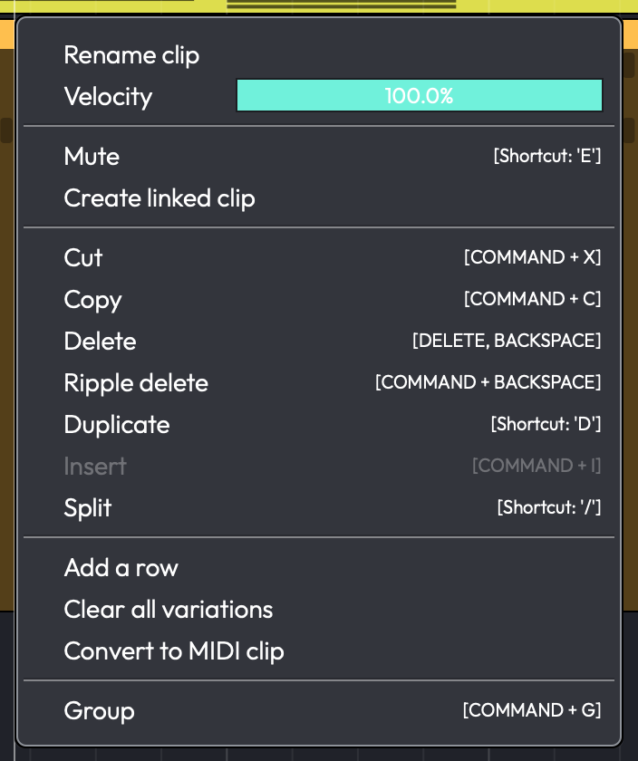

*Convert a Step Clip to a MIDI Clip*

To go the other way, select a MIDI clip and choose **Convert to Step
Clip** in the Actions panel (or **Convert to Step clip** in its
right-click menu), then pick the step size from the menu (for example
**Quantise to 1/4 beat**). This isn't offered for clips in the clip launcher.

## Step Clip Presets

You can save your Step clips as presets to build a library of sequences
for later productions. A preset also works as a template that holds
your usual row assignments and names.

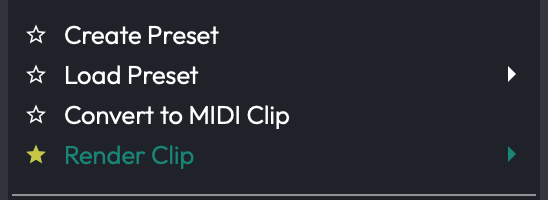

*Create Preset in the Actions Panel*

To save a preset, select the Step clip by clicking its header, then
click **Create Preset** in the Actions panel. This saves the whole clip:
its rows, variations and notes. The preset is named "Step Clip: "
followed by the clip name, and is tagged "Step Clips". You can change
the name and tags in the dialog.

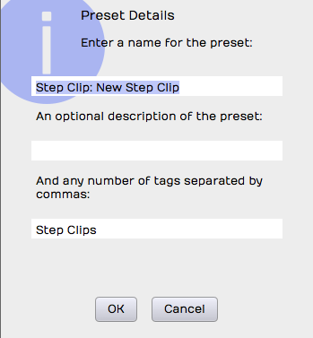

*Preset Details Dialog Box for a Step Clip*

To use a preset later, select a Step clip and click **Load Preset**,
then choose the preset from the menu. You can also find it in the
Search tab of the [Browser](browser.md) under *Categories > Clips*, or
search for "Step Clip", and drag it onto a track.

## Moving On

For detailed note editing, see [MIDI Editing](midi-editing.md). To have
Waveform generate MIDI patterns for you, see [Pattern Generator](pattern-generator.md).

**Video Clips:** This tutorial series covers Step clips in more depth:

[Step Clips Overview](https://w-edstrom.wistia.com/medias/pjf2cdmm4t)

[Step Clips
Velocity/Gate](https://w-edstrom.wistia.com/medias/mz2dg3v98s)

[Step Clips Randomise Each
Step](https://w-edstrom.wistia.com/medias/ztgsqpw2y5)

[Step Clips Groove](https://w-edstrom.wistia.com/medias/ad5zrq9oux)

[Step Clips Route Channels to Different
Synths](https://w-edstrom.wistia.com/medias/vncjr2ilh9)
