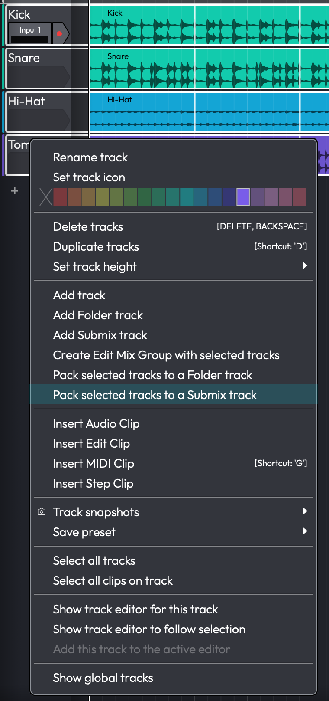
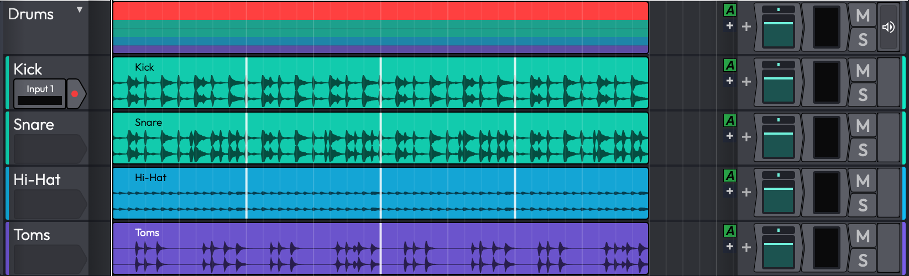
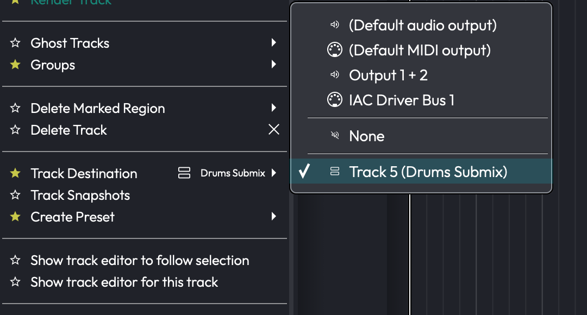
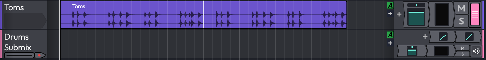

# Submix Tracks

In professional mixing, it's common to submix drums to a stereo bus to
add compression, EQ, and limiting before mixing them with the other
tracks. Vocals, guitars and other instruments are often submixed too. A
Submix track looks like a Folder track, but audio passes through it, so
you can process the submix with plugins.

You can also use an ordinary track as a submix, as described in
[Creating an Old School Submix Track](#creating-an-old-school-submix-track).

## Creating a Submix Track

To create a Submix track:

1.  Select all the tracks you want to include.

    

    *Creating a Submix Track*

2.  Right-click any of the tracks and choose **Pack selected tracks to a
    Submix track**. The same action is also available in the Actions
    panel as **Create Submix Containing**.

*A Submix Track*

The result looks much like a Folder track, but the audio passes through
the Submix track. You can use its **Volume & Pan** plugin and add any
other plugins you want.

## Working with Submix Tracks

### Adding Tracks

To add a track to a Submix, drag it onto the Submix track. You can also
drag tracks up or down within the Submix track to reorder them. Both
work the same way as for Folder tracks.

### Removing Tracks

To remove a track from a Submix, drag it back out.

> 💡 **Tip:** When dragging tracks, grab them by the track name.

### Opening and Closing a Submix

As with a Folder track, you open and close a Submix with the triangular
control at the far left of its header.

### Adding Effects

You can add any built-in or third-party effect (except the Waveform
Freeze Point) to a Submix track. Drag effects to its mixer, as for any
other track.

### Muting

**Mute** mutes everything within the Submix track.

### Soloing

Soloing a Submix solos everything inside it and mutes the tracks
outside it.

## Creating an Old School Submix Track

In older versions of Waveform, you set up a submix with an ordinary
track. You may come across older projects that use this method, so this
section shows how it works.

1.  Create a track in the normal way.

    

    *Creating an Old School Submix Track*

2.  Give the track a suitable name. This example uses *Drums Submix*.
3.  Select all the tracks you want to route to the submix.
4.  In the Actions panel, click **Track Destination**. Select the *Drums
    Submix* track. This routes the output of each selected track to the
    *Drums Submix* track.

*Set the Track Destination on the Source Tracks*

You can now use the **Volume & Pan** control on the *Drums Submix* track
to set the volume of all the tracks you routed to it, and add any
plugins you want. This example uses the built-in Compressor and
Limiter, but any plugin works here, including third-party ones.

*Submix with a Compressor and Limiter*

## Moving On

To render each submix to its own file, set **Render** to **Submixes** in
the Render dialog's **Advanced mode** PRO, which
is in Waveform Pro only. See
[Rendering and Stems](rendering-and-stems.md#simple-and-advanced-modes).
