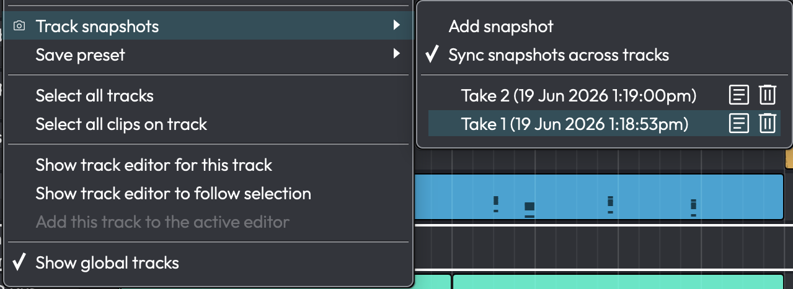

# Track Snapshots PRO { #track-snapshots }

> 📝 **Edition:** Waveform Pro, or with the Recording Engineer Expansion. In other editions the
> **Track snapshots** submenu shows only a greyed-out *"Feature unavailable"* line, and the Actions panel
> has no **Track Snapshots** button.

A Track Snapshot saves the current arrangement of clips on a single audio track, so you can try out
a different arrangement and then recall the saved one. It's an A/B tool for *arrangement* work:
lay down a verse one way, snapshot it, rearrange the clips, and switch between the versions until
you're happy.

> 📝 **Note:** A snapshot captures the track's clips only: their positions, lengths, and clip-level
> settings. It doesn't store plugins, fader, pan, mute/solo, sends, or automation. Recalling a
> snapshot changes which clips sit on the track; it leaves the channel strip and plugins untouched.

*The Track snapshots menu*

## Opening the Snapshots Menu

Track Snapshots are available on audio tracks only. You won't see them on Folder, Submix,
Tempo, or Chord tracks. There are two ways in:

- Right-click the track and choose **Track snapshots** (camera icon) to open the submenu.
- Select the track and click **Track Snapshots** in the Actions panel.

You can also assign keyboard shortcuts to the commands **"Show track snapshots menu"** and
**"Add track snapshot"** in *Settings > Keyboard Shortcuts*. Neither has a default shortcut.

## Taking a Snapshot

Choose **Add snapshot** from the menu. A dialog titled *"New Snapshot Name"* appears with a default
name. Type a name and confirm to add the snapshot to the top of the list. Each snapshot is stamped with
the real-world date and time it was taken, shown in brackets beside its name so you can tell versions
apart at a glance.

There is no limit on the number of snapshots a track can hold, and they are saved inside the Edit, so
they travel with it.

## Recalling, Renaming, and Deleting

The menu lists every snapshot on the track, newest first. If there are none, it shows a greyed
*"No snapshots created"* line.

| Action | How |
|---|---|
| **Recall** a snapshot | Click its row in the list. The track's current clips are removed and the stored clips are reinstated. |
| **Rename** a snapshot | Click the document icon on the row (*"Rename snapshot"*). |
| **Delete** a snapshot | Click the trash icon on the row (*"Delete snapshot"*). |

> ⚠️ **Warning:** Recalling a snapshot replaces all the clips currently on the track. There is no
> confirmation prompt, so anything you haven't snapshotted is swapped out. If you change your mind,
> use the Edit's normal **Undo** (Cmd + Z / Ctrl + Z).

> 📝 **Note:** Deleting a snapshot happens immediately, with no confirmation.

## Syncing Snapshots Across Tracks

At the top of the menu is **Sync snapshots across tracks**, a toggle that is on by default. This is a
global preference, so it applies to every Edit, not just the current one.

- **On**: adding, recalling, renaming, or deleting a snapshot acts on every track that shares that
  snapshot's timestamp, and on any tracks linked through an enabled Edit Mix Group. This lets you
  snapshot and recall a whole arrangement (several tracks at once) as a single operation.
- **Off**: every snapshot operation affects only the one track you clicked on.

> 💡 **Tip:** Use **Sync snapshots across tracks** to A/B a multi-track section, for example all of
> your drum tracks together. Turn it off to try out changes on a single track without disturbing the
> others.

For more on grouping tracks so that operations apply across them, see the
[Edit Mix Groups](edit-mix-groups.md) chapter.
