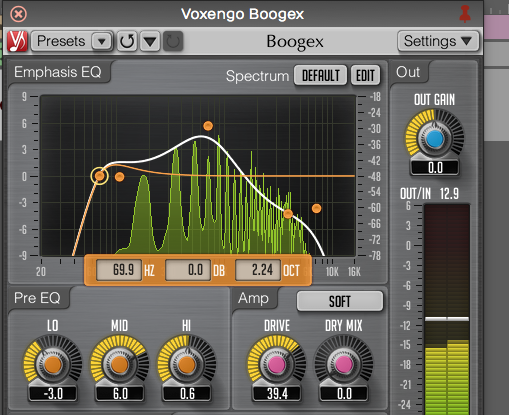
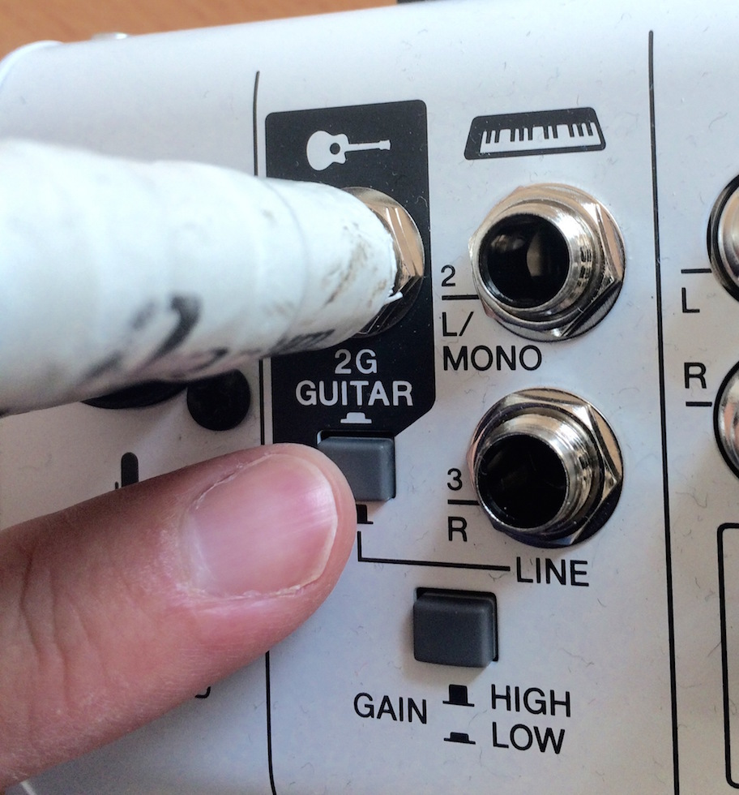
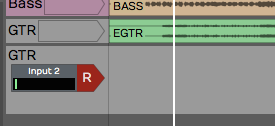
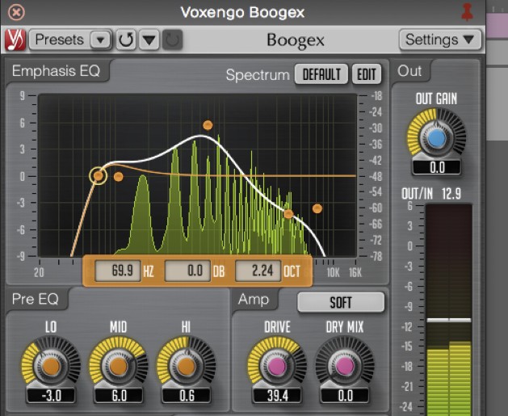
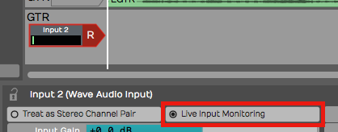
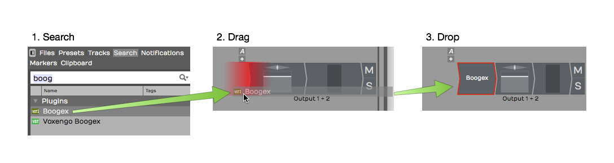
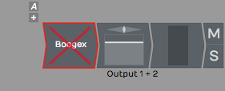
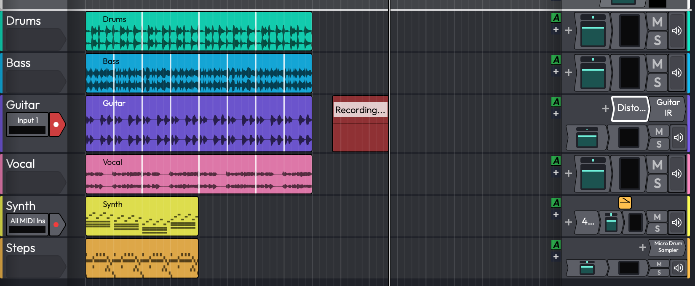
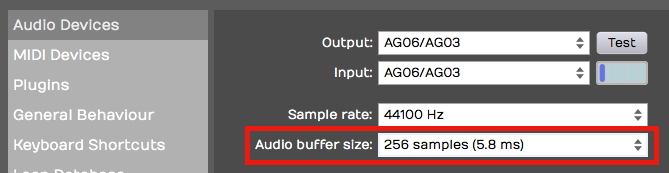
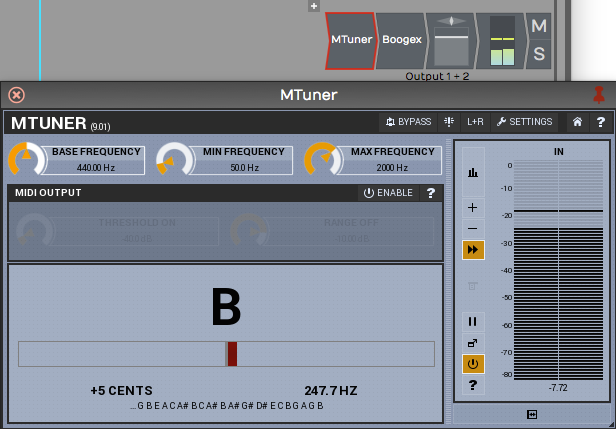

# Using an Amp Simulator Plugin

This chapter shows how to record direct electric guitar through an amp
simulator plugin. Waveform doesn't include a full amp simulator, but you
can build a basic chain from the built-in Distortion plugin followed by
Guitar IR for the cabinet (Guitar IR needs Waveform Pro or the Recording
Engineer Expansion; see [Built-in Effects Plugins](built-in-effects-plugins.md)).
Most third-party amp simulator plugins work too. If you don't have one,
Voxengo's free Boogex plugin is used as the example in this chapter. You
can download it from [Voxengo.com](https://www.voxengo.com/product/boogex/).

*Free Boogex Amp Simulator from Voxengo*

## Setting Up the Track

1.  Connect your guitar to the high impedance input on your audio
    interface as described in [Audio Device Setup](audio-device-setup.md).
    If your interface doesn't have a guitar input, use a suitable preamp.

*Connect Your Guitar to your Interface*

2.  Create a new track, select the input, and arm it for recording.

*Select the Input and Arm It*

3.  Turn direct monitoring on your audio interface all the way down, or
    disable it. You need to hear all of your guitar signal through
    Waveform.

*Turn off Any Input Monitoring on Your Interface*

4.  Right-click the input and choose *Live Input Monitoring > On* (or
    select the input and set **Input Monitoring Mode** to On in the
    Actions panel). You should now hear your dry, unprocessed guitar
    signal.

*Turn on Live Input Monitoring*

5.  Open the Search tab of the Browser and type the first few
    characters of your amp simulator plugin's name. Drag the plugin to
    the track in the inline mixer.

*Drag the Amp Sim Plugin to the Mixer*

6.  If the plugin's window didn't open, click it (or
    double-click it, if you changed **Open plugin windows by** in
    *Settings > General*). With Live Input Monitoring on, you should
    hear the plugin when you play. Select a preset and it should sound
    like you're playing through whatever rig your plugin simulates.

> 💡 **Tip:** To bypass the plugin, click it to select it and press
**F**, which enables or disables any selected plugins. You can also use
the **Enabled** row in the Actions panel.

*Amp Sim Plugin Shown Disabled*

## Recording with the Amp Sim

At this point, recording works the same as in [Recording Audio](recording-audio.md).

1.  Record-enable the track and put the cursor at the beginning.
2.  Click **Record** in the transport bar. To loop record, turn on
    **Loop** first, so you can record several takes in quick succession.
3.  Tweak the sound as much as you like after you've recorded the part.

*Recording with the Amp Sim*

Recording this way lets you change the sound after the fact, and use
guitar rigs you don't own, without disturbing the neighbours.

It also helps when you edit your guitar tracks. Edits made to the dry
signal, before the amp and distortion, sound more natural and are much
less noticeable than edits to a fully processed guitar part.

## Guitar & Impedance

Guitars connect to your audio interface through a quarter-inch,
unbalanced, high impedance connection. You don't need to understand
what that means electrically, but you get a better tone and feel from a
proper high impedance input. A standard input loads guitar pickups down,
and you lose articulation and punch.

On most audio interfaces, the first one or two channels have guitar
inputs, often with a switch or button that enables high impedance mode
for a guitar or bass. Your guitar might work through a normal low
impedance input, but the high impedance input, with that mode engaged,
gives you better picking dynamics and tone.

## Managing Latency

Latency matters when you play through an amp simulator. If the **Audio
buffer size** is too high, there's a long delay between playing a note
and hearing it. If it's too low, you might get pops and clicks when the
computer doesn't have enough CPU power for that latency. The aim is a
setting that feels responsive but still sounds clean.

To set the **Audio buffer size**, which determines the latency:

1.  Open *Settings > Audio Devices*.
2.  Locate the **Audio buffer size** setting. The value shows a number of
    samples followed by a calculated latency delay.
3.  Enter an **Audio buffer size** value. Values around 256 or lower
    tend to work well, depending on what else is going on in the Edit.

*The Audio buffer size setting on the Audio Devices page*

## Speed of Sound Through Air

In this example, a buffer size of 256 samples gives 5.8 ms of latency:
when you play a note on your guitar, you hear it about 5.8 ms later.

Sound travels through air at about 1 ms per foot (1 ms per 0.3 metres),
so a 5.8 ms delay is like playing your guitar amp from 5.8 feet
(1.8 metres) away. Add the distance to your monitor speakers as well: if
they're two or three feet away, it's like having your amplifier nine
feet away. Most guitar players can cope with that, as it's about how far
you'd stand from your amp on stage. Much more than that and you hear a
noticeable lag, which affects the feel and impact of your playing.

At a buffer size of 1024 samples, the delay is 23 ms. That feels like
playing with your amplifier 23 feet (7 metres) from your ears, which is
hard to work with.

Setting the buffer size as low as it will go can cause problems of its
own. With a lot of other plugins and virtual instruments running, a very
low buffer can make playback stop or break up.

> 📝 **Note:** Set the buffer size as low as you can to reduce latency,
while keeping it high enough for clean, solid playback. When you're
mixing rather than recording, a larger buffer such as 1024 is fine.

## Dialling in the Guitar Tone

Use the controls on the amp simulator to dial in your guitar tone.
Flip through the presets, or start with one and tweak the controls until
you like the sound. Recording this way means you don't have to commit to
the sound yet, so dial in something inspiring enough to get a good
performance, and come back to the amp settings later.

> 💡 **Tip:** If your amp sim has no cabinet of its own (or you've
switched it off), put **Guitar IR** PRO after it
on the track and load a cabinet impulse response there. **Dual Guitar
IR** PRO blends two responses, such as two mic
positions. Both need Waveform Pro or the Recording Engineer Expansion; see
[Guitar IR](built-in-effects-plugins.md#guitar-ir).

## Using a Tuner Plugin

When you record a guitar or bass direct, it helps to add a tuner
plugin before the amp sim. Waveform doesn't include a tuner, but you can
drop any tuner plugin onto the track in the inline mixer.

> 💡 **Tip:** If you don't have a tuner plugin, you can download one as
part of the MFreeFXBundle from [Melda
Production](https://www.meldaproduction.com/MFreeFXBundle).

*Tuning with the MTuner Plugin*

To set up a tuner plugin:

1.  Open the Search tab of the Browser. Select **Plugins** in the search
    options dropdown, then type the first few characters of your tuner
    plugin's name. The plugin appears in the search list.
2.  Drag the tuner into the plugins area of the track. Its window
    usually opens as soon as you drop it. If it doesn't, click the
    plugin to open it.
3.  Play a note on your guitar. If the tuner doesn't respond, arm the
    track for recording and set **Live Input Monitoring** to On. Both
    are needed for the signal to flow through the track to the inline
    mixer and the tuner plugin.

When you've finished tuning, close the tuner's window. The plugin stays
on the track, so you can click it to open the window again.

## Moving On

You can also mic up your guitar amplifier and record it as described in
[Recording Audio](recording-audio.md). If you split your guitar signal
and record the direct signal alongside the miked amp, you can blend the
amp sim with the real amp when mixing.
