# Using Markers

Waveform has four kinds of marker:

- **In marker and Out marker**: together these define the marked region,
  the range for looped playback and loop recording. See [In Marker and
  Out Marker](#in-marker-and-out-marker).
- **Bars & Beats markers** (B&B markers): clips on the Marker track that
  name song sections and give you quick navigation. See [The Marker
  Track](#the-marker-track).
- **Timecode markers** (TC markers): Marker track clips fixed to a time
  offset, unaffected by tempo changes. See [The Marker
  Track](#the-marker-track).

## In Marker and Out Marker

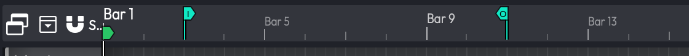

*In Marker and Out Marker*

Drag the I and O flags along the Timeline to position the In marker
and Out marker. Together they set the range that playback loops over
when the **Loop** button in the transport bar is on. They also define the
"marked region" that many editing actions work on.

> 📝 **Note:** In Waveform, "marked region" means the part of an Edit
between the In marker and the Out marker, which is also the loop range.
If you draw a marked region across tracks instead (see [Working With a
Marked Region](selecting-and-snapping.md#working-with-a-marked-region)),
editing actions use that region until you clear it.

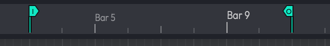

*The In Marker and Out Marker*

Press **I** to move the In marker to the cursor position, and **O** to move the
Out marker there.

You can also "draw" the range between the In marker and Out marker:
double-click the Timeline and drag right. The double-click places the
In marker at the starting point, and the Out marker follows as you drag,
setting the out point when you release the mouse button.

> 💡 **Tip:** To set the marked region over a selection of clips, select
them and press **A**. This also works for Marker clips, so it's a quick
way to set the In marker and Out marker over a song section.

## Navigate Using the In and Out Markers

The square bracket keys jump to the In and Out markers. Press
**Shift + [** to move the cursor to the In marker, and **Shift + ]** to move it
to the Out marker. On their own,
**[** and **]** jump to the previous and next marker (see [Navigating by
Markers](#navigating-by-markers)).

## Zooming to the In and Out Markers

When you have a marked region set, you can zoom in to it: right-click
the Timeline and select **Zoom to fit marked region**, or press **F7**.

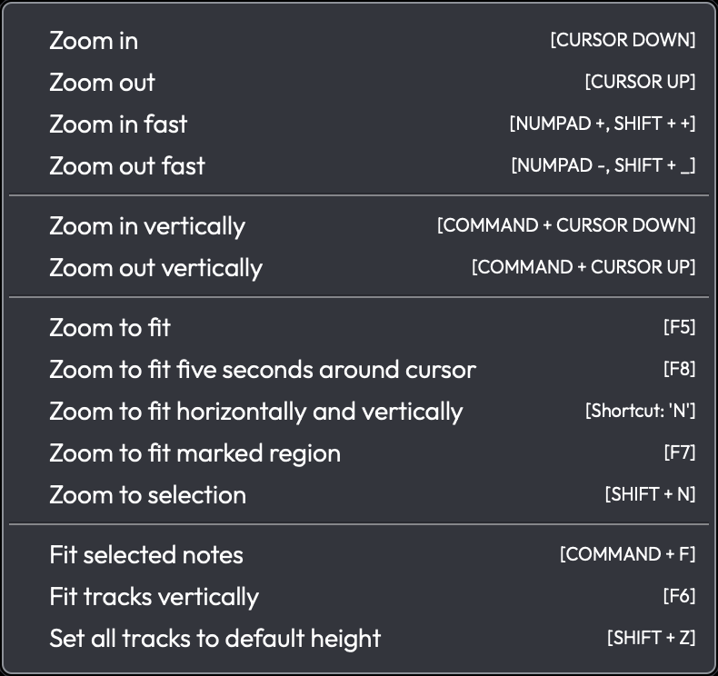

*Right-click the Timeline, Zoom to the In and Out Markers*

## Looping Playback Over the Marked Region

To repeat playback over a section of your song, set the In marker and
Out marker around it and turn on the **Loop** button (**L**). Playback
repeats that section until you stop it.

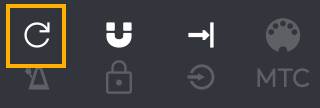

*Enabling Loop Playback*

> 📝 **Note:** When **Loop** is on, playback stays within the marked
region. If the cursor is before the In marker or after the Out marker
when you press **Play**, it jumps to the In marker and plays from there.

## Auto Punch and the Marked Region

To use Auto Punch:

1. Set the In marker and Out marker over the range where you want to
   punch in.
2. Turn on the **Punch** button (**P**) in the transport bar, and make sure
   **Loop** is off.
3. Arm a track for recording.
4. Position the cursor before the In marker and press **Record** on the
   transport bar.

Even though the track is armed, nothing is recorded until the cursor
reaches the In marker.

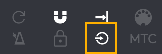

*Enabling Auto Punch Recording*

> 💡 **Tip:** With Auto Punch, recording only happens between the
In marker and Out marker, and only while **Loop** is off.

## The Marker Track

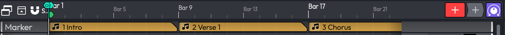

*Marker Track*

Show or hide the Marker track with the **Marker** button in the eye
button's panel (the eye button is at the top right of the window), with
*View > Global tracks > Show Marker track*, or by pressing **F10**.

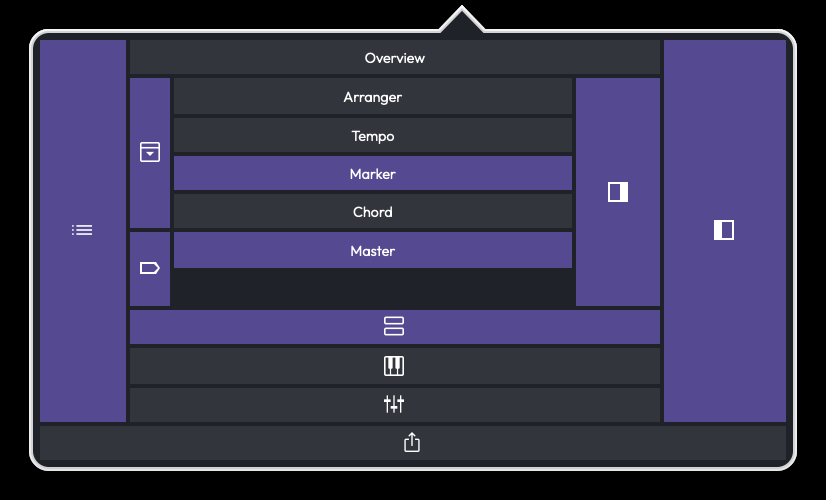

*Marker Track Show/Hide Button*

### Bars & Beats and Timecode Markers

Bars & Beats markers identify song sections, give you a visual guide to
the song and let you jump quickly between its parts. They are clips on
the Marker track, shown with a musical note icon, and appear as narrow
pointers on the Timeline when the Marker track is closed.

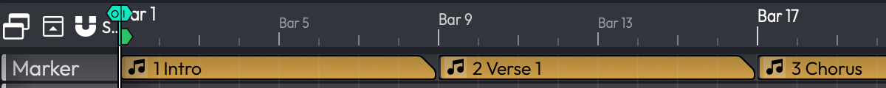

*Bars & Beats Markers on the Marker Track*

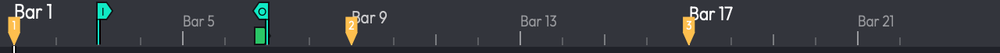

*Bars & Beats Markers on the Timeline (with Marker track closed)*

Timecode markers mark a specific time offset into the Edit and don't
move with tempo changes. They help with navigation, especially when
working with video. TC markers appear as clips with a clock icon on the
Marker track, and as rounded pointers on the Timeline when the Marker
track is closed.

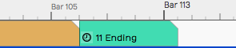

*Timecode Marker on the Marker Track*

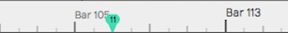

*Timecode Marker on the Timeline (with Marker track closed)*

### Choosing Which Markers Show

The Marker track can contain both Bars & Beats markers and Timecode
markers. To choose which ones it shows, select the Marker track by
clicking its header, then use the **Markers** setting in the Actions
panel:

**Markers** (Choices: Combined, Bars & Beats, Absolute, Hidden): Which
markers the Marker track shows. **Combined** shows both types together,
**Bars & Beats** and **Absolute** show only that type, and **Hidden** hides
the Marker track. (Default: Combined)

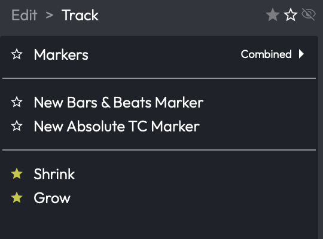

*Marker Track Settings in the Actions Panel*

> 📝 **Note:** By default **F10** shows or hides the Marker track. The
keyboard action **Cycle Marker track view mode** steps through the four
Markers choices. It has no key by default, but you can assign one.

> 💡 **Tip:** Click any blank space in the Marker track to move the
cursor there.

## Adding Markers

There are several ways to add markers to the Marker track.

### Drag the Clip Object

Drag the Clip object to the Marker track and choose which type of marker
to create. This creates a Marker clip, which you can resize with its
left and right trim handles or move by dragging its header.

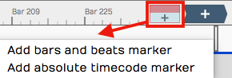

*Adding a Marker by Dragging the Clip Object*

### Press Return

The Return key (Enter on Windows) does several marker-related jobs
during playback. At its simplest, pressing Return adds a new marker at
the cursor position. The new Marker clip is the same type as the most
recently added marker, or, if a Marker clip is selected, the same type
as that one. Markers added with Return take the next available marker
number.

### Right-click the Marker Track Header

Right-click the Marker track header and choose which type of marker to
add at the cursor position.

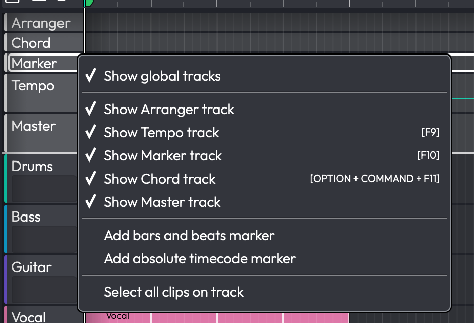

*Add a Marker from the Marker Track Right-click Menu*

### Marker Track Buttons in the Actions Panel

Click the Marker track header to select it. The Actions panel then
shows the **New Bars & Beats Marker** and **New Absolute TC Marker**
buttons.

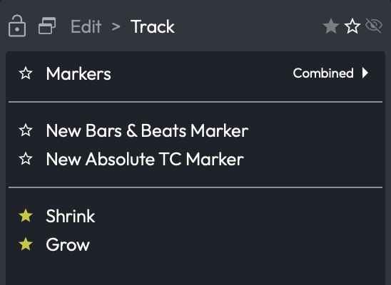

*Add a Marker from the Marker Track Actions Panel*

### The Add Button on the Markers Tab

You can add either kind of Marker clip with the **Add** button on the
**Markers** tab of the Browser.

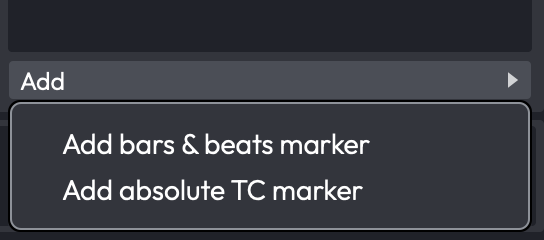

*Add a Marker from the Markers Tab of the Browser*

## Marker Clip Properties

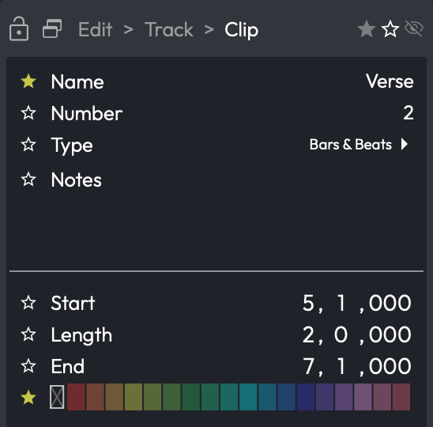

*Marker Clip Settings in the Actions Panel*

Marker clips behave like other clips in several ways: you can change
their length with the trim handles, and split, drag, duplicate or nudge
them. They also have these properties:

**Number**: Marker numbers are issued in sequence as you add Marker
clips, and you can edit them. If you change **Number** to one that is
already in use, the other clip gets the next available number. Marker
numbers give you quick navigation during playback.

> 💡 **Tip:** If you renumber your markers into order, consider leaving
gaps so new markers are easier to fit in. With a lot of markers in the
song, for example, number them in 5s.

**Type**: Choose the type of Marker clip: **Bars & Beats** or
**Absolute**. Bars & Beats markers follow tempo changes in the song.
Timecode markers are fixed to a specific time offset into the Edit and are not affected by tempo changes.

> 📝 **Note:** Timecode markers are also called "absolute markers", "TC
markers", or "absolute timecode markers" within Waveform. All those
terms refer to the same thing. For this book, I usually call them
Timecode markers.

**Name**: The name shown on the Marker clip. The default is "New
Marker". Most users name markers after song sections, for example Intro,
Verse, Chorus, Bridge or Outro.

**Start**: The start time, in bars, beats and ticks for B&B markers, or
in Hours/Minutes/Seconds/Milliseconds for Timecode markers. For either
type, edit **Start** to move the marker.

**Length**: The length, in Bars/Beats/Ticks for B&B markers or in
Hours/Minutes/Seconds/Milliseconds for Timecode markers. Edit it to
change the Marker clip's length.

**End**: The end time, in the same format as **Start**. When you edit
**End**, **Length** adjusts to match and **Start** stays the same. If you
set **End** before **Start**, it's set to the **Start** time and
**Length** becomes zero.

**Colour**: Sets the colour of all selected Marker clips.

## Navigating by Markers

Once you have markers set up, you can jump between them with the marker
number and the Return key. Type a marker number such as 5 or 11 and press
Return (Enter on Windows). As you type, the number appears in green in
the upper right of the Waveform window. Once it appears, you have about
two seconds to press Return before it disappears.

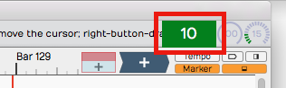

*Marker Number As It Appears Momentarily*

If you enter a number that has no matching marker, Waveform inserts a
marker with that number at the cursor. Pressing Return on its own
inserts a Marker clip at the cursor position.

Undo (**Cmd + Z / Ctrl + Z**) removes a marker if you didn't intend to
insert it.

> 📝 **Note:** **Quantise transport position changes** PRO
(on the Options menu and the Timeline's right-click menu, on by default)
comes with the Clip Launcher, in Waveform Pro or with the Launcher
Expansion. While it's on, a jump to a marker during playback waits for
the global launch quantisation, so the Edit stays in time. This covers
**[** and **]**, typed marker numbers, double-clicks in the Markers tab and
control surfaces. It only applies with a Bars & Beats timeline, and not
while recording or when Global launch quantisation is off.

> 💡 **Tip:** Number + Return works when Waveform is stopped as well as
during playback. If it doesn't seem to work while stopped, click the
Marker track header or select any marker and try again.

## The Browser Markers Tab

Use the **Markers** tab of the Browser to add Bars & Beats or Timecode
markers to the Marker track, and to jump to any marker by double-clicking
its name in the list. Select a marker there to delete it, or to rename it
in the Actions panel.

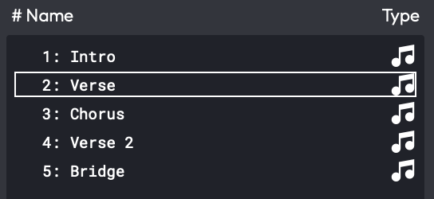

*The Markers Tab of the Browser*

**Select marker clips**: Single-click a marker in the list to select it.

**Navigate to a marker clip**: Double-click a marker in the list to
jump to that position. This works during playback too.

**Rename a marker**: Select a marker, then edit the **Name** property
in the Actions panel.

**Add a marker**: Click **Add** at the bottom of the Markers tab. Select
from the two types: **Add bars & beats marker** and **Add absolute TC
marker**.

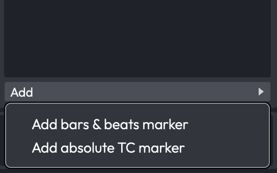

*Adding a Marker from the Markers Tab*

**Delete a marker**: Select a marker in the list and click **Delete** or
press **Delete** on your keyboard. Undo (**Cmd + Z / Ctrl + Z**) restores a
deleted marker.

**Change a marker from one type to the other**: Select the marker and
edit the **Type** property in the Actions panel.

## Renumbering Markers

Marker numbers easily get out of order. To renumber them, open the
Markers tab in the Browser, select all the markers and edit the
**Number** property. For example, if it shows "1" with all the markers
selected, change it to "2": the markers renumber starting from 2. To
number them from 1 again, repeat the step and change **Number** back
to 1.

## Moving On

For recording over the marked region, see [Recording Audio](recording-audio.md)
and [Loop Recording](loop-recording.md). For the rest of the Edit tab, see
[The Edit Tab](edit-tab.md).
