# Using Markers

Waveform has four kinds of marker:

- **In marker and Out marker**: together these define the marked region,
  the range for looped playback and loop recording. See [In Marker and
  Out Marker](#in-marker-and-out-marker).
- **Bars & Beats markers** (B&B markers): clips on the Marker track that
  name song sections and give you quick navigation. See [The Marker
  Track](#the-marker-track).
- **Timecode markers** (TC markers): Marker track clips fixed to a time
  offset, unaffected by tempo changes. See [The Marker
  Track](#the-marker-track).
- **Wave file markers**: markers stored in the audio file itself. See
  [Adjust Markers (Wave File Markers)](#adjust-markers-wave-file-markers).

## In Marker and Out Marker

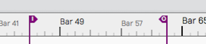

*In Marker and Out Marker*

Position the In marker and Out marker by dragging the I and O flags
along the Timeline. The In marker and Out marker together define the
range over which playback will loop when the **Loop** button is engaged in
the transport bar. They also define what is called the "marked region"
used for numerous editing actions.

> 📝 **Note:** In Waveform, the term 'marked region' means the range of an
Edit that occurs between the In marker and the Out marker.

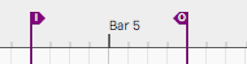

*The In Marker and Out Marker*

Pressing I will locate the In marker to the cursor position. Pressing O
locates the Out marker to the cursor position.

You can alternatively "draw" in the range between the In marker and
Out marker. Double-click on the Timeline and start dragging right.
Double-click positions the In marker at the starting point. As you drag
right, the Out marker comes along to set the out point when you lift the
mouse button.

> 💡 **Tip:** To set the marked region over a selection of clips, select
them and press A. This also works for Marker clips, making it a great
way to set the In marker and Out marker over a song section.

## Navigate Using the In and Out Markers

You can quickly navigate to the In marker or Out marker using the square
bracket keys. Press Shift + [ to locate the cursor to the In marker;
press Shift + ] to locate the cursor to the Out marker. On their own,
**[** and **]** jump to the previous and next marker (see [Navigating by
Markers](#navigating-by-markers)).

## Zooming to the In and Out Markers

When you have a marked region set between the In marker and Out marker
you can quickly zoom in to that region. To do that, right-click the
Timeline and select **Zoom to fit marked region**, or press F7.

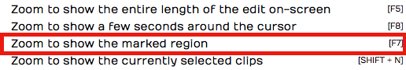

*Right-click the Timeline, Zoom to the In and Out Markers*

## Looping Playback Over the Marked Region

To continuously repeat playback over a section of your tune, set the
In marker and Out marker to define the marked region. Turn on looped
playback by engaging the **Loop** button (L). Playback will repeat that
section over and over until you stop playback.

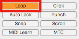

*Enabling Loop Playback*

> 📝 **Note:** When **Loop** is enabled, playback will only play within the
marked region. If the cursor is located earlier than the In marker or
after the Out marker when you press **Play**, it will jump to the
In marker and play from there.

## Auto Punch and the Marked Region

To use Auto Punch, first set the In marker and Out marker over the range
where you want to punch in. Enable the **Punch** button (P) in the transport
bar. Make sure **Loop** is turned off. Now enable a track for
recording, position the cursor before the In marker and press **Record**
on the transport bar. Even though the track is armed for recording, no
recording will happen until the cursor gets to the In marker.

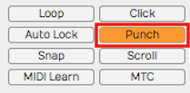

*Enabling Auto Punch Recording*

> 💡 **Tip:** Auto punch recording means that recording is only allowed
between the In marker and Out marker. Also, punch recording only works
when **Loop** is off.

## The Marker Track

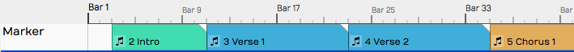

*Marker Track*

Show or hide the Marker track with the **Marker** button in the eye
button's panel (the eye button is at the top right of the window), with
*View > Global tracks > Show Marker track*, or by pressing F10.

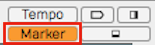

*Marker Track Show/Hide Button*

### Bars & Beats and Timecode Markers

Bars & Beats markers can be used to identify song sections, give you a
visual guide to the song, and provide quick navigation to different
parts of your song. They are arranged as clips on the Marker track.
Bars & Beats markers appear with a musical note icon on the Marker
track. They also appear as narrow pointers on the Timeline when the
Marker track is closed.

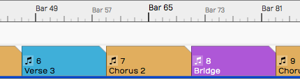

*Bars & Beats Markers on the Marker Track*

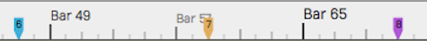

*Bars & Beats Markers on the Timeline (with Marker track closed)*

Timecode markers mark a specific time offset into the Edit, and are not
dependent on tempo changes. They can aid with navigation, especially
when working with video. TC markers appear as clips with a clock icon on
the Marker track. They appear as rounded pointers on the Timeline if the
Marker track is closed.

*Timecode Marker on the Marker Track*

*Timecode Marker on the Timeline (with Marker track closed)*

### Choosing Which Markers Show

The Marker track can contain both Bars & Beats markers and Timecode
markers. To choose which ones it shows, select the Marker track by
clicking the header, then use the **Markers** setting in the Actions
panel:

**Markers** (Choices: Combined, Bars & Beats, Absolute, Hidden): Which
markers the Marker track shows. **Combined** shows both types together,
**Bars & Beats** and **Absolute** show only that type, and **Hidden** hides
the Marker track. (Default: Combined)

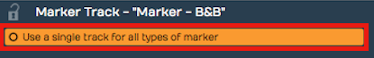

*Marker Track Settings in the Actions Panel*

> 📝 **Note:** By default F10 shows or hides the Marker track. The
keyboard action **Cycle Marker track view mode** steps through the four
Markers choices; it has no key by default, but you can assign one.

> 💡 **Tip:** You can click on any blank space in the Marker track to
instantly position the cursor.

## Adding Markers

Here are the various ways to add markers to the Marker track.

### Drag the Clip Object

Drag the Clip object to the Marker track and choose which type of marker
to create. This creates a Marker clip you can drag and resize. It has
left and right trim handles to adjust the length. You can also drag a
marker by its header and move it around.

*Adding a Marker by Dragging the Clip Object*

### Press Return

The Return key (Enter on Windows) has several functions related to
marker navigation during playback. At the most basic level, pressing
Return adds a new marker at the cursor position. The type of Marker clip
matches the most recently added marker. If a Marker clip is selected, it
adds one of that type. Markers added with Return use the next available
sequential marker number.

### Right-click the Marker Track Header

Right-click the Marker track header and choose which type of marker to
add at the cursor position.

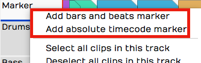

*Add a Marker from the Marker Track Right-click Menu*

### Marker Track Buttons in the Actions Panel

Click the Marker track header to select it, then look in the Actions
panel. There you will find the buttons **New Bars & Beats Marker** and
**New Absolute TC Marker**.

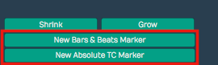

*Add a Marker from the Marker Track Actions Panel*

### The Add Button on the Markers Tab

You can add either kind of Marker clip with the **Add** button on the
**Markers** tab of the Browser.

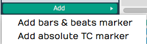

*Add a Marker from the Markers Tab of the Browser*

## Marker Clip Properties

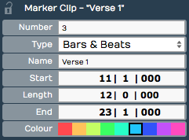

*Marker Clip Settings in the Actions Panel*

Marker clips behave like other clips in several ways. You can adjust the
length using the trim handles, you can split them, drag them, duplicate
them, or nudge them. They also contain several properties, described
below:

**Number**: Marker numbers are issued sequentially as you add Marker
clips. You can edit the **Number** property if you want. If you change
**Number** to one that is already in use, then the other clip will be
assigned the next available number. Marker numbers can be used for quick
navigation during playback.

> 💡 **Tip:** If you feel compelled to renumber all your markers to get them
into a nice sequential order, you might want to skip some numbers, in
order to make it easier to insert new markers. For example, if you have
a lot of markers in the song, you could re-number them by 5s.

**Type**: **Type** allows you choose which type of Marker clip you
want: **Bars & Beats** or **Absolute**. Bars & Beats markers adjust to
the tempo changes in the song. Timecode markers are fixed to a specific
time offset into the Edit and are not affected by tempo changes.

> 📝 **Note:** Timecode markers are also called "absolute markers", "TC
markers", or "absolute timecode markers" within Waveform. All those
terms refer to the same thing. For this book, I usually call them
Timecode markers.

**Name**: The **Name** property sets the name shown on the Marker clip.
By default it will be "New Marker." Most users rename it based on song
section. For example: Intro, Verse, Chorus, Bridge, or Outro.

**Start**: The **Start** property shows the bar, beat and tick start
time for B&B markers. For Timecode markers it shows
Hours/Minutes/Seconds/Milliseconds. For either type, you can edit
**Start** directly to move the marker to a different location.

**Length**: Similarly, **Length** shows B&B marker length in
Bars/Beats/Ticks format. For Timecode markers, it shows length as
Hours/Minutes/Seconds/Milliseconds. Edit the **Length** property and the
Marker clip length will change to match.

**End**: **End** values are in the same format as the **Start**
property. Edit it to change the ending time. When you change the **End**
value, **Length** gets adjusted to match. **Start** always remains the
same. If you edit **End** to fall before **Start**, it will be set to
match the **Start** time. In that case, **Length** gets set to zero.

**Colour**: Choose a colour. This sets all selected Marker clips to the
colour you choose.

## Navigating by Markers

Once you have markers set up, you can quickly navigate using the marker
number and the Return key. Just type in a marker number like '5' or '11'
and hit Return ('Enter' on Windows). As you type the number you will see
it appear in green in the upper right of the Waveform window. When you
see the number, you have about two seconds hit Return before the number
disappears.

*Marker Number As It Appears Momentarily*

If you enter a number that doesn't have a matching marker, then Waveform
will insert a marker with that number at the cursor. Also, if you just
press Return, a Marker clips is inserted at the cursor position.

Undo (Cmd + Z / Ctrl + Z) removes a marker if you didn't intend to
insert it.

> 📝 **Note:** **Quantise transport position changes** PRO
(on the Options menu and the Timeline's right-click menu, on by default)
comes with the Clip Launcher, in Waveform Pro or with the Launcher
Expansion. While it's on, a jump to a marker during playback waits for
the global launch quantisation, so the Edit stays in time. This covers
**[** and **]**, typed marker numbers, double-clicks in the Markers tab and
control surfaces. It only applies with a Bars & Beats timeline, and not
while recording or when Global launch quantisation is off.

> 💡 **Tip:** The Number + Return approach to navigation works during
playback but also works when Waveform is idle. If it doesn't seem to be
working when playback is idle, click the header of the Marker track or
select any marker and try again.

## The Browser Markers Tab

Use the **Markers** tab of the Browser to add Bars & Beats or Timecode
markers to the Marker track. You can also use it navigate to any marker by
double-clicking on the marker name in the list. You can also quickly
delete the selected marker or change its name in the Actions panel.

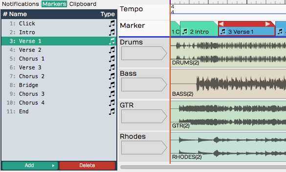

*The Markers Tab of the Browser*

**Select marker clips**: Single-click a marker in the list to select it.

**Navigate to a marker clip**: Double-click on a marker in the list to
jump to that position. This works during playback too.

**Rename a marker**: Click a marker to select it. Then, edit the
**Name** property in the Actions panel.

**Add a marker**: Click **Add** at the bottom of the Markers tab. Select
from the two types: **Add bars & beats marker** and **Add absolute TC
marker**.

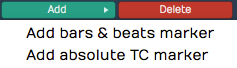

*Adding a Marker from the Markers Tab*

**Delete a marker**: Select a marker in the list and click **Delete** or
just press Delete on your keyboard. Undo (Cmd + Z / Ctrl + Z) restores a
deleted marker.

**Change a marker from one type to the other**: Select the marker and
edit the **Type** property in the Actions panel.

## Renumbering Markers

It is sometimes too easy to get your marker numbers out of order, but
there is an easy trick to renumber them: Open the Markers tab in the
Browser. Select all of the markers and edit the **Number** property. For
example if it shows "1" with all the markers selected change it to "2."
The markers instantly renumber starting from "2." If you really want
them numbered starting from one, simply do it again, changing the
**Number** property back to one.

## Adjust Markers (Wave File Markers)

There is another type of marker in Waveform, also called "markers." They
appear to mark spots in a clip, but actually are stored in the
underlying Wave files. You can add these yellow arrows directly to Wave
files, and they then appear on Audio clips. You work with these markers
from the **Adjust Markers** actions in the Audio clip's Actions panel.
You also add and remove them by dragging the marker object under **View
Source Info** in the Audio clip's Actions panel.

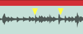

*Wave File Markers*

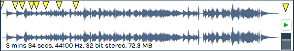

*Wave File Markers in View Source Info*

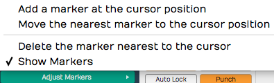

*Adjust Markers Options in the Audio Clip's Actions Panel*

## Moving On

Markers can be extremely useful in the context of recording and editing.
Not only do they keep your Edit organised, they also provide easy
navigation into important locations within the Edit.
