# Using Plugins

Effects plugins go on a track's plugin chain, which you can work with in
the inline mixer or in the separate Mixer.

> 📝 **Note:** You scan for plugins and set up a favourites plugin list in
*Settings > Plugins*. See
[Reference: Settings > Plugins](reference-settings.md#plugins-page).

## The Inline Mixer

The inline mixer sits along the right side of the Edit and completes
the left-to-right signal flow on each track. Open and close it with the
open/close icon at the upper right, or press **V**.

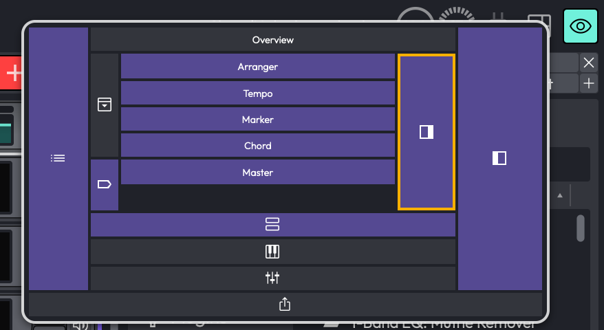

*Button to Open or Close the Inline Mixer (V)*

Every new track has a Volume & Pan plugin and a Level Meter plugin
inserted. These behave like any other plugin: you can change their
order, remove them, or add more instances of them to the same track.

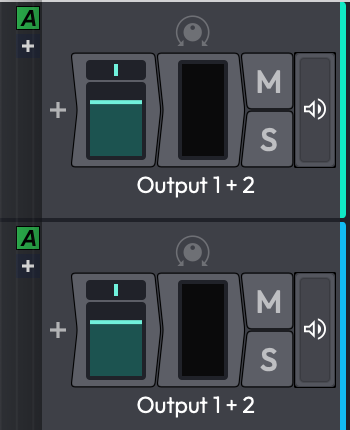

*Default Plugins Volume & Pan and Level Meter*

For example, you might want a level meter before and after a
compressor. You can add any other plugins, built-in or third-party, to
the inline mixer.

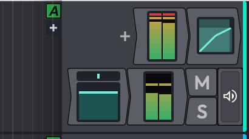

*Level Meter Before and After a 3rd Party Compressor*

> 💡 **Tip:** Each inline mixer channel is stereo. Even if the track
contains mono clips, you'll usually want stereo versions of plugins in
the inline mixer, because mono plugins only affect the left side of the
signal.

## Adjusting the Size of the Inline Mixer

Move the mouse pointer slowly from the arrangement to the inline mixer.
As it crosses over, a vertical highlight line appears.

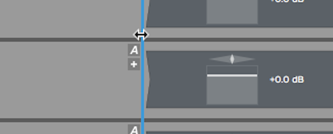

*Resizing the Inline Mixer*

Drag the highlight line left to expand the inline mixer, or right to
make it smaller. The plugins in the inline mixer resize to fit.

> 💡 **Tip:** If you accidentally delete, change or move a plugin, or
change your mind, choose *Edit > Undo* from the main menu (Cmd + Z / Ctrl + Z) to
restore it.

## Working with Plugins

You can customise the inline mixer for each track by inserting a chain
of plugins, so there's no need to switch between a horizontal track view
and a vertical console view.

### Inserting Plugins

To insert a Waveform or third-party plugin, drag the Plugin Object to a
track and select the plugin you want from the list.

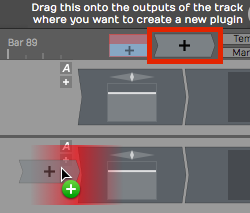

*Drag the Plugin Object to Insert a Plugin*

A third-party plugin's window opens when you insert it. Apart from the
core built-in plugins, each plugin has its own graphical interface.

### Right-Click to Insert

Right-click any existing plugin and select **Add new plugin**. The
plugin selector menu opens; pick a plugin, and it's added to the left of
the one you right-clicked.

> 📝 **Note:** If you don't see some of your plugins, see
[Scanning for Plugins](reference-settings.md#scanning-for-plugins) to scan
your system for all available plugins.

### Plugin Settings

Click a plugin to select it. The Actions panel then shows the settings
and actions for that plugin, and the click also opens the plugin's
window.

The same pages are also available in the **Plugins** tab of the Detail
Editor, which lays the whole track's chain out side by side so you can
have several plugins' pages open at once. See
[The Plugins Detail Editor](plugins-detail-editor.md).

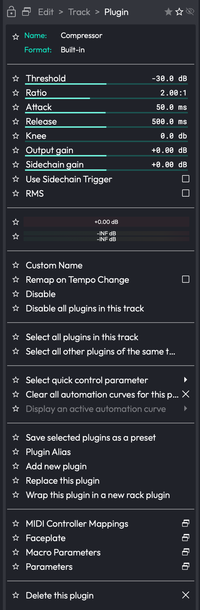

*Select a Plugin to See its Settings*

### Duplicating Plugins

To duplicate a plugin, select it and press **D**. This gives you a new
instance of the plugin to drag to a different position or to another
track.

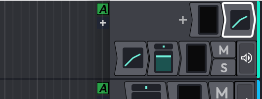

*Duplicate Plugins by Pressing D*

### Deleting Plugins

To delete a plugin, select it and press **Delete** or **Backspace**, or
use **Delete this plugin** in the Actions panel.

### Moving Plugins

To move a plugin, drag it to where you want it, on the same track or a
different one. As you drag, the gap where the plugin will go lights up
in the highlight colour.

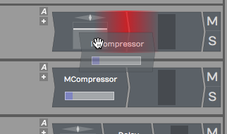

*Moving a Plugin*

### Copying Plugins

To copy a plugin, hold down Opt / Alt and drag it to where you want the
copy. Alternatively, press **D** to duplicate it, then drag the duplicate
to the target location.

### Bypassing a Plugin

To bypass a plugin, select it and turn off **Enabled** in the Actions
panel, or press **F**. A bypassed plugin is shown darkened in the
inline mixer.

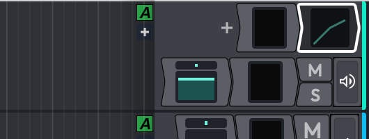

*A Bypassed Plugin*

> 💡 **Tip:** To bypass several plugins at once, select them and press
**F**.

## Plugin Presets

Most plugins have a **Preset** row with three buttons in their Actions
panel. Presets you save go into Waveform's preset library, so they are
available to every instance of that plugin in any Edit.

**Load** (folder icon): Lists the saved presets for this plugin type;
pick one to apply it. For third-party plugins the menu also lists preset
files from the plugin's own preset folders, and has an item to load a
file directly: **Load from an fxb/fxp file...** (VST),
**Load from an aupreset file...** (AU) or **Load from a vstpreset
file...** (VST3). For racks the item is **Import...**, which reads a
`.trkpreset` or `.trkrack` file.

**Save** (disk icon): Pick one of your own presets to overwrite it with the
current settings (you'll be asked to confirm, and it can't be undone),
or choose **Create new preset...** to add a new one. VST plugins can
also **Save a bank file (fxb)...** or **Save a preset file (fxp)...**, AU
plugins can **Save an aupreset file...**, and racks can **Export...** a
file to share.

**Delete** (bin icon): Pick a preset to remove it from the library.
Built-in presets can't be deleted.

## Assigning a Quick Control Parameter

You can give any instance of a plugin a quick control parameter. This
lets you tweak one parameter without going to the Actions panel or
opening the plugin's window. For example, the mix control of a delay
plugin makes a handy quick control.

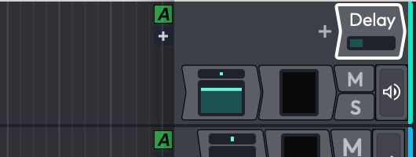

*Delay Mix Set as a Quick Control Parameter*

To set up a quick control parameter, right-click the plugin and choose
**Set quick control parameter**, then choose which parameter to use.

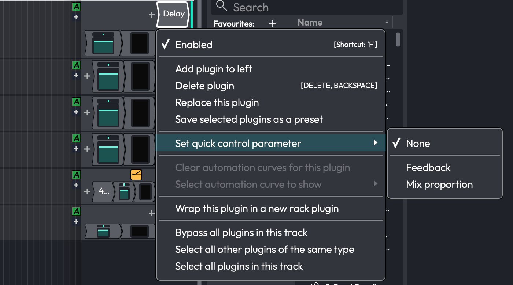

*Right-click to Set the Quick Control Parameter*

Waveform Delay has only two parameters, but many third-party plugins
have many more to choose from.

## Third-Party Plugins

Third-party plugins are inserted in the same way as built-in plugins,
but each has its own window, designed by its developer.

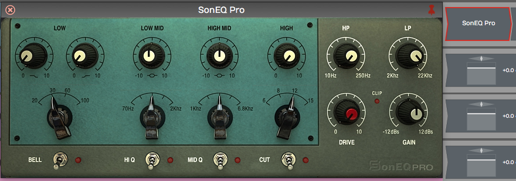

*Sonimus SonEQ, an Example 3rd Party Plugin*

To open a third-party plugin's window, click the plugin in the inline
mixer.

> 📝 **Note:** To open plugin windows with a double-click instead,
change **Open plugin windows by** under Plugin Windows on the
*Settings > General* page. (Default: Single-clicking)

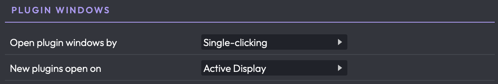

*Setting to Open Plugins with a Single-click*

## Cmajor Patches

Waveform can host Cmajor patches: audio effects and instruments written in
the Cmajor language and distributed as `.cmajorpatch` bundles. Patches are
compiled on the fly when they load, so they run as native plugins inside your
Edit and insert exactly like any other plugin.

To use them, first tell Waveform where to find your patches: open *Settings >
File Locations* and add a folder under **Directories to search for Cmajor
patches**. Scan for plugins, and the patches appear in the plugin selector under
the Cmajor format. If a patch contains an error, the message
is shown on the plugin slot so you can fix it. A built-in Pro54 example synth
is installed automatically the first time you run Waveform.

> 📝 **Note:** Cmajor support is available on Apple Silicon macOS and Windows. It
is not available on Linux or on Intel-only Macs. There is no edition restriction
for hosting patches. Having the AI Assistant build patches for you
PRO needs Waveform Pro; see
[Building Cmajor plugins](ai-assistant.md#building-cmajor-plugins).

## Searching for Plugins

Use the Search tab of the Browser to find a plugin, then drag it to
your Edit:

1.  Open the Browser and click the Search tab.
2.  Type the first few characters of the plugin's name.
3.  From the search results, drag the plugin from the Browser to the
    inline mixer.

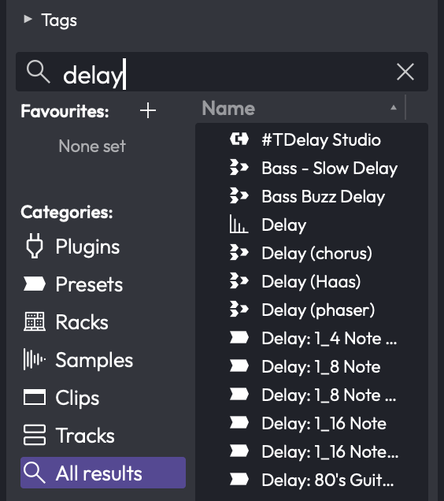

*Searching for Plugins in the Search Tab of the Browser*

The search uses an index that includes plugin names, tags, and
manufacturer. To set tags, see
[Tagging Plugins](reference-settings.md#tagging-plugins).

> 💡 **Tip:** When you're searching for a specific plugin, select
**Plugins** under **Categories** in the category list for more targeted
results.

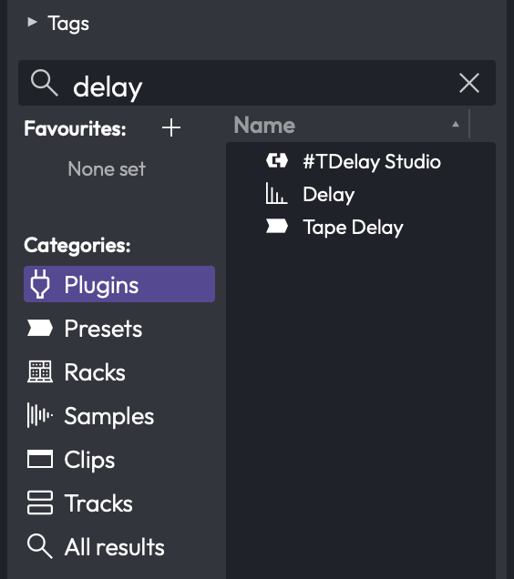

*Limiting the Search to Plugins*

## Using Master Plugins

To apply processing to the full stereo mix, add plugins to the Master
track or to the master plugin box in the transport bar. When the box is
empty it shows a power icon; drag plugins into it to add them to the
master output plugin chain. It holds up to four plugins.

The Master track shows the same master plugin chain as a track in the
arrangement. To show it, click the eye button at the upper right
and choose **Master**, or choose *View > Global tracks > Show or hide Master
track*. Plugins you add there and in the transport box are the same
plugins.

*Master plugins area*

A typical master chain is a bus compressor, a limiter and perhaps an
EQ. Waveform's own Master Mix plugin (Waveform Pro and OEM) combines
those functions in one plugin designed for use on a full mix.

*Master Mix inserted on the master*

> 💡 **Tip:** Click an empty part of the master plugin box and choose
**Add new plugin** to open the plugin selector menu. This can be quicker
than dragging the plugin object down there.

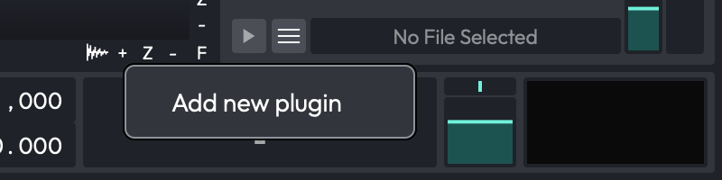

*Add new plugin from the master plugin box*

## Plugin Sidechains

Plugins that support a sidechain input have a sidechain assignment list
at the upper left in the plugin header. Pick which track you want
to route to the sidechain.

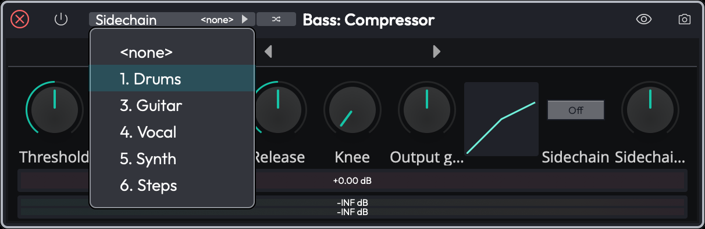

*Selecting a Sidechain Input*

In this example, the Drums track is being routed to the sidechain input
of a Compressor on the Bass track, a common trick to make the bass duck
under the kick. Not every plugin has a sidechain input: the built-in Gate,
for example, has no sidechain list.

> 🎥 [Plugin Sidechain Video Tutorial](https://youtu.be/PEan2nhPCOA)
