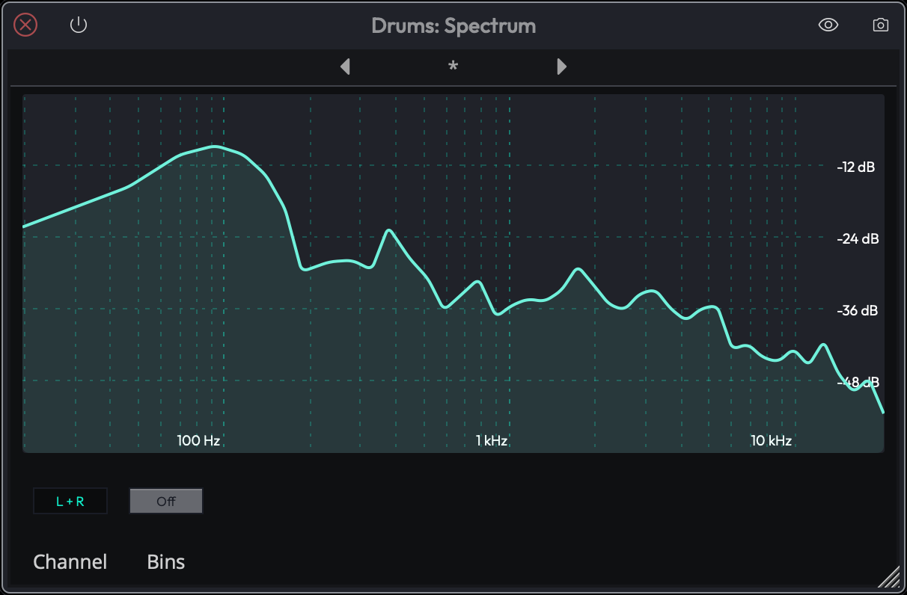
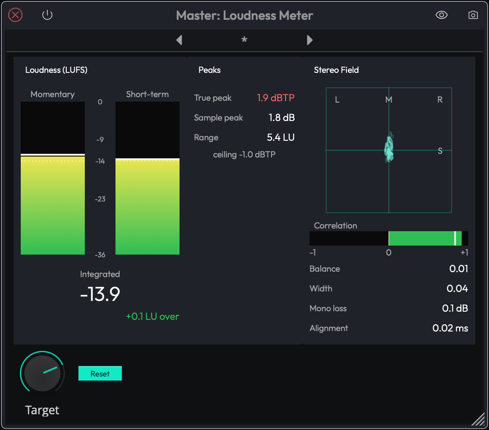

# Utility Plugins

Waveform's built-in Utility plugins handle routing, metering and CPU
management: Insert, Freeze Point, Patch Bay, Aux Send and Aux Return, Spectrum,
Loudness Meter, Mid Side, AB Switch and Mono Switch. All of them are in every
edition except the Loudness Meter. To add one, drag the Plugin object to a
track (or right-click an existing plugin and choose **Add new plugin**) and pick
it from the **Utility** category of the built-in Waveform plugins. See
[Using Plugins](using-plugins.md) for more on inserting plugins.

The Utility category also holds plugins documented elsewhere: the
[Level Meter](built-in-effects-plugins.md#level-meter) and
[Text Plugin](built-in-effects-plugins.md#text-plugin), and the MIDI utilities
(MIDI Filter, MIDI Monitor, MIDI CC, MIDI Note Names and MIDI Patch Bay) in
[Waveform Utilities](midi-effects.md#waveform-utilities).

## Insert (Hardware Insert)

The **Insert** plugin routes a track's signal out through a physical output,
through an external device, and back in through a physical input, so you can
patch outboard gear into your plugin chain. The send and return can be either
audio or MIDI devices, so it works for both outboard effects and external MIDI
hardware.

### Setting Up an Insert

After adding the plugin, open its properties to set up the routing:

- **Name**: an optional label shown in the plugin slot.
- **Send Device**: the output that feeds your external device. If no output is
  selected, the slot shows a warning: *"You must select an output device to use
  an insert plugin."*
- **Return Device**: the input that receives the processed signal back from
  your hardware.
- **Time Adjust**: a latency compensation offset (-300 ms to +300 ms,
  default 0). Positive values show the reading as *"Late"* and negative values
  as *"Early"*. Use this to align the returned signal with the rest of your mix.
- **Auto-Detect**: runs a **Device Latency Test** that plays a test signal,
  measures the round-trip delay, and offers to apply the result as the Time
  Adjust value. (Auto-detection requires an audio return signal.)
- **Refresh Devices**: rescans your device list if you've plugged in or
  switched hardware after Waveform started.

### Rendering with an Insert

Because the signal must travel through real hardware in real time, rendering faster
than real time produces silence or incorrect results on any track using an
Insert. When you render, tick **Render at 1x Play-Speed** in
the Render dialog. See [Rendering and Stems](rendering-and-stems.md#audio-settings)
for details on that option.

---

## Freeze Point

The **Freeze Point** plugin is a marker you place inside a track's plugin chain.
Waveform can render (freeze) everything in the chain *before* the Freeze Point
to an audio file, freeing the CPU those plugins were using. Everything *after*
the Freeze Point keeps running live.

### Using a Freeze Point

Once it is in the chain (its slot is labelled **Freeze** and always shows a
snowflake icon, which brightens when the track is frozen):

- The plugin slot shows a **Freeze Track** button. Click it to render everything
  before the Freeze Point and replace it with static audio playback.
- While a track is frozen, the button changes to **Unfreeze Track**. Click it
  to discard the rendered file and restore the original processing.

A Freeze Point cannot be added to clips, plugin racks, or Master tracks, and it
cannot be disabled with the plugin's enable/bypass switch. It's always active
while it's in a chain.

> 📝 **Note:** A track can't be frozen while plugins before its Freeze Point
> feed other tracks through a Rack or an aux send, for example a plugin wrapped
> in a multi-out rack. Freezing would break that connection, so Waveform shows a
> message naming the tracks involved instead.

### Freeze Point Settings

Two settings on the *Settings > General* page, under **Mixing Defaults**,
affect the Freeze Point:

- **Freeze point creation**: sets when freezing happens, either **Manually
  freeze tracks** (only when you click **Freeze Track**) or **Freeze track when a
  freeze point is created or copied** (automatic).
- **Freeze point insert location**: sets where the Freeze Point is inserted
  when a track is frozen: **Before plugins**, **Pre-fader**, or **Post-fader**.

See [Mixing Defaults](reference-settings.md#mixing-defaults) for the full
description of those options.

---

## Patch Bay

The **Patch Bay** plugin is an audio routing matrix. Each **wire** in
the matrix routes one source channel to one destination channel at a specific
gain level (in dB). Multiple wires can fan out from the same source and sum
into the same destination.

> 📝 **Note:** The Patch Bay is an *audio* routing matrix. It is different from the
> **MIDI Patch Bay**, which is a MIDI-routing plugin covered in the
> [MIDI Effects](midi-effects.md) chapter.

### Patch Bay Controls

A new Patch Bay defaults to a stereo pass-through: input 1 → output 1 and
input 2 → output 2, both at 0 dB. The plugin slot in the mixer draws a live
mini-diagram (input and output channels as dots, with arrows for each wire), so
you can read the routing at a glance.

Open the Patch Bay's properties to edit the wiring in its graphical editor. The
input channels are listed down one side and the output channels down the other:

- To make a connection, drag from an input connector onto an output
  connector (or the other way round). A new wire starts at 0 dB.
- To adjust a wire's gain, select it and use the **Gain** slider, which
  reads out in dB.

Typical uses include folding stereo down to mono, duplicating a channel for
parallel processing, or swapping left and right. Like the Freeze Point, a Patch
Bay cannot be added to clips or plugin racks and cannot be bypassed.

## Aux Send and Aux Return

The Utility category also has the **Aux Send** and **Aux Return**
plugins. These are the building blocks of an effects bus: an Aux Send taps a
portion of a track's signal and routes it to a numbered bus, and an Aux Return
receives that bus on another track so a single effect can be shared by many
tracks. Because they belong to the bus-routing workflow rather than being
standalone effects, they have their own chapter: see [Effects Bus
Tracks](effects-bus-tracks.md).

## Spectrum

The **Spectrum** plugin is a real-time spectrum analyser. It leaves the audio
unchanged and shows a live graph of the signal's frequency content as it passes
through, so you can *see* where the energy sits in a mix. Insert it anywhere in
a chain, for example after a high-pass filter to check it's doing what you
expect.

**Channel** (Choices: L + R, L, R): Which channels the analyser measures.
The Actions panel lists the same choices as Stereo, Left and Right.
(Default: L + R)

**Bins** (Choices: On, Off): Draws the spectrum as separate frequency bins when on, or
as a continuous line when off. The Actions panel shows this as **Mode**, with
the choices Bins and Line. (Default: Off)

*The Spectrum plugin showing a live line graph*

## Loudness Meter PRO { #loudness-meter }

> 📝 **Edition:** Waveform Pro.

The **Loudness Meter** measures loudness the way streaming services and
broadcasters do (EBU R128 / ITU-R BS.1770-4), alongside true peak and the
stereo field. Like the Spectrum, it only reads the audio and doesn't change it.
Put it last on the Master track (or on a submix) and play the song through to
see whether the mix is ready for release. Offline renders don't disturb its
readings.

*The Loudness Meter on the Master track during playback*

The display has three sections:

**Loudness (LUFS)**

- **Momentary**: loudness over the last 400 ms, shown as a bar meter with a
  held maximum.
- **Short-term**: loudness over the last 3 seconds, also with a held maximum.
- **Integrated**: the big number, showing the loudness of everything played
  since the last reset, gated so silence and quiet passages don't drag it down. This is
  the figure streaming platforms normalise to. Underneath it you'll see how far
  you are from the target, for example *+1.2 LU over* or *-3.0 LU under*.

Both bar meters show the target as a line and are scaled from -36 to 0 LUFS.

**Peaks**

- **True peak**: the highest peak in dBTP, measured with 4x oversampling so it
  catches the inter-sample peaks that lossy encoders turn into clipping. It
  turns red above the -1.0 dBTP ceiling.
- **Sample peak**: the highest sample value in dB.
- **Range**: loudness range (LRA) in LU, showing how much the loudness varies
  over the song. Low values mean a heavily compressed, even mix.

**Stereo Field**

- **Correlation**: from -1 to +1. +1 means the channels are identical (fully
  mono-compatible), around 0 means wide, and negative means the channels are
  cancelling each other out, so parts of the mix will disappear in mono. The
  bar turns red when negative, and a marker holds the worst reading so far.
- **Balance**: from -1 (hard left) to +1 (hard right).
- **Width**: from 0 (mono) to 1 (all side, no centre).
- **Mono loss**: how much level the mix loses when summed to mono, in dB.
- **Alignment**: the delay between the left and right channels in ms, and
  *inverted* (in red) if one channel's polarity is flipped.

A goniometer (XY scope) shows the stereo image as a shape: a vertical line is
mono, a wide cloud is wide, and a horizontal line means out-of-phase channels.

Readings show *-* until there is enough audio to measure, for example in the
first 400 ms after starting playback.

The plugin has two controls:

- **Target** (-36 to -6 LUFS, default -14 LUFS): the loudness you're aiming
  for. It's drawn on the bar meters, and the Integrated reading turns to the
  warning colour once it's more than 0.5 LU above it. -14 LUFS suits most
  streaming services. Broadcast work usually aims for -23 (EBU R128) or -24
  (ATSC A/85).
- **Reset**: restarts the integrated measurement and clears the held peaks and
  extremes. Press it before playing the song through from the start.

The meter handles up to 8 channels. On a surround master it weights the
channels as the standard specifies: the surrounds count slightly more than the
fronts, and the LFE (the fourth channel, when there are six or more) is
ignored. The stereo measurements look at the first two channels only.

> 💡 **Tip:** Keep the true peak below -1 dBTP. Streaming services encode your
> file to a lossy format, and peaks above that can clip after encoding even if
> the original file never did.

## Mid Side

The **Mid Side** plugin converts a stereo signal between standard left/right and
**mid/side** form. It has a single **Mode** control:

- **Encode** turns a left/right signal into mid (the mono centre) and side (the
  stereo difference).
- **Decode** turns a mid/side signal back into normal left/right.

Insert a Mid Side in **Encode** mode, process the centre and sides separately
with other plugins, then insert another Mid Side in **Decode** mode to return
to a normal stereo signal. This lets you, for example, EQ the centre and sides
independently.

## AB Switch

The **AB Switch** plugin routes the incoming signal to one of two outputs, **A**
or **B**, chosen with its **Mode** control (Default: A). Switching fades
quickly between the two, so it doesn't click. By feeding A and B into different
processing chains, you can flip between two treatments of the same source to
compare them.

The plugin has four output channels: **A Left**, **A Right**, **B Left** and
**B Right**. To send A and B to different chains, put the AB Switch inside a
[Rack](racks.md): wire A Left and A Right to the first chain, B Left and B Right
to the second, and both chains to the rack's outputs.

## Mono Switch

The **Mono Switch** is a mono-compatibility and stereo-troubleshooting tool. Its
controls let you collapse a stereo signal to mono and check how the mix holds up:

- **Mono** switches mono summing on or off.
- **Mode** sets how the two channels are combined when summing: at **-6 dB**,
  **-3 dB**, or **0 dB**, or listening to the **L Only** or **R Only** channel on
  its own.
- **Swap L/R** exchanges the left and right channels.
- **L Polarity** and **R Polarity** flip the polarity (phase) of each channel
  independently, which helps track down phase-cancellation problems.

Use it to check that a mix still sounds right when it's played back in mono,
for example on a phone speaker.
