# Visual Plugin Selector

The Visual Plugin selector shows your plugins as thumbnail images, so you
can pick one by how it looks. It opens from the Plugin object on each
track, the button with the tooltip **Add new plugin**.

## Using the Visual Plugin Selector

To open the Visual Plugin selector, right-click the Plugin object, or
hold any modifier key while you click it. It shows each of your plugins
as a thumbnail image with its name. A plain click opens whichever
selector **Plugin selector** in *Settings > Plugins* is set to (see [Plugin View Options](reference-settings.md#plugin-view-options)).

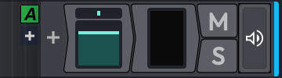

*Right-click to Open the Visual Plugin Selector*

> 📝 **Note:** If you see mostly question marks, the thumbnails haven't
> been captured yet. See
> [Scanning to Capture Thumbnails](#scanning-to-capture-thumbnails).

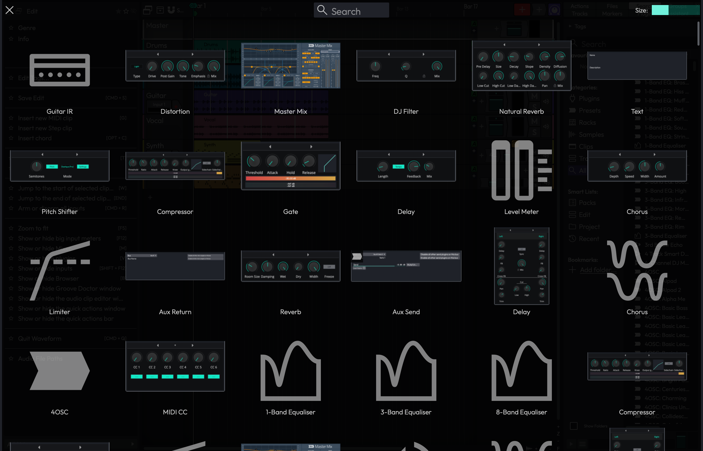

*Visual Plugin Selector*

Scroll through your plugins, and when you find the one you want, drag
it. The window closes while you keep dragging, so you can drop the
plugin on a track in the normal way.

The Visual Plugin selector has a few controls to help you find the right
plugin:

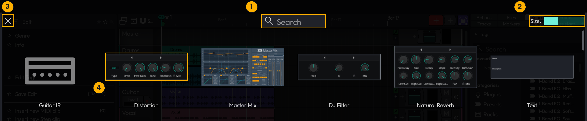

*Visual Plugin Selector Controls*

1.  Start typing to filter the list.
2.  Adjust the size of the thumbnail images using the slider at the
    right.
3.  If you decide not to pick a plugin, click the **X** at the upper left
    or press **Esc** to close the window.
4.  Drag a plugin out of the window. The window closes and you drag a
    transparent image of the plugin, which you can drop wherever you want
    to use it.

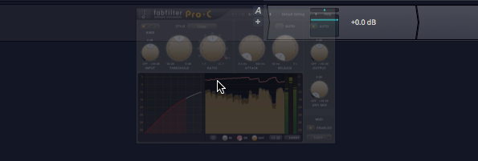

*Dragging a Plugin*

## Determining Plugin Technology

When you hover the pointer over a thumbnail, an icon appears in its
upper left corner showing the plugin's format: AU, VST, or VST3. This
helps you tell apart thumbnails that otherwise look the same.

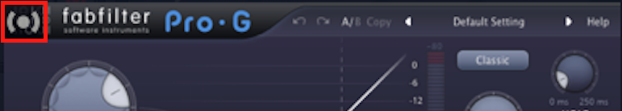

*Audio Units Icon*

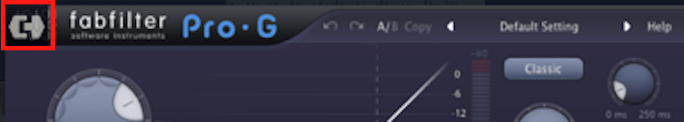

*VST Icon*

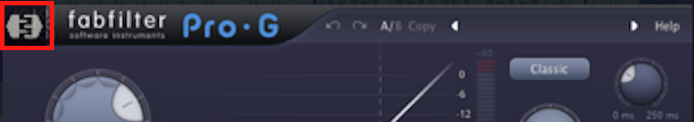

*VST3 Icon*

The Browser's **Search** tab uses the same icons to show the plugin
format.

## Customising the Thumbnail Image

Each plugin window in Waveform has a camera icon (*Save thumbnail image
of plugin UI*) in the upper right corner (macOS and Windows). Click it to
take a snapshot of the plugin window and update the thumbnail image. For
more interesting thumbnails, capture the plugin in action, with the
meters moving or an interesting EQ curve.

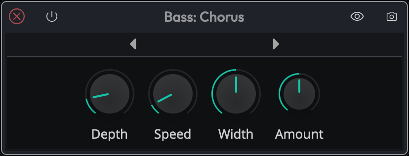

*Customise a Plugin Thumbnail*

## Scanning to Capture Thumbnails

When you first start using Waveform, the Visual Plugin selector
thumbnails appear as blank question marks. Waveform captures a plugin's
thumbnail the first time you open it, so the thumbnails fill in over
time.

To fill in every thumbnail at once, open *Settings > Plugins*, find the
**Plugin thumbnail images** row and click its **Create** button.

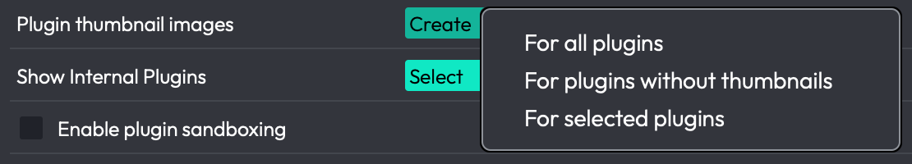

*Capture Thumbnails Options*

The menu has three options: **For all plugins**, **For plugins without
thumbnails**, or **For selected plugins** (the ones selected in the list of
installed plugins). On a new Waveform installation, **For all plugins**
is usually the one to use.

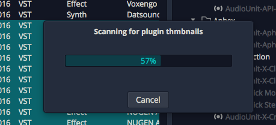

*Thumbnail Scan Progress*

## Opening Visual Plugin Selector with a Shortcut

A macro action opens the Visual Plugin selector. To use it, create a
new macro, right-click in the script editor in
*Settings > Keyboard Shortcuts*, and choose *Advanced actions >
Plugins > Show or hide the plugin selector page*.

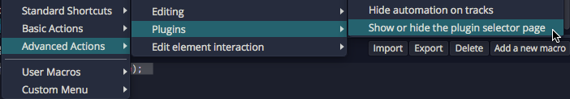

*Action to Open the Selector*

This adds the code to the macro.

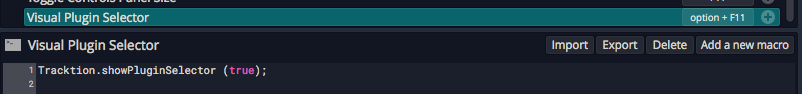

*The Completed Macro*

Then assign the macro a keyboard shortcut. This example uses
Opt + F11 / Alt + F11, which is the default shortcut for
**Lock/Unlock Actions panel**, so pick a free key combination instead if
you want to keep that shortcut.
