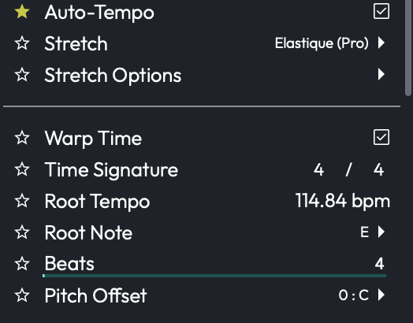
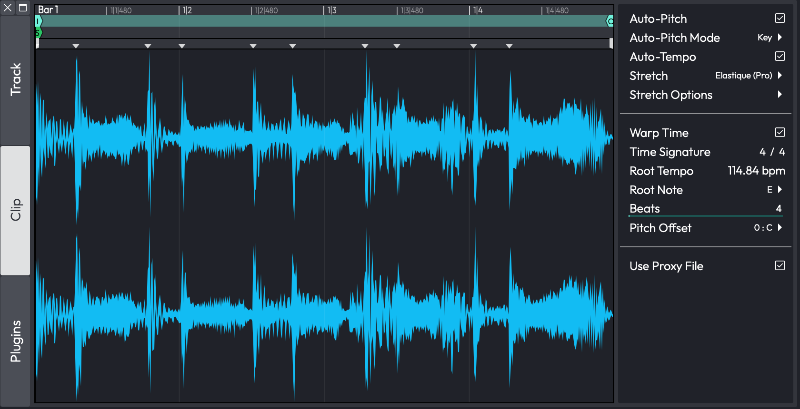
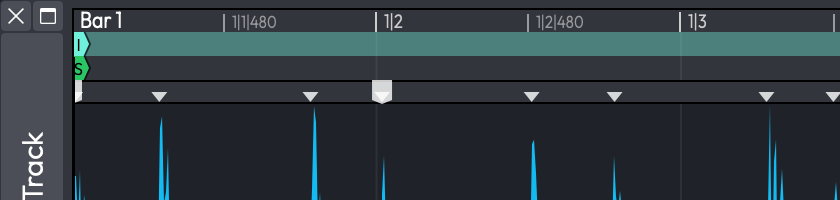
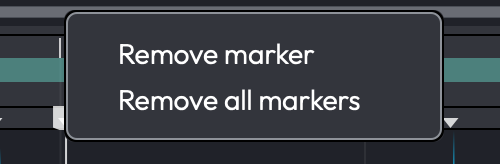
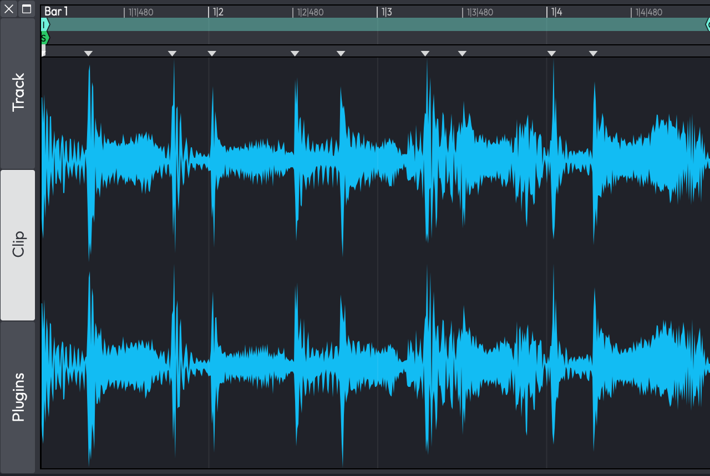
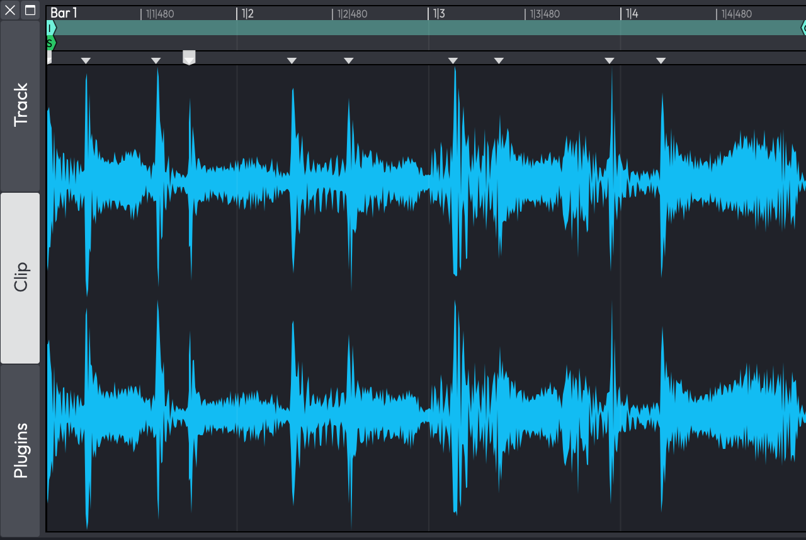
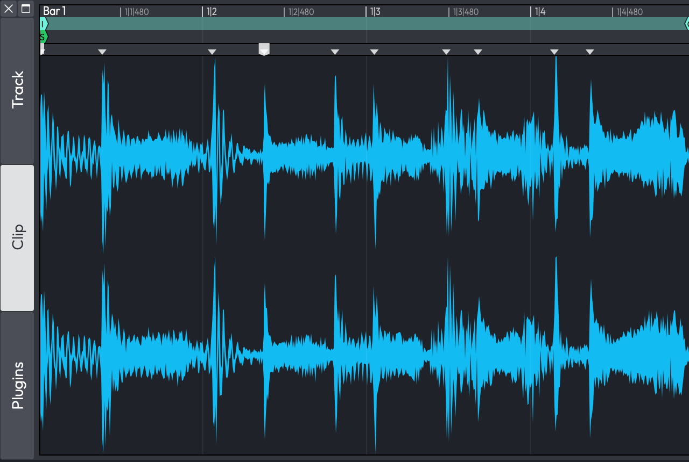
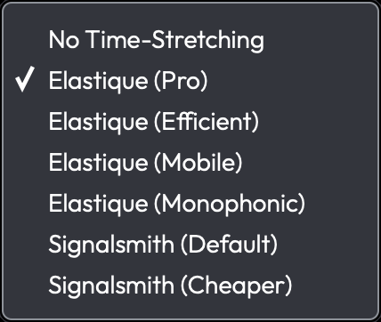
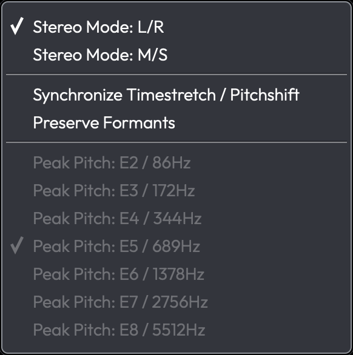

# Warp Time

Warp Time is an audio editing option. Rather than splitting out notes to
move them, as described in [Clean-up Editing](clean-up-editing.md), you
drag Warp points to bend and stretch audio into time. As well as
correcting timing problems, you can use it creatively on compositions and
loops to change the feel of recorded audio.

> 💡 **Tip:** Warp Time is also available as one of the Clip Layer
effects, as described in [Clip Layer Effects](clip-layer-effects.md).

## Warp Time Mode

To switch on Warp Time mode:

1.  Select an Audio clip.
2.  In the Actions panel (or the [Detail Editor](detail-editor.md), Clip
    tab), enable the **Warp Time** option.

*Enable Warp Time Mode*

The Detail Editor's waveform view switches to the zoomable Warp Time
editor.

## The Warp Time Editor

*Warp Time Editor in the Detail Editor*

The Warp Time editor works on the underlying audio in the clip, so it may
show much more audio than you see on the Audio clip. That's usually the
case if you've trimmed the clip.

> 💡 **Tip:** To make the Warp Time editor match the waveform on the selected Audio clip exactly, render the clip with *Render Clip > Flatten the selected clip*. This creates a new underlying file, so what you see and hear in the Warp Time editor then matches the Audio clip.

### Zooming In & Out

To zoom the waveform, use the mouse scroll wheel, or a two-finger up and
down gesture on many laptops. On Mac laptops, a two-finger left or right
gesture also slides the waveform left and right.

### Warp Points

Click the timeline to add a Warp point. Dragging a Warp point left or
right stretches or compresses time between it and the Warp points on
either side.

> 💡 **Tip:** You can add a Warp point and drag it in one action: click the timeline, hold and start dragging. The waveform stretches until you stop dragging.

*Warp Point*

### Removing Warp Points

Shift-click any existing Warp point to remove it. Right-click a Warp point and choose **Remove marker** or **Remove all markers**.

*Warp Point Right-click Menu*

## Working with Warp Points

By default, the Warp Time editor always has Warp points at the start and
end. If you add a Warp point and move it, the audio stretches between the
beginning and end of the waveform.

*Before Warping*

*Dragging a Warp Point to the Left*

*Dragging a Warp Point to the Right*

To correct timing over a limited area, use a three-point technique. Warp
points usually belong just before the start of a note or percussive hit,
that is, just before a transient, so the stretching happens across the
note rather than in the middle of it.

Add Warp points before and after the note you want to change, to lock
down the timing around it. Then add a Warp point right at the transient
you want to move and drag it into time.

## Warp Points and Snapping

As you drag Warp points, they snap to the grid. The snap grid for Warp
points is based on the zoom level of the Warp Time editor, not the zoom
level of the Edit.

To override snapping, hold Cmd / Ctrl as you drag the points.

## Limitations of Warp Time Editing

Warp Time editing works best on single-track parts. On multitrack drum
parts it seriously affects the phase alignment of multi-miked kits, and
the same goes for other instruments recorded with several mics.

You can use Warp Time on stereo tracks. If you have two mono tracks,
render them to a stereo track first.

## Time Stretch Algorithm

By default Warp Time uses Elastique Pro, but you can switch it to any of
the other modes. There's little benefit in doing so, because Waveform
does the stretching offline.

*Stretch Property Options*

Elastique Pro gives the best results most of the time. For specialised
needs, the spanner icon next to **Stretch** (shown for the Elastique Pro
modes) opens the Elastique options: **Stereo Mode: L/R**
or **Stereo Mode: M/S**, **Synchronize Timestretch / Pitchshift**, and
**Preserve Formants**, which enables a choice of **Peak Pitch** settings
from E2 / 86Hz to E8 / 5512Hz.

*Elastique Options*

> 📝 **Note:** If the **Stretch** property is set to **No
Time-Stretching**, Waveform still uses Elastique Pro for Warp Time.
Choosing an ARA plugin such as Melodyne switches Warp Time off, and the
**Warp Time** option isn't available while ARA stretches the clip.

## Moving On

For automatic timing correction of whole takes, see
[Groove Doctor](groove-doctor.md) (Waveform Pro or the Recording
Engineer Expansion).
