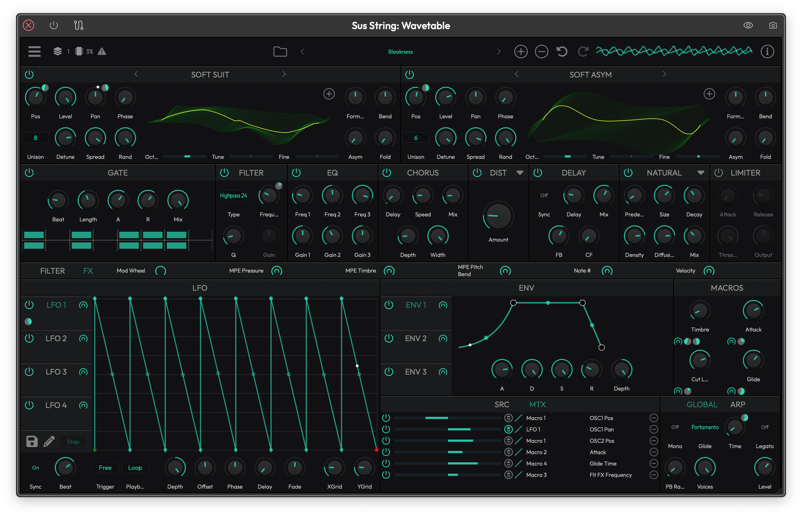

# Wavetable Synthesiser PRO { #wavetable-synthesizer }

> 📝 **Edition:** Waveform Pro, or with the Synth Pack Expansion.

Waveform's built-in Wavetable synthesiser is a two-oscillator wavetable instrument with a sub oscillator, a noise generator, two filters, a modulation matrix and an effects chain. It ships with factory wavetables and presets, can load your own wavetables, and supports MPE.

*The Wavetable synthesiser interface showing both oscillators, filters, LFOs, envelopes, macros, and the global settings.*

> 📝 **Note:** Most panels have a power button in their header. Only OSC 1 and Filter 1 are on in a new instance (the main ADSR has no power button and is always on). OSC 2, Filter 2, the Sub and Noise generators, ENV 1-3, LFO 1-4, the arpeggiator and every effect start switched off, so turn a section on before expecting it to do anything.

## Oscillators

The synth has two independent wavetable oscillators, OSC 1 and OSC 2. Each one loads a wavetable, and sweeping through the table's frames gives you timbres that change over time.

### Browsing and Loading Wavetables

Each oscillator panel shows the name of its wavetable in the header. To change it:

- Click the wavetable name to open a menu of all the factory wavetables, grouped by prefix (Analog, Digital and so on).
- Use the left and right arrows beside the name to step through the wavetables one at a time, which is handy for auditioning them.
- Click the **+** button to load your own .wav file as a user wavetable. If the file has no wavetable metadata, you're asked to choose a table size (256, 512, 1024 or 2048 samples per frame).

You can also drag a .wav file onto the wavetable display to load it.

> 💡 **Tip:** Drag up or down on the 3D wavetable display to scrub the **Pos** (position) parameter while you listen. It's a quick way to find the part of a wavetable you want.

### Oscillator Controls

Each oscillator has the following controls:

**Enable**: The power button in the oscillator's header. (Default: On for OSC 1, Off for OSC 2)

**Pos**: Sweeps through the frames of the loaded wavetable. It's the main sound-shaping control in wavetable synthesis; automate or modulate it to make the sound move. (Default: 0%)

**Level**: Output volume of the oscillator in dB. (Default: 0 dB)

**Pan**: Stereo position. Centre is zero; negative values pan left, positive values pan right. (Default: centre)

**Octave**: Coarse pitch offset in octaves, from -4 to +4. (Default: 0)

**Tune**: Pitch offset in semitones, from -12 to +12. (Default: 0)

**Fine**: Fine-tune in cents, from -100 to +100. Use this for subtle detuning between oscillators. (Default: 0)

**Phase**: Starting phase of the oscillator waveform. (Default: 0)

**Rand**: Randomises the starting phase each time a note is triggered. At maximum, each note starts at a different phase, which can reduce the "machine gun" effect on repeated notes. (Default: 1.0)

### Unison and Stereo Spread

**Unison**: Stacks up to 8 voices per oscillator. More voices means a thicker, wider sound at the cost of CPU. (Default: 1)

**Detune**: Controls how far apart the unison voices are pitched from each other. Only active when **Unison** is greater than 1. (Default: 0)

**Spread**: Pans the unison voices across the stereo field. Only active when **Unison** is greater than 1. (Default: 0%)

> 💡 **Tip:** For classic supersaw-style sounds, set **Unison** to 4-8, push **Detune** to around 0.15, and **Spread** to 80% or more. Five voices with moderate detune is a good balance between richness and CPU load.

### Wave Shaping

Each oscillator has four waveshaping controls that reshape its output before it reaches the filters:

**Formant**: Shifts the formant structure of the waveform, adding vocal-like resonances. (Default: 0)

**Bend**: Bends the waveform shape, creating harmonic asymmetry. (Default: 0)

**Asym**: Adds asymmetric distortion to the waveform. (Default: 0)

**Fold**: Folds the waveform back on itself, adding harmonics for harder, more metallic tones. (Default: 0)

## Sub Oscillator

The **Sub** oscillator adds a simple, stable tone underneath the wavetable oscillators, to anchor a bass sound or add weight to a pad.

**Enable**: Turns the sub oscillator on or off. (Default: Off)

**Wave** (Choices: Sine, Triangle, Saw, Pulse 50%, Pulse 25%, Pulse 12%): Selects the waveform shape. (Default: Triangle)

**Octave**: Pitch offset in octaves. Set to -1 or -2 to place the sub below your main oscillators. (Default: 0)

**Level**: Output volume in dB. (Default: 0 dB)

**Pan**: Stereo position. (Default: centre)

**Retrig**: When enabled, the sub oscillator restarts its phase on each new note. (Default: Off)

## Noise Generator

The **Noise** generator adds untuned noise to the signal. Use it sparingly for breathy textures, or mix it in heavily for percussive, snare-like sounds.

**Enable**: Turns the noise generator on or off. (Default: Off)

**Type**: Choose between White noise (equal energy across all frequencies) and Pink noise (more energy in the low end). (Default: White)

**Level**: Output volume in dB. (Default: 0 dB)

**Pan**: Stereo position. (Default: centre)

## Filters

The Wavetable synth has two per-voice filters, Filter 1 and Filter 2, which you can run in parallel or in series.

### Filter Types

Each filter offers eight modes:

- **Lowpass 12**: Gentle low-pass filter with a 12 dB/octave slope
- **Lowpass 24**: Steeper low-pass filter with a 24 dB/octave slope
- **Highpass 12**: 12 dB/octave high-pass filter
- **Highpass 24**: 24 dB/octave high-pass filter
- **Bandpass 12**: 12 dB/octave band-pass filter
- **Bandpass 24**: 24 dB/octave band-pass filter
- **Notch 12**: 12 dB/octave notch (band-reject) filter
- **Notch 24**: 24 dB/octave notch filter

(Default: Lowpass 12)

### Filter Controls

**Enable**: The power button in the filter's header. (Default: On for Filter 1, Off for Filter 2)

**Freq**: Cutoff frequency in Hz. (Default: about 330 Hz)

**Res**: Resonance. Boosts frequencies around the cutoff point. Higher values create a sharper, more pronounced peak. (Default: 0)

**Amnt**: Envelope amount. Controls how much the filter's built-in ADSR envelope affects the cutoff frequency. Positive values sweep the filter up; negative values sweep it down. When set to zero, the filter envelope controls (**A**, **D**, **S**, **R**) are disabled. (Default: 0)

**Key**: Key tracking. When turned up, the filter cutoff follows the pitch of the note you play, so higher notes have a brighter tone. (Default: 0%)

**Vel**: Velocity tracking. Higher values make the filter cutoff respond more to how hard you play. Only active when the envelope amount is non-zero. (Default: 0%)

**Retrig**: Retrigger. With mono mode and glide on, this sets whether the filter envelope restarts on legato notes. Only shown in that case.

### Filter Envelope (ADSR)

Each filter has its own dedicated ADSR envelope that modulates the cutoff frequency:

- **A** (Attack): Time to reach peak. (Default: 0.01s)
- **D** (Decay): Time to fall from peak to sustain level. (Default: 0.1s)
- **S** (Sustain): Level held while the note is sustained. (Default: 80%)
- **R** (Release): Time to return to zero after note-off. (Default: 0.1s)
- **AC**, **DC**, **RC** (Attack, Decay and Release Curve): The shape of each stage, from -100 to 100. Zero is a straight line; other values bend the stage into a curve. (Default: 0)

The envelope's visual display shows the current phase of active voices in real time, so you can see exactly where each voice is in its envelope cycle.

### Filter Routing

Each filter has four source buttons labelled **1**, **2**, **N**, and **S** that control which sound sources are fed into that filter:

- **1**: Oscillator 1
- **2**: Oscillator 2
- **N**: Noise generator
- **S**: Sub oscillator

(Default: All sources routed to Filter 1)

### Filter Mix

The **Mix** panel between the two filters controls how they combine:

**Type**: Choose between:
- **Parallel**: Both filters process the signal independently, and their outputs are blended.
- **Serial**: The output of Filter 1 feeds into Filter 2.

(Default: Parallel)

**Mix**: In parallel mode, this blends the balance between Filter 1 and Filter 2. In serial mode, this control is disabled. (Default: 0.5)

> 💡 **Tip:** Serial mode is good for shaping complex timbres. Try setting Filter 1 to a resonant lowpass and Filter 2 to a highpass to isolate a specific frequency band.

## Amplitude Envelope (ADSR)

The main **ADSR** envelope shapes the volume of every note you play. It's always on, and sits in the upper right of the interface.

**A** (Attack): Time for the note to reach full volume. (Default: 0.01s)

**D** (Decay): Time to fall from peak to the sustain level. (Default: 0.1s)

**S** (Sustain): Volume level held while you keep the note pressed. (Default: 80%)

**R** (Release): Time for the sound to fade out after you release the note. (Default: 0.1s)

**AC**, **DC**, **RC** (Attack, Decay and Release Curve): The shape of each stage, from -100 to 100. Zero is a straight line; other values bend the stage into a curve. (Default: 0 for AC, -70 for DC and RC)

**Vel**: Velocity tracking. Controls how much your playing velocity affects the volume. At 100%, soft notes are quiet and hard notes are loud. At 0%, velocity has no effect. (Default: 100%)

**Retrig**: Retrigger. With mono mode and glide on, this sets whether the envelope restarts on legato notes. Only shown in that case.

The envelope display draws the ADSR curve and highlights where each active voice is in it.

## LFOs

The Wavetable synth has four LFOs, LFO 1 to LFO 4, for use as modulation sources. Each one draws its shape with an MSEG (multi-segment envelope generator), so it isn't limited to sine or triangle waves.

### LFO Controls

**Enable**: The power button beside each LFO's name in the panel header. (Default: Off)

**Rate**: The speed of the LFO in Hz. Only visible when **Sync** is off. (Default: 10 Hz)

**Beat**: When **Sync** is on, sets the LFO rate to a musical note duration. (Default: 1/4 note)

**Sync**: Synchronises the LFO rate to the host tempo. (Default: Off)

**Depth**: The intensity of the LFO's modulation. Supports bipolar values. (Default: 1.0)

**Phase**: Offsets the starting phase of the LFO. (Default: 0)

**Offset**: Shifts the LFO output vertically. (Default: 0)

**Fade**: Time for the LFO to fade in (positive values) or fade out (negative values) after a note is triggered. (Default: 0s)

**Delay**: Time before the LFO starts after a note is triggered. Useful for delayed vibrato. (Default: 0s)

**Trigger**: Determines the LFO's triggering behaviour:
- **Mono**: One shared LFO for all voices
- **Poly**: Each voice gets its own independent LFO
- **Legato**: Shared LFO that doesn't reset on legato notes
- **Free**: Free-running, never resets

(Default: Poly)

**Playback**: Controls whether the LFO shape plays once (Single Shot) or continuously (Loop). (Default: Loop)

### Drawing Custom LFO Shapes

The large MSEG display shows the LFO waveform shape. You can edit it directly:

- Click and drag points to reshape the curve
- The pencil button turns on draw mode, for painting shapes freehand
- The draw mode selector (Step, Half, Down, Up, Tri) changes how the draw tool behaves
- **XGrid** and **YGrid** control the snap resolution when editing (Default: 8 for both)

### Saving and Loading LFO Shapes

Click the disk button to open the LFO shape file menu. From there you can:

- Browse and load factory LFO presets organised in categories (Basic, SC, Gate, Arp, Sequencer)
- Load a custom .mseg file
- Save the current shape as a .mseg file for later use

The factory shapes include Sine, Triangle, Saw, Square, ADSR, Side Chain, Trance Gate and several arpeggio patterns.

## Envelopes (ENV 1-3)

As well as the main ADSR and the two filter envelopes, the synth has three modulation envelopes, ENV 1, ENV 2 and ENV 3. These are general-purpose ADSR envelopes that you can route to any parameter that takes modulation, through the modulation matrix.

Each envelope has:

- **Enable**: The power button beside each envelope's name in the panel header. (Default: Off)
- **A** (Attack): (Default: 0.01s)
- **D** (Decay): (Default: 0.1s)
- **S** (Sustain): (Default: 80%)
- **R** (Release): (Default: 0.1s)
- **AC**, **DC**, **RC**: The curve of the attack, decay and release stages, from -100 to 100. (Default: 0)
- **Depth**: Scales the envelope's output before it reaches the modulation destination. Supports bipolar values. (Default: 1.0)
- **Retrig**: Retrigger on legato notes (only visible in mono mode with glide enabled).

> 💡 **Tip:** Use ENV 1 to modulate the wavetable position of OSC 1 for sounds that evolve over the duration of each note. Set a slow attack and decay with zero sustain for a gradual timbral sweep.

## Modulation

The Wavetable synth's modulation matrix connects any modulation source to nearly any parameter.

### Modulation Sources

The available modulation sources are:

- **LFO 1-4**: The four MSEG-based LFOs
- **ENV 1-3**: The three modulation envelopes
- **Filter Envelope 1-2**: The two filter ADSR envelopes
- **ADSR**: The main amplitude envelope
- **Macro 1-4**: Four user-assignable macro knobs
- **MPE Pressure**: Aftertouch from MPE controllers
- **MPE Timbre**: Timbre (slide) from MPE controllers
- **MPE Pitch Bend**: Per-note pitch bend from MPE controllers
- **Pitch Bend**: Standard pitch bend
- **Mod Wheel**: MIDI CC 1
- **MIDI Note Number**: The pitch of the note being played
- **MIDI Velocity**: How hard the note was played
- **CC 0-119**: Any standard MIDI CC message

### Using the Modulation Matrix

The bottom of the interface has two tabs: **SRC** and **MTX**.

The **SRC** tab shows all available modulation sources. Each source has a button you can use to assign it to parameters, in either of two ways:

- Drag the button onto a control.
- Click the button to arm it (it lights up), then drag the controls you want it to modulate to set how far it moves each one. Click the button again to stop assigning.

The **MTX** tab shows the full modulation matrix: every active routing, with its source, destination and depth.

### Toolbar Modulation Sources

The toolbar row between the oscillator/filter area and the LFO area gives quick access to six common modulation sources: **Mod Wheel**, **MPE Pressure**, **MPE Timbre**, **MPE Pitch Bend**, **Note #**, and **Velocity**. Each one has a modulation source button and a depth slider.

## Macros

The **Macros** panel has four assignable macro knobs, Macro 1 to Macro 4. Each macro is a modulation source you can route to several parameters, so one knob controls them all at once.

To rename a macro, click its label and type a new name. A clear name shows what each macro does in a preset.

> 💡 **Tip:** Macros are handy when you play live. Set up a "Brightness" macro that moves the filter cutoff, wavetable position and LFO depth together, and you only have one knob to turn.

## Effects

The Wavetable synth has its own effects chain with eight effect slots. The **FX** button on the toolbar shows the effects, and the **Filter** button takes you back to the oscillators and filters.

Every effect starts switched off: turn one on with the power button in its header.

Drag an effect's header left or right to reorder the chain. The signal flows through the effects from left to right, so the order changes the sound. The default order is Gate, Chorus, Distortion, Delay, Reverb, EQ, Limiter, Filter.

### Gate

A rhythmic gate effect that chops the signal on and off in a pattern.

**Beat**: The tempo-synced rate of the gate pattern. (Default: 1/8 note)

**Length**: Number of active steps, from 2 to 16. (Default: 8)

**Attack**: How quickly the gate opens. (Default: 0.01s)

**Release**: How quickly the gate closes. (Default: 0.1s)

**Mix**: Wet/dry blend. (Default: 100%)

The step sequencer display shows left and right channel patterns. Click steps to toggle them on and off.

### Chorus

Adds width and movement by mixing delayed, pitch-modulated copies of the signal.

**Delay**: Base delay time in milliseconds. (Default: 1 ms)

**Speed**: Modulation rate in Hz. (Default: 3 Hz)

**Depth**: Modulation depth in milliseconds. (Default: 1 ms)

**Width**: Stereo width of the chorus effect. (Default: 0.5)

**Mix**: Wet/dry blend. (Default: 0.5)

### Distortion

The distortion slot has ten modes, chosen from the dropdown in its header:

**Simple**: Basic waveshaping distortion with a single **Amount** control, shown from -1.0 to 4.0 (Default: 0.0). This is the default mode.

**Light, Medium, Hard, Clip, Tube, Fuzz**: Six flavours of drive-based distortion, each with:
- **Drive**: Amount of distortion. (Default: 0)
- **Post Gain**: Output level after distortion. (Default: 1.0)
- **Tone**: Brightness control. (Default: 1.0)
- **Emphasis**: Pre-distortion EQ emphasis. (Default: 0.25)

**Bitcrusher**: Sample rate and bit depth reduction for lo-fi effects:
- **Rate**: Sample rate reduction. (Default: 0.5)
- **Rez**: Bit depth reduction. (Default: 0.5)
- **Hard**: Hardness of the quantisation. (Default: 0.8)
- **Mix**: Wet/dry blend. (Default: 1.0)

**Fire Amp**: Amp simulation with a bright, aggressive character:
- **Gain**: Input gain. (Default: 0.5)
- **Tone**: Brightness. (Default: 0.5)
- **Output**: Output level. (Default: 0.8)
- **Mix**: Wet/dry blend. (Default: 1.0)

**Grind Amp**: Amp simulation with a heavier, grinding character:
- **Gain**: Input gain. (Default: 0.5)
- **Tone**: Brightness. (Default: 0.5)
- **Output**: Output level. (Default: 0.8)
- **Mix**: Wet/dry blend. (Default: 1.0)

### Delay

A stereo delay effect with tempo sync.

**Sync**: Enables tempo sync. When on, the delay time is set by a note duration. (Default: Off)

**Delay**: Delay time. When **Sync** is off, this is in seconds (0-120s). When **Sync** is on, this becomes a note duration selector. (Default: 1s / 1/4 note)

**FB**: Feedback in dB. Higher values create more repeats. (Default: -10 dB)

**CF**: Cross-feedback in dB. Feeds the left delay into the right and the right into the left, for ping-pong effects. (Default: -100 dB, which is effectively off)

**Mix**: Wet/dry blend. (Default: 0.5%)

### Reverb

The reverb slot has two modes, chosen from its dropdown:

**Plate Reverb**: A classic plate-style reverb:
- **Size**: Room size. (Default: 0.6)
- **Decay**: How long the reverb tail lasts. (Default: 0.3)
- **Lowpass**: High frequency damping cutoff. (Default: 10000 Hz)
- **Damping**: Additional high frequency absorption. (Default: 10000 Hz)
- **Predelay**: Delay before reverb begins. (Default: 0)
- **Mix**: Wet/dry blend. (Default: 0)

**Natural Reverb**: A more realistic room-style reverb (Default mode):
- **Predelay**: Delay before reverb begins. (Default: 0)
- **Size**: Room size. (Default: 0.5)
- **Decay**: Reverb tail length. (Default: 0.2)
- **Density**: Controls the density of early reflections. (Default: 0.8)
- **Diffusion**: Smoothness of the reverb tail. (Default: 0.8)
- **Mix**: Wet/dry blend. (Default: 0.5)

### EQ

A three-band parametric equaliser for final tonal shaping.

Each band has:
- **Freq**: Centre frequency in Hz. (Defaults: 100 Hz, 1500 Hz, 8000 Hz)
- **Gain**: Boost or cut in dB, from -20 to +20. (Default: 0 dB)

### Filter (FX)

A global filter effect (separate from the per-voice filters). It offers the same eight filter types as the per-voice filters plus three additional types:

- Lowpass 12, Lowpass 24, Highpass 12, Highpass 24, Bandpass 12, Bandpass 24, Notch 12, Notch 24
- **Low shelf**: Boosts or cuts below the cutoff
- **High shelf**: Boosts or cuts above the cutoff
- **Peak**: Boosts or cuts a narrow band around the cutoff

**Frequency**: Cutoff frequency. (Default: about 330 Hz)

**Q**: Resonance / bandwidth. (Default: 0.707)

**Gain**: Boost/cut in dB. Only active for shelf and peak types. (Default: 0 dB)

### Limiter

A dynamics limiter near the end of the effects chain (before the FX filter by default) to prevent clipping.

**Attack**: How quickly the limiter responds. (Default: 0 ms)

**Release**: How quickly the limiter recovers. (Default: 5 ms)

**Threshold**: Level at which limiting begins. (Default: -3 dB)

**Output**: Output gain after limiting. (Default: 0 dB)

## Arpeggiator

The built-in **Arpeggiator** takes the notes you hold and plays them back as a pattern. Toggle between the Global and Arp views using the **GLOBAL** and **ARP** tabs.

**Enable**: Turns the arpeggiator on or off. (Default: Off)

**Mode** (Choices: Up, Down, Cascade, Alt 1, Alt 2, Random, Chord 1 Octave, Chord All Octaves): The arpeggio pattern. (Default: Up)

**Speed**: The rate of the arpeggio, synced to host tempo, from 4 Bars down to 1/64 T, with dotted (D) and triplet (T) values. (Default: 1/4)

**Gate**: Note length as a percentage, from 25% to 400%. Values over 100% create overlapping notes. (Default: 100%)

**Octave**: Number of octaves to span, from 1 to 10. (Default: 1)

**Rand Pos**: Randomises note position in the pattern. (Default: 0)

**Rand Len**: Randomises note length. (Default: 0)

**Rand Vel**: Randomises note velocity. (Default: 0)

**Swing**: Adds swing feel by delaying every other note, from 0 to 33. (Default: 0)

## Global Settings

The **Global** panel controls settings that affect the entire synthesiser.

**Level**: Master output volume, from -100 to +12 dB. (Default: 0 dB)

**Mono**: Switches between polyphonic and monophonic playback. (Default: Off / polyphonic)

**Glide**: Glide mode, controlling how notes transition when playing legato:
- **Off**: No glide
- **Glissando**: Steps between notes in semitones
- **Portamento**: Smooth, continuous pitch slide

(Default: Off)

**Time**: Glide time in seconds. Only active when **Glide** is not *Off*. (Default: 0.3s)

**Legato**: When enabled in mono mode with glide, new notes that overlap don't retrigger envelopes. Only active when **Glide** is enabled. (Default: Off)

**Voices**: Maximum number of simultaneous voices, from 2 to 40. Lower values save CPU. (Default: 40)

**PB Range**: Pitch bend range in semitones, from 0 to 48. Disabled when MPE mode is active (MPE uses its own pitch bend range). (Default: 2)

## MPE Support

The Wavetable synth supports MIDI Polyphonic Expression (MPE). MPE is off by default: turn it on with the **MPE** item in the menu button on the plugin window's title bar. The choice is remembered as a preference, so new Wavetable instances start with it too. When MPE is enabled, each note can independently respond to pressure, timbre (slide), and per-note pitch bend from MPE controllers like the Roli Seaboard or Linnstrument.

MPE Pressure, MPE Timbre, and MPE Pitch Bend are all available as modulation sources in the modulation matrix.

> 📝 **Note:** When MPE mode is active, the global **PB Range** control is disabled since MPE controllers manage pitch bend range independently.

## Presets

The Wavetable synth comes with a library of factory presets: basses, leads, pads, arps and sound-design patches such as 808 Over, Super Saw, FM Bass, Ambient Trails, String Evolution and Vocal Chops. Browse them with the preset browser in the plugin's top bar.

To save your own presets, use the preset menu. User presets are stored in:

- **macOS:** ~/Library/Application Support/Tracktion/Wavetable/programs/
- **Windows:** %APPDATA%/Tracktion/Wavetable/programs/
- **Linux:** ~/.config/Tracktion/Wavetable/programs/

The undo and redo buttons on the toolbar undo and redo parameter changes.

## ⚡ Things to Watch Out For

- **Unison voice count and CPU.** Every unison voice on every oscillator adds to the CPU load. With both oscillators at 8 unison voices, each note plays 16 oscillators, and with 40-voice polyphony that adds up fast. Keeping unison under 5 suits most sounds; if you do use heavy unison, lower **Voices** in the Global settings too.

- **User wavetable sizes.** When you import a .wav file without wavetable metadata, you have to pick the table size yourself. If it's wrong, the frames won't line up and the wavetable will sound wrong. 2048 is the usual size for wavetables made in Serum, Vital and similar synths, and 256 for simpler single-cycle waveforms.

## Moving On

For Waveform's other built-in instruments, see [4OSC Synthesiser](4osc.md) and [Samplers and Instruments](samplers-and-instruments.md).
